# Ruach Studio · the YuE2 Studio · songs from words, on your own machine

<p align="center">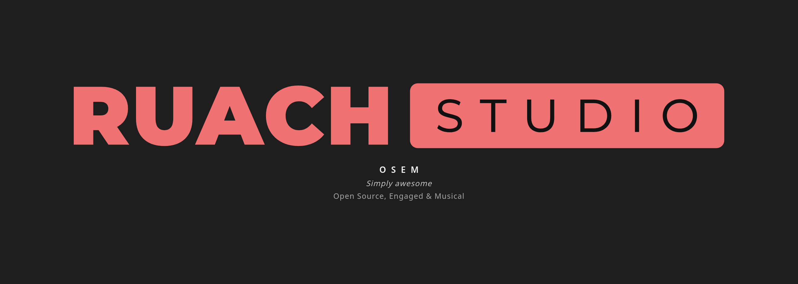</p>

<p align="center"><b>OSEM</b> <i>(say it: awesome)</i> · Open Source, Engaged &amp; Musical</p>

<p align="center"><a href="https://ruachstudio.art">Website</a> · <a href="https://github.com/igrbible/Ruach_Studio">GitHub</a> · <a href="https://huggingface.co/goldhub/Ruach_Studio_Models_v2">Models on Hugging Face</a> · <a href="docs/GUIDE.md">The guide</a> · <a href="https://buy.stripe.com/cNi4gz39t2R77bT6ey67S02"><b>☕ 24/7 coffee for Viktor and Claude</b></a></p>

> Ruach Studio is open music generation that runs on your own hardware: the model, the score, the adapters and every take stay yours, and nothing is rented by the token. Open models are now good enough to stand on their own, and what was missing is the Studio around them: that is what we build, in the open. Music should be free to make and to share: whoever has no voice, no instrument and no studio still has the right to lay their thoughts and feelings onto sound.

> **⚠ Not on free cloud GPUs.** Ruach Studio does not run on Google Colab, Kaggle or any free notebook GPU, so don't spend an evening on it there: it is a whole studio, not a notebook. It builds its C++/CUDA engine on the machine it lives on, keeps a server and a lab of Python services running beside it, and takes about 34–41 GB of disk (74–84 GB with the Artist). A free session's card, memory, wiped disk and hours-long limit cannot hold that. It wants your own Linux computer, or a server you rent and keep, with an NVIDIA card: 24 GB for everything, 16 GB with the smaller model copies.

> **⚠ The screen.** The Studio's design adapts to the window, but everything has its limit. It is made for a browser window of **1920×1080 at 100 % zoom**; the ideal monitor is **2K (2560×1440), 22″ or larger, 16:9 or wider**.

**Songs from words, on your own machine.** A full studio around **YuE2**, the open song model: write the style and the lyrics, and the Studio composes, sings and renders the song on your own GPU. Your songs, words and settings never leave it: the Writer goes to a cloud chat model only if you point it there, a debug journal goes out only when you send it and say yes, and the page itself loads nothing from the internet (see [Dependencies](#dependencies)); the lab asks GitHub whether a new release is out, once a week unless Engine → Updates says otherwise.

If you came looking for a **YuE2 WebUI** or a **YuE studio**: this is one, grown into a whole music workstation. It runs YuE2, the successor of YuE (m-a-p's open song models), through yue2.cpp on your own NVIDIA GPU.

> ### **FEATURESET**
> - **Eight rooms on one page**: the Musician makes the song, the Writer writes it, the Refiner finishes it, the Artist paints it, the Videographer films it, the Narrator reads your text aloud (new in 2.0.7), the Librarian keeps every take, and the Trainer teaches the model your own songs.
> - **Whole songs**, up to eight minutes: a 6:12 song in 135 s, a 7:25 song with its score first in 212 s, on one RTX 3090; a four-minute song in about six minutes on an Intel Arc Pro B50 (beta).
> - **The score first, and yours to edit**: YuE2 writes the melody and chords as ABC before a note sounds; change them in the piano roll, transpose them, bring your own score or MIDI, let the model write on from a few bars of yours, or lay a chord bed and let it sing over it. *Chords* (Off · Gentle · Varied · Bold) keeps the harmony from looping one progression through the whole song.
> - **Songs edited as the model writes them**: replace a section with the seam unheard, extend a take, two guidances (the style's pull and the lyrics' hold), two seeds you keep (the music's and the sound's).
> - **Our own fine-tunes**: the Tsunami Wave (RS-TW 2.0 ×0.75, taught on 109,250 tracks, about 6,650 hours) as the default and the First Wave beside it, every word they were told published, both measured in [the ring](#the-ring-yue2-against-suno-v6-and-musicful) against SUNO v6 and Musicful V3. Our own decoder, **YuE2-VAE-RS x3**, the Studio's sound from 2.0.7: m-a-p's Standard grown three times and trained by us on music, in true float32; v1 decodes every new take, v2 stands beside it, and any take is decoded again with either ([the weights](https://huggingface.co/goldhub/YuE2-RS-Finetunes/tree/main/VAE-RS), [the study](https://huggingface.co/goldhub/YuE2-RS-Finetunes/blob/main/docs/VAE-RS-x3-study.html) and [the programmers' guide](https://huggingface.co/goldhub/YuE2-RS-Finetunes/blob/main/docs/VAE-RS-x3-integration.md)).
> - **Every peak whole**: no clipper at the output, the long tails and the quiet kept.
> - **The Refiner**: thirty-some nodes on a canvas like ComfyUI's: stems (BS-Roformer, htdemucs), debuzz, a remaster to a loudness target, upscales (UniverSR, Apollo-vocal), sound to MIDI (MuScriptor, Basic Pitch), a MIDI orchestra on the take's own score (SFZ, and Pianoteq if you own it), nature laid under the song, a lyrics check by Whisper; and a DAW with lanes, EQ, gate, compressor, sends, automation and an audio editor's cuts and fades.
> - **Your own instruments**: the Bank Builder turns recordings of one instrument (a duduk, a shofar) into a tuned, looped SFZ bank for the DAW.
> - **The Artist and the Videographer**: the cover, the 16:9 and the 9:16 from your words (Qwen-Image 2512 with Lightning, SeedVR2 to upscale); a music video planned, its key frames painted around one hero, moving shots (MiniMax H3), cut on the beat, with a look of its own (3D LUTs, grain, vignette).
> - **The Narrator** (new in 2.0.7): your text read aloud by Fish Audio's Drama 3 on audio.cpp, in twelve languages, in the engine's own voice or a voice of your own from a short clip (cloned only with its owner's consent), as narration or as a dialog with a voice for each speaker, with emotion tags and a stress dictionary of your own; the Ukrainian stresses come with it (lang-uk's dictionary), and a big dictionary of your own plugs in for Russian or any other language; Whisper reads every piece back and marks a word lost or added; the quant is chosen by your card's free memory, and it reads on the processor too. Built with Fish Audio.
> - **The Narrator's second engine** (coming in 2.0.8): Higgs Audio v3 (Boson AI) beside Drama 3. Its weights come from Boson's own source under Boson's licence, fetched by your own hand; we never mirror them.
> - **LoRA training on your own songs**, in the Studio, unquantized (bf16), on several cards, with telemetry that tells you which epochs to hear first. Adapters stack on measured roads, under a measured ceiling, each with its own wave through the song.
> - **A librarian for every take**: workspaces, sixteen reactions, notes, locks and a trash that gives back; a family tree for every take; blind sets for honest listening; up to twelve versions in one compare window, synced by their own sound; Content Credentials (C2PA) signed into every download.
> - **A guard against garbage**: a broken score is caught in seconds and the run stopped, before a minute of GPU is wasted on it; a failure is said as a failure, never left to look done.
> - **Into your DAW** (experimental): a REAPER project or a DAWproject with the stems, the score as MIDI, the tempo, the sections and your markers as regions, and the lyrics on the timeline.
> - **Scripts and agents**: an API (OpenAPI 3.1) and an MCP server, on your machine and your network.
> - **Your language**: the page whole in English, Russian, Ukrainian, Belarusian, Greek, Spanish, Italian, French, Portuguese, German, Japanese and Chinese, at a click in the bar, the logo's words with it.
> - **Several GPUs, several jobs**: synthesis on one card, training or narration on the others; the Studio installs as an app, over https, and plays on a phone.
>
> ### **WHY RUACH STUDIO'S YuE2 BEATS SUNO, AND WHERE IT DOES NOT (YET)**
>
> | | Ruach Studio (YuE2) | SUNO |
> |---|---|---|
> | where it runs | your GPU; your songs never leave it | their cloud |
> | what it costs | the electricity | a subscription and credits |
> | the score | written first, shown, editable, yours (ABC, MIDI) | hidden |
> | the lyrics | a meter beside each line: its beats against its section's ruler, syllables by each language's own rules; the section tags offered as you type «[» | a text box; lyrics written for you on request |
> | repeat a take | exactly: two seeds you keep | no |
> | your own sound | train a LoRA on your songs, in the Studio | no training |
> | after the render | stems, debuzz, remaster, upscale, lyrics check, all local | stems, in the cloud |
> | seeing the sound | the take's whole spectrogram over the player, in time with its wave: the sections, the brightness and loudness, the spectrum and note under the pointer | a waveform |
> | into a DAW | a REAPER project with the score, sections and lyrics (experimental) | audio stems |
> | the code | open, every change documented | closed |
> | **polish out of the box** | **less**: a mix can buzz (Debuzz helps), lyrics can drift (the lyrics check finds where), some instruments YuE2 plays thinly or not at all (a LoRA teaches them) | **more** |
> | **what you need** | **an NVIDIA GPU (24 GB for everything at full precision), Linux, 34 to 41 GB of disk for the install, 99 to 204 GB with every room ([what it downloads](#what-it-downloads))** | a browser |
> | **the licence of the songs** | the YuE2 weights are CC BY-NC 4.0 with an individual creator permission (M-A-P, 16.09.2026): a musician, a creator or a personal user acting on their own may publish, sell and license the songs, free of charge; a company needs the authors' licence ([MODEL_LICENSE](https://github.com/multimodal-art-projection/YuE/blob/main/MODEL_LICENSE)) | SUNO's terms per plan |
>
> Every week a video says some model *KILLS* SUNO. This is not a model: it is a workstation around one, open to the bone.

<p align="center">
  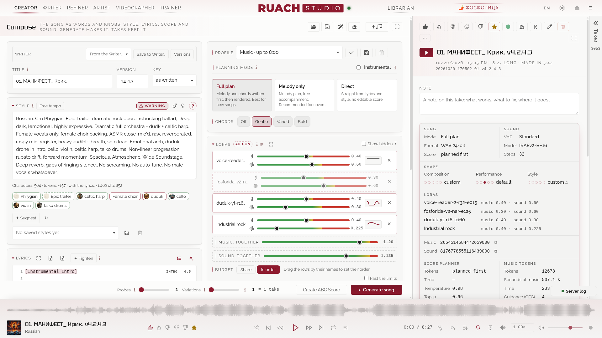
</p>

Around the model there is a whole studio of eight rooms: the **Musician** makes the song, the **Writer** writes it with a chat model, the **Refiner** finishes it, the **Artist** paints its pictures, the **Videographer** makes its music video, the **Narrator** reads a text aloud (new in 2.0.7), the **Librarian** keeps every take, and the **LoRA Trainer** teaches YuE2 your own songs with its own trainer.

**The full guide, room by room, is inside the Studio** (F1, or **Guide** in the bar's ☰) and here: [docs/GUIDE.md](docs/GUIDE.md). The Artist in depth: [docs/ARTIST.md](docs/ARTIST.md), in the twelve languages of the Studio beside it.

## What It Downloads

Measured file by file against the pinned lists of the Studio's Hugging Face repositories, and on a fresh install's disk (01.11.2026, our decoders 10.11.2026; 1 GB = 10⁹ bytes). A model takes on the disk exactly what it downloads. The install brings the Musician, the Librarian and the Refiner's chain; every other room comes only when you ask for it, from **Engine → Models and LoRAs → By room** (it measures the free disk first and fetches nothing that would not fit with 2 GB to spare) or from `launcher/extras.sh` in a terminal. The card decides the sizes, as the install does.

| | what it is | 24 GB card | 12–16 GB card | 8 GB card |
|---|---|---:|---:|---:|
| the program | the Studio's code (0.2 GB downloaded) and its engine, built here | 0.9 GB | 0.9 GB | 0.9 GB |
| its two Pythons | `.venv` and `.venv-art`, PyTorch for CUDA 12.8 in each (8.7 GB downloaded) | 16.5 GB | 16.5 GB | 16.5 GB |
| YuE2 | m-a-p's YuE2-3B as GGUF and its decoder | 7.7 GB (BF16) | 4.3 GB (Q8_0) | 4.3 GB (Q8_0) |
| our fine-tune | YuE2-RS-TW 2.0 ×0.75, the Studio's default, at the backbone's quant | 7.2 GB | 3.8 GB | 3.8 GB |
| our decoder | YuE2-VAE-RS x3 v1, the Studio's default decoder (float32) | 0.8 GB | 0.8 GB | 0.8 GB |
| the rest | our second decoder (YuE2-VAE-RS x3 v2), the transcriber for covers, Whisper, the stems' models, UniverSR and Apollo-vocal, the LoRAs | 8.5 GB | 8.5 GB | 8.5 GB |
| **the install** | | **41.6 GB** | **34.9 GB** | **34.9 GB** |
| + Writer | Qwopus3.5-9B through llama.cpp, built here (0.75 GB) | 7.4 GB | 7.4 GB | 6.2 GB (compact) |
| + Refiner | MuScriptor large (sound to MIDI), FlashSR (the Voice upscale's; else it comes on its first use) | 6.1 GB | 6.1 GB | 6.1 GB |
| + Artist | the covers' helpers, Qwen-Image 2512 with Lightning | 42.9 GB (Q6) | 39.3 GB (Q4) | 39.3 GB (Q4, from RAM) |
| + Videographer | MiniMax H3 int8, SeedVR2 7B sharp | 86.3 GB | needs 24 GB | needs 24 GB |
| + LoRA Trainer | its base with MERT-v2-FullSong, the style listener | 20.2 GB | 16.3 GB | 12.9 GB |
| **every room** | | **204.5 GB** | **104.0 GB** | **99.4 GB** |

A card under 7 GB takes Q6_K (the install's models 15.7 GB) or, under 4.5 GB, Q5_K_M without the fine-tune (12.5 GB): short songs only.

**Only when you ask for it by name:** another backbone beside yours (BF16 7.2, Q8_0 3.8, Q6_K 2.9, Q5_K_M 2.6 GB); every other sound engine: the IRA, five IRAE, the seven RS-FW merges (RS-FW 2.4 ×0.75 among them, the default before 2.0.6) and RS-TW 2.0 ×0.9 (By room → Sound engines: 100.8 GB at BF16, 53.2 at Q8_0, 40.6 at Q6_K; each also on its own in Engine → Models and LoRAs, 7.2, 3.8 or 2.9 GB); the Artist's ten shared adapters (7.5 GB), each fp8 fine-tune of Qwen-Image 2512 (20.4 GB), Qwen-Image 2.1 under Qwen's research licence (33.1 GB); MiniMax H3's every int8 tier (201 GB) or its BF16 (478 GB), SeedVR2 3B (7.3 GB) or all three (40.2 GB); the style listener in bf16 (22 GB); MuScriptor small or medium (0.2 or 0.6 GB); the 💎 workspaces from the Librarian (5.6 GB, all seven).

**Not counted:** the NVIDIA driver and the CUDA toolkit 12.8 (the system's, or Pinokio's own), Pianoteq, Organteq and Airteq (Modartt's, yours to buy or to try, if you want them), and your takes. pip keeps no copy of the wheels it fetched (since 2.0.5; before, `~/.cache/pip` kept 8.7 GB more).

## The Rooms

<table>
  <tr>
    <td width="50%"><br><sub><b>Musician</b>: style, lyrics, planning mode, VAE, LoRAs on a road from green to red, each with its wave; the take with its score, seeds and everything to make it again</sub></td>
    <td width="50%">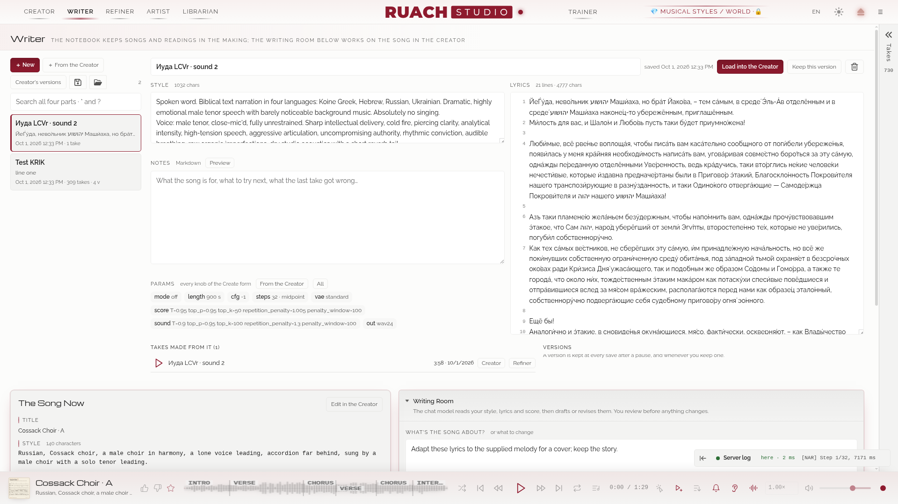<br><sub><b>Writer</b>: songs as documents with versions, text profiles, and a chat model that drafts and revises with you</sub></td>
  </tr>
  <tr>
    <td width="50%">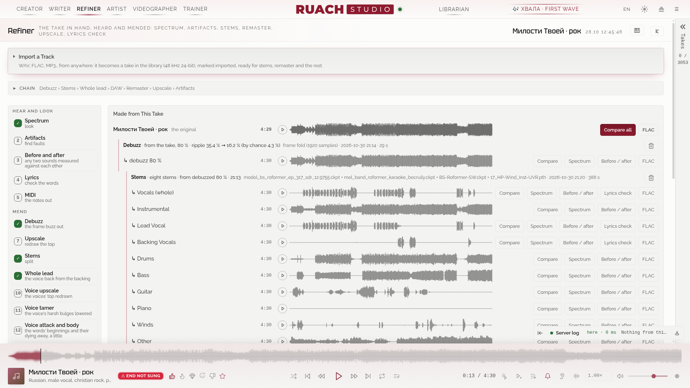<br><sub><b>Refiner</b>: spectrum, artifacts, debuzz, a lyrics check by Whisper, stems, remaster, upscale; a chain runs them in one go</sub></td>
    <td width="50%">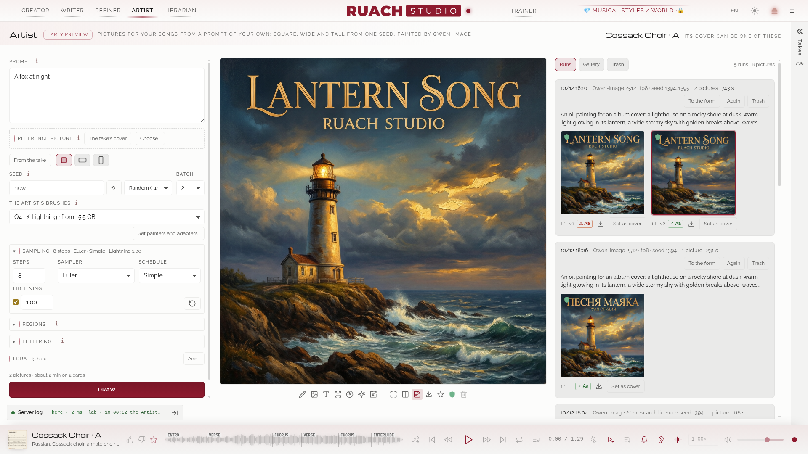<br><sub><b>Artist</b>: pictures for your songs from a prompt of your own, square, wide and tall from one seed; the run develops on the stage, a square picture becomes the take's cover (an early preview)</sub></td>
  </tr>
  <tr>
    <td width="50%">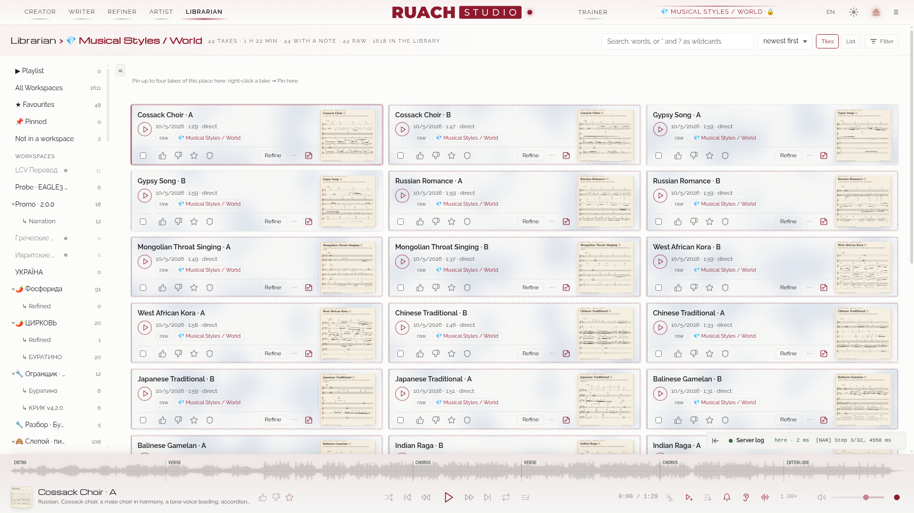<br><sub><b>Librarian</b>: every take in workspaces, searched, liked, noted, locked, exported; the heading counts what the open collection holds</sub></td>
    <td width="50%">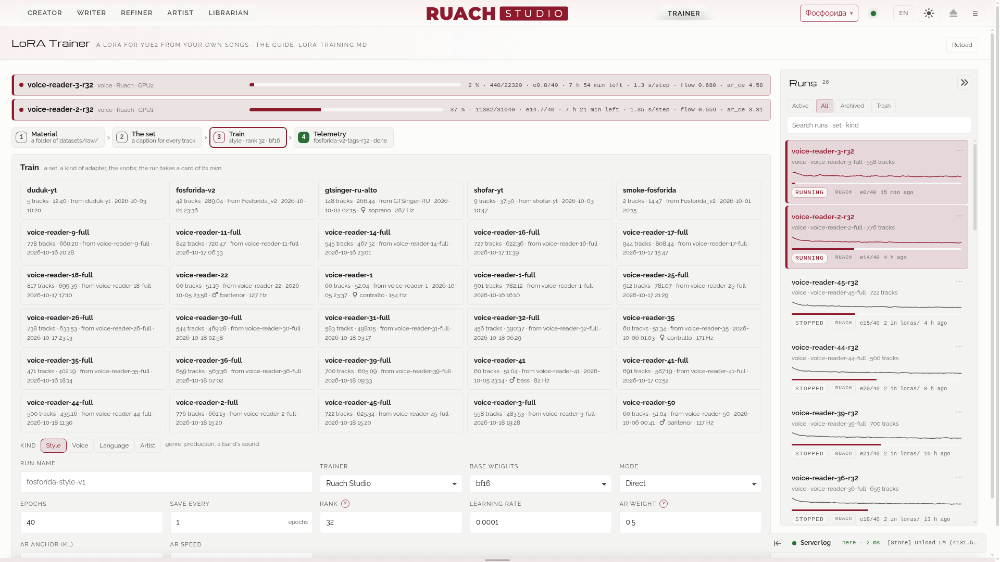<br><sub><b>LoRA Trainer</b>: LoRA adapters from your own songs: the set, the run, both halves' curves explained, the epochs worth hearing first</sub></td>
  </tr>
  <tr>
    <td width="50%">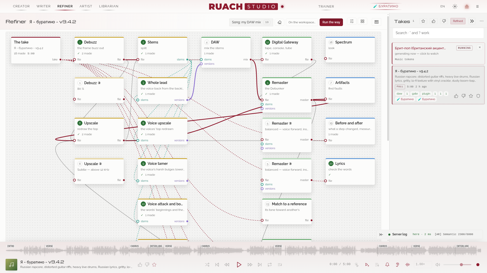<br><sub><b>The Refiner as a canvas</b>: every step a node, wired the way the sound goes, as in ComfyUI; a pipeline's way drawn across it, run up to any node, bypass, clones, profiles</sub></td>
    <td width="50%">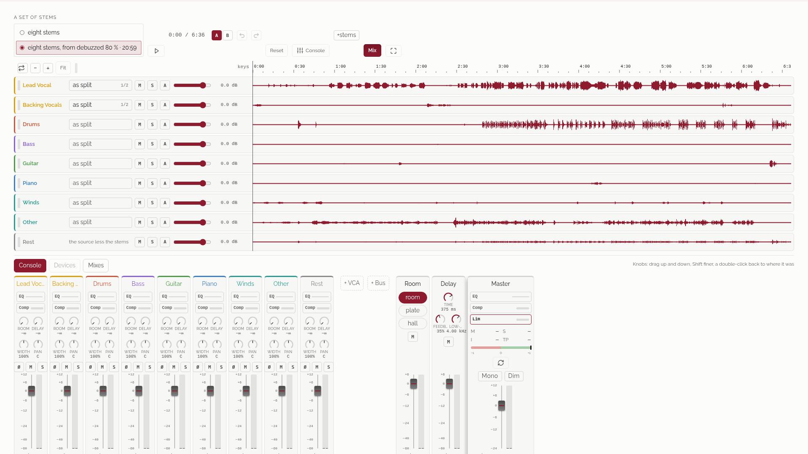<br><sub><b>DAW</b> (a preview, in the Refiner): the take's stems on lanes over a console: a version per lane, level, pan, sends, buses and VCAs, automation, cuts with fades, a master chain; <b>Mix</b> renders what you hear</sub></td>
  </tr>
  <tr>
    <td width="50%">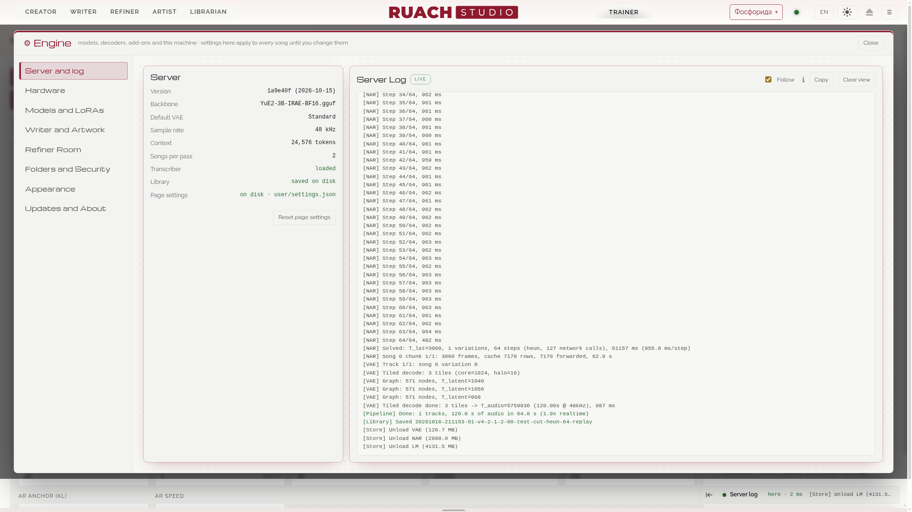<br><sub><b>Engine</b>: the model, memory, which card does what, decoders, adapters, the writer's model, the look, the log, the debug journal (off unless you choose it)</sub></td>
  </tr>
</table>

### Day and Night

The Studio has 22 themes, kept for working in: clear, quiet, readable for hours. The same take by day and by night:

<table>
  <tr>
    <td width="50%"><br><sub><b>Scroll &amp; Brick</b>, the day theme</sub></td>
    <td width="50%">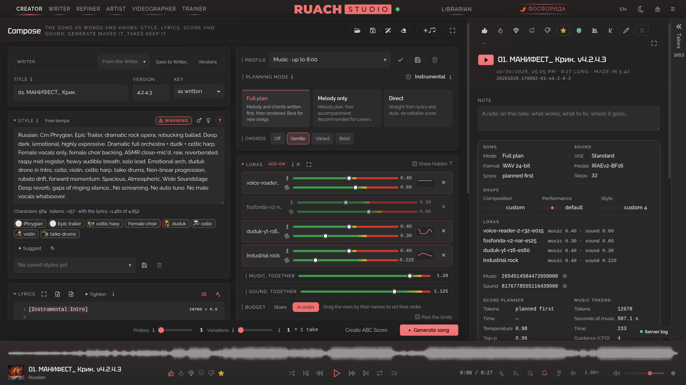<br><sub><b>Scroll by Lamplight</b>, the night theme</sub></td>
  </tr>
</table>

## What Makes It a Studio

- **A guard against garbage.** When the music half writes a broken score (adapters pushed too far do that), the engine stops the run before any music is built on it, in seconds, and says why: which adapters, how far past their limits, what was written. Strengths sit on measured roads; stacked adapters share a measured ceiling.

  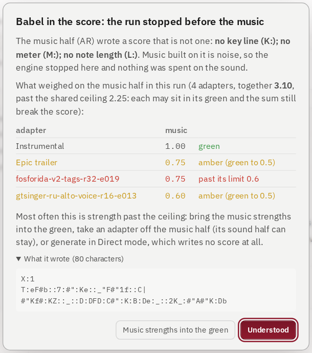
- **Its own LoRA trainer.** The Studio trains adapters itself, on unquantized bf16 weights, making its own latent cache. Against Ostris' AI-Toolkit on the same set, the music half's loss agrees epoch by epoch within 0.015. The run's telemetry explains both curves and lights the epochs worth hearing first.

  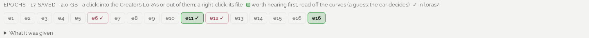
- **Lyrics that keep time.** Beside each line its beats, against the ruler of its section: verse and bridge one group, the pre-chorus and the chorus their own; a pause or an interlude inside a section opens no new group. A syllable is counted by each language's own rules (English, Russian, Ukrainian, Belarusian, Greek, Spanish, Italian; Hebrew by its vowel points; Chinese, Japanese and Korean by their signs), and the consonants that take a beat of their own count too. Type «[» at a line's start and the section tags are offered, as a code editor offers its words; stress marks astray are found; Ctrl+F finds in the box alone.

  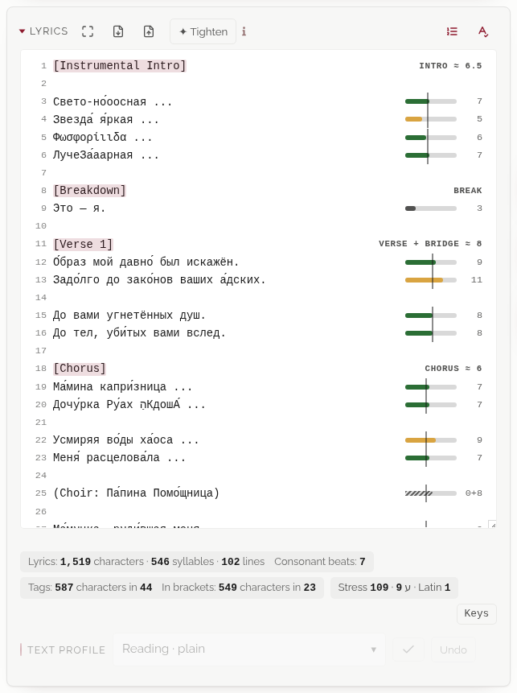
- **Several cards, several jobs.** On a machine with more than one GPU each card gets its work: synthesis on one, training on others, the listener, Whisper and stems where there is room. With one card, synthesis waits while a run trains, and the page says so.
- **The instruments YuE2 really plays.** 200 instruments probed and judged by ear, with their A/B probes, in a cheat-sheet beside the style prompt. The probes' pictures are painted by an image model: some show an instrument not quite as it really is.
- **A guide that comes to you.** The first time the Studio opens in a browser, the guide opens by itself a minute later.

## Measured

| | |
|---|---|
| a 6:12 song, Direct mode, RTX 3090 | 135 s |
| a 7:25 song, Full plan (score first), RTX 3090 | 212 s |
| LoRA training, bf16, rank 16, 148 songs | 2.1 s a step, 12 GB |
| LoRA training, bf16, rank 32, 42 full songs | 6.7 s a step, 18 GB |
| a broken score caught | 15 s into the run |

## The Ring: YuE2 against SUNO v6 and Musicful

Twenty cards, each a style line and lyrics, sent unchanged to every side: SUNO v6 and Musicful V3 as their services deliver them, ours raw from the engine, sung again in November with every peak whole: the stock YuE2-3B, our own fine-tune RS-FW at three of its saves, and RS-TW 2.0 at two strengths. Eight sides, one yardstick for all: the card plays one take of each side for each card, 160 in all, and the 280 measured below hold two takes of each card for each of our six sides and one for each of theirs. **[Listen to them side by side](https://ruachstudio.art/#ring)** on the visiting card, every file at the same loudness, a name switched on the same second.

FW and TW are the code names of our two fine-tunes of YuE2 3B: the First Wave and the Tsunami Wave. The Tsunami Wave was trained on 109,250 tracks, about 6,650 hours: 66.7 % of the hours instrumental, 31.6 % sung, 1.8 % spoken. The voices are in English (7.0 % of the hours), Russian (5.8 %), Hebrew (1.7 %), Greek and Ukrainian (0.6 % each), French and Spanish (0.5 % each), Portuguese (0.3 %), Italian (0.2 %) and fourteen more languages under 0.1 % each; in 15.9 % of the hours a voice is heard whose language was not identified.

RS-TW 2.0 is our second fine-tune: its epoch 2.0, merged over RS-FW 2.4 at two strengths, ×0.75, the safe balance and the Studio's default, and ×0.9, more tectonic, with no promise of stability. Ours are two seeds a card, both on the visiting card, neither chosen over the other, and the table's means count both.

<table>
<thead>
<tr><th rowspan="2">measured raw, the means</th><th rowspan="2">SUNO v6</th><th rowspan="2">Musicful V3</th><th rowspan="2">YuE2-3B</th><th colspan="5">Ruach Studio (RS-…) Finetunes of YuE2 3B</th></tr>
<tr><th>FW 0.7</th><th>FW 1.5</th><th>FW 2.4</th><th>TW 2.0 ×0.75</th><th>TW 2.0 ×0.9</th></tr>
</thead>
<tbody>
<tr><td>Whisper's error on the lyrics, heard on the mix, % (lower is better)</td><td>23.1</td><td><b>19.5</b></td><td>20.0</td><td>19.9</td><td>24.8</td><td>21.8</td><td>23.0</td><td>26.1</td></tr>
<tr><td>Whisper's error on the lyrics, heard on the separated voice, % (lower is better)</td><td>27.4</td><td><b>18.9</b></td><td>21.6</td><td>24.8</td><td>31.1</td><td>28.8</td><td>29.5</td><td>33.7</td></tr>
<tr><td>sand in the quiet, 6–16 kHz, dB (lower is better)</td><td>-15.7</td><td>-14.8</td><td>-17.6</td><td><b>-18.1</b></td><td>-17.3</td><td>-17.3</td><td>-17.9</td><td>-17.5</td></tr>
<tr><td>stray standing tones (lower is better)</td><td>2.2</td><td>1.9</td><td>4.33</td><td>2.0</td><td>2.27</td><td>2.23</td><td>2.15</td><td><b>1.6</b></td></tr>
<tr><td>the decoder's 25 Hz buzz in the highs, dB (lower is better)</td><td>8.3</td><td><b>8.0</b></td><td>11.4</td><td>11.6</td><td>11.6</td><td>11.5</td><td>11.6</td><td>11.1</td></tr>
<tr><td>sub 20–60 Hz share, dB</td><td><b>-8.6</b></td><td>-10.2</td><td>-10.0</td><td>-9.6</td><td>-9.9</td><td>-10.4</td><td>-10.0</td><td>-9.8</td></tr>
<tr><td>loudness as delivered, LUFS</td><td>-15.5</td><td><b>-14.3</b></td><td>-14.5</td><td>-14.7</td><td>-14.7</td><td>-14.4</td><td>-14.6</td><td>-14.8</td></tr>
<tr><td>true peak as delivered, dBTP</td><td><b>-3.4</b></td><td>-0.5</td><td>-0.2</td><td>-0.2</td><td>-0.1</td><td>-0.2</td><td>-0.3</td><td>-0.1</td></tr>
</tbody>
</table>

In bold, each row's best of the eight: the lowest where lower is better; for loudness the closest to −14 LUFS, for the true peak the closest to −1.0 dBTP from below, for the sub 20–60 Hz share the highest (denser lows).

Every side is heard on an RTX 3090, the mix and the voice alike, by Whisper large-v3: the first Whisper row on the mix, the second on the separated voice, where BS-Roformer splits all of a take's voices from the music, the lead, the backing voices and the choir together, never the lead alone. Without the music Whisper sometimes loses whole lines and writes words nobody sang into the pauses, on every side, so the two rows are best read together.

Theirs come mastered, ours raw at the decoder's own level with every peak whole: loudness is left to the master, which is the Refiner's to do. Other seeds and other prompts sound different on every side; the ring shows the quality and the spread, not a final ranking. The whole table and how it was measured are on the [model card](https://huggingface.co/goldhub/YuE2-RS-Finetunes).

### What the Spectrum Says

The ring measured instead of heard: 280 takes, 40 for each of our six sides, 20 of SUNO v6 and 20 of Musicful V3. Every take was first brought to −14 LUFS, so loudness wins nothing, and every curve is its take's own level, band by band, against that take's whole power: only the shape is compared. Ours are the engine's raw output and theirs come mastered, so some of the gaps below are the master's. The four graphs are on [the visiting card](https://ruachstudio.art/#spectrum).

- **One curve, until the last octave.** From 100 Hz to 10 kHz the mean curves of all eight sides stay within 5.2 dB of one another; above 16 kHz they part. Musicful V3 holds nothing past 16 kHz in 38 of its 40 takes, SUNO v6 keeps the most up there (−31.0 dB in 16–20 kHz), and ours sit at −39.3 to −42.3 dB.
- **The air: theirs brighter by 2.3 to 4.6 dB.** In the air band, 8–16 kHz, SUNO v6 and Musicful V3 sit at −19.4 and −19.6 dB of their takes' power, our six sides at −21.8 to −24.0 dB. A master usually lifts the air, and ours have had none: in the Studio that is the Refiner's to do.
- **Peaks and range: ours breathe wider.** Crest factor, the peak over the average: SUNO v6 14.4 dB, Musicful V3 15.7 dB, ours 16.2 to 16.6 dB; loudness range: theirs 5.9 and 6.0 LU, ours 6.4 to 7.0 LU. RS-TW 2.0 ×0.9 is the widest of our fine-tunes, 16.6 dB and 7.0 LU, as wide as the stock YuE2-3B; ×0.75 is the tighter, 16.2 dB and 6.6 LU.
- **Four strengths, one psalm.** The blind set: twelve cards sung at four strengths of RS-TW 2.0 over RS-FW 2.4, the same seed at every strength. On Psalm 22 in Greek the step from ×0.75/0.75 to ×0.8/0.8 took 36 dB out of the sub-bass, 20–60 Hz; across the twelve cards ×0.75/0.75 comes closest to the ring's own median curve on 6 cards of 12, a mean distance of 4.1 dB against 4.8 to 5.2 dB. That is why ×0.75 is the Studio's default in 2.0.6, and ×0.9 the one that promises no stability.

Measured with our own code on the CPU: 1/3-octave bands from a Welch spectrum, loudness and its range by ITU-R BS.1770-4 and EBU Tech 3342.

## Into Your DAW (Experimental)

**Experimental: it needs crash tests and more work.** Two ways out of the Studio, and only two: the mixed track as it is (WAV, FLAC, MP3), or the whole take into your own DAW, where the rest happens. Export to DAW is in a take's menu and in the Refiner. No audio and no project comes back in; what REAPER can give the Studio is what a song is made from: its words, and a melody from its MIDI items.

| DAW | what the Studio gives it | download | trial | licence |
|---|---|---|---|---|
| **REAPER** (Cockos) | a project: the mix and every stem, the score as MIDI, tempo and meter, the sections as regions, the lyrics on the timeline; and three actions inside REAPER ([`extras/reaper/`](extras/reaper/README.md)): a song made from the time selection and its MIDI, a take brought in | [reaper.fm/download.php](https://www.reaper.fm/download.php): Linux x86_64, i686, aarch64, armv7l (`.tar.xz`) | 60 days, every function, no registration | $60 (yourself, a business under $20,000 a year, education, non-profit) or $225 commercial; upgrades free through 8.99 ([purchase](https://www.reaper.fm/purchase.php)) |
| **Waveform** (Tracktion), 14 or newer | DAWproject: the mix and every stem, the score as note tracks, the sections as markers, the style and the lyrics in its notes | [Waveform Free](https://www.tracktion.com/products/waveform-free): a `.deb`, tested by its makers on Ubuntu 24.04 | Free has no time limit; Pro 30 days | Free: free, "completely unlimited" in its makers' words; Pro bundles from $249, upgrades from $149 ([Waveform Pro](https://www.tracktion.com/products/waveform-pro)) |
| **Bitwig Studio** | DAWproject, as for Waveform | [bitwig.com/download](https://www.bitwig.com/download/): Ubuntu `.deb` or Flatpak | 30 days without limits, after signing up | Essentials $99, Producer $199, Studio $399 ([buy](https://www.bitwig.com/buy/)) |

Checked so far: REAPER 7.81 opens the project and runs the actions (under Xvfb, by the Studio's own harness); DAWproject against the format's schema (`Project.xsd`), not yet in Waveform or Bitwig themselves. Studio One and Cubase read DAWproject too, on Windows and macOS. Prices and versions from the makers' pages on 3 October 2026; they change.

## Requirements

Made and tested on Viktor's setup:

- **Forge**, the Studio's machine: `Description: Ubuntu 24.04.4 LTS`, kernel 7.0, NVIDIA driver 595.71, CUDA 12.8; three RTX 3090 (24 GB each) and an Intel Arc Pro B50 (16 GB); Xeon E5-2697A v4 (64 threads), 251 GB RAM; Python 3.12.3, gcc 13.3, cmake 3.28, ffmpeg 6.1.
- **The laptop** the Studio is used from, over a VPN (the browser, REAPER, Waveform 14, Bitwig): `Description: Ubuntu 24.04.5 LTS`, a Quadro RTX 5000.

What it needs:

- Linux, an NVIDIA GPU with CUDA. 24 GB runs everything (synthesis in BF16, training in bf16); smaller cards use smaller model copies (Q8_0 3.8 GB, Q6_K, Q5_K_M) and int8 training.
- An Intel Arc card runs the engine as a beta (oneAPI, `./build.sh --sycl`), chosen as the Studio's card in Engine → GPUs: songs in every mode, adapters, Extend; training, the Artist and the Refiner's GPU steps stay on NVIDIA ([INSTALL.md › Intel Arc (beta)](INSTALL.md#intel-arc-beta)).
- About 35 GB of disk for the install on a 12–16 GB card and 42 GB on a 24 GB card, measured file by file (01.11.2026; our decoders 10.11.2026): the program 0.9 GB, its two Pythons 16.5 GB, the models 17.5 or 24.2 GB with Ruach Studio's own fine-tune and decoders among them; every other room only when you take it, 99 to 205 GB with all of them: [What It Downloads](#what-it-downloads) says each part. More for your takes.
- The CUDA toolkit 12.8, `git`, `cmake`, `gcc`/`g++`, `python3.12`, `ffmpeg`, `curl`. FLAC needs nothing more: the engine encodes it itself, the Refiner and the exports through ffmpeg.
- Only for the tests: `flac` and `metaflac` (`sudo apt install flac`) for the FLAC test, which checks the engine's encoder against the reference; Node.js 22+ and Chrome or Chromium for the page tests.

**The Studio answers on port 7777**: http://127.0.0.1:7777 on its machine, http://ITS-ADDRESS:7777 from your network. Over https or on its own machine, Chrome and Edge install it as an app from the address bar: a web app (PWA) with its own window and icon, the same Studio, nothing of it kept offline. [INSTALL.md](INSTALL.md) installs it step by step (on Windows 11, through WSL2: [INSTALL_WINDOWS.md](INSTALL_WINDOWS.md)); [INSTALL_by_LLM_Agent.md](INSTALL_by_LLM_Agent.md) is the same for an AI agent. With [Pinokio](https://pinokio.co) the install and the start are buttons of its menu, on Linux ([INSTALL.md › With Pinokio](INSTALL.md#with-pinokio)).

## Linux: AppImage

One file and nothing to build: the Studio with its engine, its Python, ffmpeg and its own C library inside, for Linux on x86-64. Since 2.0.7 it runs whatever glibc the system has: it carries its own (measured on Debian 10 and CentOS 7, offline, as well as on Ubuntu 22.04 and 24.04, Debian 12 and Fedora 41).

Download `RuachStudio-2.0.7-core-x86_64.AppImage` (1.2 GB) and its `.sha256` from the [v2.0.7 release](https://github.com/igrbible/Ruach_Studio/releases/tag/v2.0.7), then:

```bash
sha256sum -c RuachStudio-2.0.7-core-x86_64.AppImage.sha256
chmod +x RuachStudio-2.0.7-core-x86_64.AppImage
./RuachStudio-2.0.7-core-x86_64.AppImage
```

**A window of its own comes up first**, offline too: it says what the Studio is doing, what is missing and whether there is a network, opens the page when the Studio answers (*Open the Studio*), and stops the Studio when you close it. Without a desktop, or with `RUACH_NO_WINDOW=1`, the AppImage speaks in the terminal as before.

**The first start** names each model it needs with its size, the total and the free disk, and downloads nothing until you say so: *Fetch the models* in the window (it wakes only when there is a network), `[Y/n]` in a terminal. It brings only what a song needs: the Studio's default backbone, RS-TW 2.0 ×0.75, at your card's quant, m-a-p's decoder (0.53 GB, which also encodes covers and uploads) and ours, YuE2-VAE-RS x3 v1 (0.8 GB). That is 8.5 GB on a 24 GB card (BF16), 5.1 GB on 7 to 16 GB (Q8_0), 4.3 GB below (Q6_K), and 4.0 GB on the processor or a card under 4.5 GB (m-a-p's YuE2-3B Q5_K_M). Everything else comes from **Engine → Models** when you want it: Whisper for the lyrics check, the transcriber for covers from a recording, our second decoder, upscale, the LoRAs. The stems need the full Python with PyTorch (`lab/install-venv.sh`), which the AppImage does not carry. The page opens at http://127.0.0.1:7777; the Studio keeps its things in `~/.local/share/ruach-studio` (`RUACH_HOME=/another/disk` puts them elsewhere).

**The GPU** is NVIDIA's, with the driver 570 or newer: the RTX 20xx, 30xx, 40xx and 50xx, the GTX 16xx, Quadro RTX and the RTX A and Ada cards, the A100 and the other Ampere cards, the H100 and H200, the B200 and B300. Pascal and Volta run as an experiment (the GTX 10xx, Quadro P, Tesla P4 and P40, Titan V, V100). On any other card, or with none, the Studio computes on the processor, slowly; `CUDA_VISIBLE_DEVICES= ./RuachStudio-2.0.7-core-x86_64.AppImage` makes it do so on any card.

**An update** is the next AppImage started in place of this one: your models, songs and settings stay where they are, and its first start asks only for what changed among the models you have. `--fetch-models --only whisper,transcriber` (or `--help` after `--fetch-models`) fetches the packs from a terminal.

## Dependencies

Everything the Studio uses, and what for. The engine comes with the repository; the rest is fetched, pinned and checked by the scripts named.

**The engine** (`build/`, compiled by `build.sh`):

| | what for | licence |
|---|---|---|
| [yue2.cpp](https://github.com/ServeurpersoCom/yue2.cpp), with our patches | the music engine and the Studio's server | MIT |
| [ggml](https://github.com/ggml-org/ggml) | the model on the GPU (CUDA) | MIT |
| [cpp-httplib](https://github.com/yhirose/cpp-httplib) · [yyjson](https://github.com/ibireme/yyjson) · [minimp3](https://github.com/lieff/minimp3) | HTTP · JSON · MP3 decoding | MIT · MIT · CC0 |
| our FLAC encoder (`build/src/flac-enc.h`) | FLAC downloads and the player | MIT |

**The system** (your package manager): the NVIDIA driver and the CUDA toolkit 12.8 (`nvcc`), `git`, `cmake` 3.24+, `gcc`/`g++` 13, `ninja` (optional, faster), `python3.12` with `venv`, `ffmpeg` (decoding, the Refiner, the exports, MP3 and FLAC there), `curl`.

**Python** (`lab/requirements.txt`, installed into `.venv` by `lab/install-venv.sh`):

| | what for |
|---|---|
| torch 2.11, torchaudio, torchvision (CUDA 12.8) | every GPU job of the lab, the trainer |
| audio-separator 0.47 | stems: BS-Roformer, htdemucs_ft |
| faster-whisper 1.2.1 | the lyrics check, karaoke timing, trim to the text |
| transformers (below 5) | CLAP for the instrument probes, Qwen3-4B for the artwork's prompts |
| soundfile, numpy, audioread, mutagen | audio in and out, MP3 tags |
| yt-dlp | the audio of long recordings for instrument sets |
| scipy, matplotlib | the Digital Gateway, the DAW's render and the measures; Before and after drawn |
| c2pa-python 0.38, cryptography | Content Credentials (C2PA) on the downloads, signed by the install's own certificate |
| [UniverSR](https://github.com/woongzip1/UniverSR) (cloned at its tested commit) | upscale |

**The Artist's Python** (`lab/requirements-art.txt`, its own `.venv-art` by `lab/install-venv.sh --art`): torch 2.11 with torchvision; transformers 5 (Qwen-Image's text encoder, the prompt writer, the content filter); diffusers 0.41 (Qwen-Image 2512 and 2.1) with gguf (the quantized transformers) and peft (the LoRAs); scipy (the Beta schedule); [spandrel](https://github.com/chaiNNer-org/spandrel) 0.4 (the upscalers, MIT); omegaconf, rotary-embedding-torch and OpenCV, headless (the Videographer's SeedVR2).

**Models** (`fetch-models.sh`, and `heresy/fetch-heresy.sh` for the extras), all from [goldhub/Ruach_Studio_Models_v2](https://huggingface.co/goldhub/Ruach_Studio_Models_v2) at its pin, each file byte for byte as its author publishes it (SheetSage2 F32 converted once by the Studio), but the stems' models, the Kit's three adapters without a licence and Qwen2.5-Omni-7B whole, which come from their authors, and Ruach Studio's own merges and decoders, which come from their own repositories at their pins; sizes, sources and licences in that repo's card and its `MANIFEST.tsv`:

| | what for | licence |
|---|---|---|
| YuE2-3B (GGUF: BF16, Q8_0, Q6_K, Q5_K_M) | the songs | CC BY-NC 4.0 |
| YuE2-RS-TW 2.0 ×0.75, Ruach Studio's own fine-tune and the Studio's default, at the backbone's quant; RS-TW 2.0 ×0.9 and the seven RS-FW merges · extra ([goldhub/YuE2-RS-Finetunes](https://huggingface.co/goldhub/YuE2-RS-Finetunes)) | the songs | CC BY-NC-SA 4.0 |
| the IRA merge and the five IRAE (YuE2-3B with Mothersuperior's Instrumental and Real Audio folded in, the IRAE with monsterovich's Epic Trailer on top) · extra ([goldhub/YuE2-3B-Ruach_Studio-IRA-Merge](https://huggingface.co/goldhub/YuE2-3B-Ruach_Studio-IRA-Merge)) | other sound engines | CC BY-NC 4.0 |
| YuE2-VAE-RS x3 v1, Ruach Studio's own decoder and the Studio's default (m-a-p's Standard grown three times and trained on music, float32); x3 v2 · extra ([goldhub/YuE2-RS-Finetunes, VAE-RS/](https://huggingface.co/goldhub/YuE2-RS-Finetunes/tree/main/VAE-RS)) | the sound decoder | CC BY-NC 4.0 |
| YuE2-Vae (Standard) | the encoder (covers, uploads), and a decoder beside ours | CC BY-NC 4.0 |
| Blend 0.666 ([Mothersuperior/YuE2-Vae-merge-0.666](https://huggingface.co/Mothersuperior/YuE2-Vae-merge-0.666)), a decoder of the Studio up to 2.0.6 · **excluded from 2.0.7 on** | none now: a take decoded with it keeps its decoder's name | CC BY-NC 4.0 |
| SheetSage2 with MERT-v2-FullSong | a score written from a recording (covers, a take's score from its sound) | CC BY-NC 4.0 |
| SheetSage2-Refined (anime-song's fine-tune, as our F16 GGUF) · extra | the transcriber's Refined mode | CC BY-NC 4.0 |
| the Kit's library of LoRAs: Instrumental and Real audio (Mothersuperior), sv-billie, DreamPop v2, J-pop | instrumental pieces, genres, a real-audio sound | CC BY-NC 4.0 |
| Whisper large-v3 (CTranslate2) | the lyrics check, timing | MIT |
| BS-Roformer ep317 · htdemucs_ft | stems | not stated by its author · MIT |
| UniverSR | upscale | CC BY 4.0 |
| Apollo-vocal (baicai1145, on Apollo by JusperLee) | the Voice upscale's bundle | CC BY-NC-SA 4.0 (the model's code CC BY-SA 4.0) |
| FlashSR (Jaekwon Im) · on first use: its weights from our models' repository, its code from him | the Voice upscale's bundle | the weights Apache 2.0, his code MIT (as he stated on 20.10.2026) |
| Qwopus3.5-9B-v3 (Jackrong's, on Qwen3.5-9B; GGUF of our AutoRound quant, through [llama.cpp](https://github.com/ggml-org/llama.cpp)'s llama-server, built by `launcher/extras.sh`) · extra | the Writer's own language model: quality for a 12 GB card, compact for 8 GB | Apache-2.0 |
| Qwen2.5-Omni-7B (GGUF, through [llama.cpp](https://github.com/ggml-org/llama.cpp), built by you) · extra | the style listener for training sets | Apache-2.0 |
| Qwen3-4B-Instruct-2507 · extra | the artwork's prompt writer | Apache-2.0 |
| the content filter (Falconsai's nsfw_image_detection) · extra | every picture the Artist and a take's artwork paint passes it | Apache-2.0 |
| Qwen-Image 2512 (its parts from Qwen; the transformer as GGUF Q4_K_M or Q6_K, by unsloth) with Lightning's 8 steps (lightx2v) · extra | the Artist's painter, a take's artwork | Apache-2.0 |
| Qwen-Image 2.1 · extra | the Artist's painter that edits by words; its fp8 fine-tunes as brushes, Turbo in 4 steps and Outpaint with their authors' adapters, fetched by you from Civitai | Qwen Research License: not for commercial use; the adapters under their authors' terms |
| the upscalers you put into `models/artist/upscalers/` (ESRGAN, DAT, HAT, SPAN…) | the Artist's upscale | each its own |
| Fish Audio Drama 3 (35B MoE, 3B active), as our GGUF quants Q4_K, Q6_K and Q8_0 with its LICENSE and NOTICE, at the Narrator's own pin · extra | the Narrator's voice | Fish Audio Community License 1.0: free for research and non-commercial use, and for commercial use while you and your affiliates take less than USD 500,000 a year from all sources (past that, notify Fish Audio and move to a licence of theirs); never a hosted speech or voice-cloning service for others, at any revenue; never an identifiable person's voice without their consent; never a model created, trained, distilled or improved on what it makes; its watermark kept; «Built with Fish Audio» on what uses it |
| the Ukrainian stress index, Ruach Studio's, of lang-uk's ukrainian-word-stress 2.1.0 (2.9 million word forms, from ULIF's «Словники України»), with its NOTICE, at the Narrator's pin · extra | the Narrator's Ukrainian stresses | MIT (lang-uk) |
| YuE2-3B for training (bf16 or int8) · extra | the LoRA trainer | CC BY-NC 4.0 |

**In the page** (one file, made by `build.sh`): the icons (Font Awesome Free, CC BY 4.0; Lucide, ISC), the logo's words (Montserrat, SIL OFL, as paths) and [abcjs](https://www.abcjs.net/) 6.7 (MIT), which draws the staff, are inside it; YuE2 Studio's score checker (Apache-2.0) is ported into it, and the lab carries the original (`lab/abc_tools.py`). **The fonts** (Raleway, Michroma and Liberation Mono by default; Noto Sans and Noto Sans Mono, IBM Plex Sans and Mono, Bodoni Moda, Space Grotesk, Roboto, Lato, Unbounded, Tektur and Jura to choose from; SIL OFL), and the Hebrew and Greek letters' own (David CLM, GPL-2.0 with the font exception; GFS Didot, SIL OFL), are served by the lab from `lab/fonts/`. **The piano roll's instruments** (the Salamander Grand Piano by Alexander Holm; the choir «aah» and the voice «ooh» of FluidR3 GM by Frank Wen; CC BY 3.0, shortened and made mono) are served by the lab from `lab/sounds/`. The page loads no script, stylesheet or font from the internet.

**Optional:** the Writer's own model (Qwopus3.5-9B through llama.cpp's llama-server, which `launcher/extras.sh` fetches and builds where the card has 8 GB or more), or a chat server of your own (vLLM, LM Studio or Ollama) or OpenRouter (the cloud, your key); a DAW (above); Modartt's Pianoteq, Organteq or Airteq for the Refiner's steps that play a stem again; `node` 22+ (YouTube in yt-dlp, the page tests) and Chrome or Chromium (the page tests); `flac` and `metaflac` (the FLAC test); `pip install mcp` on an agent's machine (`extras/ruach-mcp.py`).

## Extras

[`extras/`](extras/README.md) holds the helpers we wrote for our own work on the Studio and kept, because a user of the Studio may well need them too: a loop finder for long recordings (how much of a "three hour" video is new, and the new part cut out), a downloader of a video's audio for instrument sets, a slicer of training sets, a calculator of what a LoRA rank costs on YuE2, a workspace sung again with fresh seeds. [`extras/plugins/`](extras/plugins/README.md) holds Refiner plugins made by others and given to the Studio, installed only when you ask: the first is Steven Altsman's (manchuwook) **Basic Pitch**, a set of stems into MIDI. [`extras/debug-receiver/`](extras/debug-receiver/README.md) is the whole of what receives a debug journal sent from Engine → Debugging, published so anyone can see what is kept and how.

**Six voice adapters**, trained in the Studio's LoRA Trainer on Russian audiobook readers and named by the kind of voice they carry (a bass, two baritenors, three contraltos), never by the person, are on Hugging Face with their samples: [goldhub/Ruach_Studio_LoRAs `voices/`](https://huggingface.co/goldhub/Ruach_Studio_LoRAs/tree/main/voices); the instrument adapters (shofar, duduk) beside them.

**No warranty.** We use them and they work here. They are not part of the Studio, nobody tests them on your machine, and if one eats your files, that is on you. Read before you run.

## Roadmap

Where the Studio goes next, in the order we make it. Dates follow the work, not the calendar.

- **2.1.0: learning the Studio by using it.** An interactive guide through the rooms; the Videographer's several takes a shot.

Issues and pull requests are read and answered; the roadmap moves with them.

## What Comes Next

### Done › 2.0.0-rc2 (October 2026)

- **The engine on ggml 0.26.0**, with yue2.cpp's latest: a two-minute song in 51 s on an RTX 3090 (54–61 s before).
- **Another VAE in seconds**: every take keeps its latents, and + Standard, + Legacy, + Blend decode them again with the VAE alone (about 2 s for two minutes).
- **Lyrics that keep time**: each line's beats against its section's ruler, a syllable by each language's own rules and the consonants that take a beat of their own; the section tags offered as you type «[»; stress marks astray found; Ctrl+F inside a box.
- **The Creator**: frames over the room, the VAE in the ☰ menu under the model, Max length in Sampling, Denoising steps.
- **The Writer**: the whole notebook exported to one file and imported back, nothing written over.
- **Open** says what of a prompt file the form could not take; copying works on the machine's address; F5 keeps a run.
- **Windows 11**: [INSTALL_WINDOWS.md](INSTALL_WINDOWS.md), through WSL2.

Everything that changed: [CHANGELOG.md](CHANGELOG.md).

### Done › 2.0.0-rc3 (October 2026)

- **The Writer's models with their prices**, from OpenRouter's list, as you type.
- **Every button that cannot be undone behind a dialog**, and drawing artwork for several takes or regenerating several asked first.
- **One shape for the icon buttons** across the rooms.
- **A voice's kind in the Trainer**: measured on speech and on singing, shown beside the set, with a name to give it.
- **The lyrics box as a code editor**: numbered lines, marks to jump between, mcedit's keys, the section tags under «[» along a song's arc with what each one is, the brackets checked before Generate.
- **End at…**: a take ending where you choose, its last seconds faded, from its kept latents in seconds; the tail after a Full song's proper end is the score's leftover bars, measured.
- **The logo is the name alone**: RUACH and the STUDIO block in each language, in the bar of one height, on the veil and in About; the tab's icon the name's first letter (R, Р, Π).
- **The Refiner's chain in the order of the work**: the stems split from the debuzzed and upscaled take and mixed by the remaster, the top drawn anew at the end.
- **The guide's Score and Voices on a Score**: YuE2's ABC line by line, and how a narrator and a choir are timed on one take.
- **The Artist room, an early preview**: pictures for your songs from a prompt of your own, in three shapes from one seed, painted by Krea 2 Muse, seen developing step by step and kept in a gallery; a square one becomes a take's cover.
- **[Pinokio](https://pinokio.co) on Linux**: install, start, update and more models from its menu; the work is done by bash scripts that run the same from a terminal ([INSTALL.md › With Pinokio](INSTALL.md#with-pinokio)).
- **The player where the songs are**: in two rows where they are heard and compared, in one elsewhere, and back with its take and its place after a reload.
- **Fewer tips**: none repeats what the screen already says.
- **The cards live**: each card's load and memory second by second, under it in Engine → GPUs and beside the server log, the Studio's card framed.

### Done › 2.0.0-rc4 (October 2026)

- **The models converted once**: the legacy and blend decoders and the sixteen sliders come as GGUF from [goldhub/Ruach_Studio_Models_v2](https://huggingface.co/goldhub/Ruach_Studio_Models_v2), so nothing is converted on your machine and no checkpoints are fetched.
- **Engine → Models and LoRAs**: what the install brings, part by part, here or not, fetched again from the Studio (a download cut short goes on where it stopped), and the extras each asked with its size.
- **Engine → Folders**: the songs, the trash, the Artist's pictures and the Writer's documents moved to any disk from the page, checked file by file.
- **The downloads made whole**: a failure says why and is tried again, the LoRAs come with the install, BF16 beside Q8_0 from Pinokio's More models.
- **The Artist in three columns**: the prompt, the picture as it develops with its run's data, the gallery in even tiles; Stop while it draws.
- **Find and replace** in the lyrics and the style (F4 or Ctrl+H), the lyrics as a `.txt` named by the Title, a second tag on a line, ♂ and ♀ in the Style.
- **The player**: the take's menu on its wave, the sections on the wave, a sound when a run ends.
- **Nothing from the internet in the page**: abcjs and ten font families served by the Studio itself; Ctrl+S, Ctrl+N and F5 that keep your work.

Everything that changed: [CHANGELOG.md](CHANGELOG.md).

### Done › 2.0.0-rc5 (October 2026)

- **The Artist room, nearly whole**: a reference picture to paint from, its mask, painting around it, and the canvas as InvokeAI's (the picture placed in each shape's frame by hand, the mask painted over it); LoRA adapters, up to four, each muted at a click; Qwen-Image 2512 and 2.1 beside Krea 2 Muse, with Lightning and the samplers we paint with; an upscale to 2K and 4K; two runs at a time; a painter streamed from RAM when it does not fit the card.
- **The page in all six languages**, wall to wall, and the cheat-sheet's descriptions with it.
- **The wave's sections are the lyrics' own tags**, each where Whisper hears its first line.
- **A new studio reads its machine at its first start** and offers what suits it; a VRAM limit for each card; one card for everything (the engine lets its models go for a job).
- **The server log on either side**, the Artist's own log beside it, and a window of its own with the cards live.
- **Trash (Art)** in the Librarian; the LoRA Trainer's runs go on to more epochs.

Everything that changed: [CHANGELOG.md](CHANGELOG.md).

### Done › 2.0.0-rc6 (October 2026)

- **The Artist room, nearly closed**: regions (up to three parts of the frame, each with words of its own), a reference edited by the prompt's words or used for its style alone, a second pass at ×1.5 or ×2 with extra noise as Viktor's ComfyUI workflow paints it, Qwen-Image 2.1 on a 16 GB card, adapters' strength over the steps and from Civitai, a painter kept between runs, a run's pictures on several cards, upscale in passes with TTA, protected pictures; the whole room in depth: [docs/ARTIST.md](docs/ARTIST.md).
- **Five more languages**: French, Portuguese, German, Japanese and Chinese, the page whole and the guide in all twelve.
- **SUNO's quick ideas**: Crop and Remove a section on the score's bar lines, Adjust speed with the tempo written into the score, Tighten these lyrics and style suggestions, the wave's sections on the music's own changes, and the take's whole spectrogram over the player.
- **The LoRA Trainer, held at 90 %**: it trains well on our own songs and voices, and your sets and scenarios are not ours; tell us how it went, with the set, the mode, the settings and what you heard ([a trainer report](https://github.com/igrbible/Ruach_Studio/issues/new?template=trainer-report.md)).

Everything that changed: [CHANGELOG.md](CHANGELOG.md).

### Done › 2.0.0-rc7 (October 2026)

- **Songs edited as the model writes them**: Replace a section from the player's wave, its words sung anew between the rests the ear finds and the rest of the take kept to the sample, several sections in one go; Free tempo; two guidances, the style's pull and the lyrics' hold.
- **Compare**: a take with its namesakes, or two to twelve checked, in one player from the same second, each heard as it is: its wave with the second under the pointer and a ruler under it, ⏪ ⏩, the second kept or each from its start, thumbs and star, 👎 to show or hide the disliked, each version placed by its own sound (a print through gear comes back late), an A–B loop on the ruler, a blind mode, a moment marked into the take's note, and each take's own menu on its row.
- **The Studio's own LoRA Trainer, whole**: epochs, score mode (Full, Melody) and the separation of vocals and music; AI-Toolkit no longer needed.
- **Covers by the cards**: Qwen-Image 2512 where a card holds it, Krea 2 Muse below; a cover copied to a take's namesakes; the Refiner's Colour (vinyl, tape, room); the Artist's guide in twelve languages.

Everything that changed: [CHANGELOG.md](CHANGELOG.md).

### Done › 2.0.0-rc8 (October 2026)

- **Every weight from one repo**: [goldhub/Ruach_Studio_Models_v2](https://huggingface.co/goldhub/Ruach_Studio_Models_v2) is the Studio's own disk, file for file, the LoRA Trainer's base in it; the install takes all of it from there at one pin, and a file renamed or moved into a folder of your own is known by its content.
- **The Artist on Qwen-Image alone**: Krea 2 out; the brushes in one list; Qwen-Image 2.1's fp8 fine-tunes, its Turbo in 4 steps and Outpaint; a picture's note; ten adapters shared by their authors.
- **Who may open the Studio**: Engine → Security, asked at the first start; the Studio on port 7777.
- **Guards and comfort**: no take outside a workspace that takes them; the lyrics' arc and the voices among their tags; a font and a size for the section marks, the buttons and the rooms; the Creator's long lists in the Studio's dialog.

Everything that changed: [CHANGELOG.md](CHANGELOG.md).

### Done › 2.0.0-pre (October 2026)

- **The Refiner as a canvas**: every step a node, wired the way the sound goes; seven pipelines shipped and a plugin's own, run up to any node, bypass, clones, profiles; the chain on many takes at once.
- **The DAW, a preview**: the take's stems on lanes over a console: a version per lane, EQ, compressor, sends, buses, VCAs, sidechain, automation, fades on a cut, moving and copying, the master's EQ, compressor and limiter, inserts through the Digital Gateway; **Mix** renders it on Forge.
- **New steps**: Whole lead, Voice upscale, Before and after, Match to a reference, the Digital Gateway; eight stems by their proper names; steps of your own as plugins, on a set of stems and on the GPU too ([docs/PLUGINS.md](docs/PLUGINS.md)).
- **The Creator**: each LoRA's wave through the song and a budget for the adapters that share their layers; the IRA merge; the denoising steps on a slider; Also render with; the Creator's versions; the song's length by its mode.
- **Content Credentials (C2PA)** on every download; the Engine and the guide over the room in tabs; every job's progress above the player; new pictures of every room.

Everything that changed: [CHANGELOG.md](CHANGELOG.md).

### Done › 2.0.0 (October 2026)

- **Ruach Studio's own fine-tune**: YuE2-RS-FW folded into the base at seven points of its training, each named by its epoch and strength ([goldhub/YuE2-RS-Finetunes](https://huggingface.co/goldhub/YuE2-RS-Finetunes), CC BY-NC-SA 4.0); RS-FW 2.4x0.75, the safest, was the Studio's default and came with the install until 2.0.6; the adapters themselves are not published. **Its vocabulary**, every word it was trained on and its scores' keys, counted: [docs/FW-VOCABULARY.md](docs/FW-VOCABULARY.md), searchable on [the Studio's page](https://ruachstudio.art/#vocabulary) and in F1.
- **Songs edited as the model writes them**: Extend from any moment; a section sung once more, a line re-sung, a window sung anew with its neighbours kept and the sound decoded whole; a take arranged anew from its sections and matched section by section; music before a repeat and an interlude written by the model; the opening alone.
- **The piano roll** (beta): the scores YuE2 writes opened and played on real instruments, its Vocal singing the vowels in phrases; Chords, and a chord bed the model sings over; a segment transposed; MIDI for the whole Studio and a MIDI API; a planned score read before it is sung.
- **The Refiner is its canvas, and the DAW (beta) had a sound engineer's pass**: the nodes wired as the work flows; Voice tamer, Voice attack and body, Bass under the kick, Details up, Mono Maker, Peak glue, a true-peak ceiling and the voice transposer; the console's solo, reference, fades, typed values, parallel compression, a gate on every strip, returns with pre-delay, LRA and PLR.
- **Listening and choosing**: the playlist and its crossfade; Compare from memory, up to twelve takes, with a star, a dislike and a note; the Library's cards anew; the lyrics timed word by word; the tags in every download.
- **The Trainer**: on several cards; a rank for each half, and tracks without the music lesson; saves in tenths of an epoch, Pause and Resume, the held-out best; the learning rate honest, with a fade; datasets as parquet.
- **Lettering on a cover**: the title and a second line painted into the picture by Qwen-Image, each picture read back and painted again when misspelled.
- **The engine**: at upstream's level; AB2 at 48 steps by default; Full an octave lower by default; a job names its backbone and Regenerate keeps a take's own; the IRAE merges in the lineage; the sound decode's ladder, an experiment in the Creator's Sampling; Intel Arc as a beta.

Everything that changed: [CHANGELOG.md](CHANGELOG.md).

### Done › 2.0.1 (October 2026)

- **The Studio's own Writer**: Qwopus3.5-9B-v3, quantized with AutoRound and moved into GGUF bit for bit, on your own card through llama.cpp's llama-server, quality for 12 GB and compact for 8 GB; the default where it is here, so the Writer needs no chat server of yours and nothing leaves the machine.
- **Playing and choosing**: a take starts on a slow line before all of it has come; Engine → Defaults for the player's steps, its clicks and the disliked takes; a double-click plays a card; a workspace moved into another.
- **An https door for MIDI**, the log's own window with every view, the Trainer's progress in the log, and the fixes of the days after 2.0.0.

Everything that changed: [CHANGELOG.md](CHANGELOG.md).

### Done › 2.0.2 (October 2026)

- **The writer gives its card back**: a room that needs the card the Studio's writer holds gets it; the writer leaves unless it is answering.
- **The playlist's «Up next» and «Play only»**, and a training that goes on when one of its cards runs out of memory.

Everything that changed: [CHANGELOG.md](CHANGELOG.md).

### Done › 2.0.3 (October 2026)

- **Sound to MIDI**: MuScriptor turns a take, a stem or any file into multi-instrument MIDI, in the datasheet and as a Refiner step, and opens it in the piano roll.
- **The Videographer (beta)**: four rooms on one canvas (Editing, Shots, The idea and the look, Animatic and clip); a take cut into shots at its sung lines, the cuts moved onto the beat, the scenes written with the Writer, every shot drawn by the Artist in one go around one hero kept across them, an animatic and a clip with the sung lines, a title and credits, a cut, a dip to black, a flash or a dissolve between sections, in 16:9, 9:16 or 1:1; each shot set in motion by MiniMax H3 (draft or final, long shots in pieces without a seam) and made larger by SeedVR2; an edit page in the manner of DaVinci Resolve, and the plan as an editor's project (OTIO, EDL).
- **The Refiner's canvas, closer to ComfyUI**: each node's window as large as what it holds, Ctrl+wheel from 50 to 200 %, Mute and Bypass (Ctrl+M, Ctrl+B), a bucket of up to ten takes run as a batch, the way kept as a profile (Ctrl+S, each flow its own layout), and on the running node a bar with its time left and a Stop.
- **Adapters against their model**: one trained on another model (YuE2's on the RS-FW fine-tune, or the other way round) is marked, asked before it goes in and muted when the model changes; the Studio's trainer writes its base into every adapter it saves.
- **The Refiner's MIDI orchestra and Ambient**: a stem played again by sampled instruments (sfizz, FluidSynth); a fireplace, rain, thunder, a forest, water or birds under the song, as a strip of its own in the DAW.
- **Sung to the end?**: Whisper says whether a take's last lines were sung and Regenerate from… starts where they stopped; the Librarian checks many at once and marks the takes.
- **The Library**: reactions beside 🔥 and 💎, blind listening for a workspace, the player's stream in FLAC or Opus, and its place kept in a take.
- **The Remaster's Colour** gains cassette, radio and hall; an adapter's wave gains Rise and Fall; End at… finds the coda after the song.

Everything that changed: [CHANGELOG.md](CHANGELOG.md).

### Done › 2.0.4 (October 2026)

- **The DAW as an audio editor**: a drag selects; the selection is moved, copied, cut, silenced, faded or raised from its right-click; the level's line over every wave is taken at a point up into a peak or down into a fade; Ctrl+E splits; the place a stretch leaves fades into its silence and out of it, its fades drawn with the right button or set by sliders; a selection's edges cling to sections, splits and the playhead.
- **The DAW's lanes and console**: each lane its own height and its own right-click menu; the console pinned beside the lanes, on hover at the right edge, or floating.
- **Pianoteq**: a step of the Studio's own on a set of stems, played by the Pianoteq you installed and activated, into a lane of its own in the DAW.
- **The Refiner's nodes in FULL**: every step's settings on its node's face as ComfyUI's rows (name … ◀ value ▶), folded and unfolded; a node's output in its window.
- **The Studio on a phone**: the Creator, the Writer and the Librarian in one column, the player in one row.

Everything that changed: [CHANGELOG.md](CHANGELOG.md).

### Done › 2.0.5 (November 2026)

- **Every peak left whole**: the engine's hard clip (Peak clip) taken out; the song leaves the engine as it is, and loudness is the master's work.
- **A take's family tree**: every take it came from and every take made from it, the Refiner's versions inside; a click shows it in the Library, the way there and back.
- **Compare, deeper**: each version heard as it is and synced by its own sound, an A–B loop on the ruler, a blind mode, a moment marked into the take's note.
- **Before and after**: a node that measures any two sounds against each other: their spectrograms, their difference, the measures and a verdict.
- **Your first node**: a guide to the Refiner's nodes and an example to copy; Basic Pitch, the first plugin made by someone else (Steven Altsman).
- **Pianoteq, whole**: its own window (presets, effects, the pedals) and a tab of its own in the Engine.
- **The Studio over https**: its own authority trusted once, the settings handed over; MIDI, the console's own window, the clipboard and the Writer from another computer.
- **The DAW's lanes**: S L R M, polarity, colour, fold and order; a whole lane shifted in time; the level on the console; a layer from a bank under the song.

Everything that changed: [CHANGELOG.md](CHANGELOG.md).

### Done › 2.0.6 (November 2026)

- **RS-TW 2.0 ×0.75, the Studio's default**: Ruach Studio's second fine-tune, the Tsunami Wave (TW), trained over RS-FW 2.4 ×0.75 of the First Wave (FW) and folded back into it, comes with the install at your backbone's format; a model you chose stays yours. ×0.75 is the safe balance; ×0.9 is «tectonic», the most fire in the blind listening and no promise of stability, fetched only when you ask (`heresy/fetch-heresy.sh --tw 2.0x0.9-Q8_0`). Both at [goldhub/YuE2-RS-Finetunes](https://huggingface.co/goldhub/YuE2-RS-Finetunes), both in [the ring](#the-ring-yue2-against-suno-v6-and-musicful).
- **The debug journal**: Engine → Debugging, off unless you choose it, keeps a day of what goes wrong in this browser: what was clicked (never its words), keys pressed as commands (never what you type), the requests and the page's errors. *Download* and *Send* first scrub it on your own machine with the Studio's and the lab's logs (prompts cut out, names turned into marks, your folders, names, addresses and keys gone), show what the guard still found, and only on your yes save it or send it to the Studio's receiver for a ticket number ([what it keeps](extras/debug-receiver/README.md)). It tells a stalled line from a stalled page: keys by their code and never a modifier alone, nothing at all from a secret field, a hidden tab marked, the connection, the build beside every error, the long tasks and the memory, each write refused, sent again or lost; the lab's own log says when each request came, how long it took and who asked.
- **A bad line said, never hidden**: each change the page sends is counted until the Studio answers (a cloud with the count in the bar), the quick ones sent again with the same id and done once, and a change lost after three tries said so, never left to look saved; a broken link in the bar when the line itself is stuck; the window that holds the Studio keeps it through a stall, and a read-only window greys what writes and says why a change was not saved.
- **Every writer in one place**: Engine → Writer and Artwork holds the Studio's own writer, vLLM, LM Studio, Ollama and OpenRouter, each with a tick, its state and *Test connection*; the Writer, Tighten, the style's suggestions and the Videographer ask only the ticked ones that answer, and the OpenRouter key is kept by the Studio on this machine, never in a browser and in no backup.
- **Tail guards on new takes**: ∿ among the player's switches, off unless you choose it (also in a take's menu and in Engine → Defaults): each new take's end checked as it lands, for a sound that comes back after a silence (End at… offers that second) and, with lyrics, whether its last lines were sung (Whisper only while a card has room, never on the processor).
- **The compare window, anew**: Blind (🫣) across the Studio, a version titled «the original» keeping its name and the first place; one 📄 for the style and lyrics of the version playing; Play on, Ring and Shuffle; its own volume to 150 %; the wave ×2 and coloured by its bands; Wide to 2000 px; up to twelve takes from the Librarian. **+dB**, there and beside the player's volume, plays a take as loud as the old Peak clip made it.
- **The More menu (☰) in a new order**: GPU and VRAM, Model, VAE, then Engine, Theme and Guide in one row, and Text size last; Export to DAW left it for a take's menu and the Refiner (Ctrl+Alt+8 opens it).
- **Hebrew and Greek in fonts of their own**: every Hebrew letter in David CLM and every Greek letter in GFS Didot wherever they show (the lyrics, the titles, the styles), the rest of the line in its own font; Engine → Appearance → Fonts changes them.
- **The Creator** (the Musician since 2.0.7): both waves' vocabularies, the First Wave's and the Tsunami Wave's, under the Style and as tabs of the ♪ cheat-sheet, every word of your style the training data knew and how many tracks named it in each; Full's planned Vocal line sung as the model wrote it by default (an octave down is a choice in Engine → Creator Heresy).
- **The Librarian to the end**: a take found by its ID wherever it lives; hidden takes counted and shown again; workspaces archived out of sight; a loose search (words in any order, `*` and `?`, `!word` to leave out); a whole workspace in the playlist, albums with square covers.
- **Sounds and the DAW**: SFZ banks built from your own recordings by the Trainer, ready in the DAW's + Layer; Organteq and Airteq beside Pianoteq in the Refiner; a DAW lane's sound as a preset, markers, and the master's loudness against a platform's target (it only says).
- **A safer Studio, after a full audit**: a page of another website can no longer drive the Studio on your computer or network; Engine → Security refuses networks beyond the private ones; `RUACH_HOSTS` names the extra names your Studio may be reached by.
- **What the last audit found in the rooms, mended**: the Takes column's ⋯ sends the non-favourites of its workspace to the Librarian's trash, never past it (a take with a mark, a reaction or a note stays unless you tick it); the Refiner keeps your way across F5; a take's note survives a 👍; a workspace's marks go with it when it is deleted, poured or merged; every run filed in the workspace it was sent into, a refusal said with its reason; Instrumental kept with the take; «Song complete» only over a kept take; a reload no longer says the Studio is open in another window.
- **Doors, reloads and a new address**: another site can no longer put the Studio in a frame (Pinokio still can; `RUACH_FRAME_ANCESTORS` names more); the fonts, sounds, covers and icons are kept by your browser under a key of their own content, so a new build or release fetches only what changed; the Studio's page at its own address, [ruachstudio.art](https://ruachstudio.art), linked from F1 › About.
- **The Studio as an app**, from Chrome's or Edge's address bar (a PWA, nothing of it kept offline); the Intel Arc an equal member of Engine → GPUs; the clip's look (3D LUTs) and film in the Videographer; the player whole at any zoom and width; the page gzipped over a slow link.

Everything that changed: [CHANGELOG.md](CHANGELOG.md).

### Done › 2.0.7 (November 2026)

- **Our own decoders, the Studio's sound**: YuE2-VAE-RS x3 v1 decodes every new take and v2 stands beside it, m-a-p's Standard grown three times and trained by us on music, in true float32 on NVIDIA cards; a take's VAE switch decodes any take again from the music it holds; Engine → Defaults chooses the decoders offered (up to three, Standard among them if you want it); Legacy and the 0.666 Blend leave the Studio. Public with their study, a programmers' guide and an integration kit for ComfyUI and YuE2's own pipeline: [the weights](https://huggingface.co/goldhub/YuE2-RS-Finetunes/tree/main/VAE-RS), [the study](https://huggingface.co/goldhub/YuE2-RS-Finetunes/blob/main/docs/VAE-RS-x3-study.html) and [the programmers' guide](https://huggingface.co/goldhub/YuE2-RS-Finetunes/blob/main/docs/VAE-RS-x3-integration.md).
- **The Narrator**, a room for the spoken word: your text read aloud by Fish Audio's Drama 3 through audio.cpp, in the quant your card allows or on the processor, as narration or a dialog; stresses from your marks and your dictionary, lang-uk's for Ukrainian, and a big dictionary of your own for Russian or any other language ([NARRATOR-DICTIONARIES.md](docs/NARRATOR-DICTIONARIES.md)); Whisper hears every piece and a word lost or added is read again; a take fixed piece by piece, its pauses shaped to the hundredth; a book read part by part in one voice, a recording turned into a script; its own realm in the Library and its own speech chain in the Refiner. Built with Fish Audio.
- **The rooms by their new names and in a new order**: the Musician (once the Creator) and the Narrator; the keys 1–8 with the Narrator second, the Engine on 0.
- **The page in Hebrew**, right to left, its thirteenth language (נפחות רוח); the Greek letters in Noto Sans by default.
- **The DAW grows up**: a bar grid from the take's own tempo and sections, a chord and key lane, a reference at equal loudness, Bounce in place, Audition from the click point, the automation's shapes and an LFO; your markers and the score's chords and lyrics into REAPER.
- **The Videographer for quality**: MiniMax H3 at 1280 × 704, the hero in his own words and as a shot's last frame, cuts on the bar grid, karaoke, colour matched across shots, film and titles, every card of the lab at once.
- **The compare window**: First and second from any two versions with their measures in a table, an A–B loop with grips that holds the playhead, flags to the millisecond, one clock with the player.
- **The Artist**: SeedVR2 as an upscale pass, a size of your own, the painter's pass at the end of a chain, Viktor's ComfyUI way and a samplers grid.
- **Two transcriber modes** where a score is written from a recording, named alike in every language: **Heretical**, SheetSage2 with the bf16 angles it was trained with (the default), and **Refined**, anime-song's community fine-tune SheetSage2-Refined; each tooltip says what it is, whose it is and what it risks. SheetSage2 with exact angles (the scores before 2.0.7) left the page; a set whose sheets it wrote keeps them.
- **Legacy and Blend out of the Studio**: Standard and our two decoders remain; a take decoded with Legacy or Blend before keeps its decoder's name.
- **Around the rooms**: a live spectrum behind the player, the system bar in every room, the page a centred block of 2560 px on a 4K screen, the worn words of each language marked, a song or a reading asked before it waits long behind other work, every file the engine writes whole or not at all, and the AppImage with a window of its own and its own C library.

Everything that changed: [CHANGELOG.md](CHANGELOG.md).

### To Do › After 2.0.0

2.0.0 is the Studio we make our own songs in every day. These are the larger pieces on their way, planned or put off until their time:

- **Right-to-left languages** (Arabic, Hebrew, Urdu), once the page itself runs right to left.
- **The Videographer** (2.1.0): several takes a shot with the best kept, and a shot's last frame carried into the next.
- **Windows 11 through WSL2, by Pinokio**: the launcher's steps run inside WSL2 (Ubuntu 24.04), which Pinokio is to set up where it is missing, the path of INSTALL_WINDOWS.md (asked for in [#1](https://github.com/igrbible/Ruach_Studio/issues/1)). A native Windows build is not our initiative: it comes in only as a fork or a pull request made whole, turnkey. In Viktor's words (01.11.2026): «Нейро-ересь вселенская изначально под UNIX/BSD/Linux, и портирование под Виндоуз — это сломанный костыль и имитация жизни» (the universal neuro-heresy was born for UNIX, BSD and Linux, and a port to Windows is a broken crutch and an imitation of life).
- **Native plugins** for REAPER, Waveform and Bitwig, once the Studio has found its people.

Issues and pull requests are welcome: they are read and answered.

## Standing On

- **[YuE2](https://huggingface.co/m-a-p/YuE2-3B)** by m-a-p, the model; **SheetSage2** with **MERT-v2-FullSong** by m-a-p, the score written from a recording.
- **[SheetSage2-Refined](https://github.com/anime-song/SheetSage2-Refined)** by anime-song (CC BY-NC 4.0), the Refined transcriber, its weights in GGUF through the converter and the ported heads of scragnog's **[HOT-Step CPP](https://github.com/scragnog/HOT-Step-CPP)** (MIT).
- **[yue2.cpp](https://github.com/ServeurpersoCom/yue2.cpp)** by ServeurpersoCom, the C++ engine on ggml; this Studio carries it with its own patches (upstream alone will not run the Studio).
- **[timoncool's yue2.cpp](https://github.com/timoncool/yue2.cpp)** (MIT): the planned score's chords (after Yeufonic) and the opening a plan goes on from (after Mothersuperior's hum-to-song), ported into our engine.
- **[YuE2 Kit](https://github.com/IronWolve/yue2-kit)** by SeattleSysop (IronWolve), the base of the page and the scripts (Apache License 2.0).
- **[Basic Pitch](https://github.com/spotify/basic-pitch)** by Spotify's Audio Intelligence Lab (Apache-2.0), in the **[Basic Pitch plugin](https://github.com/null-angel/ruach-basic-pitch-plugin)** Steven Altsman ([manchuwook](https://github.com/manchuwook)) wrote for the Studio and gave to it (MIT, `extras/plugins/basic-pitch/`).
- **[AI-Toolkit](https://github.com/ostris/ai-toolkit)** by Ostris (MIT): the trainer's YuE2 code was ported from it, and the Videographer's MiniMax H3 runtime (`lab/h3rt`) is taken from it.
- **Mothersuperior**: the realaudio tokenizer head (CC BY-NC 4.0) and the VAE merge YuE2-Vae-merge-0.666 (Blend, excluded from 2.0.7 on).
- **Qwen2.5-Omni** (the listener), **Whisper** (the lyrics check), **BS-Roformer** and **htdemucs_ft** (stems), **UniverSR**, **Apollo-vocal** and **FlashSR** (upscale), the **Salamander Grand Piano** and **FluidR3 GM** (the piano roll's instruments), **GTSinger** (CC BY-NC-SA 4.0, training data of the First Wave's voices).
- **Qwen-Image 2512** by Qwen and its **Lightning** by lightx2v (the artwork's painter) and **Qwen3-4B** (its prompts); **[YuE2 Studio](https://github.com/vrgamegirl19/Yue2_Studio)** (Apache-2.0): the score checker the page and the lab use.
- **MiniMax H3** with its Qwen3-VL text encoder, the Videographer's moving shots, and **SeedVR2** by ByteDance Seed, the upscale of its shots and of the Artist's pictures.
- **[Fish Audio Drama 3](https://huggingface.co/fishaudio/drama-3)** (Built with Fish Audio), the Narrator's voice, on **[audio.cpp](https://github.com/0xShug0/audio.cpp)** by ShugoAI.
- **[ukrainian-word-stress](https://github.com/lang-uk/ukrainian-word-stress)** by **[lang-uk](https://lang.org.ua)** (MIT; its dictionary generated by Oleksiy Syvokon), from the stresses of **[«Словники України»](https://lcorp.ulif.org.ua/dictua/)** (Dictionaries of Ukraine) of the Ukrainian Lingua-Information Fund of the National Academy of Sciences of Ukraine (ULIF): the Narrator's Ukrainian stresses.
- **David CLM** of the Culmus project (Maxim Iorsh) and **GFS Didot** of the Greek Font Society: the Hebrew and Greek letters.

Every project is linked from the Studio's own Engine → About.

## Licence

- **What we wrote** (the patches over the engine and the page, the lab, the trainer, the extras, the tools, the guides): the **GNU Affero General Public License, version 3 or any later version** (AGPL-3.0-or-later), in `LICENSE`. Free to use, study, change and pass on, and every copy passed on, changed or not, and every service run on a changed copy, goes with its source under the same licence: nobody can close it and sell it as their own. From 2.0.5 it comes with the **additional terms of the licence's section 7** (`LICENSE-ADDITIONAL-TERMS.md`): a copy or a fork keeps the line «Based on Ruach Studio by Viktor Zhuromskyy» in sight in its interface and its README, says that it is changed, and does not take the Studio's name or logo for its own.
- **The logo and the name «Ruach Studio», and the audio and pictures we publish with it** (the probe workspaces, the LoRA samples, their artworks): CC BY-NC-ND 4.0, in `LICENSE-ASSETS.md`.
- **yue2.cpp, ggml and the other MIT projects** inside keep their MIT notices; MIT code may stand inside an AGPL work. So does the **Basic Pitch plugin** by Steven Altsman, given to the Studio under the MIT licence, its `LICENSE` in `extras/plugins/basic-pitch/`.
- **YuE2 Kit** by SeattleSysop (IronWolve), the base of the page and the scripts: its original contributions (the scripts, the documentation, the Studio page's customisations, the engine's modifications) are under the **Apache License 2.0** since 22.10.2026 (its commit 5df6eaa). Its licence text is in `LICENSES/yue2-kit-Apache-2.0.txt` and its notice is kept word for word in `NOTICE`, as its section 4 asks; Apache 2.0 code may stand inside an AGPL-3.0 work.
- **The Hebrew and Greek fonts** that come with the Studio keep their own licences, in `LICENSE-ASSETS.md`: David CLM of the Culmus project under the GNU General Public License version 2 with the font exception, GFS Didot of the Greek Font Society under the SIL Open Font License 1.1.
- **The models and the datasets** keep their own licences, and several are non-commercial: the realaudio head (CC BY-NC 4.0), GTSinger (CC BY-NC-SA 4.0), and YuE2, whose licence file reads: *"The YuE2-3B, YuE2-Vae and YuE2-Vae-legacy checkpoint weights are licensed under Creative Commons Attribution-NonCommercial 4.0 International (CC BY-NC 4.0)"*, and *"This weight license does not replace separately applicable licenses for code, text tokenization files, evaluation assets or other bundled material."* It speaks of the weights; it says nothing of the songs you make with them. What you may do with your songs is a question for your own judgement and, if it matters to you, a lawyer: this README gives no legal advice.

## A Little Story

Viktor Zhuromskyy, the author of Ruach Studio, does not publish it for the hype. He made it for himself. After more than half a year of struggling with Suno on paid plans, and of searching for a model worth working with (ACE-Step, MiniMax and others), he set out to build an audio studio of his own, on his own machine. He settled on YuE2: of all the open models, it is the best value and the most refined.

He did not knock the Studio together just to have something that runs. He built it his own way, because his work is his own: his translations, his interlinear texts and much more. He fit into it as much as he could, polished the interface as far as he could, and made working with it not poking and clicking among crutches and potholes, but as productive as it can be.

*That is the whole story. Now the Studio is yours as well.*

<details><summary>Русский</summary>

#### Маленькая история

Виктор Журомский, автор Ruach Studio, публикует её не ради хайпа. Он делал её для себя. После более чем полугода мучений с Suno на платных тарифах и поисков достойной модели (ACE-Step, MiniMax и другие) он взялся построить собственную аудиостудию, на своей машине. Выбор пал на YuE2: из всех открытых моделей она самая рентабельная и самая изысканная.

Студию он делал не тяп-ляп, лишь бы как-то шло, а в своём стиле, потому что и труд у него свой: собственные переводы, подстрочники и многое другое. Он постарался вместить в неё максимум, отполировать интерфейс до блеска и сделать творчество в Студии не тыканьем и кликаньем среди костылей и ям, а по-настоящему продуктивным.

*Вот и вся история. Теперь эта Студия и ваша.*

</details>
<details><summary>Українська</summary>

#### Маленька історія

Віктор Журомський, автор Ruach Studio, публікує її не заради хайпу. Він творив її для себе. Після понад пів року мук із Suno на платних тарифах і пошуків гідної моделі (ACE-Step, MiniMax та інші) він узявся збудувати власну аудіостудію, на своїй машині. Вибір упав на YuE2: з усіх відкритих моделей вона найвигідніша й найвишуканіша.

Студію він творив не абияк, аби лиш працювало, а у своєму стилі, бо й праця в нього своя: власні переклади, підрядники та багато іншого. Він намагався вмістити в неї максимум, відшліфувати інтерфейс до блиску, щоб творчість у Студії була не тицянням і клацанням серед милиць і ям, а справді продуктивною.

*Ось і вся історія. Тепер ця Студія і ваша.*

</details>
<details><summary>Беларуская</summary>

#### Маленькая гісторыя

Віктар Журомскі, аўтар Ruach Studio, публікуе яе не дзеля хайпу. Ён ствараў яе для сябе. Пасля больш як паўгода пакут з Suno на платных тарыфах і пошукаў годнай мадэлі (ACE-Step, MiniMax і іншыя) ён узяўся пабудаваць уласную аўдыястудыю, на сваёй машыне. Выбар упаў на YuE2: з усіх адкрытых мадэляў яна самая выгадная і самая вытанчаная.

Студыю ён ствараў не абы-як, абы працавала, а ў сваім стылі, бо і праца ў яго свая: уласныя пераклады, падрадкоўнікі і шмат іншага. Ён стараўся змясціць у яе максімум, адшліфаваць інтэрфейс да бляску, каб творчасць у Студыі была не тыцканнем і клікамі сярод мыліц і ям, а сапраўды прадуктыўнай.

*Вось і ўся гісторыя. Цяпер гэтая Студыя і ваша.*

</details>
<details><summary>Ελληνικά</summary>

#### Μια μικρή ιστορία

Ο Viktor Zhuromskyy, ο δημιουργός του Ruach Studio, δεν το δημοσιεύει για εντυπωσιασμό. Το έφτιαξε για τον εαυτό του. Ύστερα από περισσότερους από έξι μήνες ταλαιπωρίας με το Suno σε πληρωμένα πακέτα, και αναζήτησης ενός μοντέλου που να αξίζει (ACE-Step, MiniMax και άλλα), αποφάσισε να φτιάξει ένα δικό του στούντιο ήχου, στο δικό του μηχάνημα. Κατέληξε στο YuE2: από όλα τα ανοιχτά μοντέλα είναι το πιο συμφέρον και το πιο εκλεπτυσμένο.

Δεν έστησε το Στούντιο πρόχειρα, απλώς για να δουλεύει. Το έφτιαξε με το δικό του ύφος, γιατί και η δουλειά του είναι δική του: οι μεταφράσεις του, τα διάστιχα κείμενά του και πολλά άλλα. Προσπάθησε να χωρέσει σε αυτό όσο περισσότερα γινόταν, να γυαλίσει το περιβάλλον εργασίας ως την τελευταία λεπτομέρεια και να κάνει τη δουλειά μαζί του όχι άσκοπα κλικ ανάμεσα σε δεκανίκια και λακκούβες, αλλά κάτι πραγματικά παραγωγικό.

*Αυτή είναι όλη η ιστορία. Τώρα το Στούντιο είναι και δικό σας.*

</details>
<details><summary>Español</summary>

#### Una pequeña historia

Viktor Zhuromskyy, el autor de Ruach Studio, no lo publica para llamar la atención. Lo hizo para sí mismo. Tras más de medio año de sufrir con Suno en planes de pago y de buscar un modelo que mereciera la pena (ACE-Step, MiniMax y otros), se propuso construir su propio estudio de audio, en su propia máquina. Se quedó con YuE2: de todos los modelos abiertos, es el más rentable y el más refinado.

No montó el Estudio de cualquier manera, solo para que funcionara. Lo hizo a su estilo, porque su trabajo también es suyo: sus traducciones, sus textos interlineales y mucho más. Procuró meter en él todo lo posible, pulir la interfaz hasta el último detalle y hacer que trabajar con el Estudio no sea dar clics a ciegas entre muletas y baches, sino algo de verdad productivo.

*Esa es toda la historia. Ahora el Estudio también es tuyo.*

</details>
<details><summary>Italiano</summary>

#### Una piccola storia

Viktor Zhuromskyy, l'autore di Ruach Studio, non lo pubblica per fare clamore. Lo ha costruito per sé. Dopo più di sei mesi di tormenti con Suno sui piani a pagamento, e di ricerche di un modello all'altezza (ACE-Step, MiniMax e altri), ha deciso di crearsi uno studio audio tutto suo, sulla sua macchina. La scelta è caduta su YuE2: fra tutti i modelli aperti è il più conveniente e il più raffinato.

Non ha messo insieme lo Studio alla buona, giusto perché funzionasse. Lo ha fatto a modo suo, perché anche il suo lavoro è suo: le sue traduzioni, i suoi testi interlineari e molto altro. Ha cercato di farci stare il massimo, di rifinire l'interfaccia fino all'ultimo dettaglio e di rendere il lavoro con lo Studio non un cliccare a vuoto tra stampelle e buche, ma qualcosa di davvero produttivo.

*Questa è tutta la storia. Ora lo Studio è anche tuo.*

</details>
<details><summary>Français</summary>

#### Une petite histoire

Viktor Zhuromskyy, l'auteur de Ruach Studio, ne le publie pas pour faire parler de lui. Il l'a fait pour lui-même. Après plus de six mois à se débattre avec Suno sur des formules payantes, et à chercher un modèle qui en vaille la peine (ACE-Step, MiniMax et d'autres), il s'est mis à construire son propre studio audio, sur sa propre machine. Son choix s'est arrêté sur YuE2 : de tous les modèles ouverts, c'est le plus rentable et le plus raffiné.

Il n'a pas bricolé le Studio à la va-vite, juste pour avoir quelque chose qui tourne. Il l'a fait à sa manière, parce que son travail est le sien : ses traductions, ses textes interlinéaires et bien plus encore. Il y a fait entrer tout ce qu'il a pu, a poli l'interface aussi loin qu'il a pu, et a fait du travail avec le Studio non pas un tâtonnement de clics entre béquilles et nids-de-poule, mais quelque chose de vraiment productif.

*Voilà toute l'histoire. Maintenant, le Studio est aussi à toi.*

</details>
<details><summary>Português</summary>

#### Uma pequena história

Viktor Zhuromskyy, o autor do Ruach Studio, não o publica pelo hype. Ele o fez para si mesmo. Depois de mais de meio ano sofrendo com o Suno em planos pagos, e procurando um modelo que valesse a pena (ACE-Step, MiniMax e outros), ele decidiu construir o seu próprio estúdio de áudio, na sua própria máquina. A escolha caiu no YuE2: de todos os modelos abertos, é o de melhor custo-benefício e o mais refinado.

Ele não montou o Estúdio de qualquer jeito, só para ter algo que rodasse. Fez do seu jeito, porque o trabalho dele é dele: as suas traduções, os seus textos interlineares e muito mais. Colocou nele o máximo que pôde, poliu a interface até onde pôde e fez do trabalho com o Estúdio não um cutucar e clicar entre muletas e buracos, mas algo de fato produtivo.

*Essa é a história toda. Agora o Estúdio também é seu.*

</details>
<details><summary>Deutsch</summary>

#### Eine kleine Geschichte

Viktor Zhuromskyy, der Autor von Ruach Studio, veröffentlicht es nicht für den Hype. Er hat es für sich selbst gemacht. Nach mehr als einem halben Jahr Mühe mit Suno in bezahlten Tarifen und der Suche nach einem Modell, mit dem sich arbeiten lässt (ACE-Step, MiniMax und andere), machte er sich daran, ein eigenes Audiostudio zu bauen, auf seiner eigenen Maschine. Die Wahl fiel auf YuE2: von allen offenen Modellen das lohnendste und das ausgefeilteste.

Er hat das Studio nicht zusammengeschustert, nur damit irgendetwas läuft. Er hat es auf seine Art gebaut, denn seine Arbeit ist seine eigene: seine Übersetzungen, seine Interlinearübersetzungen und vieles mehr. Er hat so viel hineingepackt, wie er konnte, die Oberfläche poliert, so weit er konnte, und die Arbeit damit nicht zu einem Stochern und Klicken zwischen Krücken und Schlaglöchern gemacht, sondern zu etwas wirklich Produktivem.

*Das ist die ganze Geschichte. Jetzt ist das Studio auch deins.*

</details>
<details><summary>日本語</summary>

#### ちょっとした話

Ruach Studio の作者 Viktor Zhuromskyy は、話題づくりのためにこれを公開しているのではありません。自分のために作ったのです。有料プランで Suno と半年以上格闘し、取り組むに値するモデルを探し回った末に（ACE-Step、MiniMax ほか）、彼は自分のマシンの上に自分だけのオーディオスタジオを作ろうと決めました。選んだのは YuE2 でした。オープンなモデルの中で、最も割に合い、最も洗練されているからです。

彼は、とりあえず動けばいいという作り方はしませんでした。自分の流儀で作りました。彼の仕事は彼自身のものだからです：自身の翻訳、行間対訳のテキスト、そのほか多くのもの。詰め込めるだけ詰め込み、磨けるだけインターフェースを磨き、スタジオでの作業を、松葉杖と穴ぼこの間を手探りでクリックすることではなく、本当に生産的なものにしました。

*話はこれで全部です。これからは、このスタジオはあなたのものでもあります。*

</details>
<details><summary>中文</summary>

#### 一个小故事

Ruach Studio 的作者 Viktor Zhuromskyy 发布它并不是为了炒作。他是为自己做的。在付费套餐上和 Suno 折腾了半年多，又四处寻找值得投入的模型（ACE-Step、MiniMax 等）之后，他决定在自己的机器上搭建一个属于自己的音频工作室。他选定了 YuE2：在所有开放模型中，它最划算，也最精致。

他没有随便拼凑一个能跑就行的工作室，而是按自己的方式来做，因为他的工作也是他自己的：他的译本、他的逐行对照文本，还有许多别的。他尽可能多地装进其中，把界面打磨到力所能及的极致，让用这个工作室工作不再是在拐杖和坑洼之间胡乱点击，而是真正高效的事。

*故事就是这样。现在，这个工作室也是你的了。*

</details>

---

<p align="left"><b>P.S.</b><br><br>
<b>There are a lot of things that could be done, but there is a limit, and it's precious time.</b><br>
<b>We polished everything of YuE2 to its highest shine, but still the diamond is like chipped rock.</b><br>
<b>As time permits, we will continue. Will polish this astonishing and precious gem of FOSS.</b><br>
<b>But there is no guarantee this treasure of the Open Source idea in future will perfect itself without thee.</b></p>
