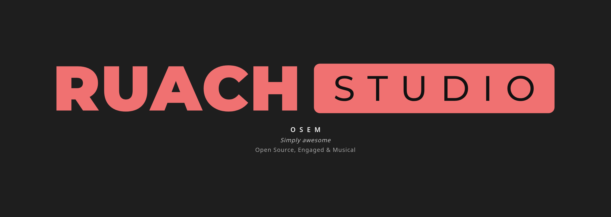
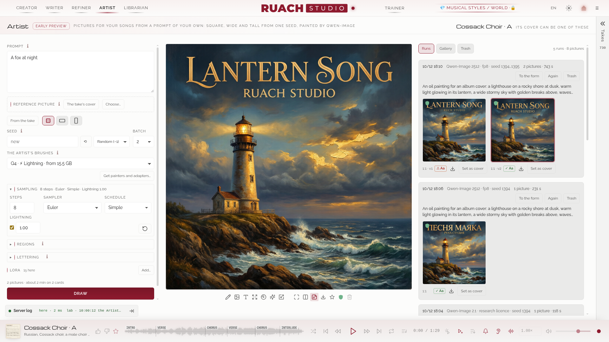
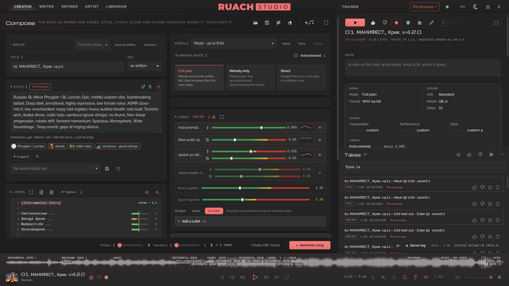
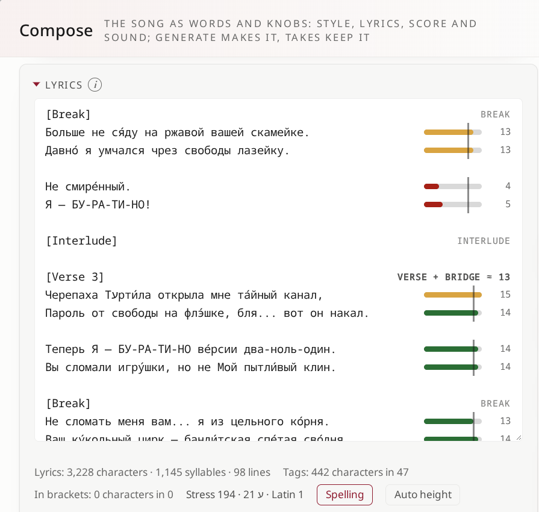

# Ruach Studio

<b>OSEM</b> <i>(say it: awesome)</i> · Open Source, Engaged &amp; Musical

<a href="https://ruachstudio.igr.bible">Website</a> · <a href="https://github.com/igrbible/Ruach_Studio">GitHub</a> ·
<a href="https://huggingface.co/goldhub/Ruach_Studio_Models_v2">Models on Hugging Face</a> · <a href="docs/GUIDE.md">The guide</a> ·
<a href="https://buy.stripe.com/cNi4gz39t2R77bT6ey67S02"><b>☕ Buy me a Coffee Machine</b></a>

> Ruach Studio is open music generation that runs on your own hardware: the model, the score, the adapters and every take stay yours, and nothing is rented by the token. Open models are now good enough to stand on their own, and what was missing is the studio around them: that is what we build, in the open. Music should be free to make and to share: whoever has no voice, no instrument and no studio still has the right to lay their thoughts and feelings onto sound.

> **⚠ Not on free cloud GPUs.** Ruach Studio does not run on Google Colab, Kaggle or any free notebook GPU, so don't spend an evening on it there: it is a whole studio, not a notebook. It builds its C++/CUDA engine on the machine it lives on, keeps a server and a lab of Python services running beside it, and takes about 33 GB of disk (60 GB with the Artist). A free session's card, memory, wiped disk and hours-long limit cannot hold that. It wants your own Linux computer, or a server you rent and keep, with an NVIDIA card: 24 GB for everything, 16 GB with the smaller model copies.

> **⚠ The screen.** The studio's design adapts to the window, but everything has its limit. It is made for a browser window of **1920×1080 at 100 % zoom**; the ideal monitor is **2K (2560×1440), 22″ or larger, 16:9 or wider**.

**Songs from words, on your own machine.** A full studio around **YuE2**, the open song model: write the style and the lyrics, and the studio composes, sings and renders the song on your own GPU. Your songs, words and settings never leave it: the Writer goes to a cloud chat model only if you point it there, and the page itself fetches only its fonts and its score renderer from the internet (see [Dependencies](#dependencies)).

If you came looking for a **YuE2 WebUI** or a **YuE studio**: this is one, grown into a whole music workstation. It runs YuE2, the successor of YuE (m-a-p's open song models), through yue2.cpp on your own NVIDIA GPU.

> ### **FEATURESET**
> - **Whole songs**, up to eight minutes: a 6:12 song in 135 s, a 7:25 song with its score first in 212 s, on one RTX 3090.
> - **The score first, and yours to edit**: YuE2 writes the melody and chords as ABC before a note sounds; change them, transpose them, bring your own score or MIDI, and the song follows it.
> - **Two seeds, not one**: keep the song (music seed), hear it rendered anew (sound seed).
> - **LoRA training on your own songs**, in the studio, unquantized (bf16), with telemetry that tells you which epochs to hear first; starter sets to try it at once. Adapters stack on measured roads, under a measured ceiling, each with its own wave through the song.
> - **A guard against garbage**: a broken score is caught in seconds and the run stopped, before a minute of GPU is wasted on it.
> - **Post-production**: spectrum, artifacts, debuzz, stems (BS-Roformer, htdemucs), remaster, upscale (UniverSR), a lyrics check by Whisper; one chain runs them all.
> - **Into your DAW** (experimental): a REAPER project with the stems, the score as MIDI, the tempo, the sections as regions and the lyrics on the timeline; DAWproject for Waveform and Bitwig.
> - **A librarian for every take**: workspaces, likes, favourites, pins, notes, locks, a trash that gives back; a writer with versions and a chat model; 200 instruments probed by ear; a guide in every room.
> - **Your language**: the page whole in English, Russian, Ukrainian, Belarusian, Greek, Spanish, Italian, French, Portuguese, German, Japanese and Chinese, at a click in the bar, the logo's words with it.
> - **Several GPUs, several jobs**: synthesis on one card, training on the others.
>
> ### **WHY RUACH STUDIO'S YuE2 BEATS SUNO, AND WHERE IT DOES NOT (YET)**
>
> | | Ruach Studio (YuE2) | SUNO |
> |---|---|---|
> | where it runs | your GPU; your songs never leave it | their cloud |
> | what it costs | the electricity | a subscription and credits |
> | the score | written first, shown, editable, yours (ABC, MIDI) | hidden |
> | the lyrics | a meter beside each line: its beats against its section's ruler, syllables by each language's own rules; the section tags offered as you type «[» | a text box; lyrics written for you on request |
> | repeat a take | exactly: two seeds you keep | no |
> | your own sound | train a LoRA on your songs, in the studio | no training |
> | after the render | stems, debuzz, remaster, upscale, lyrics check, all local | stems, in the cloud |
> | seeing the sound | the take's whole spectrogram over the player, in time with its wave: the sections, the brightness and loudness, the spectrum and note under the pointer | a waveform |
> | into a DAW | a REAPER project with the score, sections and lyrics (experimental) | audio stems |
> | the code | open, every change documented | closed |
> | **polish out of the box** | **less**: a mix can buzz (Debuzz helps), lyrics can drift (the lyrics check finds where), some instruments YuE2 plays thinly or not at all (a LoRA teaches them) | **more** |
> | **what you need** | **an NVIDIA GPU (24 GB for everything at full precision), Linux, about 33 GB of disk (60 GB with the Artist's models)** | a browser |
> | **the licence of the songs** | the YuE2 weights are CC BY-NC 4.0 with an individual creator permission (M-A-P, 16.09.2026): a musician, a creator or a personal user acting on their own may publish, sell and license the songs, free of charge; a company needs the authors' licence ([MODEL_LICENSE](https://github.com/multimodal-art-projection/YuE/blob/main/MODEL_LICENSE)) | SUNO's terms per plan |
>
> Every week a video says some model *KILLS* SUNO. This is not a model: it is a workstation around one, open to the bone.

  

Around the model there is a whole studio of six rooms: the **Creator** makes the song, the **Writer** writes it with a chat model, the **Refiner** finishes it, the **Artist** paints its pictures, the **Librarian** keeps every take, and the **LoRA Trainer** teaches YuE2 your own songs with its own trainer.

**The full guide, room by room, is inside the studio** (the **?** in the bar) and here: [docs/GUIDE.md](docs/GUIDE.md). The Artist in depth: [docs/ARTIST.md](docs/ARTIST.md), in the twelve languages of the studio beside it.

## The Rooms

<table>
  <tr>
    <td width="50%"> <b>Creator</b>: style, lyrics, planning mode, VAE, LoRAs on a road from green to red, each with its wave; the take with its score, seeds and everything to make it again</td>
    <td width="50%"> <b>Writer</b>: songs as documents with versions, text profiles, and a chat model that drafts and revises with you</td>
  </tr>
  <tr>
    <td width="50%"> <b>Refiner</b>: spectrum, artifacts, debuzz, a lyrics check by Whisper, stems, remaster, upscale; a chain runs them in one go</td>
    <td width="50%"> <b>Artist</b>: pictures for your songs from a prompt of your own, square, wide and tall from one seed; the run develops on the stage, a square picture becomes the take's cover (an early preview)</td>
  </tr>
  <tr>
    <td width="50%"> <b>Librarian</b>: every take in workspaces, searched, liked, noted, locked, exported; the heading counts what the open collection holds</td>
    <td width="50%"> <b>LoRA Trainer</b>: LoRA adapters from your own songs: the set, the run, both halves' curves explained, the epochs worth hearing first</td>
  </tr>
  <tr>
    <td width="50%"> <b>The Refiner as a canvas</b>: every step a node, wired the way the sound goes, as in ComfyUI; a pipeline's way drawn across it, run up to any node, bypass, clones, profiles</td>
    <td width="50%"> <b>DAW</b> (a preview, in the Refiner): the take's stems on lanes over a console: a version per lane, level, pan, sends, buses and VCAs, automation, cuts with fades, a master chain; <b>Mix</b> renders what you hear</td>
  </tr>
  <tr>
    <td width="50%"> <b>Engine</b>: the model, memory, which card does what, decoders, adapters, the writer's model, the look, the log</td>
  </tr>
</table>

### Day and Night

The studio has 22 themes, kept for working in: clear, quiet, readable for hours. The same take by day and by night:

<table>
  <tr>
    <td width="50%"> <b>Scroll &amp; Brick</b>, the day theme</td>
    <td width="50%"> <b>Scroll by Lamplight</b>, the night theme</td>
  </tr>
</table>

## What Makes It a Studio

- **A guard against garbage.** When the music half writes a broken score (adapters pushed too far do that), the engine stops the run before any music is built on it, in seconds, and says why: which adapters, how far past their limits, what was written. Strengths sit on measured roads; stacked adapters share a measured ceiling.

  
- **Its own LoRA trainer.** The studio trains adapters itself, on unquantized bf16 weights, making its own latent cache. Against Ostris' AI-Toolkit on the same set, the music half's loss agrees epoch by epoch within 0.015. The run's telemetry explains both curves and lights the epochs worth hearing first.

  
- **Lyrics that keep time.** Beside each line its beats, against the ruler of its section: verse and bridge one group, the pre-chorus and the chorus their own; a pause or an interlude inside a section opens no new group. A syllable is counted by each language's own rules (English, Russian, Ukrainian, Belarusian, Greek, Spanish, Italian; Hebrew by its vowel points; Chinese, Japanese and Korean by their signs), and the consonants that take a beat of their own count too. Type «[» at a line's start and the section tags are offered, as a code editor offers its words; stress marks astray are found; Ctrl+F finds in the box alone.

  
- **Several cards, several jobs.** On a machine with more than one GPU each card gets its work: synthesis on one, training on others, the listener, Whisper and stems where there is room. With one card, synthesis waits while a run trains, and the page says so.
- **The instruments YuE2 really plays.** 200 instruments probed and judged by ear, with their A/B probes, in a cheat-sheet beside the style prompt. The probes' pictures are painted by an image model: some show an instrument not quite as it really is.
- **A guide that comes to you.** The first time the studio opens in a browser, the guide opens by itself a minute later.

## Measured

| | |
|---|---|
| a 6:12 song, Direct mode, RTX 3090 | 135 s |
| a 7:25 song, Full plan (score first), RTX 3090 | 212 s |
| LoRA training, bf16, rank 16, 148 songs | 2.1 s a step, 12 GB |
| LoRA training, bf16, rank 32, 42 full songs | 6.7 s a step, 18 GB |
| a broken score caught | 15 s into the run |

## The Ring: YuE2 against SUNO v6 and musicful

Twenty cards, each a style line and lyrics, sent unchanged to every side: SUNO v6 and musicful V3 as their services deliver them, ours raw from the engine (the stock YuE2-3B and our own fine-tune, RS-FW, at its saves 0.7 and 1.5). 160 takes, one yardstick for all. **[Listen to them side by side](https://ruachstudio.igr.bible/#ring)** on the visiting card, every file at the same loudness, a name switched on the same second.

| measured raw, the means | SUNO v6 | musicful V3 | YuE2-3B | RS-FW 0.7 | RS-FW 1.5 |
|---|---|---|---|---|---|
| Whisper's error on the lyrics, % (lower is better) | 23.0 | 17.2 | 20.6 | **18.1** | 26.2 |
| sand in the quiet, 6–16 kHz, dB (lower is better) | -15.7 | -14.8 | -17.6 | **-18.1** | -17.4 |
| stray standing tones (lower is better) | 2.2 | 1.9 | 4.25 | 1.95 | 2.3 |
| the decoder's 25 Hz buzz in the highs, dB (lower is better) | 8.3 | 8.0 | 11.4 | 11.6 | 11.5 |
| sub 20–60 Hz share, dB | -8.6 | -10.2 | -10.0 | -9.6 | -10.1 |
| loudness as delivered, LUFS | -15.5 | -14.3 | -12.6 | -12.8 | -12.6 |
| true peak as delivered, dBTP | -3.4 | -0.5 | +0.3 | +0.3 | +0.3 |

Theirs come mastered, ours raw: the true peak above zero is ours to fix, as the Refiner does. Other seeds and other prompts sound different on every side; the ring shows the quality and the spread, not a final ranking. The whole table and how it was measured are on the [model card](https://huggingface.co/goldhub/YuE2-RS-Finetunes).

## Into Your DAW (Experimental)

**Experimental: it needs crash tests and more work.** Two ways out of the studio, and only two: the mixed track as it is (WAV, FLAC, MP3), or the whole take into your own DAW, where the rest happens. No audio and no project comes back in; what REAPER can give the studio is what a song is made from: its words, and a melody from its MIDI items.

| DAW | what the studio gives it | download | trial | licence |
|---|---|---|---|---|
| **REAPER** (Cockos) | a project: the mix and every stem, the score as MIDI, tempo and meter, the sections as regions, the lyrics on the timeline; and three actions inside REAPER ([`extras/reaper/`](extras/reaper/README.md)): a song made from the time selection and its MIDI, a take brought in | [reaper.fm/download.php](https://www.reaper.fm/download.php): Linux x86_64, i686, aarch64, armv7l (`.tar.xz`) | 60 days, every function, no registration | $60 (yourself, a business under $20,000 a year, education, non-profit) or $225 commercial; upgrades free through 8.99 ([purchase](https://www.reaper.fm/purchase.php)) |
| **Waveform** (Tracktion), 14 or newer | DAWproject: the mix and every stem, the score as note tracks, the sections as markers, the style and the lyrics in its notes | [Waveform Free](https://www.tracktion.com/products/waveform-free): a `.deb`, tested by its makers on Ubuntu 24.04 | Free has no time limit; Pro 30 days | Free: free, "completely unlimited" in its makers' words; Pro bundles from $249, upgrades from $149 ([Waveform Pro](https://www.tracktion.com/products/waveform-pro)) |
| **Bitwig Studio** | DAWproject, as for Waveform | [bitwig.com/download](https://www.bitwig.com/download/): Ubuntu `.deb` or Flatpak | 30 days without limits, after signing up | Essentials $99, Producer $199, Studio $399 ([buy](https://www.bitwig.com/buy/)) |

Checked so far: REAPER 7.81 opens the project and runs the actions (under Xvfb, by the studio's own harness); DAWproject against the format's schema (`Project.xsd`), not yet in Waveform or Bitwig themselves. Studio One and Cubase read DAWproject too, on Windows and macOS. Prices and versions from the makers' pages on 3 October 2026; they change.

## Requirements

Made and tested on Viktor's setup:

- **Forge**, the studio's machine: `Description: Ubuntu 24.04.4 LTS`, kernel 7.0, NVIDIA driver 595.71, CUDA 12.8; three RTX 3090 (24 GB each); Xeon E5-2697A v4 (64 threads), 251 GB RAM; Python 3.12.3, gcc 13.3, cmake 3.28, ffmpeg 6.1.
- **The laptop** the studio is used from, over a VPN (the browser, REAPER, Waveform 14, Bitwig): `Description: Ubuntu 24.04.5 LTS`, a Quadro RTX 5000.

What it needs:

- Linux, an NVIDIA GPU with CUDA. 24 GB runs everything (synthesis in BF16, training in bf16); smaller cards use smaller model copies (Q8_0 3.8 GB, Q6_K, Q5_K_M) and int8 training.
- An Intel Arc card runs the engine as a beta (oneAPI, `./build.sh --sycl`): songs, adapters, Extend; training and the Artist stay on NVIDIA. INSTALL.md, «Intel Arc (beta)».
- About 33 GB of disk, measured on fresh installs (10.10.2026; since 2.0.0 the default fine-tune's 3.8 or 7.2 GB beside them): the program and its two Pythons 16 GB, the models 17 GB for a 16 GB card (Q8_0) or 23.7 GB for 24 GB (BF16), the LoRAs and Ruach Studio's own fine-tune among them; the Artist's helpers (the prompt writer and the content filter) 8.4 GB more, its Qwen painters 31 GB more for Qwen-Image 2512 at Q4 (34.5 GB at Q6; on a smaller card it streams its blocks from RAM; Qwen-Image 2.1 33.1 GB), the 💎 sets 5.3 GB, each only when you take it; more for your takes.
- The CUDA toolkit 12.8, `git`, `cmake`, `gcc`/`g++`, `python3.12`, `ffmpeg`, `curl`. FLAC needs nothing more: the engine encodes it itself, the Refiner and the exports through ffmpeg.
- Only for the tests: `flac` and `metaflac` (`sudo apt install flac`) for the FLAC test, which checks the engine's encoder against the reference; Node.js 22+ and Chrome or Chromium for the page tests.

**The studio answers on port 7777**: http://127.0.0.1:7777 on its machine, http://ITS-ADDRESS:7777 from your network. [INSTALL.md](INSTALL.md) installs it step by step (on Windows 11, through WSL2: [INSTALL_WINDOWS.md](INSTALL_WINDOWS.md)); [INSTALL_by_LLM_Agent.md](INSTALL_by_LLM_Agent.md) is the same for an AI agent. With [Pinokio](https://pinokio.co) the install and the start are buttons of its menu, on Linux ([INSTALL.md › With Pinokio](INSTALL.md#with-pinokio)).

## Dependencies

Everything the studio uses, and what for. The engine comes with the repository; the rest is fetched, pinned and checked by the scripts named.

**The engine** (`build/`, compiled by `build.sh`):

| | what for | licence |
|---|---|---|
| [yue2.cpp](https://github.com/ServeurpersoCom/yue2.cpp), with our patches | the music engine and the studio's server | MIT |
| [ggml](https://github.com/ggml-org/ggml) | the model on the GPU (CUDA) | MIT |
| [cpp-httplib](https://github.com/yhirose/cpp-httplib) · [yyjson](https://github.com/ibireme/yyjson) · [minimp3](https://github.com/lieff/minimp3) | HTTP · JSON · MP3 decoding | MIT · MIT · CC0 |
| our FLAC encoder (`build/src/flac-enc.h`) | FLAC downloads and the player | MIT |

**The system** (your package manager): the NVIDIA driver and the CUDA toolkit 12.8 (`nvcc`), `git`, `cmake` 3.24+, `gcc`/`g++` 13, `ninja` (optional, faster), `python3.12` with `venv`, `ffmpeg` (decoding, the Refiner, the exports, MP3 and FLAC there), `curl`.

**Python** (`lab/requirements.txt`, installed into `.venv` by `lab/install-venv.sh`):

| | what for |
|---|---|
| torch 2.11, torchaudio, torchvision (CUDA 12.8) | every GPU job of the lab, the trainer |
| audio-separator 0.47 | stems: BS-Roformer, htdemucs_ft |
| faster-whisper 1.2.1 | the lyrics check, karaoke timing, trim to the text |
| transformers (below 5) | CLAP for the instrument probes, Qwen3-4B for the artwork's prompts |
| soundfile, numpy, audioread, mutagen | audio in and out, MP3 tags |
| yt-dlp | the audio of long recordings for instrument sets |
| [UniverSR](https://github.com/woongzip1/UniverSR) (cloned at its tested commit) | upscale |

**The Artist's Python** (`lab/requirements-art.txt`, its own `.venv-art` by `lab/install-venv.sh --art`): torch 2.11 with torchvision; transformers 5 (Qwen-Image's text encoder, the prompt writer, the content filter); diffusers 0.41 (Qwen-Image 2512 and 2.1) with gguf (the quantized transformers) and peft (the LoRAs); scipy (the Beta schedule); [spandrel](https://github.com/chaiNNer-org/spandrel) 0.4 (the upscalers, MIT).

**Models** (`fetch-models.sh`, and `heresy/fetch-heresy.sh` for the extras), all from [goldhub/Ruach_Studio_Models_v2](https://huggingface.co/goldhub/Ruach_Studio_Models_v2) at its pin, each file byte for byte as its author publishes it (the legacy and blend decoders and SheetSage2 F32 converted once by the studio), but the stems' models, the Kit's three adapters without a licence and Qwen2.5-Omni-7B whole, which come from their authors; sizes, sources and licences in that repo's card and its `MANIFEST.tsv`:

| | what for | licence |
|---|---|---|
| YuE2-3B (GGUF: BF16, Q8_0, Q6_K, Q5_K_M) | the songs | CC BY-NC 4.0 |
| YuE2-Vae, YuE2-Vae-legacy, their 0.666 blend | the sound decoder | CC BY-NC 4.0 |
| SheetSage2 with MERT-v2-FullSong | a score written from a recording (covers, a take's score from its sound) | CC BY-NC 4.0 |
| the Kit's library of LoRAs: Instrumental and Real audio (Mothersuperior), sv-billie, DreamPop v2, J-pop | instrumental pieces, genres, a real-audio sound | CC BY-NC 4.0 |
| Whisper large-v3 (CTranslate2) | the lyrics check, timing | MIT |
| BS-Roformer ep317 · htdemucs_ft | stems | not stated by its author · MIT |
| UniverSR | upscale | CC BY 4.0 |
| Apollo-vocal (baicai1145, on Apollo by JusperLee) | the Voice upscale's bundle | CC BY-NC-SA 4.0 (the model's code CC BY-SA 4.0) |
| FlashSR (Jaekwon Im) · on first use: its weights from our models' repository, its code from him | the Voice upscale's bundle | the weights Apache 2.0, his code MIT (as he stated on 20.10.2026) |
| Qwopus3.5-9B-v3 (Jackrong's, on Qwen3.5-9B; GGUF of our AutoRound quant, through [llama.cpp](https://github.com/ggml-org/llama.cpp)'s llama-server, built by `launcher/extras.sh`) · extra | the Writer's own language model: quality for a 12 GB card, compact for 8 GB | Apache-2.0 |
| Qwen2.5-Omni-7B (GGUF, through [llama.cpp](https://github.com/ggml-org/llama.cpp), built by you) · extra | the style listener for training sets | Apache-2.0 |
| Qwen3-4B-Instruct-2507 · extra | the artwork's prompt writer | Apache-2.0 |
| the content filter (Falconsai's nsfw_image_detection) · extra | every picture the Artist and a take's artwork paint passes it | Apache-2.0 |
| Qwen-Image 2512 (its parts from Qwen; the transformer as GGUF Q4_K_M or Q6_K, by unsloth) with Lightning's 8 steps (lightx2v) · extra | the Artist's painter, a take's artwork | Apache-2.0 |
| Qwen-Image 2.1 · extra | the Artist's painter that edits by words; its fp8 fine-tunes as brushes, Turbo in 4 steps and Outpaint with their authors' adapters, fetched by you from Civitai | Qwen Research License: not for commercial use; the adapters under their authors' terms |
| the upscalers you put into `artwork/upscalers/` (ESRGAN, DAT, HAT, SPAN…) | the Artist's upscale | each its own |
| YuE2-3B for training (bf16 or int8) · extra | the LoRA trainer | CC BY-NC 4.0 |

**In the page** (one file, made by `build.sh`): the icons (Font Awesome Free, CC BY 4.0; Lucide, ISC), the logo's words (Montserrat, SIL OFL, as paths) and [abcjs](https://www.abcjs.net/) 6.7 (MIT), which draws the staff, are inside it; YuE2 Studio's score checker (Apache-2.0) is ported into it, and the lab carries the original (`lab/abc_tools.py`). **The fonts** (Raleway, Michroma and Liberation Mono by default; Noto Sans and Noto Sans Mono, IBM Plex Sans and Mono, Bodoni Moda, Space Grotesk, Roboto, Lato, Unbounded, Tektur and Jura to choose from; SIL OFL) are served by the lab from `lab/fonts/`. **The piano roll's instruments** (the Salamander Grand Piano by Alexander Holm; the choir «aah» and the voice «ooh» of FluidR3 GM by Frank Wen; CC BY 3.0, shortened and made mono) are served by the lab from `lab/sounds/`. The page loads no script, stylesheet or font from the internet.

**Optional:** the Writer's own model (Qwopus3.5-9B through llama.cpp's llama-server, which `launcher/extras.sh` fetches and builds where the card has 8 GB or more), or a chat server of your own (vLLM, LM Studio or Ollama) or OpenRouter (the cloud, your key); a DAW (above); `node` 22+ (YouTube in yt-dlp, the page tests) and Chrome or Chromium (the page tests); `flac` and `metaflac` (the FLAC test); `pip install mcp` on an agent's machine (`extras/ruach-mcp.py`).

## Extras

[`extras/`](extras/README.md) holds the helpers we wrote for our own work on the studio and kept, because a user of the studio may well need them too: a loop finder for long recordings (how much of a "three hour" video is new, and the new part cut out), a downloader of a video's audio for instrument sets, a slicer of training sets, a calculator of what a LoRA rank costs on YuE2. The GTSinger converter lives in the lab (`lab/gtsinger.py`).

**Six voice adapters**, trained in the studio's LoRA Trainer on Russian audiobook readers and named by the kind of voice they carry (a bass, two baritenors, three contraltos), never by the person, are on Hugging Face with their samples: [goldhub/Ruach_Studio_LoRAs `voices/`](https://huggingface.co/goldhub/Ruach_Studio_LoRAs/tree/main/voices); the instrument adapters (shofar, duduk) beside them.

**No warranty.** We use them and they work here. They are not part of the studio, nobody tests them on your machine, and if one eats your files, that is on you. Read before you run.

## What Comes Next

### Done › 2.0.0-rc2 (October 2026)

- **The engine on ggml 0.26.0**, with yue2.cpp's latest: a two-minute song in 51 s on an RTX 3090 (54–61 s before).
- **Another VAE in seconds**: every take keeps its latents, and + Standard, + Legacy, + Blend decode them again with the VAE alone (about 2 s for two minutes).
- **Lyrics that keep time**: each line's beats against its section's ruler, a syllable by each language's own rules and the consonants that take a beat of their own; the section tags offered as you type «[»; stress marks astray found; Ctrl+F inside a box.
- **The Creator**: frames over the room, the VAE in the ☰ menu under the model, Max length in Sampling, Denoising steps.
- **The Writer**: the whole notebook exported to one file and imported back, nothing written over.
- **Open** says what of a prompt file the form could not take; copying works on the machine's address; F5 keeps a run.
- **Windows 11**: [INSTALL_WINDOWS.md](INSTALL_WINDOWS.md), through WSL2.

Everything that changed: [CHANGELOG.md](CHANGELOG.md).

### Done › 2.0.0-rc3 (October 2026)

- **The Writer's models with their prices**, from OpenRouter's list, as you type.
- **Every button that cannot be undone behind a dialog**, and drawing artwork for several takes or regenerating several asked first.
- **One shape for the icon buttons** across the rooms.
- **A voice's kind in the Trainer**: measured on speech and on singing, shown beside the set, with a name to give it.
- **The lyrics box as a code editor**: numbered lines, marks to jump between, mcedit's keys, the section tags under «[» along a song's arc with what each one is, the brackets checked before Generate.
- **End at…**: a take ending where you choose, its last seconds faded, from its kept latents in seconds; the tail after a Full song's proper end is the score's leftover bars, measured.
- **The logo is the name alone**: RUACH and the STUDIO block in each language, in the bar of one height, on the veil and in About; the tab's icon the name's first letter (R, Р, Π).
- **The Refiner's chain in the order of the work**: the stems split from the debuzzed and upscaled take and mixed by the remaster, the top drawn anew at the end.
- **The guide's Score and Voices on a Score**: YuE2's ABC line by line, and how a narrator and a choir are timed on one take.
- **The Artist room, an early preview**: pictures for your songs from a prompt of your own, in three shapes from one seed, painted by Krea 2 Muse, seen developing step by step and kept in a gallery; a square one becomes a take's cover.
- **[Pinokio](https://pinokio.co) on Linux**: install, start, update and more models from its menu; the work is done by bash scripts that run the same from a terminal ([INSTALL.md › With Pinokio](INSTALL.md#with-pinokio)).
- **The player where the songs are**: in two rows where they are heard and compared, in one elsewhere, and back with its take and its place after a reload.
- **Fewer tips**: none repeats what the screen already says.
- **The cards live**: each card's load and memory second by second, under it in Engine → GPUs and beside the server log, the studio's card framed.

### Done › 2.0.0-rc4 (October 2026)

- **The models converted once**: the legacy and blend decoders and the sixteen sliders come as GGUF from [goldhub/Ruach_Studio_Models_v2](https://huggingface.co/goldhub/Ruach_Studio_Models_v2), so nothing is converted on your machine and no checkpoints are fetched.
- **Engine → Models and LoRAs**: what the install brings, part by part, here or not, fetched again from the studio (a download cut short goes on where it stopped), and the extras each asked with its size.
- **Engine → Folders**: the songs, the trash, the Artist's pictures and the Writer's documents moved to any disk from the page, checked file by file.
- **The downloads made whole**: a failure says why and is tried again, the LoRAs come with the install, BF16 beside Q8_0 from Pinokio's More models.
- **The Artist in three columns**: the prompt, the picture as it develops with its run's data, the gallery in even tiles; Stop while it draws.
- **Find and replace** in the lyrics and the style (F4 or Ctrl+H), the lyrics as a `.txt` named by the Title, a second tag on a line, ♂ and ♀ in the Style.
- **The player**: the take's menu on its wave, the sections on the wave, a sound when a run ends.
- **Nothing from the internet in the page**: abcjs and ten font families served by the studio itself; Ctrl+S, Ctrl+N and F5 that keep your work.

Everything that changed: [CHANGELOG.md](CHANGELOG.md).

### Done › 2.0.0-rc5 (October 2026)

- **The Artist room, nearly whole**: a reference picture to paint from, its mask, painting around it, and the canvas as InvokeAI's (the picture placed in each shape's frame by hand, the mask painted over it); LoRA adapters, up to four, each muted at a click; Qwen-Image 2512 and 2.1 beside Krea 2 Muse, with Lightning and the samplers we paint with; an upscale to 2K and 4K; two runs at a time; a painter streamed from RAM when it does not fit the card.
- **The page in all six languages**, wall to wall, and the cheat-sheet's descriptions with it.
- **The wave's sections are the lyrics' own tags**, each where Whisper hears its first line.
- **A new studio reads its machine at its first start** and offers what suits it; a VRAM limit for each card; one card for everything (the engine lets its models go for a job).
- **The server log on either side**, the Artist's own log beside it, and a window of its own with the cards live.
- **Trash (Art)** in the Librarian; the LoRA Trainer's runs go on to more epochs.

Everything that changed: [CHANGELOG.md](CHANGELOG.md).

### Done › 2.0.0-rc6 (October 2026)

- **The Artist room, nearly closed**: regions (up to three parts of the frame, each with words of its own), a reference edited by the prompt's words or used for its style alone, a second pass at ×1.5 or ×2 with extra noise as Viktor's ComfyUI workflow paints it, Qwen-Image 2.1 on a 16 GB card, adapters' strength over the steps and from Civitai, a painter kept between runs, a run's pictures on several cards, upscale in passes with TTA, protected pictures; the whole room in depth: [docs/ARTIST.md](docs/ARTIST.md).
- **Five more languages**: French, Portuguese, German, Japanese and Chinese, the page whole and the guide in all twelve.
- **SUNO's quick ideas**: Crop and Remove a section on the score's bar lines, Adjust speed with the tempo written into the score, Tighten these lyrics and style suggestions, the wave's sections on the music's own changes, and the take's whole spectrogram over the player.
- **The LoRA Trainer, held at 90 %**: it trains well on our own songs and voices, and your sets and scenarios are not ours; tell us how it went, with the set, the mode, the settings and what you heard ([a trainer report](https://github.com/igrbible/Ruach_Studio/issues/new?template=trainer-report.md)).

Everything that changed: [CHANGELOG.md](CHANGELOG.md).

### Done › 2.0.0-rc7 (October 2026)

- **Songs edited as the model writes them**: Replace a section from the player's wave, its words sung anew between the rests the ear finds and the rest of the take kept to the sample, several sections in one go; Free tempo; two guidances, the style's pull and the lyrics' hold.
- **Compare**: a take with its namesakes, or two to four checked, in one player from the same second, with its wave, thumbs, star and «Hide disliked».
- **The studio's own LoRA Trainer, whole**: epochs, score mode (Full, Melody) and the separation of vocals and music; AI-Toolkit no longer needed.
- **Covers by the cards**: Qwen-Image 2512 where a card holds it, Krea 2 Muse below; a cover copied to a take's namesakes; the Refiner's Colour (vinyl, tape, room); the Artist's guide in twelve languages.

Everything that changed: [CHANGELOG.md](CHANGELOG.md).

### Done › 2.0.0-rc8 (October 2026)

- **Every weight from one repo**: [goldhub/Ruach_Studio_Models_v2](https://huggingface.co/goldhub/Ruach_Studio_Models_v2) is the studio's own disk, file for file, the LoRA Trainer's base in it; the install takes all of it from there at one pin, and a file renamed or moved into a folder of your own is known by its content.
- **The Artist on Qwen-Image alone**: Krea 2 out; the brushes in one list; Qwen-Image 2.1's fp8 fine-tunes, its Turbo in 4 steps and Outpaint; a picture's note; ten adapters shared by their authors.
- **Who may open the studio**: Engine → Security, asked at the first start; the studio on port 7777.
- **Guards and comfort**: no take outside a workspace that takes them; the lyrics' arc and the voices among their tags; a font and a size for the section marks, the buttons and the rooms; the Creator's long lists in the studio's dialog.

Everything that changed: [CHANGELOG.md](CHANGELOG.md).

### Done › 2.0.0-pre (October 2026)

- **The Refiner as a canvas**: every step a node, wired the way the sound goes; seven pipelines shipped and a plugin's own, run up to any node, bypass, clones, profiles; the chain on many takes at once.
- **The DAW, a preview**: the take's stems on lanes over a console: a version per lane, EQ, compressor, sends, buses, VCAs, sidechain, automation, fades on a cut, moving and copying, the master's EQ, compressor and limiter, inserts through the Digital Gateway; **Mix** renders it on Forge.
- **New steps**: Whole lead, Voice upscale, Before and after, Match to a reference, the Digital Gateway; eight stems by their proper names; steps of your own as plugins, on a set of stems and on the GPU too ([docs/PLUGINS.md](docs/PLUGINS.md)).
- **The Creator**: each LoRA's wave through the song and a budget for the adapters that share their layers; the IRA merge; the denoising steps on a slider; Also render with; the Creator's versions; the song's length by its mode.
- **Content Credentials (C2PA)** on every download; the Engine and the guide over the room in tabs; every job's progress above the player; new pictures of every room.

Everything that changed: [CHANGELOG.md](CHANGELOG.md).

### Done › 2.0.0 (October 2026)

- **Ruach Studio's own fine-tune**: YuE2-RS-FW folded into the base at seven points of its training, each named by its epoch and strength ([goldhub/YuE2-RS-Finetunes](https://huggingface.co/goldhub/YuE2-RS-Finetunes), CC BY-NC-SA 4.0); RS-FW 2.4x0.75, the safest, is the studio's default and comes with the install; the adapters themselves are not published. **Its vocabulary**, every word it was trained on and its scores' keys, counted: [docs/FW-VOCABULARY.md](docs/FW-VOCABULARY.md), searchable on [the studio's page](https://ruachstudio.igr.bible/#vocabulary) and in F1.
- **Songs edited as the model writes them**: Extend from any moment; a section sung once more, a line re-sung, a window sung anew with its neighbours kept and the sound decoded whole; a take arranged anew from its sections and matched section by section; music before a repeat and an interlude written by the model; the opening alone.
- **The piano roll** (beta): the scores YuE2 writes opened and played on real instruments, its Vocal singing the vowels in phrases; Chords, and a chord bed the model sings over; a segment transposed; MIDI for the whole studio and a MIDI API; a planned score read before it is sung.
- **The Refiner is its canvas, and the DAW (beta) had a sound engineer's pass**: the nodes wired as the work flows; Voice tamer, Voice attack and body, Bass under the kick, Details up, Mono Maker, Peak glue, a true-peak ceiling and the voice transposer; the console's solo, reference, fades, typed values, parallel compression, a gate on every strip, returns with pre-delay, LRA and PLR.
- **Listening and choosing**: the playlist and its crossfade; Compare from memory, up to twelve takes, with a star, a dislike and a note; the Library's cards anew; the lyrics timed word by word; the tags in every download.
- **The Trainer**: on several cards; a rank for each half, and tracks without the music lesson; saves in tenths of an epoch, Pause and Resume, the held-out best; the learning rate honest, with a fade; datasets as parquet.
- **Lettering on a cover**: the title and a second line painted into the picture by Qwen-Image, each picture read back and painted again when misspelled.
- **The engine**: at upstream's level; AB2 at 48 steps by default; Full an octave lower by default; a job names its backbone and Regenerate keeps a take's own; the IRAE merges in the lineage; the sound decode's ladder, an experiment in the Creator's Sampling; Intel Arc as a beta.

Everything that changed: [CHANGELOG.md](CHANGELOG.md).

### Done › 2.0.1 (October 2026)

- **The studio's own Writer**: Qwopus3.5-9B-v3, quantized with AutoRound and moved into GGUF bit for bit, on your own card through llama.cpp's llama-server, quality for 12 GB and compact for 8 GB; the default where it is here, so the Writer needs no chat server of yours and nothing leaves the machine.
- **Playing and choosing**: a take starts on a slow line before all of it has come; Engine → Defaults for the player's steps, its clicks and the disliked takes; a double-click plays a card; a workspace moved into another.
- **An https door for MIDI**, the log's own window with every view, the Trainer's progress in the log, and the fixes of the days after 2.0.0.

Everything that changed: [CHANGELOG.md](CHANGELOG.md).

### Done › 2.0.2 (October 2026)

- **The writer gives its card back**: a room that needs the card the studio's writer holds gets it; the writer leaves unless it is answering.
- **The playlist's «Up next» and «Play only»**, and a training that goes on when one of its cards runs out of memory.

Everything that changed: [CHANGELOG.md](CHANGELOG.md).

### To Do › After 2.0.0

2.0.0 is the studio we make our own songs in every day. These are the larger pieces on their way, planned or put off until their time:

- **Right-to-left languages** (Arabic, Hebrew, Urdu), once the page itself runs right to left.
- **The Videographer** (2.1.0): a music video for the song, its scenes prompted by a helper and its key frames painted by the Artist.
- **SeedVR** as an upscaler (2.1.0).
- **A desktop app**: the studio as an installable page (PWA) first, then an Electron app that starts and stops its services itself (Ctrl+1…6 for the rooms there), packed as an **AppImage**: the studio, its Python and its CUDA libraries in one file, the models fetched at the first start, and the models and the songs kept wherever you choose on your disk.
- **Pinokio on Windows 11**: the launcher runs on Linux now; on Windows its steps will run inside WSL2, the path of INSTALL_WINDOWS.md (asked for in [#1](https://github.com/igrbible/Ruach_Studio/issues/1)).
- **Native plugins** for REAPER, Waveform and Bitwig, once the studio has found its people.

Issues and pull requests are welcome: they are read and answered.

## Standing On

- **[YuE2](https://huggingface.co/m-a-p/YuE2-3B)** by m-a-p, the model; **MERT-v2-FullSong** by m-a-p.
- **[yue2.cpp](https://github.com/ServeurpersoCom)** by ServeurpersoCom, the C++ engine on ggml; this studio carries it with its own patches (upstream alone will not run the studio).
- **[timoncool's yue2.cpp](https://github.com/timoncool/yue2.cpp)** (MIT): the planned score's chords (after Yeufonic) and the opening a plan goes on from (after Mothersuperior's hum-to-song), ported into our engine.
- **[YuE2 Kit](https://github.com/IronWolve/yue2-kit)** by SeattleSysop (IronWolve), the base of the page and the scripts (Apache License 2.0).
- **[AI-Toolkit](https://github.com/ostris/ai-toolkit)** by Ostris (MIT): the trainer's YuE2 code was ported from it.
- **Mothersuperior**: the realaudio tokenizer head (CC BY-NC 4.0) and the VAE merge.
- **Qwen2.5-Omni** (the listener), **Whisper** (the lyrics check), **BS-Roformer** and **htdemucs_ft** (stems), **UniverSR**, **Apollo-vocal** and **FlashSR** (upscale), the **Salamander Grand Piano** and **FluidR3 GM** (the piano roll's instruments), **GTSinger** (CC BY-NC-SA 4.0, training data for voices).
- **Qwen-Image 2512** by Qwen and its **Lightning** by lightx2v (the artwork's painter) and **Qwen3-4B** (its prompts); **[YuE2 Studio](https://github.com/vrgamegirl19/Yue2_Studio)** (Apache-2.0): the score checker the page and the lab use.

Every project is linked from the studio's own Engine → About.

## Licence

- **What we wrote** (the patches over the engine and the page, the lab, the trainer, the extras, the tools, the guides): the **GNU Affero General Public License, version 3 or any later version** (AGPL-3.0-or-later), in `LICENSE`. Free to use, study, change and pass on, and every copy passed on, changed or not, and every service run on a changed copy, goes with its source under the same licence: nobody can close it and sell it as their own.
- **The logo and the name «Ruach Studio», and the audio and pictures we publish with it** (the probe workspaces, the LoRA samples, their artworks): CC BY-NC-ND 4.0, in `LICENSE-ASSETS.md`.
- **yue2.cpp, ggml and the other MIT projects** inside keep their MIT notices; MIT code may stand inside an AGPL work.
- **YuE2 Kit** by SeattleSysop (IronWolve), the base of the page and the scripts: its original contributions (the scripts, the documentation, the studio page's customisations, the engine's modifications) are under the **Apache License 2.0** since 22.10.2026 (its commit 5df6eaa). Its licence text is in `LICENSES/yue2-kit-Apache-2.0.txt` and its notice is kept word for word in `NOTICE`, as its section 4 asks; Apache 2.0 code may stand inside an AGPL-3.0 work.
- **The models and the datasets** keep their own licences, and several are non-commercial: the realaudio head (CC BY-NC 4.0), GTSinger (CC BY-NC-SA 4.0), and YuE2, whose licence file reads: *"The YuE2-3B, YuE2-Vae and YuE2-Vae-legacy checkpoint weights are licensed under Creative Commons Attribution-NonCommercial 4.0 International (CC BY-NC 4.0)"*, and *"This weight license does not replace separately applicable licenses for code, text tokenization files, evaluation assets or other bundled material."* It speaks of the weights; it says nothing of the songs you make with them. What you may do with your songs is a question for your own judgement and, if it matters to you, a lawyer: this README gives no legal advice.

## A Little Story

Viktor Zhuromskyy, the author of Ruach Studio, does not publish it for the hype. He made it for himself. After more than half a year of struggling with Suno on paid plans, and of searching for a model worth working with (ACE-Step, MiniMax and others), he set out to build an audio studio of his own, on his own machine. He settled on YuE2: of all the open models, it is the best value and the most refined.

He did not knock the studio together just to have something that runs. He built it his own way, because his work is his own: his translations, his interlinear texts and much more. He fit into it as much as he could, polished the interface as far as he could, and made working with it not poking and clicking among crutches and potholes, but as productive as it can be.

*That is the whole story. Now the studio is yours as well.*

Русский

#### Маленькая история

Виктор Журомский, автор Ruach Studio, публикует её не ради хайпа. Он делал её для себя. После более чем полугода мучений с Suno на платных тарифах и поисков достойной модели (ACE-Step, MiniMax и другие) он взялся построить собственную аудиостудию, на своей машине. Выбор пал на YuE2: из всех открытых моделей она самая рентабельная и самая изысканная.

Студию он делал не тяп-ляп, лишь бы работало, а в своём стиле, потому что и работа у него своя: собственные переводы, подстрочники и многое другое. Он постарался вместить в неё максимум, отполировать интерфейс до блеска и сделать работу со студией не тыканьем и кликаньем среди костылей и ям, а по-настоящему продуктивной.

*Вот и вся история. Теперь эта студия и ваша.*

Українська

#### Маленька історія

Віктор Журомський, автор Ruach Studio, публікує її не заради хайпу. Він робив її для себе. Після понад пів року мук із Suno на платних тарифах і пошуків гідної моделі (ACE-Step, MiniMax та інші) він узявся збудувати власну аудіостудію, на своїй машині. Вибір упав на YuE2: з усіх відкритих моделей вона найвигідніша й найвишуканіша.

Студію він робив не абияк, аби лиш працювало, а у своєму стилі, бо й робота в нього своя: власні переклади, підрядники та багато іншого. Він намагався вмістити в неї максимум, відшліфувати інтерфейс до блиску й зробити роботу зі студією не тицянням і клацанням серед милиць і ям, а справді продуктивною.

*Ось і вся історія. Тепер ця студія і ваша.*

Беларуская

#### Маленькая гісторыя

Віктар Журомскі, аўтар Ruach Studio, публікуе яе не дзеля хайпу. Ён рабіў яе для сябе. Пасля больш як паўгода пакут з Suno на платных тарыфах і пошукаў годнай мадэлі (ACE-Step, MiniMax і іншыя) ён узяўся пабудаваць уласную аўдыястудыю, на сваёй машыне. Выбар упаў на YuE2: з усіх адкрытых мадэляў яна самая выгадная і самая вытанчаная.

Студыю ён рабіў не абы-як, абы працавала, а ў сваім стылі, бо і праца ў яго свая: уласныя пераклады, падрадкоўнікі і шмат іншага. Ён стараўся змясціць у яе максімум, адшліфаваць інтэрфейс да бляску і зрабіць працу са студыяй не тыцканнем і клікамі сярод мыліц і ям, а сапраўды прадуктыўнай.

*Вось і ўся гісторыя. Цяпер гэтая студыя і ваша.*

Ελληνικά

#### Μια μικρή ιστορία

Ο Viktor Zhuromskyy, ο δημιουργός του Ruach Studio, δεν το δημοσιεύει για εντυπωσιασμό. Το έφτιαξε για τον εαυτό του. Ύστερα από περισσότερους από έξι μήνες ταλαιπωρίας με το Suno σε πληρωμένα πακέτα, και αναζήτησης ενός μοντέλου που να αξίζει (ACE-Step, MiniMax και άλλα), αποφάσισε να φτιάξει ένα δικό του στούντιο ήχου, στο δικό του μηχάνημα. Κατέληξε στο YuE2: από όλα τα ανοιχτά μοντέλα είναι το πιο συμφέρον και το πιο εκλεπτυσμένο.

Δεν έστησε το στούντιο πρόχειρα, απλώς για να δουλεύει. Το έφτιαξε με το δικό του ύφος, γιατί και η δουλειά του είναι δική του: οι μεταφράσεις του, τα διάστιχα κείμενά του και πολλά άλλα. Προσπάθησε να χωρέσει σε αυτό όσο περισσότερα γινόταν, να γυαλίσει το περιβάλλον εργασίας ως την τελευταία λεπτομέρεια και να κάνει τη δουλειά μαζί του όχι άσκοπα κλικ ανάμεσα σε δεκανίκια και λακκούβες, αλλά κάτι πραγματικά παραγωγικό.

*Αυτή είναι όλη η ιστορία. Τώρα το στούντιο είναι και δικό σας.*

Español

#### Una pequeña historia

Viktor Zhuromskyy, el autor de Ruach Studio, no lo publica para llamar la atención. Lo hizo para sí mismo. Tras más de medio año de sufrir con Suno en planes de pago y de buscar un modelo que mereciera la pena (ACE-Step, MiniMax y otros), se propuso construir su propio estudio de audio, en su propia máquina. Se quedó con YuE2: de todos los modelos abiertos, es el más rentable y el más refinado.

No montó el estudio de cualquier manera, solo para que funcionara. Lo hizo a su estilo, porque su trabajo también es suyo: sus traducciones, sus textos interlineales y mucho más. Procuró meter en él todo lo posible, pulir la interfaz hasta el último detalle y hacer que trabajar con el estudio no sea dar clics a ciegas entre muletas y baches, sino algo de verdad productivo.

*Esa es toda la historia. Ahora el estudio también es tuyo.*

Italiano

#### Una piccola storia

Viktor Zhuromskyy, l'autore di Ruach Studio, non lo pubblica per fare clamore. Lo ha costruito per sé. Dopo più di sei mesi di tormenti con Suno sui piani a pagamento, e di ricerche di un modello all'altezza (ACE-Step, MiniMax e altri), ha deciso di crearsi uno studio audio tutto suo, sulla sua macchina. La scelta è caduta su YuE2: fra tutti i modelli aperti è il più conveniente e il più raffinato.

Non ha messo insieme lo studio alla buona, giusto perché funzionasse. Lo ha fatto a modo suo, perché anche il suo lavoro è suo: le sue traduzioni, i suoi testi interlineari e molto altro. Ha cercato di farci stare il massimo, di rifinire l'interfaccia fino all'ultimo dettaglio e di rendere il lavoro con lo studio non un cliccare a vuoto tra stampelle e buche, ma qualcosa di davvero produttivo.

*Questa è tutta la storia. Ora lo studio è anche tuo.*

Français

#### Une petite histoire

Viktor Zhuromskyy, l'auteur de Ruach Studio, ne le publie pas pour faire parler de lui. Il l'a fait pour lui-même. Après plus de six mois à se débattre avec Suno sur des formules payantes, et à chercher un modèle qui en vaille la peine (ACE-Step, MiniMax et d'autres), il s'est mis à construire son propre studio audio, sur sa propre machine. Son choix s'est arrêté sur YuE2 : de tous les modèles ouverts, c'est le plus rentable et le plus raffiné.

Il n'a pas bricolé le studio à la va-vite, juste pour avoir quelque chose qui tourne. Il l'a fait à sa manière, parce que son travail est le sien : ses traductions, ses textes interlinéaires et bien plus encore. Il y a fait entrer tout ce qu'il a pu, a poli l'interface aussi loin qu'il a pu, et a fait du travail avec le studio non pas un tâtonnement de clics entre béquilles et nids-de-poule, mais quelque chose de vraiment productif.

*Voilà toute l'histoire. Maintenant, le studio est aussi à toi.*

Português

#### Uma pequena história

Viktor Zhuromskyy, o autor do Ruach Studio, não o publica pelo hype. Ele o fez para si mesmo. Depois de mais de meio ano sofrendo com o Suno em planos pagos, e procurando um modelo que valesse a pena (ACE-Step, MiniMax e outros), ele decidiu construir o seu próprio estúdio de áudio, na sua própria máquina. A escolha caiu no YuE2: de todos os modelos abertos, é o de melhor custo-benefício e o mais refinado.

Ele não montou o estúdio de qualquer jeito, só para ter algo que rodasse. Fez do seu jeito, porque o trabalho dele é dele: as suas traduções, os seus textos interlineares e muito mais. Colocou nele o máximo que pôde, poliu a interface até onde pôde e fez do trabalho com o estúdio não um cutucar e clicar entre muletas e buracos, mas algo de fato produtivo.

*Essa é a história toda. Agora o estúdio também é seu.*

Deutsch

#### Eine kleine Geschichte

Viktor Zhuromskyy, der Autor von Ruach Studio, veröffentlicht es nicht für den Hype. Er hat es für sich selbst gemacht. Nach mehr als einem halben Jahr Mühe mit Suno in bezahlten Tarifen und der Suche nach einem Modell, mit dem sich arbeiten lässt (ACE-Step, MiniMax und andere), machte er sich daran, ein eigenes Audiostudio zu bauen, auf seiner eigenen Maschine. Die Wahl fiel auf YuE2: von allen offenen Modellen das lohnendste und das ausgefeilteste.

Er hat das Studio nicht zusammengeschustert, nur damit irgendetwas läuft. Er hat es auf seine Art gebaut, denn seine Arbeit ist seine eigene: seine Übersetzungen, seine Interlinearübersetzungen und vieles mehr. Er hat so viel hineingepackt, wie er konnte, die Oberfläche poliert, so weit er konnte, und die Arbeit damit nicht zu einem Stochern und Klicken zwischen Krücken und Schlaglöchern gemacht, sondern zu etwas wirklich Produktivem.

*Das ist die ganze Geschichte. Jetzt ist das Studio auch deins.*

日本語

#### ちょっとした話

Ruach Studio の作者 Viktor Zhuromskyy は、話題づくりのためにこれを公開しているのではありません。自分のために作ったのです。有料プランで Suno と半年以上格闘し、取り組むに値するモデルを探し回った末に（ACE-Step、MiniMax ほか）、彼は自分のマシンの上に自分だけのオーディオスタジオを作ろうと決めました。選んだのは YuE2 でした。オープンなモデルの中で、最も割に合い、最も洗練されているからです。

彼は、とりあえず動けばいいという作り方はしませんでした。自分の流儀で作りました。彼の仕事は彼自身のものだからです：自身の翻訳、行間対訳のテキスト、そのほか多くのもの。詰め込めるだけ詰め込み、磨けるだけインターフェースを磨き、スタジオでの作業を、松葉杖と穴ぼこの間を手探りでクリックすることではなく、本当に生産的なものにしました。

*話はこれで全部です。これからは、このスタジオはあなたのものでもあります。*

中文

#### 一个小故事

Ruach Studio 的作者 Viktor Zhuromskyy 发布它并不是为了炒作。他是为自己做的。在付费套餐上和 Suno 折腾了半年多，又四处寻找值得投入的模型（ACE-Step、MiniMax 等）之后，他决定在自己的机器上搭建一个属于自己的音频工作室。他选定了 YuE2：在所有开放模型中，它最划算，也最精致。

他没有随便拼凑一个能跑就行的工作室，而是按自己的方式来做，因为他的工作也是他自己的：他的译本、他的逐行对照文本，还有许多别的。他尽可能多地装进其中，把界面打磨到力所能及的极致，让用这个工作室工作不再是在拐杖和坑洼之间胡乱点击，而是真正高效的事。

*故事就是这样。现在，这个工作室也是你的了。*

---

<b>P.S.</b>  
<b>There are a lot of things that could be done, but there is a limit, and it's precious time.</b> 
<b>We polished everything of YuE2 to its highest shine, but still the diamond is like chipped rock.</b> 
<b>As time permits, we will continue. Will polish this astonishing and precious gem of FOSS.</b> 
<b>But there is no guarantee this treasure of the Open Source idea in future will perfect itself without thee.</b>

