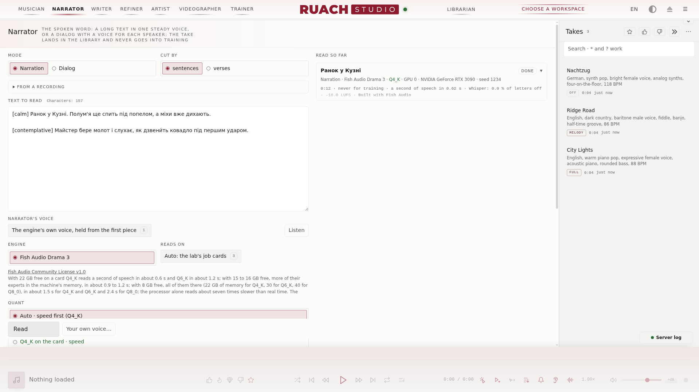
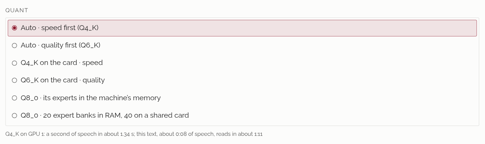

## קריין <!-- #narrator -->

הקריין, החדר שאחרי הווידאוגרף, הופך טקסט לקול: פרק, ספר, תסכית, פודקאסט, קול מעל קליפ. הוא קורא בקול יציב אחד או כדיאלוג של כמה קולות, מאזין לכל קטע שקרא, ומכניס את הטייק לספרייה בדיוק כמו שיר.



### מה הוא עושה <!-- #what-it-does -->

**מצב** נותן שתי דרכים לקרוא. **קריינות**: קול אחד קורא את כל הטקסט, שנחתך לפי **משפטים** (קטעים של כמאתיים תווים; שורה ריקה היא הפסקה ארוכה יותר) או לפי **פסוקים** (שורה לכל קטע; מספר הפסוק ומספרי סטרונג לא נקראים); הקטע הראשון שנמשך 2.5 s ומעלה הופך לייחוס של כל קטע שאחריו, וכך הקול מחזיק לאורך פרק שלם. **דיאלוג**: שורה לכל תור דיבור, בכתיב `Name: words`, וקול לכל דובר; שורה בלי שם ממשיכה את התור שלפניה.

הכפתור **קריאה** מתחיל את ההרצה. היא ממתינה בתור כמו שאר המשימות הכבדות של המעבדה, עם פס ההתקדמות שלה מעל הנגן והשורות שלה ביומן. הכרטיס שלה מציין את הקוונט ואת הזמן שנותר בזמן שהיא קוראת; וכשהיא מסתיימת, את האורך, את המהירות שלה, את מה ש-Whisper שמע ואת העוצמה.

### המנוע: Drama 3 <!-- #the-engine-drama-3 -->

הקריין קורא עם Fish Audio Drama 3 (35B MoE, 3B פעילים) דרך audio.cpp, מקוונטים של GGUF שב-`models/narrator/drama-3-gguf/`, ולצידם קובצי ה-LICENSE וה-NOTICE שלו; בלעדיהם המנוע לא נטען. הוא קורא רוסית, אוקראינית, עברית, יוונית, אנגלית, ספרדית, איטלקית, צרפתית, פורטוגזית, גרמנית, יפנית וסינית. מנוע משלך מתחבר ב-`user/reader/engines/` עם `engine.json` משלו, ומופיע לצידו בבורר **מנוע**.

### הקוונטים והמהירות שלהם <!-- #quants-and-their-speed -->



**קוונט** אומר איזה קוונט קורא והיכן. **אוטומטי · איכות תחילה** (ברירת המחדל) בוחר ב-Q8_0 בכל מקום שהוא נכנס: 20 בנקי מומחים ב-RAM בכרטיס עם 23.6 GB פנויים, ואחרת כל 40 הבנקים בזיכרון המחשב, בכרטיס עם 7.4 GB פנויים ו-40 GB זיכרון פנוי; אחריו Q6_K; ו-Q4_K רק היכן שאף אחד מהם לא נכנס (כרטיס קטן, מעט זיכרון) ובכרטיס Intel. **אוטומטי · מהירות תחילה** בוחר קודם ב-Q4_K. שניהם בוחרים לפי הזיכרון הפנוי ברגע שההרצה מתחילה; וכשבוחרים ברשימה קוונט מסוים, ההרצה נצמדת אליו. Q8_0 הוא ברירת המחדל כי הוא יצא הנקי ביותר לאוזן: בבדיקה הגולמית של 09.11.2026 אף טייק של Q8_0 לא סומן כשגוי מתוך 20, של Q6_K אחד מתוך 20, של Q4_K שבעה מתוך 50, וכל הסימונים באותו תפר של אותו משפט. ההתקנה מורידה את Q8_0 (41.1 GB) כשלכרטיס הגדול ביותר במחשב יש 24 GB או יותר, ואחרת את Q4_K (24.9 GB); בכרטיס קטן יותר `bash tools/narrator-setup.sh --quant Q8_0` מוריד את Q8_0 לצידו. בלעדיו אוטומטי קורא בקוונט שנמצא כאן. השורה שמתחת לבורר אומרת מה היה קורא עכשיו ובאיזה כרטיס, תוך כמה שניות נקראת שנייה של דיבור, וכמה זמן ייקח הטקסט הזה כולל טעינת המודל.

נמדד על RTX 3090 אחד ב-09.11.2026, עם קטע ברוסית של 27 s. RTF הוא מספר השניות שלוקח לקרוא שנייה אחת של דיבור; Whisper שמע כל אות נכון, אלא אם כתוב אחרת בשורה:

| קוונט | בנקי מומחים ב-RAM | בכרטיס | RAM | RTF | איך נמדד |
|---|---|---|---|---|---|
| Q4_K | 4 | 21.5 GiB | 3 GiB | 0.62 | הכרטיס לבדו |
| Q6_K | 16 | 21.9 GiB | 11.2 GiB | 1.16 | הכרטיס לבדו |
| Q8_0 | 20 | 23.0 GiB | 17.3 GiB | 1.37 | הכרטיס לבדו |
| Q8_0 | 40 | 6.9 GiB | 33.2 GiB | 2.43 | הכרטיס לבדו |
| Q4_K | 20 | 15.7 GiB | 9.8 GiB | 1.34 | לצד משימת סט נתונים |
| Q6_K | 28, cuda_perf | 13.8 GiB | 18.6 GiB | 1.74 | לצד משימת סט נתונים; מילה אחת נשמעה לא נכון |
| Q4_K | 40, cuda_perf | 7.3 GiB | 18.3 GiB | 1.75 | לצד משימת סט נתונים |
| Q6_K | 40, cuda_perf | 7.3 GiB | 26.0 GiB | 2.46 | לצד משימת סט נתונים |
| Q8_0 | המעבד לבדו | — | 44 GB | 7.0 | המעבד |

השורות שנמדדו לצד משימת סט נתונים פסימיות: כוח החישוב של הכרטיס והמעבד היו משותפים איתה, ובכרטיס שאינו משותף אותן תצורות קוראות מהר יותר. **Q8_0 · 20 בנקי מומחים ב-RAM, 40 בכרטיס משותף** נשאר ב-Q8_0: 20 בנקים ב-RAM בכרטיס עם 23.6 GB פנויים; כשהכרטיס משותף, כל ה-40 בזיכרון המחשב; וכשבבורר הכרטיס נבחר **אוטומטי**, המעבד בא אחרון. הקריאה הראשונה טוענת את המודל; בכרטיס הוא נשאר טעון בין ההרצות.

### על Intel Arc או על כרטיס Vulkan אחר <!-- #on-an-intel-arc-or-another-vulkan-card -->

Drama 3 קורא בכרטיס Intel (Arc) דרך בניית ה-Vulkan של audio.cpp, בדרג משלו: Q4_K, ש-28 מתוך 40 בנקי המומחים שלו בזיכרון המחשב, כ-11 GB בכרטיס ו-16 GB זיכרון פנוי. נמדד על Arc Pro B50 (16 GB) ב-12.11.2026: שנייה של דיבור ב-3.3 s, טעינת המודל 53 s. כשזיכרון הכרטיס לא מספיק, המנוע מעביר עוד ארבעה בנקים לזיכרון המחשב וממשיך לקרוא. בכרטיס Intel אוטומטי בוחר רק בדרג הזה, וקוונט שנועד לכרטיס אחר נדחה שם, והדחייה מציינת אותו בשמו; Drama 3 לעולם לא קורא על המעבד תחת שמו של הכרטיס: כשהכרטיס לא יכול לשאת אותו, ההרצה אומרת זאת. לטוען של Vulkan מוצג רק מנהל ההתקן של Intel מבית Mesa, כך שהמרנדר התוכנתי של המעבד לעולם לא נחשב לכרטיס. בינתיים הקריין שולח את Drama 3 לבניית ה-Vulkan רק בכרטיס Intel; בניית ה-Vulkan של audio.cpp רצה גם על כרטיסי Vulkan אחרים, אבל הקריין עדיין לא מנתב אליהם.

חבילות המערכת, פעם אחת (קובצי הכותרת של Vulkan, מהדר השיידרים glslc, קובצי הכותרת של SPIR-V, מנהלי ההתקן של Vulkan מבית Mesa ו-vulkaninfo):

```
# Debian, Ubuntu
sudo apt install libvulkan-dev glslc spirv-headers mesa-vulkan-drivers vulkan-tools
# Fedora
sudo dnf install vulkan-loader-devel glslc spirv-headers-devel mesa-vulkan-drivers vulkan-tools
# Arch
sudo pacman -S --needed vulkan-icd-loader vulkan-headers shaderc spirv-headers vulkan-intel vulkan-tools
```

בדוק שמנהל ההתקן רואה את הכרטיס: `vulkaninfo --summary` מציג אותו תחת Devices עם מנהל ההתקן של Mesa, כמו `deviceName = Intel(R) Arc(tm) Pro B50 Graphics (BMG G21)` ו-`driverName = Intel open-source Mesa driver`. רשימה שיש בה רק `llvmpipe` פירושה שמנהל ההתקן לא נמצא. `bash tools/narrator-setup.sh --vulkan-check` אומר מה קיים כאן ומציין את החבילות שחסרות במערכת שלך.

אחר כך הבנייה: `bash tools/narrator-setup.sh` יוצר את בניית ה-Vulkan בעצמו במחשב עם כרטיס Intel, לצד הבנייה האחרת; `bash tools/narrator-setup.sh --build --vulkan` יוצר רק אותה, אל `build/audio.cpp/build/linux-vulkan-release/`. היא צריכה cmake ומהדר C++, כמו הבניות האחרות; ההתקנה לעולם לא מתקינה חבילת מערכת, אלא מציינת את שמה. נמדד על Ubuntu 24.04 עם Mesa 25.2 ו-Linux 7.0; הפרטים ב-`docs/NARRATOR-VULKAN.md`.

### דירוגי הקוונטים <!-- #grades-of-the-quants -->

רשימת הקוונט צובעת כל קוונט לפי הבדיקה הגולמית של 09.11.2026: הקריאה הראשונה של שני קטעים ברוסית, 30 s כל אחד (אחד עם תגיות רגש, אחד פשוט), חמישה זרעים לכל קטע, הדגימה של הקריין (temperature 0.8, top_p 0.9), בלי קריאה חוזרת ובלי זרע שני; Whisper large-v3 האזין למילים שנוספו, הושמטו או הוחלפו. **ירוק**, יציב: אף מילה שגויה באף טייק. **צהוב**, בינוני: מילה שגויה בטייק אחד מתוך עשרה; האוזן של הקריין קוראת קטע כזה שוב. **אדום**, לא רצוי: שגיאות מילים בשני טייקים או יותר, או שגיאה גסה אחת; אוטומטי לעולם לא בוחר בו, וחלונית העזרה שלו וכרטיס ההרצה אומרים זאת. כל הקוונטים שרצו בכרטיס יצאו ירוקים, כל 70 הטייקים נקיים. המקום שבו מחושבים הטנזורים אכן משנה, אבל כמו שזרע משנה: אותו קוונט עם אותו זרע, כשהמומחים שלו בכרטיס או ב-RAM (20 השכבות התחתונות, האמצעיות או העליונות), מתפצל לקריאה אחרת כבר ב-40–60 ms הראשונות, ואילו הרצה שחוזרת על אותה פריסה זהה עד הביט. זרע אחד מראה דרך אחת מני רבות: המילה שאחרי "глубоко" בסט העיוור של 09.11 (כל הטייקים שלו על זרע אחד) היא תוספת קולית של 0.7–1 s, לא נשימה.

| קוונט | בנקי מומחים ב-RAM | טייקים עם מילה שגויה | דירוג |
|---|---|---|---|
| Q4_K | 40 | 0 / 10 | ירוק |
| Q6_K | 40 | 0 / 10 | ירוק |
| Q8_0 | 40 | 0 / 10 | ירוק |
| Q4_K | 20 · התחתונות | 0 / 10 | ירוק |
| Q4_K | 20 · האמצעיות | 0 / 10 | ירוק |
| Q4_K | 20 · העליונות | 0 / 10 | ירוק |
| Q4_K | 40 · temperature 1.0 | 0 / 10 | ירוק |
| Q4_K · Q6_K · Q8_0 | המעבד לבדו | נמדד כעת | נמדד כעת |

### טקסט, קולות ורגשות <!-- #text-voices-and-emotions -->

**קול הקריין**: הקול של המנוע עצמו, שנשמר מהקטע הראשון; או **קול משלך…**, קליפ קצר של קול שהמנוע הולך בעקבותיו, שמתקבל רק תחת האזהרה האדומה וכשתיבת ההסכמה מסומנת (שיבוט קול ללא הסכמת בעליו הוא עבירה פלילית במדינות רבות, והאחריות היא שלך). עם הנפחות לא מגיעים קולות מוכנים. גובה הצליל של כל קטע נמדד בזמן הקריאה; קטע שהקול בו עבר למגדר השני נקרא שוב עם זרע אחר.

**קול לכל פסקה.** בקריינות עומד בשוליים, ליד השורה הראשונה של כל פסקה, צ'יפ ↳ קטן: לחיצה עליו בוחרת את הקול שבו הפסקה הזאת נקראת (קול שלך, קבוצה, או שוב הקול שמעל הטקסט), והפסקאות שאחריה שומרות עליו עד שאחת מהן מקבלת קול אחר; לאורכן עובר פס דק בצבע של אותו קול. הטקסט עצמו נשאר נקי, והקולות הולכים עם הפסקאות שלהם כשעורכים אותו; בדיאלוג יש במקום זאת קול לכל דובר, ובקריאה לפי פסוקים אין אף אחד.

רגשות וצלילים נכתבים בסוגריים מרובעים, כפי ש-Drama 3 קורא אותם: `[calm]`, `[sad]`, `[whispering]`, `[pause]`, `[laughs]`. **לוח תגיות** מכניס אותם: רגש, קצב או סגנון בתחילת המשפט שלהם, הפסקה או צליל במקום הסמן. **לקרוא את התגיות המוטמעות** מופעל כברירת מחדל בדיאלוג וכבוי בקריינות, שבה רוצים קריאת ספר נקייה. **סגנון** נותן לקריאה כולה סוגריים משלה, למשל `calm, warm, unhurried narration`.

### הטעמות והאקוט <!-- #stresses-and-the-acute -->

**הוסף הטעמות** מסמן את התנועות המוטעמות לפני שהמנוע קורא: הסימנים שלך נשארים כפי שנכתבו (האקוט, U+0301, כמו ב-`звени́т`), אחר כך המילון שלך, **מילון הטעמות**, ואחר כך המילון הגדול של השפה, היכן שיש כזה: המילונים של אוקראינית ושל רוסית מגיעים עם הנפחות (של אוקראינית מ-lang-uk, על פי "Словники України" של ULIF; של רוסית, "המילון הדקדוקי" של א. א. זליזניאק, שנפרש מהנתונים של gramdict, CC BY-NC 4.0: חופשי לשימוש לא מסחרי), ולכל שפה אחרת חבר מילון משלך (`docs/NARRATOR-DICTIONARIES.md`); מילה שאפשר להטעים בשתי דרכים נשארת להקשר שלה. **בדוק הטעמות** מציג את הטקסט כפי שהמנוע יקרא אותו. מילה שנקראה לא נכון בטייק: לחץ **תקן** בהרצה שלה, בחר את הקטע שלה, הוסף את ההטעמה, **זכור את ההטעמה במילון**, ו**קרא את הקטע שוב**.

**Drama 3 לא תמיד מציית לסימן הטעמה.** במבחנים העיוורים של 13.11 הוא קרא את ההומוגרפים בדרכו שלו, בכל כתיב שהוא (за́мок/замо́к, мука́/му́ка: בלי סימנים, באות גדולה, באות גדולה עם אקוט, באקוט בלבד, באות גדולה על התנועה האחרת), ואמר "втОрая" ו-"руАх" אף שבטקסט שלפניו עמדו "втора́я" ו-"Ру́ах"; Higgs v3 ציית לאקוטים. היכן שההטעמה חשובה, קרא את הקטע הזה עם Higgs v3 או כתוב את המילה בדרך אחרת; **בדוק הטעמות** אומר זאת מעל ההומוגרפים כש-Drama 3 קורא.

### מפת הגליפים של LCV <!-- #the-lcv-glyph-map -->

**לקרוא את אותיות LCV לפי מפת הגליפים** הופך את האותיות של LCV עצמו (Ѓ, Ђ, Љ, ѵ, Ѳ וכל השאר) למה שהמנוע קורא, לפי הטבלה של המחבר: `Авраѓа́ма` נקרא כ-`Авраהа́ма`. **מפת הגליפים של LCV** שמתחת למילון מציגה את הטבלה; **לשמור כעותק שלי** שומר את העותק שלך ב-`user/reader/glyphs.map.tsv`, ומאותו רגע הוא זה שמוחל; **לחזור לטבלה של המחבר** מוותר עליו. המתג כבוי כברירת מחדל.

### האוזן והעוצמה <!-- #the-ear-and-the-loudness -->

**להאזין לכל קטע (Whisper)**, מופעל כברירת מחדל: Whisper large-v3 על המעבד מאזין לכל קטע בזמן שהמנוע קורא את הבא. קטע שבו הוא שומע מילה שנוספה, הושמטה או הוחלפה, או ש-12 % או יותר מהאותיות שלו סוטות מהטקסט (חזרה, דילוג, מלמול), נקרא שוב עם זרע אחר, עד שלוש קריאות, ונשמרת הקריאה הקרובה ביותר לטקסט. כרטיס ההרצה אומר אילו קטעים נקראו שוב ולמה, כל מילה עם הזמן שלה בטייק. הטייק מחובר לעוצמה של −16 LUFS, כמו פודקאסטים, והשיאים שלו לעולם לא עוברים את −1 dBFS. אוזן שלא הצליחה להיטען מצוינת בהרצה ובהערת הטייק, ולעולם לא נחשבת לקריאה נקייה. כשהמתג כבוי, המנוע קורא בלי להאזין: אף קטע לא נקרא שוב בגלל המילים שלו, האותיות לא נספרות, וכרטיס ההרצה והערת הטייק אומרים "Whisper כבוי", ולעולם לא קריאה נקייה. **בדיקה עם Whisper** בהרצה שהסתיימה, או בתפריט של טייק קריין בספרייה, מאזינה לטייק בדיעבד: הטייק, כפי שהוא נשמע, נחתך במקום שבו יושב כל קטע ונבדק מול המילים שהמנוע התבקש לקרוא; האותיות השגויות וכל מילה שסומנה, עם הזמן שלה בטייק, נכנסות להערת הטייק ול-`whisper-check.json` שלצידו. בשמע שלו לא נוגעים.

### מהקלטה <!-- #from-a-recording -->

**מהקלטה** מקבל הרצאה או שידור (כל שמע, או הצליל של וידאו), ו**תעתוק** מאזין לו עם Whisper: המילים עם הזמנים שלהן, וטקסט בפסקאות לפי ההפסקות שבו. **לנקות במודל של הכותב** מתקן את מה ש-Whisper שמע לא נכון, את הפיסוק ואת האותיות הגדולות, ושומר על כל מילה ועל הסדר שלה; **אל הטקסט** מכניס אותו לטקסט של הקריין, כדיאלוג כשהשורות שלו הן `Name: words`.

### רישיונות <!-- #licences -->

Drama 3 מופץ תחת Fish Audio Community License v1.0: חופשי למחקר ולשימוש לא מסחרי, וגם לשימוש מסחרי כל עוד ההכנסה השנתית נשארת מתחת ל-USD 500,000. הוא לא מתיר שירות מאוחסן של TTS או של שיבוט קול עבור אחרים, לא שיבוט של קולו של אדם אמיתי ללא הסכמה, ולא שימוש בשום דבר שהוא יוצר כדי לאמן או לזקק מודל אחר; סימן המים שלו נשאר בצליל. כל טייק שהוא קורא נושא **Built with Fish Audio** בתוצאה של ההרצה שלו, בעורך הטייק ובהערה שלו בספרייה. כל טייק של הקריין מסומן "לעולם לא לאימון": הקובץ שלו נושא את הסימון, המאמן מסרב לתיקייה שמכילה אותו, והמטבחים שמכינים סטי נתונים משאירים אותו בחוץ.

### קריאה בשישה שלבים <!-- #a-reading-in-six-steps -->

1. הדבק את הטקסט, או הבא אותו **מהקלטה**.
2. בחר **מצב**: **קריינות** לספר, **דיאלוג** לקולות.
3. בחר את **קול הקריין**; בדיאלוג, קול לכל דובר.
4. השאר את **הוסף הטעמות** מופעל; ל-LCV הוסף גם את **לקרוא את אותיות LCV לפי מפת הגליפים**.
5. הסתכל על **קוונט** ועל השורה שמתחתיו: הקוונט, הכרטיס, כמה זמן זה ייקח.
6. לחץ **קריאה**, ואז האזן לטייק; קטע שיצא שגוי עובר דרך **תקן**.
