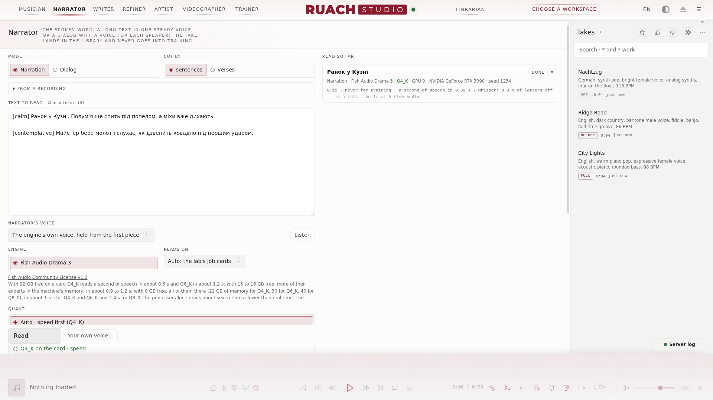
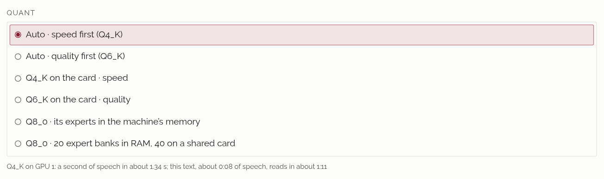

## 朗読 <!-- #reader -->

朗読は、映像師の次の部屋で、テキストを声にします。章、本、ラジオドラマ、ポッドキャスト、クリップに重ねる声。一つの安定した声で、または複数の声の対話として読み、読んだピースを一つずつ聞き取り、テイクを歌と同じようにライブラリへ入れます。

### できること <!-- #what-it-does -->

**モード**には二つの読み方があります。**ナレーション**: 一つの声がテキスト全体を読みます。**文** ごと(約二百文字のピース、空行は長めの間)か **節** ごと(一行が一ピース、節番号とストロング番号は読まない)に切ります。2.5 s 以上続く最初のピースが以後すべてのピースの参照になり、声は章全体で保たれます。**対話**: 一行が一つのセリフで、`Name: words` と書き、話し手ごとに声を割り当てます。名前のない行は前のセリフの続きです。

**読む** で読み上げが始まります。ラボのほかの重いジョブと同じくキューで待ち、プレーヤーの上にバー、ログにその行が出ます。カードには量子化と、読んでいる間の残り時間が出て、終わると長さ、速度、Whisper が聞いた内容、ラウドネスが出ます。

### エンジン: Drama 3 <!-- #the-engine-drama-3 -->

朗読は Fish Audio Drama 3 (35B MoE、アクティブ 3B) で、audio.cpp を通して読みます。量子化は `models/narrator/drama-3-gguf/` の GGUF で、その横に LICENSE と NOTICE があります。それがないとエンジンは読み込まれません。ロシア語、ウクライナ語、ヘブライ語、ギリシャ語、英語、スペイン語、イタリア語、フランス語、ポルトガル語、ドイツ語、日本語、中国語を読みます。自分のエンジンは `user/reader/engines/` に独自の `engine.json` とともに置けば、**エンジン** にその横で現れます。

### 量子化と速度 <!-- #quants-and-their-speed -->

**量子化** は、どの量子化がどこで読むかを示します。**自動 · 速度優先** (既定) と **自動 · 品質優先** は、読み上げ開始時の空きメモリで選びます。リストで名前を選んだ量子化はそれに留まります。下の行は、今どれがどのカードで読むか、音声一秒に何秒かかるか、モデルの読み込みを含めてこのテキストにどれだけかかるかを示します。

09.11.2026 に RTX 3090 一枚で、27 s のロシア語のピースで測りました。RTF は音声一秒を読むのにかかる秒数です。行に別の記載がない限り、Whisper はすべての文字を正しく聞き取りました:

| 量子化 | RAM のエキスパートバンク | カード上 | RAM | RTF | 測り方 |
|---|---|---|---|---|---|
| Q4_K | 4 | 21.5 GiB | 3 GiB | 0.62 | カード単独 |
| Q6_K | 16 | 21.9 GiB | 11.2 GiB | 1.16 | カード単独 |
| Q8_0 | 20 | 23.0 GiB | 17.3 GiB | 1.37 | カード単独 |
| Q8_0 | 40 | 6.9 GiB | 33.2 GiB | 2.43 | カード単独 |
| Q4_K | 20 | 15.7 GiB | 9.8 GiB | 1.34 | データセットのジョブと同居 |
| Q6_K | 28, cuda_perf | 13.8 GiB | 18.6 GiB | 1.74 | データセットのジョブと同居、一語を聞き違え |
| Q4_K | 40, cuda_perf | 7.3 GiB | 18.3 GiB | 1.75 | データセットのジョブと同居 |
| Q6_K | 40, cuda_perf | 7.3 GiB | 26.0 GiB | 2.46 | データセットのジョブと同居 |
| Q8_0 | プロセッサーのみ | — | 44 GB | 7.0 | プロセッサー |

データセットのジョブと同居した行は悲観的な値です。カードの計算とプロセッサーをそのジョブと分け合っていたので、専用のカードならもっと速く読みます。**Q8_0 · エキスパート 20 バンクを RAM に、共有カードでは 40** は Q8_0 から離れません。23.6 GB 空いたカードでは 20 バンクを RAM に、カードが共有なら 40 すべてをマシンのメモリに、カードが **自動** なら最後はプロセッサーで読みます。最初の読み上げでモデルを読み込み、カード上では読み上げの間も読み込まれたままです。

### 量子化の評価 <!-- #grades-of-the-quants -->

「量子化」リストは各量子化を 09.11.2026 の生のテストで色分けします: 30 s のロシア語のピース二つ (感情タグ付きと、タグなし) の最初の読み、各五シード、朗読のサンプリング (temperature 0.8, top_p 0.9)、読み直しも 二つ目のシードもなし。Whisper large-v3 が語の挿入・抜け・置き換えを聞き取りました。**緑**、安定: どのテイクにも誤った語なし。**黄**、中: 十テイク中一つに誤った語。朗読の耳はそのようなピースを読み直します。**赤**、非推奨: 二テイク以上に誤り、またはひどい誤り。自動は決して選ばず、ツールチップと実行カードがそう伝えます。カード上の量子化はすべて緑、70 テイクすべてクリーンでした。テンソルをどこで計算するかは効きますが、シードと同じ効き方です: 同じ量子化・同じシードでも、エキスパートをカードに置くか RAM に置くか (下層・中層・上層の 20 層) で、最初の 40–60 ms から別の読みに分かれます。同じ配置の繰り返しはビット単位で同一です。一つのシードは多くの道の一本しか見せません: 09.11 のブラインドセット (全テイクが一つのシード) で「глубоко」の後に入った語は 0.7–1 s の有声の挿入で、息ではありません。

| 量子化 | RAM のエキスパートバンク | 誤った語のあるテイク | 評価 |
|---|---|---|---|
| Q4_K | 40 | 0 / 10 | 緑 |
| Q6_K | 40 | 0 / 10 | 緑 |
| Q8_0 | 40 | 0 / 10 | 緑 |
| Q4_K | 20 · 下層 | 0 / 10 | 緑 |
| Q4_K | 20 · 中層 | 0 / 10 | 緑 |
| Q4_K | 20 · 上層 | 0 / 10 | 緑 |
| Q4_K | 40 · temperature 1.0 | 0 / 10 | 緑 |
| Q4_K · Q6_K · Q8_0 | プロセッサーのみ | 測定中 | 測定中 |

### テキスト、声、感情 <!-- #text-voices-and-emotions -->

**朗読の声**: エンジン自身の声を最初のピースから保ったもの。または **自分の声…** で、エンジンがなぞる声の短いクリップを、赤い警告の下で同意にチェックを入れたときだけ受け付けます(持ち主の同意なしに声を複製することは多くの国で犯罪であり、責任はあなたにあります)。Studio に出来合いの声は付属しません。各ピースの音高は読むときに測られ、声が別の性別に移ったピースは別のシードで読み直されます。

感情と音は Drama 3 が読むとおり角括弧に入れます: `[calm]`、`[sad]`、`[whispering]`、`[pause]`、`[laughs]`。**タグパレット** がそれを挿入します。感情、テンポ、スタイルは文の先頭に、間や音はカーソルの位置に。**インラインタグを読む** は対話では既定でオン、きれいな本の朗読が欲しいナレーションではオフです。**スタイル** は朗読全体に独自の括弧を与えます。たとえば `calm, warm, unhurried narration`。

### アクセントとアキュート <!-- #stresses-and-the-acute -->

**アクセントを付ける** は、エンジンが読む前に強勢のある母音に印を付けます。自分の印は書いたまま残り(アキュート、U+0301、`звени́т` のように)、次に **アクセント辞書**、次にその言語の大きな辞書があればそれを使います。ウクライナ語の辞書は Studio に付属し(lang-uk のもので、ULIF の「Словники України」に基づく)、ロシア語やほかの言語は自分の辞書をつなぎます(`docs/NARRATOR-DICTIONARIES.md`)。二通りの強勢がある語は文脈に任せます。**アクセントを確認** は、エンジンが読むとおりのテキストを示します。テイクで読み違えた語があれば、その読み上げの **修正** でピースを選び、アクセントを付け、**アクセントを辞書に記憶** して **このピースを読み直す**。

### LCV グリフマップ <!-- #the-lcv-glyph-map -->

**LCV の文字をグリフマップで読む** は、LCV 独自の文字(Ѓ、Ђ、Љ、ѵ、Ѳ など)を作者の表に従ってエンジンが読めるものに変えます: `Авраѓа́ма` は `Авраהа́ма` と読まれます。辞書の下の **LCV グリフマップ** が表を示し、**自分のコピーとして保存** で自分のコピーを `user/reader/glyphs.map.tsv` に置くと、以後はそれが適用されます。**作者の表に戻す** でそれを手放します。スイッチは既定でオフです。

### 耳とラウドネス <!-- #the-ear-and-the-loudness -->

**各ピースを聞き取る (Whisper)** は既定でオンです。プロセッサー上の Whisper large-v3 が、エンジンが次のピースを読む間に各ピースを聞き取ります。語の挿入・抜け・置き換えが聞こえたピース、または文字がテキストから 12 % 以上ずれたピース (繰り返し、抜け、不明瞭) は別のシードで読み直し、最大三回のうちテキストに最も近いものを残します。実行カードには、読み直したピースとその理由が、テイク内の時刻つきで表示されます。テイクはポッドキャストと同じく −16 LUFS にまとめられ、ピークは −1 dBFS を決して超えません。読み込めなかった耳は読み上げとテイクのメモに記され、きれいな朗読と見なされることはありません。

### 録音から <!-- #from-a-recording -->

**録音から** は講演や配信(任意の音声、または動画の音)を受け取り、**文字起こし** が Whisper で聞き取ります: 時刻つきの単語と、間ごとに段落に分けたテキスト。**ライターのモデルで整える** は、Whisper の聞き違い、句読点、大文字を直し、すべての語とその順序を保ちます。**テキストへ** はそれを朗読のテキストに入れ、行が `Name: words` なら対話として入れます。

### ライセンス <!-- #licences -->

Drama 3 は Fish Audio Community License v1.0 のもとにあります。研究と非商用の利用は自由で、年間収益が USD 500,000 を下回る間は商用も自由です。他人向けのホスト型 TTS や声の複製サービス、同意のない実在の人物の声の複製、そしてそれが作ったものを別のモデルの学習や蒸留に使うことは認められません。透かしは音に残ります。それが読んだテイクにはすべて、読み上げの結果、テイクのエディター、ライブラリのメモに **Built with Fish Audio** が付きます。朗読のテイクはすべて学習に使わない印が付きます: ファイル自体が印を持ち、トレーナーはそれを含むフォルダーを拒み、データセットのキッチンはそれを除外します。

### 六つの手順で朗読 <!-- #a-reading-in-six-steps -->

1. テキストを貼り付けるか、**録音から** 持ってきます。
2. **モード** を選びます: 本なら **ナレーション**、声の掛け合いなら **対話**。
3. **朗読の声** を選びます。対話では話し手ごとに一つ。
4. **アクセントを付ける** はオンのまま。LCV なら **LCV の文字をグリフマップで読む** も加えます。
5. **量子化** とその下の行を見ます: 量子化、カード、かかる時間。
6. **読む**、そしてテイクを聞きます。うまくいかなかったピースは **修正** へ。
