# נפחות רוח · המדריך

שירים ממילים, על המחשב שלך: כל חדר, מה כל דבר עושה, והמספרים שמדדנו.

## מתחילים כאן <!-- #start -->

### מה זה <!-- #what-this-is -->

נפחות רוח הופכת שורת סגנון ומילים לשיר גמור בעזרת **YuE2**, מודל השירים הפתוח, שרץ על ה-GPU שלך. שום דבר לא יוצא מהמחשב. סביב המודל יש אולפן שלם: חדר כתיבה עם מודל צ'אט, פוסט-פרודקשן (סטמים, רימאסטר, אפסקייל, בדיקת מילים), אוסף של כל הטייקים, וחדר שמאמן מתאמי LoRA על השירים שלך.

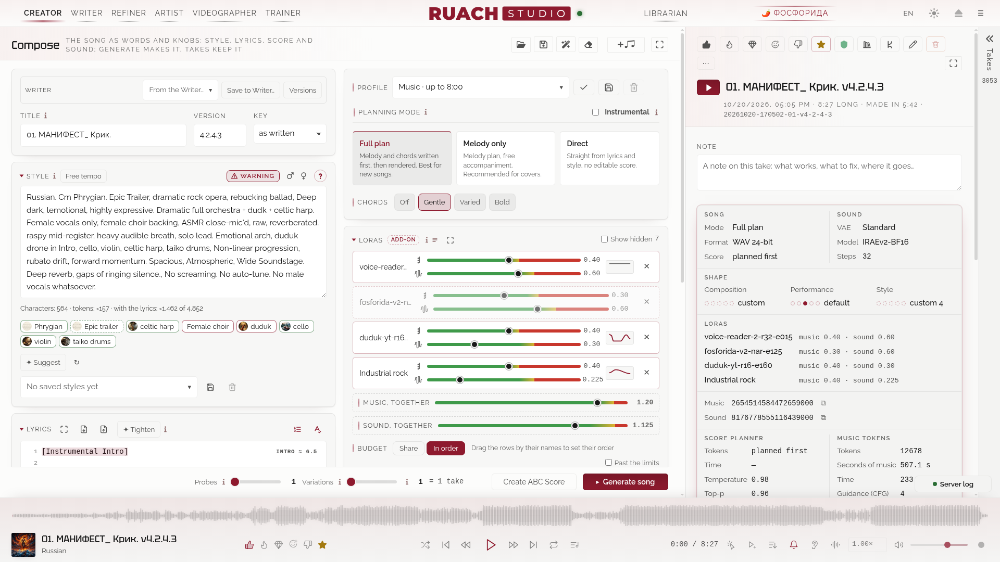

ל-YuE2 יש **שני חצאים**, ורוב מה שמגדירים בנפחות מכוון לאחד מהם:

| חצי | מה הוא עושה | במה שולטים שם |
|---|---|---|
| **מוזיקה** (AR, מודל השפה) | כותב את השיר: קודם פרטיטורה (כתיב ABC), אחר כך את טוקני המוזיקה, 25 בשנייה | מצב התכנון, הפרטיטורה, זרע המוזיקה, עוצמת המוזיקה של LoRA |
| **צליל** (NAR + VAE) | מרנדר את הטוקנים לצליל | זרע הצליל, ה-VAE, עוצמת הצליל של LoRA, צעדים ופותר |

### שמונת החדרים <!-- #the-eight-rooms -->

| חדר | בשביל מה |
|---|---|
| **מוזיקאי** | טופס השיר והטייק שמאזינים לו |
| **קריין** | הטקסט שלך מוקרא בקול: קריינות או דיאלוג עם קול לכל דובר, ההטעמות מהמילון שלך; ספר שנקרא חלק אחר חלק |
| **כותב** | השירים שלך כמסמכים עם גרסאות; מודל צ'אט מנסח טיוטות ומשכתב יחד איתך |
| **מלטש** | אחרי הרינדור: ספקטרום, ארטיפקטים, אנטי-זמזום, בדיקת מילים, סטמים, רימאסטר, אפסקייל |
| **צייר** | תמונות לשירים שלך מפרומפט משלך: ריבועית, רחבה וגבוהה מזרע אחד; הריבועית הופכת לעטיפה של טייק (תצוגה מוקדמת) |
| **וידאוגרף** | וידאו קליפ שמתוכנן לטייק (בטא): שוטים לפי השורות המושרות שלו, הסצנות שלהם, תמונה לכל אחד, האנימטיק והקליפ |
| **מאמן LoRA** | מתאמי LoRA מהשירים שלך: הסט, ההרצה, הטלמטריה שלה והאפוקים שלה |
| **ספרן** | כל הטייקים: מרחבים, חיפוש, לייקים, הערות, פעולות על הרבה טייקים בבת אחת, הפח |

### הסרגל <!-- #the-bar -->


הסרגל נפתח בחדרים, לפי סדר העבודה: מוזיקאי, קריין, כותב, מלטש, צייר (תצוגה מוקדמת: תמונות לשירים שלך), וידאוגרף (בטא) ומאמן; הלוגו עומד באמצעו, והספרן מיד אחריו; מימין, המרחב, נורית המנוע (ירוקה: מוכן; כתומה: עסוק; אדומה: משהו נכשל) והכפתורים המעטים. הסמן על הנורית (או לחיצה) פותח את **מה רץ ומה ממתין**: השירים, היצירות מחדש ומשימות המעבדה על הכרטיסים (עטיפות, סטמים, אפסקייל, Whisper). משימה ממתינה יוצאת מהתור שלה ב-✕ שלה, בשתי לחיצות (הלחיצה הראשונה שואלת); מה שכבר רץ נעצר במקום שבו הוא מוצג: שיר בהרצה שלו, אימון במאמן. בטלפון (עד 760 px רוחב) הנפחות היא עמודה אחת עם שלושה חדרים, המוזיקאי, הכותב והספרן; האחרים לא מופיעים בסרגל, וחדר שנפתח דרך קישור אומר בחלון שהוא צריך מסך רחב יותר. מחוץ לבית, הקם VPN לרשת הביתית שלך (WireGuard, למשל) ופתח בטלפון את הכתובת של המחשב או השרת שלך, כמו בבית: הנפחות נשארת על המחשב שלך, והטלפון רק מציג אותה.

- **מרחב**: המרחב שביד. רשימת הטייקים מציגה רק אותו, וכל טייק חדש נוחת בו. *כל המרחבים* מציג הכול. היכן שהסרגל צר (אין בו לוגו), גם המילה *מרחב* יורדת; השדה נשאר.
- **בחירת מרחב**: התיבה פותחת את העץ של הספרייה עצמה, כל אמוג'י בעמודה משלו, הסימנים של ה-Studio אחרי השמות, ומה שלא מקבל טייק חדש מעומעם ועם הסיבה; המדורים של מרחב נפתחים בעלה כותרת מימין לו (→ פותח, ← או Esc סוגר), ו-**+ מדור חדש ב-…** ביניהם.
- **אין טייק מחוץ למרחב**: כל מה שיוצר טייק (יצירה, החלפת קטע, ייבוא) ממתין למרחב שביד שמקבל טייקים חדשים, ולעולם לא לסט 💎, למדורים שלו או למרחב מוקפא. המרחב היחיד שפתוח נכנס ליד מעצמו, התקנה חדשה מקבלת את *השירים שלי*, ואחרת הנפחות שואלת; שום דבר לא נשלח עד שנבחר מרחב, וגם לא כל עוד הספרן לא עונה.
- **HE** (שתי האותיות של השפה): הדף בשפה אחרת, שנשמרת עם ההגדרות שלך: English, Русский, Українська, Беларуская, Ελληνικά, Español, Italiano, Français, Português, Deutsch, 日本語, 中文, עברית, כל שפה בשם שלה עצמה. מספרים ותאריכים הולכים לפי השפה, והמדריך הזה נפתח בה.
- **☀ / ☾**: יום, לילה, או כמו במערכת.
- בראש ההלחנה: **שמירה** שומרת פרומפט (כל מה ש"יצירה" הייתה שולחת) כ-JSON או YAML, ו**פתיחה** פותחת אותו שוב; **ניקוי** מנקה את הטקסטים (שם, סגנון, מילים, פרטיטורה, זרעים) ומשאיר את כל השאר, או שאפשר להתחיל **שיר חדש** (גם המצב, הדגימה וה-LoRA חוזרים לברירות המחדל; *צליל ופלט* נשאר). **פתיחה** אומרת מה מתוך הקובץ הטופס לא הצליח לקלוט, ומה הוא מחזיק במקום זה. **טעינת דוגמה** מציעה דוגמה אקראית בשפת הדף ואחת באנגלית, אף פעם לא בסינית, ואחריהן את הדוגמאות שלנו לפי שם (קריאות…).
- **ייצוא ל-DAW** (במלטש: ליד הטייק שביד ובסטמים שלו): הדרך החוצה מהנפחות. או המיקס כמו שהוא (WAV, FLAC, MP3), או הטייק כולו לתוך ה-DAW שלך, שבו השאר קורה מחוץ לנפחות. הדף מוצא את REAPER, Waveform ו-Bitwig במחשב של הנפחות, או שאפשר לציין את שלך. כל טייק יוצא מהתפריט שלו (לחיצה ימנית עליו): *ייצוא ל-DAW ← פרויקט REAPER* או *DAWproject* (Waveform, Bitwig, Studio One, Cubase), וה-DAW שלך ראשון; הכרטיסייה DAW של המדריך הזה מפרטת מה יש בפנים.
- **פריקת המודל**: מסירה עכשיו מזיכרון ה-GPU כל מודל שלא בשימוש; הכפתור צבוע באדום כל עוד מודל טעון.
- **☰**: כל השאר, מלמעלה למטה: הכרטיס והזיכרון שלו, עותק המודל, מפענח הצליל (VAE); אחר כך חדר המנוע, ערכות הנושא והמדריך הזה זה לצד זה בשורה אחת; ובתחתית **גודל טקסט**, שקובע את הטקסט של כל הדף בטווח −2 עד +4 pt (הפריסה נשארת), ולמסגרת מורמת יש −, + ו-⟲ משלה מעליה (−4 עד +6 pt); כל מסך שומר את שלו. כשפלאגין משלך נמצא ב-`user/plugins/`, **פלאגינים משלך**, תיבת סימון מתחת ל-VAE, מכבה אותו בדפדפן הזה: המלטש, ה-DAW ו-MIDI מציגים אז רק מה שיש לנפחות ציבורית, לבדיקה של הדרך הציבורית, לפרומו או לתמונות; שום דבר לא נמחק, והדף נטען מחדש.

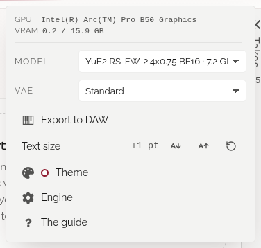

### השיר הראשון שלך, בשישה שלבים <!-- #your-first-song-in-six-steps -->

1. תן לו **שם**, ובחר **סולם** אם יש לך אחד בראש (או השאר *כפי שנכתב*).
2. כתוב את ה**סגנון**: שפה, ז'אנר, קול, כלים, טמפו. שורה או שתיים פשוטות מספיקות. ה-♪ שלידו מפרט 200 כלים, ולכל אחד מה ש-YuE2 באמת מנגן (ראה *מוזיקאי*).
3. הדבק את ה**מילים** עם תגיות קטע בשורות נפרדות: `[Verse]`, `[Chorus]`, `[Bridge]`, `[Outro]`.
4. השאר את **תוכנית מלאה** כמצב התכנון: YuE2 כותב קודם מנגינה ואקורדים, ואחר כך את השיר.
5. לחץ על **יצירת שיר**. ההרצה מציגה את השלבים שלה: הפרטיטורה, טוקני המוזיקה, הצליל, הפענוח.
6. הטייק נפתח באמצע, עם הנגן שלו, הפרטיטורה שלו וכל מה שצריך כדי ליצור אותו שוב.

> נמדד על RTX 3090: שיר של 6:12 במצב ישיר לקח 135 שניות, ושיר של 7:25 ב"תוכנית מלאה" 212 שניות (הפרטיטורה נכתבת קודם). שירים קצרים יותר מהירים יותר.

### הנגן, הטייקים ויומן השרת <!-- #the-player-the-takes-and-the-server-log -->

- **הנגן** בתחתית: צורת הגל לכל הרוחב, ענן רך אחד שבו החלק שכבר נשמע בצבע ההדגשה (לחיצה קופצת לשם); מתחתיה הטייק (העטיפה שלו כשיש לו, השם שלו, המילים הראשונות של הסגנון שלו, 👍 👎 ★), אחר כך **ערבוב**, הקודם, ניגון, הבא ו**חזרה** (כבוי · כל הרשימה שוב · הטייק הזה שוב, מסומן ב-1), אחר כך הזמן (לחיצה על האורך הכולל מחליפה אותו בזמן שנותר), *ניגון בלחיצה* (לחיצה ברשימה מנגנת את הטייק מיד), *המשך ניגון* (כשטייק נגמר, הבא אחריו ברשימה מתחיל), *ניגון טייקים חדשים* (שיר שנוצר כאן מתנגן כשהוא מוכן, אלא אם משהו כבר מתנגן), 🔔 *צליל כשהרצה מסתיימת* (שני תווים עולים כשהיא הושלמה, פעם אחת לתור של הרצות, שניים יורדים כשהרצה נכשלת; שום צליל מעל שיר חדש שמתחיל להתנגן מעצמו), ה**מהירות** (0.50× עד 2.00×, גובה הצליל נשמר), עוצמת הקול ונקודת מצב (היא פועמת כל עוד טייק מתנגן). מה שלא נחוץ ברגע זה נשאר חיוור עד שהסמן מגיע; כל סמל אומר מה הוא עושה כשהסמן נח עליו. הסמן מעל צורת הגל מראה את הזמן שאליו לחיצה הייתה קופצת. מקשי המדיה של המקלדת ושל האוזניות מפעילים את הנגן, ולוח המדיה של שולחן העבודה מציג את הטייק. ⏪ ו-⏩ קופצים לסימון הקודם או הבא מבין הסימונים שכל 15 s, החל מ-0:00; ← ו-→ קופצים לסימונים שכל 5 s (עם Shift: כל 30 s). תג המצב בקצה הימני של הנגן (ירוק כשטייק מתנגן, בצבע ההדגשה כשטייק נוצר) פותח את הטייק או את ההרצה; כשההלחנה מורמת מעל החדר, הוא מחליף את המסגרת המורמת במסגרת של הטייק. לחיצה ימנית על צורת הגל, על התמונה או על השם פותחת את תפריט הטייק, כמו ברשימה. צורת הגל מציגה את הקטעים של הטייק: התגיות של המילים עצמן, כל אחת במקום שבו Whisper שומע את השורה הראשונה שלה (פעם אחת לכל טייק, כחצי דקה; מעצמו במחשב עם שני כרטיסים או יותר, ואחרת דרך תפריט הטייק ← *איתור הקטעים בשמיעה*); טייק שמעולם לא נשמע מציג את הסימונים של הפרטיטורה שלו. קו דק בתחילת כל קטע, והשם שלו למטה; לחיצה ליד קו עוברת בדיוק לתחילת הקטע; הסמן מעל צורת הגל מציג כרטיס עם הקטע, הזמן שלו והשורות שלו כפי שנכתבו, והשורה שמושרת באותו מקום מוארת; קטע שמסומן ב-? לא נשמע בבירור. סמן שנח רגע על צורת הגל מעלה מעל הנגן את הספקטרוגרמה של הטייק כולו (מתג הספקטרום שליד 🔔 מכבה אותה): ברוחב צורת הגל ומסונכרנת איתה בזמן, בגובה של כשליש מהחלון, וכרטיס הקטע מעליה; בתוכה הקטעים, הצנטרואיד הספקטרלי כקו מג'נטה (היכן שמשקל הצליל יושב: הבהירות שלו), ה-RMS בפס בתחתיתה עם הממוצע של הטייק עצמו בקו מקווקו, וסמן הניגון; מתחת לסמן הזמן שלו, הספקטרום של אותו רגע ליד הקו עם התדר החזק ביותר שלו והתו שלו, ולמעלה בתמונה התדר באותה נקודה, התו שלו והרמה שלו. *לוגריתמי* או *ליניארי* בראשה; לחיצה עוברת לשם כמו על צורת הגל; הרחקת הסמן או Esc מורידים אותה. הטייק נמדד פעם אחת, על ידי המעבדה, כמו עבור ה"ספקטרום" שלו. עוצמת הקול מגיעה עד 150 %: מעל 100 % היא מגבירה טייק שקט, והסליידר נעצר קודם ב-100 % (שחרר וגרור שוב כדי לעבור הלאה). הריבוע עם העטיפה מוביל לכרטיס הטייק בספרן; הכפתור הקטן בפינה שלו מציג את העטיפה בגדול. מאחורי כפתורי הנגינה, היכן שצורת הגל עומדת מעל הפקדים, ספקטרום חי של מה שמתנגן עולה בעדינות מתחתית הנגן, 25 Hz משמאל עד 20 kHz מימין; הוא נח כששום דבר לא מתנגן, ואפשר לכבות אותו במנוע ← ברירות מחדל (*ספקטרום חי ברקע הנגן*).
- **שתי שורות או אחת**: הנגן שומר את צורת הגל מעל הפקדים שלו במקומות שבהם מאזינים לשירים ומשווים ביניהם (המוזיקאי, המלטש, הספרן), והוא בשורה אחת בכותב, בצייר, במאמן ובמנוע, וגם במוזיקאי כל עוד מסגרת מורמת או שהמילים פרושות מעל הכול. אחרי טעינה מחדש (F5) הוא חוזר עם הטייק שלו והמקום שלו בו. בצייר עמודת הטייקים מתחילה מקופלת ויומן השרת עומד משמאל. כשחלון צר או מוגדל, שום דבר בנגן לא מסתיר דבר אחר: השם מפנה מקום ראשון, אחר כך האדום *הסוף לא הושר* והכתום *זנב אחרי הסוף* נשארים רק עם הסמלים שלהם (הסמן על אחד מהם אומר מה הוא), אחר כך המהירות והסליידר של עוצמת הקול זזים הצידה, ואחריהם המתגים שנחוצים הכי פחות; פס הפלייליסט עומד בתחתית הנגן של השורה האחת.
- **הכרטיסים בזמן אמת**: במנוע ← כרטיסי GPU לכל כרטיס יש שורה משלו מתחתיו, העומס והזיכרון שלו, עמודה כל שתי שניות לאורך ארבע דקות, עם הטמפרטורה וההספק שלו; יומן השרת, כשהוא פתוח, מציג לידו את הכרטיסים שיש להם תפקיד, כל אחד עם התפקיד שלו בכותרת, והכרטיס של הנפחות ממוסגר. המדידות נאספות כל הזמן, כך שהיומן נפתח ישר על הדקות האחרונות שלו.
- **הקו אל הנפחות** מוצג ליד יומן השרת (*Forge · 85 ms*, או *כאן* כשזה אותו מחשב). כשהנפחות רחוקה, לייק, מועדף או הצמדה מופיעים מיד, והנפחות רק מאשרת אותם.
- **טייקים** מימין: חיפוש במילים, ב-`*` וב-`?` (מספר נחפש בשלמותו; כשהוא מוקלד אחרי מילה, הוא הולך עם המילה הזאת היכן שבטייק יש את המילה ואחריה מספר: `seed 1` מוצא את seed 1, לא את seed 12; בשאר המקרים הוא נמצא בכל מקום, בכל סדר); *מועדפים*; קפל את העמודה ב-»; ⋯ לפעולות של הרשימה עצמה. ב-⋯, *מכל המרחבים* מציג בעמודה הזאת את הטייקים של כל המרחבים, והמרחב שביד נשאר כמו שהוא.
- **טייקים, מקופלים**: עכבר שנח על הפס של » פותח את הרשימה מעל הטייק; היא מתקפלת שוב שנייה אחרי שהעכבר עוזב (כפתור הקיפול שלה, אם לוחצים עליו בזמן הזה, משאיר אותה פתוחה). תפריט ה-⋯ נפתח כלפי מעלה כשהנגן לא משאיר לו מקום מתחתיו.
- **יומן השרת** יושב ממש מעל הנגן בכל חדר: מקופל, הוא מציג את הדבר האחרון שהמנוע אמר (באדום כשמשהו נכשל); פתוח, עשר שורות, *מעקב*, *העתקה*, והדרך אל היומן המלא במנוע. כשמסגרת מורמת מעל החדר, הוא עומד משמאל, הרחק מהכפתורים של המסגרת. החץ בקצה הפנימי שלו מעביר אותו לצד השני של הדף, וכל חדר זוכר את הצד שלו (של הצייר הוא השמאלי). גרירת הקצה החיצוני שלו מרחיבה אותו, עד 1200 px (הרוחב נשמר; לחיצה כפולה מחזירה את הרוחב המקורי שלו); עם הכרטיסים לידו הוא ברוחב 920 px, והעמודה שלהם 390. למסגרת יש שתי תצוגות, **שרת** ו**צייר** (היומן של הצייר עצמו: מה התבקש, מה המעבדה ענתה, הדרך של כל הרצה עד סופה), וכל חדר נפתח על התצוגה שלו; **⧉** פותח את היומן בחלון משלו, מעל כל החלונות ב-Chrome, או כזה שאפשר להעביר למסך אחר. כל עוד LoRA מתאמן, פס משלו עומד מעל היומן, שורה לכל הרצה: הכרטיס שלה, הצעד שלה, כמה הושלם ובערך כמה זמן נשאר לה; לחיצה פותחת את המאמן.

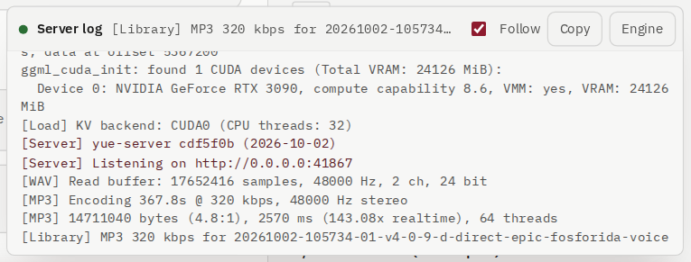

## מוזיקאי <!-- #creator -->

### הלחנה: טופס השיר <!-- #compose-the-song-form -->

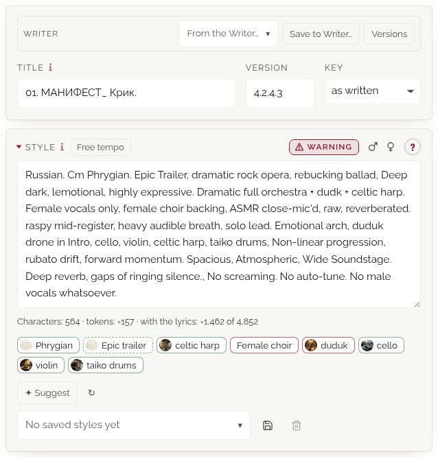

- **התחלה מרעיון**: שורה אחת על השיר; מודל הצ'אט של הכותב מנסח את השם, הסגנון והמילים (*כתיבת הבריף*).
- **שם**, **סולם**: הסולם נכנס לפרטיטורה (`K:`). כשיש פרטיטורה בטופס, סולם חדש מעביר אותה אליו; כשאין, הבחירה ממתינה ומעבירה את הפרטיטורה שתגיע.
- **גרסאות** (ליד *שמירה בכותב…*): הטופס נשמר תחת השם שלו בכל "יצירה", ב-Ctrl+S, אחרי שהפיאנו רול כותב לתוך הפרטיטורה, ולפני כל דבר שדורס אותו (דוגמה, טייק, הכותב, גרסה), יחד עם הכפתורים שלו, כך ששינוי לעולם לא הולך לאיבוד; לחיצה בוחרת גרסה, לחיצה על גרסה שנייה מציגה את שתיהן כהשוואת הבדלים, *אל הטופס* מחזיר אחת מהן; כוכב, תווית, נעילה. מחיקת טייק לעולם לא לוקחת איתה את הגרסאות שלו. **גרסה**, ליד "שם", מקבלת ספרות ונקודות (4.2.3): טייק נקרא "שם v4.2.3", כמו שנותנים שמות לרצועות, והגרסאות מחזיקות עץ אחד לכל שם עם ענף לכל גרסה (שם שמוקלד יחד עם הגרסה שלו מתפצל לשני השדות). *מחיקת העץ…* שולחת את כל העץ של שם לפח הגרסאות; *גרסאות המוזיקאי* בכותב מחזירות אותו.
- **זרע מוזיקה** ו**זרע צליל**: הקוביות של שני החצאים. ריק פירושו אקראי; מספר חוזר על טייק. השאר את זרע המוזיקה ושנה את זרע הצליל כדי לשמוע את אותו שיר מרונדר אחרת. הם עומדים ראשונים *בדגימה והסרת רעש*. ליד כל אחד, ה**מצב** שלו: *אקראי (−1)*: זרע חדש בכל הרצה (השדה ריק), *אקראי, קבוע*: זרע אקראי שנכנס לשדה ונשמר, *קבוע*: הזרע שנכתב, *הבא* *והקודם* מזיזים אותו אחרי כל "יצירה" אל מעבר לזרעים שכבר שימשו (הגרסאות למוזיקה, הווריאציות לצליל). לזרע של הצייר יש אותם מצבים. זרע מוזיקה קבוע נמצא תחת השגחה: אם המתאמים שלו (חצאי המוזיקה שלהם) או מודל הליבה זזו מאז ההרצה האחרונה שלו, או שהוא שבר תוכנית עם אותם מתאמים, ההרצה שואלת קודם: **זרע חדש** או **שמירת הזרע**. תוכנית כבר לא כותבת את הזרע שלה לשדה, ו**פרטיטורה חדשה** לוקחת זרעים חדשים. זרע שמוקלד ביד הוא בין 1 ל-999 999 999 (ארוך יותר הופך ל-999 999 999); −1, 0 או כל מה שאינו מספר פירושם זרע חדש בכל הרצה, שנבחר מ-1000 עד 999 999 999. הזרע של הטייק עצמו, שנכנס לשדה כשיוצרים אותו שוב, נשמר כמו שהוא, ארוך ככל שיהיה הזרע של טייק ישן; *הבא* מסתובב בתוך הטווח, ואילו *הקודם* שיורד עד לכלום חוזר להיות −1.
- **סגנון**: שפה, ז'אנר, קול, כלים, טמפו. *שמירת סגנון…* שומרת אותו תחת שם. **♂** ו-**♀** בראשו מכניסים לתוכו *male vocals* או *female vocals* (במקום המילה של המין השני, ואחרת לפני ה-BPM); הכפתור הדולק מוציא את התגית שלו. **טמפו חופשי**, לידם, יוצר את המוזיקה מהפרטיטורה בלי סימוני הטמפו שלה (Q:): הקול והקצב נושמים בעצמם, והמילים כבר לא קשורות לתיבה (רובאטו, לא ליניארי); הוא נדלק מעצמו כשהסגנון מבקש rubato או non-linear ולא נוקב ב-BPM, ו-BPM בסגנון כשהמתג מופעל מצוין מתחת לשדה. גם פרטיטורה שתוכננה לבד (*יצירת פרטיטורת ABC*) מגיעה בלי הטמפו שלה.
- **אותיות שאינן לטיניות** בסגנון מצוינות מתחתיו: YuE2 קורא את הסגנון כתגיות באנגלית. הכפתור **✦ הצעות** קורא את המילים במלואן (עד 8000 תווים). הסגנונות השמורים, הפרופילים, פרופילי הטקסט והמסמכים של הכותב נבחרים בדיאלוג של הנפחות עצמה, עם סינון על רשימה ארוכה, כמו המרחב.
- **האוקטבות של שורת ה-Vocal** (התו בסוף השורה של הסגנונות השמורים): ב"תוכנית מלאה" בלי פרטיטורה בטופס, המודל מתכנן את הפרטיטורה, ושורת ה-Vocal שלה זזה באוקטבות שלמות לפני שהיא מושרת, משתיים למטה עד שתיים למעלה; 0 כברירת מחדל, כמו שהמודל כתב אותה. ההזזה שייכת לשיר עצמו: היא נשמרת בטופס, בטייק ("טייק חדש" ו"שימוש כבסיס" מחזירים אותה) ובקובץ פרומפט, ואילו *שיר חדש* מחזיר אותה ל-0. הכפתור מציג אותה בספרות, דולק כשהיא מזיזה את השורה, ומעומעם עם הסיבה כש"יצירה" לא הייתה משתמשת בה (מצב אחר, אינסטרומנטלי, פרטיטורה או קודי מוזיקה בטופס). קודם הוא עמד במנוע.

### שליף הכלים ♪ <!-- #the-instruments-cheat-sheet -->

ה-♪ שליד הסגנון פותח טבלה של 200 כלים שהנפחות בדקה בניסויים: המשפחה שלהם, ארץ המוצא שלהם, איך הם נשמעים (באנגלית וברוסית), והמילים שקוראות להם. ▶ A ו-▶ B מנגנים שני ניסויים של 60 שניות לכל כלי. פסק הדין בכל שורה בא מאוזן אנושית: נשמע, בספק, או **לא זוהה ב-YUE2** (YuE2 לא מכיר אותו; הוא צריך פרומפטים מתוחכמים יותר). לחיצה מעתיקה את השם ושואלת לאן הוא הולך: לסוף הסגנון בשורה משלו, או במקומו; שם שהסגנון כבר מכיל מסומן בטבלה, ואפשר לבחור ולהעתיק את הטקסט של הטבלה.

**YuE2 מחליט מתי כלי נכנס.** שורת סגנון היא בקשה, לא פקודה: לא משנה כמה מבקשים, המודל מכניס כלי במקום שבו האימון שלו אומר שהשיר רוצה אותו, והזרע מכריע הרבה. אותו פרומפט נתן טייק אחד עם הכלי ואחד בלעדיו. הקשב לכמה זרעים לפני שפוסקים על כלי.

**נשמע, אבל לא אמיתי כמו כלי חי.** הרבה כלים אכן מנגנים, אבל בצורה פחות ברורה ופחות נאמנה מהכלי האמיתי: זה מה ש-YuE2 יודע עליהם. פסקי הדין אומרים אם YuE2 מנגן כלי בכלל, לא כמה אמיתי הוא נשמע. להפוך אותו לאמיתי זה התפקיד של **LoRA לכלי**: כמה עשרות הקלטות נקיות שלו, מאומנות במאמן LoRA.

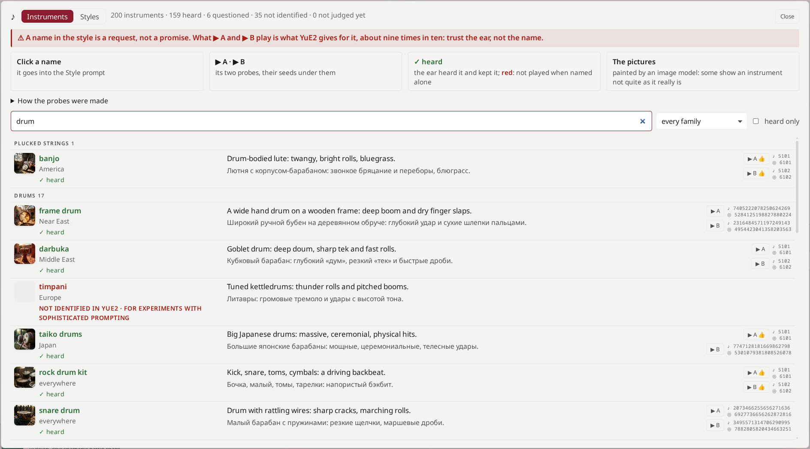

### פרומפטים שליליים, או איך לא לכתוב פרומפט <!-- #negative-prompting-or-how-not-to-prompt -->

**לנקוב במה שרוצים, ולעולם לא במה שלא רוצים.** YuE2 הוא מודל נקי: כלי שאף אחד לא ביקש נכנס לעתים רחוקות. ההרגל של שירותי הסאונד, סגנון ארוך שעמוס בכלים, באפקטים ובמילות הפקה ואחריו "no this, no that", לא הופך שיר לנקי יותר; הוא חונק אותו. פרומפטים שליליים שייכים לעבר של המודלים מעידן ה-DiT, והנפחות לא מציעה אותם ולא מלמדת אותם: בהנחיות של הכותב אין שום עצה של "no …", והמתג "אינסטרומנטלי" שם *Instrumental,* לפני הסגנון ולא מוסיף כלום אחריו.

**מה הניסוי שמע.** ב-18.11.2026 הנפחות שרה 75 טייקים עיוורים על שלושה כרטיסי ניסוי: בלדת פסנתר (6 זרעים), בלדת גיטרה בפריטת אצבעות (4 זרעים) ואינסטרומנטל פלמנקו (5 זרעים). כל זרע הושר חמש פעמים עם אותו זרע מוזיקה, אותו זרע צליל ואותן מילים; רק סוף הסגנון השתנה: נקי, ואז הכלים הלא רצויים בצורת `-x`, `no x`, `avoid x` ו-`without x` (גיטרה, תופים ודרונים מול הפסנתר; תופים, פסנתר ופדים של סינתיסייזר מול הגיטרה; ווקאל, שירה, מקהלה ודיבור מול הפלמנקו). אוזן דירגה 51 מהם בלי לדעת איזה זנב הוא איזה:

| זנב | טייקים שדורגו | נקיים מהצליל הלא רצוי |
|---|---|---|
| סגנון נקי | 10 | 2 |
| `-x` | 10 | 2 |
| `no x` | 10 | 4 |
| `avoid x` | 11 | 0 |
| `without x` | 10 | 0 |

**מה זה אומר.** הסגנון הנקי כבר הכניס את מה שהיינו אוסרים: בלדת הגיטרה הביאה תופים, פדים של סינתיסייזר או פסנתר ב-2 מתוך 4 הזרעים שלה, ואינסטרומנטל הפלמנקו הביא דרון ווקאלי או של מקהלה בכל ה-5. אף זנב לא סילק את הדליפה: "no" יצא נקי ב-4 טייקים מול 2 של הסגנון הנקי, מעט מדי כדי לקרוא לזה תרופה; "avoid" ו-"without" הכניסו את הצליל הלא רצוי בכל זרע של שני הכרטיסים שנשמעו במלואם, כך שייתכן שהם אפילו מזמינים אותו. והמילים האלה עולות לשיר ביוקר: עם זנב שלילי השירה נחנקת וההגייה מתמרחת, כאילו מישהו דרך לזמר על האוזן.

**איך לכתוב פרומפט במקום זה.**

- **שמור על סגנון קצר**: היעד הוא 200 תווים בלי רווחים, 400 לכל היותר (מעל 800 הנפחות מסרבת לשיר). סגנון קצר מושר נקי; סגנון ארוך מטשטש את הקומפוזיציה.
- **בחר ז'אנר לפי ההרכב שלו.** שם של ז'אנר מביא איתו את הכלים המקובלים בז'אנר הזה: בלדת רוק מביאה תופים וגיטרה חשמלית, יצירה קאמרית מביאה כלי מיתר. כשלא רוצים את מה שז'אנר מביא, עדיף לבחור ז'אנר שלא מביא אותו מאשר לאסור אותו.
- **ציין את הכלי המוביל ראשון.** הכלי שמצוין ראשון תופס את מקומו בחזית; הקול ושניים או שלושה כלים מלווים באים אחריו.
- **תן למילים לשאת את המבנה.** העיבוד שייך לתגיות הקטעים של המילים ([Intro], [Verse], [Chorus], [Interlude], [Outro]), לא למשפטים בסגנון.
- **תן לקול הרכב.** קול מעל כלי סולו אחד יוצא דק יותר מאשר מעל הרכב שנושא אותו: גם השירה סובלת על כלי בודד.
- **שנה את הזרע, לא את הניסוח.** כלי נכנס במקום שבו האימון של המודל אומר שהשיר רוצה אותו, והזרע מכריע הרבה מזה: הקשב לכמה זרעים לפני שכותבים מחדש את הסגנון.
- **השתק אותו אחר כך.** כלי לא רצוי שבכל זאת יוצא נתפס בסטמים של המלטש ומושתק ב-DAW. אל תכפה על המודל ברינדור.

### אוצר המילים של הגל הראשון <!-- #the-first-wave-s-vocabulary -->

**YuE2-RS-FW**, הפיינטיון הראשון של הנפחות (*מנוע ← מודלים ו-LoRA ← מיזוג RS-FW*), למד מ-32,633 רצועות, וכל מילה בשורות הסגנון שלהן נספרה **[באוצר המילים שלו](fw-vocabulary/index.html?lang=he&set=fw)**: ז'אנרים, כלים, קול, מצב רוח, מילות הרגש שהאודיו עצמו קיבל, סולמות ו-BPM, והשדות של הפרטיטורות עצמן (קטעים, משקלים, טמפו, אקורדים). חפש בו, סנן לפי סוג ולפי מקור, וראה עם אילו מילים הגיעה כל אחת. לחיצה מכניסה מילה לשורת סגנון בסדר שבו המודל למד; *העתקה* לוקחת את השורה לשדה "סגנון". מילה שמופיעה במאות רצועות היא מילה שהמודל מבין; מילה שמופיעה פעמיים היא רמז. אותו חומר עזר, כמסמך, נמצא [בדף של המודל](https://huggingface.co/goldhub/YuE2-RS-Finetunes/blob/main/FW-VOCABULARY.md).

### אוצר המילים של ה-Tsunami Wave <!-- #the-tsunami-wave-s-vocabulary -->

**YuE2-RS-TW**, ה-Tsunami Wave, הפיינטיון השני של הנפחות וברירת המחדל שלה (*מנוע ← מודלים ו-LoRA ← מיזוג RS-TW*), אומן מעל הגל הראשון על 109,250 רצועות, ו**[אוצר המילים שלו](fw-vocabulary/index.html?lang=he&set=tw)** נספר באותה דרך: 2,920 מילים שמופיעות בשתי רצועות או יותר, השדות של 106,532 פרטיטורות, והמקורות שהוא לא מפרט אחד-אחד מקובצים תחת *אחר*. הוא שומר את המילים של הגל הראשון דרך הבסיס שלו: מילה שמסומנת *חדש* היא מילה שרק ה-Tsunami Wave שמע באימון, ואילו **[אוצר המילים של הגל הראשון](fw-vocabulary/index.html?lang=he&set=fw)** נמצא במרחק לחיצה באותו דף. בשליף ♪ שניהם כרטיסיות, *הגל הראשון* לצד *Tsunami Wave*, והצ'יפים מתחת לסגנון מציגים לכל מילה את הרצועות שלה בשניהם. אותו חומר עזר כמסמך: [TW-VOCABULARY.md](https://huggingface.co/goldhub/YuE2-RS-Finetunes/blob/main/TW-VOCABULARY.md).

### מילים ופרופילי טקסט <!-- #lyrics-and-text-profiles -->

- תגיות קטע בשורות נפרדות; YuE2 מכיר את `[Intro]`, `[Verse]`, `[Pre-Chorus]`, `[Chorus]`, `[Bridge]`, `[Interlude]`, `[Outro]`.
- השאר תגית אינסטרומנטלית כמו `[Instrumental Outro]` בלי מילים: מילים מתחתיה גורמות לזנב לנדוד לשירה מומצאת, טייק אחרי טייק. שים את המילים האחרונות תחת `[Breakdown]` לפניה.
- **פרופיל טקסט**: הדבק טקסט שלם, בחר פרופיל, *החלה*: הכללים שלו (ניקוי, פונטיקה) והמבנה שלו (`[Intro]`, `[Verse]` בשורות ריקות, `[Interlude]` אחרי פסקאות ארוכות) מכינים אותו לקריאה. *ביטול פעולה* מחזיר את הטקסט. פרופילים נוצרים בכותב.

### מרקמים ווקאליים ואנחות <!-- #vocal-textures-and-sighs -->

תנועה מוארכת בשורה משלה מושרת כמרקם: אנחה, קריאה, נשימה עצורה בין השורות (תגלית של ויקטור, נובמבר 2026).

- כתוב את התנועה מוארכת: `הaaaaaaa`, `הooooooo`, `הeeeeeee`, `aaahhhhhhh` (עם האות העברית ה בהתחלה, כמו כאן).
- חמש תנועות לפחות למתיחה טובה; שבע הן המקסימום שנוסה עד כה. תמיד מספר אי-זוגי.
- אחת בכל שורה.

### משקל המילים והיד הפונטית <!-- #the-lyrics-meter-and-the-phonetic-hand -->

- **המשקל** לצד המילים: ההברות של כל שורה מוצגות כפס מול הסרגל של הקבוצה שלה — בית וגשר הם קבוצה אחת, לקדם-פזמון קבוצה משלו, לפזמון קבוצה משלו, ולכל קטע אחר קבוצה משלו. הפסקה, ברייק, שקט, אינטרלוד, פרלוד או מעבר אינסטרומנטלי בתוך קטע מושר לא פותחים קבוצה: השם שלהם מופיע לצדם מעומעם, והסרגל של הקטע ממשיך. תגיות אף פעם לא נספרות: שורה של תגיות בלבד (`[Break] [Silence]`) לא נספרת בכלל, ותגית בתוך שורה נשמטת מהספירה. הסרגל עומד באורך הרגיל של הקבוצה; בסטייה של עד הברה אחת הפס ירוק, בסטייה של שתיים או שלוש הוא כתום, ומעבר לזה אדום. מה שבסוגריים עגולים מצויר בהצללה אחרי הפס: YuE2 עשוי לשיר אותו. מתחת לשדה: התווים, ההברות והשורות של המילים, תגיות הקטעים, הסוגריים והיד הפונטית; בדיקת האיות של הדפדפן בשפת המילים (ושם גם מכבים אותה); שדה שהוגבה ביד שומר על הגובה שלו עד לחיצה על *גובה אוטומטי*.
- **מספרי שורות וסימונים**: שדה המילים ממספר את השורות שלו כמו עורך קוד (שורה שגולשת לכמה שורות תצוגה ממוספרת פעם אחת, בראשונה שבהן; *מספרי שורות* מתחת לשדה מכבה אותם). **Alt+K** מסמן את שורת הסמן או מבטל את הסימון שלה, **Alt+J** עובר לסימון הבא, **Alt+Shift+J** לקודם, **Alt+Shift+K** מנקה את כולם; המספר של שורה מסומנת כתום, והסימונים הולכים עם השורות שלהם כשכותבים מעליהן. כל [תגית] מונחת מתחת לשכבה כתומה דקה. גם במילים של הכותב זה כך. כמו ב-mcedit: **Alt+O** גם הוא מנקה את הסימונים, **Alt+L** עובר לשורה לפי המספר שלה, **Ctrl+Y** מוחק את השורה, **Alt+↑** ו-**Alt+↓** מזיזים את השורה (או את השורות שנבחרו) יחד עם הסימון שלה. *מקשים* מתחת לשדה מפרט את כולם, והתווית "מילים" של הכותב מציגה אותם כשהסמן עליה. **⤢** ליד "מילים" מרים את השדה מעל הכול, ברוחב 60 % מהמסך וגדול בארבע עשיריות, עם כל אלה, ועם −, + ו-⟲ משלו לגודל הטקסט (נשמרים בדפדפן הזה); Esc מחזיר אותו למקומו. ליד **⤢** יש שני כפתורים ששומרים את המילים כטקסט פשוט: הראשון שומר אותן כקובץ `.txt` ששמו לפי השדה "שם", והשני מכניס קובץ `.txt` (UTF-8) במקומן (הוא שואל קודם כשיש מילים בשדה, ו-**Ctrl+Z** בשדה מחזיר אותן; כשהשדה "שם" ריק, הוא מקבל את שם הקובץ).
- **בדיקת סוגריים**: "[" שלא נסגר באותה שורה, "]" בלי פותח, "[" בתוך תגית ותגית ריקה צובעים את מספר השורה שלהם באדום, והכפתור *תגיות לא סגורות או לא במקומן* מתחת לשדה עובר מאחד לבא; סוגר עגול שנשאר פתוח, או שנסגר בלי פותח, מסומן בכתום (ייתכן שהד נמשך הלאה). "[" שעדיין מקלידים אותו לא מסומן עד שהסמן עוזב את השורה שלו. **יצירת שיר שואלת קודם** כשתגית שבורה: מה שבא אחרי "[" לא סגור עלול ללכת לאיבוד בשיר, והסוף שלו עלול להשתבש; *מעבר לשורה*, או *יצירה בלי שינוי*.
- **סימני הטעמה שלא במקומם**: סימן שאינו על תנועה — בתחילת שורה, אחרי רווח או סימן פיסוק, על עיצור, סימן שני על אותה אות, או ´ עצמאי במקומו — מציג כפתור אדום מתחת לשדה (*סימני הטעמה שלא על תנועה*) וסימון לפני הספירה של השורה; הכפתור בוחר אותם אחד אחרי השני. מילה עם שני סימנים מקבלת כפתור כתום: בכוונה, או טעות? בספירה, סימן הטעמה אינו הברה; ע ותנועה לטינית בתוך מילה רוסית — כן. הברה היא צליל תנועה אחד, תו אחד, והיא נספרת לפי הכללים של כל שפה: אות תנועה אחת ברוסית, באוקראינית ובבלארוסית (ומכיוון שהמשקל מודד את הזמן ששורה נמשכת, מילה בלי תנועה — с, в, к, з, й, ў — ועיצור סותם שנצמד לאפריקטה בתוך מילה — глу-п-цо́в — מקבלים פעמה משלהם, שמצוירת בהיר יותר: "Я же вижу глупцо́в с приду́рческим планом" הן 12 הברות ועוד 2 פעמות כאלה, 14); ביוונית αι, ει, οι, ου, αυ, ευ הן הברה אחת (דיארזיס או סימן ההטעמה מפרידים ביניהן: τσά-ι); בספרדית ובאיטלקית i או u חלשה מצטרפת לתנועה השכנה (cie-lo, cuo-re), ושתי תנועות חזקות הן שתי הברות (po-e-ta); באנגלית e אילמת בסוף מילה אינה הברה (make, אבל ta-ble); עברית סופרת את סימני הניקוד שלה; בסינית, ביפנית ובקוריאנית כל סימן הוא הברה. מילים באותיות לטיניות נספרות כאנגלית, ספרדית או איטלקית: לפי שם השפה בסגנון, ואם אין — לפי מילות הקישור הקטנות שבטקסט השיר עצמו.
- **הקשת**: הבתים ממוספרים 1, 2, 3… (בלי חוסר, בלי כפילות, ובלי בית לא ממוספר בין ממוספרים); בתוך המחזור של בית — Verse › Pre-Chorus › Chorus › Post-Chorus — מותר לדלג על קטע, אבל לא לחזור אחורה; Bridge או חלק אינסטרומנטלי פותחים את המחזור מחדש; Intro רק לפני השיר, ושום דבר לא מושר אחרי Outro. הטעויות שלה: **קשת לבדיקה** בכתום, ולחיצה עוברת לבאה.
- **מילים שחוקות**: מילים וביטויים שנשחקו בשירים, רשימה לכל שפה של המילים: בהתחלה הרשימה של הנפחות, ואחר כך שלך, לשינוי דרך *מילים שחוקות* מתחת לשדה (לערוך אותה, לחזור לרשימה של הנפחות, או לא לסמן אף מילה). כל מילה שנמצאת מקבלת קו תחתון מנוקד במילים, גם בטופס השיר וגם בכותב, אבל אף פעם לא בתוך [תגית]; הכפתור הכתום *מילים שחוקות* מתחת לשדה סופר אותן, ולחיצה בוחרת את הבאה; למודל של הכותב נאמר להימנע מהן (ההנחיות שלו נושאות את הרשימה של שפת השיר). * בסוף מילה תופסת גם את הצורות שלה (неон* תופס את неоновый); סימן הטעמה אף פעם לא מסתיר מילה.
- **Ctrl+F** במילים או בסגנון (וגם בשדות של הכותב) מחפש בשדה הזה בלבד: Enter ו-Shift+Enter עוברים בין ההתאמות, ו-Esc משדה החיפוש מחזיר את הסמן לשדה, וההתאמה מסומנת; מהשדה עצמו (אחרי לחיצה במקום אחר בתוכו) הוא סוגר את שורת החיפוש ומשאיר את הסמן במקומו, ומילים שהוקלדו שם בינתיים לא מזיזות את התצוגה. החיפוש מתעלם מסימני הטעמה, ё נחשבת е, ו-о ו-а מוצאות גם ע וגם את o ו-a הלטיניות. **F4** או **Ctrl+H** פותחים שורה שנייה להחלפה: **Enter** שם את המילים החדשות במקום ההתאמה הנוכחית וממשיך לבאה, **Ctrl+Enter** (או *הכול*) מחליף את כל ההתאמות בבת אחת, ו-**Ctrl+Z** אחד בשדה מבטל את זה; **Aa** (**Alt+C**) מוצא רק התאמות ברישיות שהוקלדו.
- **תגיות אחרי "["**: "[" שמוקלד בתחילת שורה במילים (של המוזיקאי או של הכותב) פותח את תגיות הקטעים, כמו שעורך קוד מציע את המילים שלו, לפי הסדר שבו שיר עובר דרכן, מ-Intro ועד End. אותיות שמוקלדות אחריו מצמצמות את הרשימה (גם בפריסת מקלדת רוסית או אוקראינית), מספר ממספר את התגית (`v2` הוא `[Verse 2]`), ולמילים שממספרות את הבתים שלהן מוצע הבית הבא. ↑ ↓ בוחרים, Enter או Tab מציבים את התגית בשורה משלה (Ctrl+Z מבטל), Esc או `]` סוגרים את הרשימה. Intro, Outro ו-End שכבר נמצאים במילים נשארים במקומם ברשימה, מעומעמים, עם השורה שלהם: ↑ ↓ מגיעים אליהם ומראים מה הם, אבל אי אפשר להכניס אותם פעמיים. Ctrl+Space פותח את הרשימה, ובתחילת שורה מקליד את ה-"[" בעצמו. הרשימה עומדת בשתי עמודות: התגיות, ולצדן מה היא התגית הנוכחית (במילים שלנו, לפי המדריך של Genius לקטעי שיר) וכמה פעמים 110 הדוגמאות הרשמיות כותבות אותה; החלונית שומרת על הגודל שלה כשהרשימה מצטמצמת. קטעים שאף אחת מהדוגמאות לא כותבת מסומנים TEST. **תגית שנייה ושלישית** בשורה: "[" שמוקלד מיד אחרי תגית השורה מקבל רווח מעצמו ומציע את התגיות שאינן קטע (מי שר, כפי שהדוגמאות כותבות זאת; Female Vocals, Break ו-Silence מסומנות TEST); Enter מציב אותה באותה שורה, ו-"…" שבתוכה מסומן למילים שלך; גם שם Ctrl+Space מקליד " [".
- **היד הפונטית** (של ויקטור, מ-SUNO; גם YuE2 נשמע לה):
  - **סימן הטעמה** (האקוט המשולב, U+0301) אחרי תנועה: `обе́щано`, `сули́т`. הוא תופס בערך ב-90 % מהשורות; השאר תלוי במזל של הזרע.
  - **תנועה מוטעמת באות גדולה** מעבירה את ההטעמה למקום שהחרוז רוצה, בניגוד למילון: `базилиО́`. אות גדולה לבדה, בלי הסימן (`дрОв`), מזיזה את ההטעמה רק לעתים רחוקות.
  - **"е" שמושרת כ-"ё".** המודל שר לפעמים `е` כ-`ё` ("вЁрный" במקום "вЕрный"), בניגוד לכל פונטיקה ולמה שהוא למד ממנו. כדי למנוע את זה, ובמיוחד כשה-`е` מוטעמת, תן לה סימן הטעמה (`ве́рный`) או `Е` גדולה (`вЕрный`).
  - **ע (עיין) בתוך מילה רוסית** מושרת כ-о/а רכה, כמו שדיבור חי הוגה о לא מוטעמת: `кעмо́рка`, `пעле́но`, `Ка́рлע`. היא גם מאטה ראפ שהולך ומאיץ.
  - **o לטינית בתוך מילה רוסית** מושרת כ-o קשה ופתוחה, במקום שבו המודל היה אומר а: `Кo дну`.
  - **תנועה מתוחה** (`о-о-о`, `БУ… РА… ТИ… НО`) מחזיקה תו; היכן שיש לה מקום במוזיקה, לא בכל שורה.
  - **[Interlude]** בין חלקים יוצר הפסקה בראפ ומאט דיבור שהולך ומאיץ (לא תמיד).
  - **סוגריים עגולים** אינם פקודה: מילה או שתיים בתוכם, בשפת המילים עצמה, מושרות לרוב כהד של מקהלה; הוראת ביצוע בתוכם (`(Music slowly fades)`) לרוב מדולגת, או מושרת. פקודה נכתבת בסוגריים מרובעים.
  - **קול מוביל ומקהלה** (תגלית של ויקטור, 20.10.2026): פצל את המילים לשורות של הקול המוביל ולתשובות של המקהלה. כשבסגנון יש `female choir backing` ו-`solo lead`, שורה קצרה בסוגריים עגולים בשפת השיר עצמו מושרת לרוב על ידי המקהלה, בשורה משלה או בסוף השורה של הקול המוביל. שתי דרכים עובדות: סוגריים פשוטים, היציבה ביותר (`это же (божественный экстаз!)`), ו-`(Choir: …)`, שלא תופסת בכל פעם; `(Choir backing: …)` נכשלת לגמרי. עם מילים באנגלית, סוגריים פשוטים עלולים להחטיא מדי פעם. בפיצול כזה, הקול המוביל יוצא עם הרבה אוויר סביבו. **שלוש נקודות** (`...`) אחרי מילה יוצרות הפסקה קצרה. שיר שנכתב כך עשוי להתארך (השיר שלו הגיע ל-8:27), או לצאת קצר מקודם עם אותן מילים, מה שמשאיר מקום למעברים אינסטרומנטליים.
  - **מילה עברית עם הניקוד שלה** (`רוּחַ`): המודל הוגה אותה טוב יותר מאשר בתעתיק.
  - **סוגריים מרובעים הם פקודה** ל-YuE2: קטע, קול, איך שורה מושרת או נאמרת. כאן יש הרבה עם מה לשחק.
- **קולות** (לא קטע: השורות נשארות בקטע שלפניהם). הצורה של ויקטור: `[Vocal: Female - …]` או `[Vocal: Male - …]` לשורה מושרת, `[Spoken: Female - …]` או `[Spoken: Male - …]` לשורה נאמרת; קודם מי, ואחרי מקף איך (`[Spoken: Female - Soft Whisper, Intimate, Sacred]`). תגית דיבור יכולה לפתוח את השורה עצמה: `[Spoken: Female - Soft Whisper] Ты слышишь?`. בבלדה ארוכה עם מתאם של קול גברי ואישה שמספרת (13.10.2026), YuE2 נענה לתגיות כאלה בערך ב-95 % מהמקרים, יציב יותר מ-SUNO. **Solo** לא נשמע בתגית של קול (הדוגמאות שומרות אותו לכלים: `[Guitar Solo]`): קרא לקול בשמו. "[" מציע אותם אחרי הקטעים, מסומנים *לא קטע*.
- **הברה אחת מזיזה את כל השיר.** YuE2 קורא את המילים כשרשרת אחת לפני שהוא כותב את המוזיקה: שנה הברה, מירכאות «», תגית, ואותו זרע ילך בדרך אחרת משם ועד הסוף. הזרע הוא הקובייה, לא השיר. כדי לשנות שורה ולשמור על השאר, החלף את הקטע שלה (לחיצה ימנית על צורת הגל בנגן); כדי לשפוט מילים חדשות, הקשב להן על כמה זרעים.
- **אורך**: YuE2 מחזיק שיר של 8 עד 9 דקות, יותר מ-6:15 של SUNO v6. השדה *אורך מרבי* מגיע לכל היותר ל-10 דקות בכל מצב, והצ'יפ שלצדו (≈ m:ss) אומר כמה מוזיקה חלון המודל משאיר לשיר הזה בדיוק, אחרי הסגנון, המילים והפרטיטורה שלו; הוא נצבע כתום כשהשדה *אורך מרבי* מבקש יותר.

### VAE ו-LoRA <!-- #vae-and-loras -->

- **VAE** הופך את השיר הכתוב לצליל: **RS x3 v1** (המפענח שלנו: הסטנדרטי של m-a-p, שהוגדל פי שלושה ואומן על מוזיקה; ברירת המחדל), **RS x3 v2** (הענף השני שלו, שאומן עם משקל עדין יותר על הגבוהים) ו-**סטנדרטי** (המפענח של m-a-p, שיצא יחד עם YuE2). שלנו רצים ב-float32 בלבד ואיטיים יותר מהסטנדרטי. לטייק גמור אפשר להוסיף מאוחר יותר פענוח נוסף מהדף שלו. הבחירה נעשית בתפריט **☰**, מתחת למודל, לשירים הבאים; טייק מפוענח מחדש ב-VAE אחר מהכרטיס שלו תוך שניות (מאז rc2 כל טייק שומר את הייצוגים הלטנטיים שלו; טייק שנוצר לפני כן מרנדר את הצליל שלו מחדש).
- **LoRA**: מתאמים לחצי המוזיקה, לחצי הצליל או לשניהם, ולכל אחד עוצמה משלו: הסליידר של חצי המוזיקה נפתח בסמל של אקורד, וזה של חצי הצליל בסמל של גל (הסמן על כל אחד מהם מציג את שמו). שם ארוך מהעמודה שלו מקוצר, ומוצג במלואו מתחת לסמן. **הוספת LoRA** מרכזת את המתאמים שאינם בשיר מאחורי שורה אחת: חיפוש מוצא אותם לפי כל מילה (השם, הסוג, החצאים, התגית, מילת ההפעלה, ההערה), הסוגים מסננים אותם (*קול*, *שירה*, *סגנון*, *כלי*, *פרטיטורה*), כל סוג הוא פס בצד שמאל של האריח (לקול של דובר יש פס שני, שהצבע שלו נקבע לפי האות הראשונה של השם, כמו באנשי הקשר בטלפון), שתי עמודות במסך 1080p ויותר במסך רחב יותר, וגלילה משלה מעל 800 px.

**הגל של LoRA.** מתאם דוחף בעוצמה שלו מהשנייה הראשונה ועד האחרונה: שטוח. התמונה הקטנה בסוף השורה שלו פותחת את הגל שלו: **שטוח** משאיר אותו כך; **קשת** נותנת לו לעלות לעוצמה המלאה באמצע השיר ולרדת בהדרגה בשני הקצוות; **ציור** מעצב אותו ביד: גרור נקודה למעלה להתפרצות, למטה לדעיכה, ולאורך השיר כדי להזיז אותה; לחיצה כפולה מוסיפה נקודה, ולחיצה כפולה על נקודה מסירה אותה. העוצמה שנקבעה היא הפסגה של הגל; שני הקבצים של זוג (חצי המוזיקה וחצי הצליל) רוכבים על גל אחד. חצי המוזיקה עובר עליו טוקן אחר טוקן בזמן שהמוזיקה נכתבת, וחצי הצליל פריים אחר פריים בזמן שהצליל נוצר, מתחילת אורך השיר ועד סופו; הגל נכנס לבקשה של הטייק, כך שטייק שנוצר שוב רץ על אותו גל, והכרטיס של הטייק מציין *גל*. **קטעים** נותן לו להישמע רק בקטעים המסומנים, עם מעבר הדרגתי קצר בכל גבול: הגבולות נלקחים מהתיבות של הפרטיטורה כשיש לשיר פרטיטורה, ואחרת בקירוב משורות המילים.

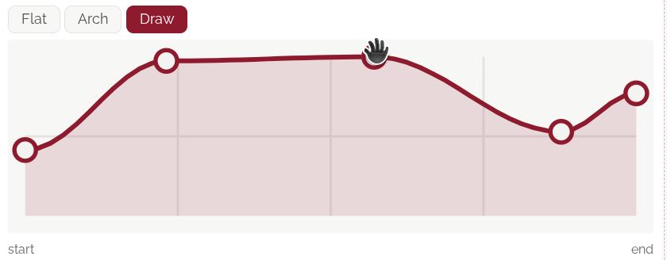

**הרשת של הגל.** הגרף מודד את העוצמה ברבעים ואת השיר בדקות ובשניות. הזמן שלו משתרע על האורך שנקבע ב**פלט** (אורך מרבי), ולא על האורך של השיר עצמו: המנוע פורש את הגל על פני האורך הזה. הקלד ב**שיר ≈** בערך כמה זמן השיר יימשך: קו מקווקו מסמן את סופו, ומה שמצויר אחריו לא נשמע. **Shift** משאיר נקודה נגררת על הרשת, לחיצה ימנית מסירה נקודה, והקריאה שמעל הגרף אומרת היכן הסמן עומד. הכפתור שליד הכותרת LoRA מרים אותם מעל הדף, עד 1800 px ברוחב, להזזות עדינות של הנקודות; Esc מחזיר אותם למקומם. קבע ב**פלט** אורך קרוב לאורך הצפוי, כדי שהגל יישמע כולו: טייק שהתבקש ל-9:00 נגמר ב-6:37, והרבע האחרון של הגלים שלו לא נשמע.

**קשת רגשית.** מתאם קול על קשת מתעצם לקראת אמצע השיר ונרגע בקצוות, והשיר נושם יחד איתו. במצב **לפי הסדר**, כששני מתאמים יחד עוברים את הקו האדום, את מה שהגל של העליון משחרר לוקח התחתון: דודוק על קשת מעל קול מעביר את השיר ביניהם. זה ניכר גם במדידות: בטייק שבו מתאם הדודוק צויר גבוה, אחר כך נמוך, ואז עולה, הסטם של כלי הנשיפה שהופרד מהשיר הלך באותו קו (−30 dB בהתחלה, −59 dB באמצע, −36 dB לקראת הסוף).

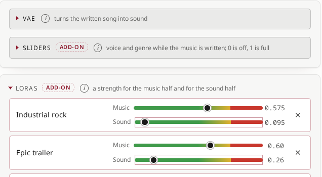

כל עוצמה יושבת על **דרך**: ירוק הוא בטוח, צהוב הוא הגבול שלה, ואדום הוא מעבר לגבול. הגבולות נמדדו:

- כל המתאמים באותה מידה, בעשיריות של הסליידרים: חצי המוזיקה ירוק עד **0.4**, אדום מ-**0.5**, ולכל היותר **0.75** (מתאם פרטיטורה, כזה שמתכנן ABC, שומר על גבולות משלו: ירוק עד 1.0);
- חצי הצליל ירוק עד **0.6**, אדום מ-**0.75**, ולכל היותר **1.0**;
- **מוזיקה, יחד** ו-**צליל, ביחד**: מתאמים שנערמים זה על זה מצטברים, וכל אחד יכול לשבת בירוק שלו בזמן שהסכום בכל זאת שובר את הפרטיטורה. בזמן שהמודל כותב את הפרטיטורה, חצי המוזיקה ביחד ירוק עד **1.2** ואדום ב-**1.4**, המרב שלו: בתוכניות של הנפחות (13–20.10.2026) אף אחת מ-6 לא נשברה עד 1.0 ביחד, 14 מתוך 35 נשברו בין 1.0 ל-1.2 (8 מתוך 10 על IRAEv3), ו-8 מתוך 9 מעל 1.2. כשיש פרטיטורה בטופס, חצי המוזיקה לא כותב פרטיטורה, והפס מגיע עד 3.5 (שלם עד 2.25 בטייקים אמיתיים, שבור מ-2.5). חצי הצליל ביחד ירוק עד 1.2, ולכל היותר 1.5. לתוכנית יש גם נתיך: במצב "תוכנית מלאה" כשעדיין אין פרטיטורה, מתאמים שעוברים ביחד את **1.0** (**0.8** על IRAEv3) מתכננים את הפרטיטורה כשהם מוחלשים באופן יחסי עד אליו, והשיר מושר עליה בעוצמות שלהם עצמם. תוכנית שיוצאת שבורה לא מושרת: עם זרע מוזיקה אקראי היא מתוכננת מחדש פעם אחת; מעבר לזה, או עם זרע קבוע, חלון בבל אומר מה הכביד עליה (המתאמים, מודל הליבה, הזרע, הנתיך), ולפי בקשה מתכנן אותה מחדש עם זרע חדש.

**תקציב.** עם שני מתאמים או יותר, **תקציב** מופיע מתחת לדרך. אף מצב לא דולק: אין תקציב, וכל אחד רץ בעוצמה שלו, כמו קודם; לחיצה נוספת על המצב הדולק משחררת את התקציב. **יחסי**: המתאמים שדוחפים על אותן שכבות חולקים תקציב אחד לכל חצי, והקו האדום הוא התקרה שלו; מעבר לו, כל אחד מוותר באופן יחסי. **לפי הסדר**: השורה העליונה לוקחת את העוצמה שלה ראשונה, הבאה את מה שהקו האדום משאיר, ואת מה שגל משחרר לוקח הבא; גרור את השורות בשם שלהן כדי לקבוע את הסדר. המנוע שומר על התקציב בכל רגע של השיר. אילו מתאמים חולקים שכבות, הנפחות מודדת בעצמה: חלונית העזרה על שם של מתאם אומרת היכן הוא דוחף (השכבות בכל חצי, קשב מול MLP, כמה הוא מזיז שכבה ב-1.0), וההערות שליד הכותרת LoRA אומרות מתי שניים חולקים שכבות ואיך הם מושכים: לאותו כיוון (יחד הם דוחפים חזק יותר ממה שהעוצמות שלהם אומרות), זה נגד זה, או בניצב. עוצמה שהתקציב מרסן מראה מה רץ בפועל: המספר שלה נצבע כתום, הדרך שלה מתעמעמת מעבר לנקודת החיתוך, וחלונית העזרה שלה אומרת למה; **מוזיקה, יחד** ו-**צליל, ביחד** מראים מה רץ מתוך מה שהתבקש (אותו סכום בשני המצבים, השורות שונות). הסליידרים זזים בעשיריות; לחיצה כפולה מאפשרת להקליד מאיות.

**מעבר לגבולות.** תיבת הסימון בסוף שורת התקציב מאפשרת לכל סליידר לעבור את המרב שלו (חצי המוזיקה עד 1.5, חצי הצליל עד 2), וגם לסליידרים המשותפים; הדרכים שומרות על הצבעים שלהן, כך שהאדום שנמדד עדיין נראה, והתקציב לא מרסן אף אחד. זה נועד למתאם שהגל שלו מנגן רק חלק מהשיר (דודוק חזק בפתיחה, ואז נעלם): הוא לא צריך לקחת את החלק שלו מהאחרים לאורך כל השיר. הפרטיטורה עדיין מתוכננת כשחצי המוזיקה מוחלש עד הנתיך של התוכנית (1.0 ביחד, 0.8 על IRAEv3), ואז מושרת בעוצמות שנקבעו. **מחוץ לפרטיטורה** (לחיצה ימנית על שורה): חצי המוזיקה שלו שר את הפרטיטורה אבל לא כותב אותה; התוכנית נעשית בלעדיו, והשורה מציינת *רק שר*.

**לחיצה כפולה** על מספר מאפשרת להקליד עוצמה מדויקת. הרמזים מתחת לבלוק אומרים מה חשוב: מילת הפעלה שחסרה בסגנון, מתאם שאומן במצב תכנון אחר, עוצמה שעוברת את הגבול שלה. כל עוד הסמן על סליידר או גורר אותו, העוצמה המדויקת מוצגת מעל הסמן בצבע של הדרך שלה. המתאם Instrumental נעצר ב-1.0, שם הוא מתחיל: מעבר לזה, הפרטיטורות שלו סוטות מהדרך.

**אומן על מודל אחר.** מתאם לומד על המשקלים שעליהם הוא מאומן: מתאם שלמד על YuE2 נקרע על הפיינטיון RS-FW (קול מתפורר, סגנון נמרח), ומתאם שלמד על RS-FW מתנהג כך גם על YuE2. הנפחות יודעת על מה כל אחד אומן (הקובץ שלו אומר זאת, או ההרצה במאמן שיצרה אותו; קובץ שלא אומר כלום נחשב מתאם של YuE2, כמו כל מתאם YuE2 מחוץ לנפחות) ומסמנת אותו מול המודל שבשימוש: **⊘** של מודל אחר, ולפני שהוא נכנס נשאלת שאלה (**שימוש בכל זאת**); **≈** אותו פיינטיון באפוק אחר, רק מסומן. ה-Tsunami Wave, RS-TW, צמח מעל RS-FW 2.4: עליו, מתאם שלמד על RS-FW מסומן ≈, הגל האחר של אותו פיינטיון, וכך גם מתאם שלמד על RS-TW כשהוא על RS-FW. כשמחליפים את המודל, המתאמים בשיר שאומנו על מודל אחר מושתקים, עם הודעה, וחוזרים מעצמם כשהמודל שוב שלהם; לחיצה ימנית על שורה מחזירה אחד מהם בכל זאת. IRA ו-IRAE נחשבים YuE2 (YuE2 שמתאמים מוזגו לתוכו).

> **מתאם פרטיטורה אינסטרומנטלי עם מילים לשירה.** מתאם כזה מתכנן פרטיטורות *בלי קו שירה*. ב-1.00 הוא נתן טייק עם תו אחד ב-127 תיבות של שירה: הזמר דיבר מעל שתי תיבות שחוזרות בלופ. עם מילים, החזק אותו נמוך, 0.3 עד 0.5. ה-⚠ שליד הכותרת LoRA אומר זאת כשזה קורה.

### פרופילים ומצבי תכנון <!-- #profiles-and-planning-modes -->

- **פרופיל** קובע בבת אחת את המצב, האורך, הדגימה, ההנחיה, הצעדים, ה-VAE, ה-LoRA והפלט; הטקסטים והזרעים נשארים. *שמירת פרופיל…* שומרת את הכפתורים הנוכחיים תחת שם.
- **מצב תכנון**:
  - **תוכנית מלאה**, ברירת המחדל: קודם נכתבות המנגינה והאקורדים (פרטיטורה שאפשר לערוך), ואחר כך השיר. הכי טוב לשירים חדשים.
  - **מנגינה בלבד**: תוכנית למנגינה, וליווי חופשי. מומלץ לקאברים.
  - **ישיר**: ישר מהמילים ומהסגנון, בלי פרטיטורה. כאן המקום של מתאמים שאומנו בלי פרטיטורה.
  - **אינסטרומנטלי**: בלי שירה, המתכון הרשמי של YuE2. הוא נמצא בצד ימין של הכותרת של מצב התכנון.
- **אקורדים**, מתחת למצבים: *כבוי*, *עדין*, *מגוון* או *נועז* — כמה רחוק מותר לאקורדים של פרטיטורה שהמודל מתכנן לנדוד. בלי התערבות, המתכנן נוטה לסובב מהלך אקורדים אחד לאורך כל השיר; *עדין*, *מגוון* *ונועז* גורמים לאקורד שנשמע בין החילופים האחרונים לחזור מאוחר יותר, ושומרים על אקורדי הפתיחה של קטע שונים מאלה של הקטע שלפניו, *ונועז* גם מאפשר לאקורד לצאת מדי פעם מחוץ לסולם. הם פועלים רק כשהמודל כותב את הפרטיטורה: "תוכנית מלאה" או "מנגינה בלבד", בלי פרטיטורה משלך או רק עם הפתיחה שלה. נמדד על התוכנית של שיר אחד: כשכבוי — שישה אקורדים, ורצף אחד של ארבעה אקורדים שלוש עשרה פעמים; בעוצמה של *מגוון* — תשעה אקורדים, והרצף הנפוץ ביותר ארבע פעמים. בעקבות Yeufonic, דרך yue2.cpp של timoncool. *עדין* הוא ברירת המחדל.
- **תוכנית מלאה או ישיר.** המילה של ויקטור אחרי שבוע של שירים: "ישיר" הוא פעם פוגע ופעם מחטיא, כמו SUNO (בערך שני טייקים טובים מתוך מאה, לפי הספירה שלו); "תוכנית מלאה" היא הדרך לכולם, גם בלי לקרוא אף תו של ABC: התגיות נשמרות, הצליל מתייצב, הדיבור מחזיק והטמפו צפוי. נמדד על הראפ שלו, ארבעה עשר טייקים מכל מצב, כש-Whisper מקשיב: הטייק הטוב מכולם היה של "תוכנית מלאה" עם המתכון השמרני שלו (84 % מהמילים נשמעו, 76 % ברבע האחרון). איפה ש"תוכנית מלאה" נכשלת, היא נכשלת בסוף: טייק ארוך כמו הפרטיטורה שלו, והתוכנית עשויה להכיל פחות קטעים מהטקסט (ואז הבתים האחרונים נשמטים, או שבית מוקדם יותר מושר שוב); אחרי המילים האחרונות ממשיכות להתנגן התיבות שנותרו בפרטיטורה, ואלה הן ה-10–15 s שאחרי הדעיכה האמיתית של השיר, לא ההנחיה. הקשב לסוף של טייק ב"תוכנית מלאה": *סיום ב…* חותך זנב, *יצירה מחדש מ…* כותבת מחדש סוף שאבד.

### קאברים, רמיקסים ופרטיטורה משלך <!-- #covers-remixes-and-your-own-score -->

- **קאבר או רמיקס**: קח את הלחן של הקלטה (*תעתוק*: רק המנגינה שלה, בלי המילים ובלי הזמר), או את המנגינה של אחד הטייקים שלך, ותן לו סגנון חדש. *המתעתק* שלו פועל בשני מצבים, ששמותיהם זהים בכל השפות: **Heretical**, ברירת המחדל (SheetSage2 עם זוויות bf16 שעליהן אומן), ו-**Refined** (הפיינטיון הקהילתי של anime-song, לא שלנו); כל אחד מהם אומר, כשהסמן מרחף מעליו, מה הוא ובמה הוא מסתכן.
- **התאמת קטעים** (ליד *תעתוק*, כשהפרטיטורה של ההקלטה כבר בטופס): Whisper שומע איפה בהקלטה מתחיל כל בלוק של המילים שלך, וכל בלוק מקבל את התגית של קטע הפרטיטורה שבו הוא מושר. המילים עצמן לא משתנות לעולם: בלוק שכבר נקרא בשם הסוג שלו שומר על התגית שלו, בלוק שלא נשמע נשאר במקומו (לא ודאי), פזמון שנכתב פעם אחת מועתק לכל מקום שבו הוא מושר שוב, והקטעים שהקול לא שר בהם מקבלים תגית ריקה. ההצעה מוצגת, ואפשר לערוך אותה, לפני שהיא נכנסת לטופס; המילים שהיו שם קודם נשמרות כגרסה. בעקבות YuE2-Studio של timoncool ו-Cover Studio של HOT-Step.
- **פרטיטורה משלך**: פרטיטורת ABC, שלפיה הולכים "תוכנית מלאה" ו"מנגינה בלבד". אפשר להעביר אותה בטרנספוזיציה (לקרוב ביותר, למעלה או למטה), להזיז קול אחד לפי דרגות הסולם, לייבא קובץ MIDI (קו מלודי אחד לכל קול), לייצא MIDI או סמנים ל-DAW, לטעון דוגמה, להפוך אותה לאינסטרומנטלית. כשיש כאן פרטיטורה, לחיצה על **יצירת שיר** שואלת קודם: על הפרטיטורה הזאת, או על חדשה (השדה מתרוקן, ומודל השיר כותב אחת). הפרטיטורה זוכרת את המתאמים ואת עוצמות המוזיקה שאיתם נכתבה (תוכנית, הפרטיטורה של הטייק עצמו); כשאלה שפעילים עכשיו שונים, שורה מתחתיה אומרת זאת, וגם השאלה: בעוצמות אחרות המוזיקה עלולה להתרחק מהפרטיטורה, ובעיקר ב-Industrial Rock ובשירים אינסטרומנטליים. במצב תוכנית מלאה הפרטיטורה נשארת פתוחה כל עוד יש בה פרטיטורה. **רק הפתיחה**, מתחת לפרטיטורה: הפרטיטורה שבשדה היא רק תחילת השיר, כמה תיבות שנוגנו ברול או במקלדת MIDI, שזומזמו ונכתבו מתוך הצליל, או שהוקלדו, והמודל מתכנן ממנה את המשך השיר, בסולם ובמשקל שלה; הפרטיטורה כולה, והפתיחה שלך ראשונה, מושרת ונשמרת כפרטיטורה של הטייק. "תוכנית מלאה" או "מנגינה בלבד"; *אקורדים* מכוונים את מה שהמודל מוסיף. בעקבות hum-to-song של Mothersuperior, דרך yue2.cpp של timoncool.
- **הפיאנו רול** (הכפתור עם החמשה, ליד *הסרת הפרטיטורה*): הפרטיטורה על כל החלון. למעלה, הפרטיטורה על נייר, פעמיים: כפי ש-YuE2 כתב אותה, וכפי שהיא עכשיו. למטה, הזמן זורם כלפי מטה אל שתי מקלדות, של Vocal מעל של Ins, הקלידים באותו גודל בכל מסך, והאוקטבות שמעבר להן בקצוות (כשהסמן מרחף שם, מופיעה מקלדת קטנה שלהן). לחיצה כותבת תו באורך הגריד, גרירה מזיזה אותו, הקצה התחתון שלו מותח אותו, לחיצה ימנית או Delete מסירות אותו; קול של YuE2 שר תו אחד בכל פעם, ולכן כשמניחים תו מעל תו אחר, התו הקודם מפנה לו את מקומו. הברות המילים עומדות על התווים של Vocal. **Shift** וקלידים יחד יוצרים אקורד שמוצב בתיבה של הסמן; מקשי המחשב מנגנים מקלדת וחצי (הלבנים על A…', השחורים על W…], ו-Z ו-X מזיזים אוקטבה), גם מקלדת MIDI מנגנת (**MIDI**), ועם **Rec** הקליד שמנגנים נכתב בסמן. **ניגון** (Space) מנגן מהסמן את המקור או את הגרסה הערוכה: את Ins בקלידים, את Vocal בשירה על שמות התווים, או את שניהם. **כתיבה לפרטיטורה** כותבת בחזרה רק את השורות שהשתנו. בלילה הנייר כהה, ביום אפור. הגיליונות עוקבים אחרי הרצועה (סמן הניגון, הסמן, או המקום שאליו נגללה הרצועה), והתיבה שביד מוארת בשניהם; גיליון שגוללים ביד מושך איתו את השני ואת הרצועה, ולחיצה על תו בגיליון מציבה את הסמן בתיבה שלו. Ins נשמע כפסנתר כנף; Vocal שר את התנועות עצמן, a, e, i, o, u, כפי שהזמרים של VocalSet מחזיקים אותן, בלי רעש לפניהן. **צליל ▾** ליד **ניגון** מחזיק את ה**דוושה** (*תווים ארוכים*, ברירת המחדל: תו של פעמה או ארוך יותר ממשיך להדהד אחרי סופו ודועך, עד שהדוושה מוחלפת בקו התיבה הבא; *תמיד*: כל תו; *כבוי*), את ה**אקוסטיקה** סביב הפסנתר והקול (*יבש*, *חדר*, *אולם*) ואת ה**מכסה** של פסנתר הכנף (*מורם*; *סגור*, כהה ורך יותר). מדריך הקלידים מונח, חיוור, מעל האוקטבות הנמוכות של הרצועה; תיבת הסימון שלו מקפלת אותו. **מנוע ← חומרה ← MIDI** מפעיל MIDI לכל הנפחות: מקלדת מנגנת ברול, ופורט ה-DAW של M-Audio Oxygen (Mackie Control) מפעיל את Play, Stop ו-Record. הדפדפן נותן MIDI רק לדף שנפתח כ-localhost או דרך https: ממחשב אחר, הרץ `ssh -L 7777:localhost:7777` אל המחשב של הנפחות ופתח את http://localhost:7777. חיצים בקצות המקלדות מזיזים את הקלידים באוקטבה, ו-◎ מחזיר אותם אל התווים של הפרטיטורה; ידית בין הגיליונות לרול נותנת יותר מקום לאחד מהם (נשמר; לחיצה כפולה: כמו בהתחלה), ובמסך גבוה הקלידים של Ins מקבלים את האורך האמיתי של קלידי פסנתר כנף. **ניגון** מנגן בטמפו שלידו (לפרטיטורה בטמפו חופשי אין טמפו, ולכן הרול לוקח את האחרון שנקבע), ו-↑ מחזיר גיליון להתחלתו. Vocal שר פראזה בקול אחד, על הברות המילים או על *דו רה מי*. גלגל הפיץ' של מקלדת MIDI מריץ את הסמן לאורך הזמן, וגלגל המודולציה שלה קובע את אורך התו החדש. **⇅ טרנספוזיציה**: גרור לאורך מספרי התיבות משמאל כדי לבחור מקטע, ואז צייר את ההזזה על קו של נקודות, בחצי טון, ברבע, בשליש או בחצי אוקטבה, באוקטבה או בשתיים, קבועה או גולשת; *למינור* או *למז'ור* הופכים חלק יחד עם האקורדים שלו, *בסולם* שומר את התווים שלו בתוך הסולם; *החלה* מתבטלת בצעד ביטול אחד. מספר הקלידים בכותרת פותח רשימה משלו: כמה קלידים יש למקלדת ה-MIDI שלך (88, 61, 37 או 25, ולכל אחד כתוב מה הוא) ואילו אוקטבות נראות; הטמפו, כפתור מודגש ליד **ניגון**, פותח רשימה משלו: −4, −1, +1, +4, סליידר והטמפו של הפרטיטורה עצמה. כשלא נבחרו תיבות, **⇅ טרנספוזיציה** לוקחת את הקטע שתחת הסמן. המילים עומדות גם מתחת לחמשת ה-Vocal בשני הגיליונות, והתווים הספורים שהפתיחה נותנת לקול לפני הבית שרים את ההברות הראשונות של הבית. גם פרטיטורה ש-YuE2 כתב בה תיבה שלא במשקל שלה (נניח 18/16) נפתחת: הרול קורא תיבה כזאת מיושרת (מה שחורג נחתך, תיבה קצרה מתמלאת בהפסקה) ואומר זאת, ושורה שלא נוגעים בה חוזרת כפי ש-YuE2 כתב אותה. הטקסט על הגיליונות כתוב ב-Noto Sans, מכווץ לרוחב כמו בדף מודפס: שמות הקולות ל-76 %, האקורדים והמילים ל-90 %.
- **דקלום המילים על פרטיטורה** (*הנחת המילים על הפרטיטורה הזאת…*, מתחת לפרטיטורה, כשהיא נקראת): הקריין מהפרומו של הנפחות, בשביל המילים שלך. כל שורה מונחת על התיבות של הפרטיטורה, הברה בשמינית (בשש-עשרית, כמו שמדקלמים ראפ, היכן ששמיניות היו משאירות שורות בחוץ) על צליל מהאקורד של התיבה שלה, נשימה אחרי פסיק ואחרי נקודה, וההברה האחרונה בשורה ברבע, נמוכה יותר; כל קטע מתחיל בפראזה של שתי תיבות אחרי תיבה של הפסקה, או אחרי ווקאליז כשמסמנים אותו. הכלים, האקורדים, הסולם והטמפו נשארים; הקטעים של הפרטיטורה הולכים אחרי התגיות שלך, עם פתיחה וסיום סביבם. לדיבור, לקריאות ולראפ מעל מצע: צור את המצע, *כתיבה מתוך הצליל*, ואז את זה; הוא שואל קודם, ו-Ctrl+Z בכל שדה מחזיר את הטקסט הקודם.
- **מצע אקורדים** (*מצע אקורדים* מתחת לפרטיטורה: הסולם, המשקל, הטמפו והכפתור *כתיבת מצע*): פרטיטורה בלי מנגינה, רק השלד שלה. כל קטע במילים שלך מקבל תיבות, בערך 2.5 s לכל שורה מושרת, בזוגות של תיבות; ברייק, פתיחה וסיום מקבלים כמה תיבות משלהם, ובכל תיבה יש אקורד; התיבות של הקול הן הפסקות, ושל הכלים ריקות. הסולם והטמפו נלקחים מהסגנון כשהוא מציין אותם, וכל לחיצה מגרילה מהלכים חדשים: אחד לבתים, אחר לפזמונים, שלישי לגשרים. מצב התכנון עובר למצב *תוכנית מלאה*. המודל כותב את המנגינה בעצמו ושר את המילים שלך מעל ההרמוניה הזאת: האקורדים והמבנה הם בחירה שלך, ואת הלחן הוא מוצא. נמדד על שני טייקים (22.10.2026): הצליל הלך אחרי האקורדים של המצע תיבה אחר תיבה, קרוב יותר מכל 300 הערבובים של אותם אקורדים ומאותם אקורדים בכל סולם אחר; המודל שר מעל ההפסקות (הקול ב-75 % וב-34 % מהפריימים, לעומת 79 % ו-49 % בפרטיטורה מתוכננת); וטייק לא מוגבל לאורך המצע: שניהם נמשכו כ-70 s על מצע של 40 s, והמשיכו עם המהלך האחרון שלו. הועבר מ-YuE2-Studio של timoncool (MIT).

### דגימה והסרת רעש <!-- #sampling-and-denoising -->

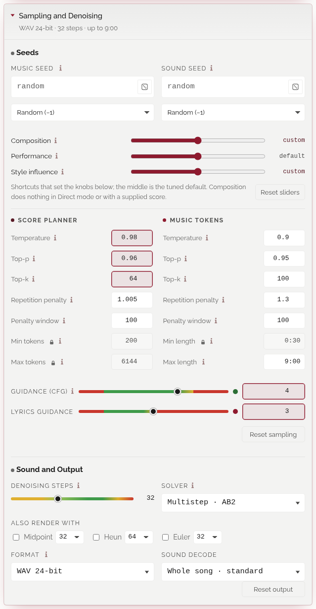

ברירות המחדל מכוילות. שלוש שורות ה**צורה** (הלחנה, ביצוע, סגנון) מזיזות את הכפתורים יחד בחמש דרגות; הכפתורים עצמם נמצאים מתחתיהן.

- **מתכנן הפרטיטורה** ו**טוקני מוזיקה**: טמפרטורה, top-p, top-k, קנס על חזרה, חלון הקנס.
- **מינימום טוקנים** ו**מקסימום טוקנים** **נעולים** מפני עריכה מקרית: לחץ על ה-🔒 שליד השם כדי לשנות אותם, ושוב כדי לנעול אותם. הרצפות הן נתיכים: פרטיטורה לא יכולה להסתיים לפני 200 טוקנים, והמוזיקה לא לפני 750 (30 שניות; אורך מבוקש קצר יותר מוריד את הרצפה עד לאורך הזה). המקסימום של המוזיקה מוצג כ**אורך מרבי**, ביחידות זמן (25 טוקנים לשנייה), בלי מנעול: זה האורך המרבי של השיר, והוא נקבע רק כאן (ב"צליל ופלט" אין שדה אורך).
- כל כפתור מוחזק בתוך גבולות שפויים; ערך שחורג מהם מוחזר פנימה, והדף אומר זאת.
- **הנחיה (CFG)**: ההנחיה של המוזיקה, המשיכה של הסגנון בשלב המוזיקה; 1.6 כברירת מחדל בכל מצב.
- **הנחיית מילים**: ההנחיה של המילים עצמן, בנפרד מזו של הסגנון: ענף שלישי, הפרומפט בלי המילים שלו, לצד השניים שתמיד היו להנחיה; 2.2 כברירת מחדל. האוזן של ויקטור, על שיר עם אחד: הנחיה 4.0 עם המילים ב-2.2 היא הבהירה ביותר, 3.0 עם 2.2 בהירה באותה מידה, 3.0 עם 1.6 נותנת עומק משלה, המילים ב-2.6 מביאות את השייקר קדימה; ב-1.6 המילים נמסות, קטיפתיות. כשהן שוות, חצי מהמילים נסחפות להזיה, ה-С (s) הולכת לאיבוד וההטעמה של התנועות משתבשת: שמור על הפרש של 0.4 עד 1.0 בין השתיים. נורית ליד כל שדה אומרת זאת: ירוק בתוך הטווח של ויקטור (המוזיקה 1.0–4.0, המילים 1.0–2.6, בהפרש של 0.4 או יותר), כתום מעט מעבר לו, אדום הרחק מעבר לו; אף ערך לא נחתך לגבול. כשהשדה ריק, המילים הולכות אחרי "הנחיה", כמו קודם.
- **צליל ופלט**, החלק התחתון של הבלוק: **צעדי הסרת רעש** ו**פותר** לחצי הצליל, **פורמט** (WAV 24-bit, 16-bit, 32-bit float או MP3 עם הביטרייט שלו); *איפוס הפלט* מחזיר אותם לקדמותם. מבין הפותרים, *Midpoint · לגרסה סופית* וכן *Heun* קוראים לרשת פעמיים בכל צעד, *Multistep · AB2* (Adams–Bashforth מסדר שני: משתמש שוב בצעד הקודם) קורא לה פעם אחת בכל צעד, ואילו *Euler · טיוטה* קורא לה פעם אחת, מסדר ראשון. אחריהם **פענוח הצליל**: *השיר כולו · סטנדרטי* (ברירת המחדל, והפענוח היחיד בכל מקום אחר בנפחות) או *מדרגות · ניסיוני*: חצי הצליל בחתיכות שוות של כ-20 s, שכל אחת מהן שומעת 2 s מעבר לקצוות שלה, והמפגשים ביניהן בקרוספייד; על אותם קודים ואותם זרעים התוצאה קרובה לפענוח של השיר כולו, אבל לא זהה. **חיתוך שיאים** כבר אין (HERESY 2007): המנוע נהג להגביר את השיר ולחתוך את הדגימות החזקות ביותר שלו לקו שטוח, קליפינג קשה בלי look-ahead בכל רגע רועש; עכשיו השיר נכתב ברמה של המפענח עצמו, בלי הגברה ובלי חיתוך לעולם (הוא מונמך בדיוק כמה שצריך כששיא היה עובר את הסקאלה המלאה ב-WAV של 16 או 24 ביט; רק MP3 עובר נורמליזציה), והעוצמה היא תפקידו של המאסטר, במלטש. אחריו **שירים ארוכים**: *שלם · עד חלון אחד* (ברירת המחדל) מגביל שיר למה שחלון אחד של חצי הצליל מכיל (בערך 6 עד 7¾ דקות עם ההקשר המלא, לפי האורך של הסגנון, המילים והפרטיטורה; פחות כשיש פחות "שורות הקשר" בהגדרות המנוע), ולכן שיר אף פעם לא מודבק מחלקים; כשהחלון קוטע אותו, הטייק אומר זאת. *בחלקים · ניסיוני*, לשירים ארוכים באמת, נותן למוזיקה להמשיך ופותר אותה בשני חלקים שווים או יותר, שהחלונות שלהם שומעים 6 s מעבר לכל מפגש ונפגשים בקרוספייד של 4 s; מפגש כזה עדיין עלול להיות שקט יותר בכ-1 dB למשך כמה שניות.

**מתכון שמרני לרוסית** (של ויקטור, לפי האוזן): הלחנה *נמוך*, ביצוע *נמוך*, השפעת הסגנון *חזק*: מתכנן הפרטיטורה בטמפרטורה 0.85, top-p 0.92, top-k 40, טוקני המוזיקה ב-0.85, 0.93, 80, קנסות החזרה 1.005 ו-1.3 בחלון של 100, הנחיה 1.6 והנחיית המילים 2.2; 32 צעדי הסרת רעש עם Midpoint. בלי האצה, ראפ בקצב מתון. זה הפרופיל המובנה *Musical Heresy of Creator's Ear*, ואת ערכיו קובע ויקטור: "שמירה" מעליו ב"פרופילים" שומרת על Forge את הערכים של ויקטור, ו"מחיקה" מחזירה את אלה.

### "יצירת פרטיטורת ABC" ו"יצירה" <!-- #create-abc-score-and-generate -->

- **יצירת פרטיטורת ABC** כותבת את הפרטיטורה ונעצרת: קרא אותה, ערוך אותה, ואז *יצירת שיר* מרנדרת בדיוק את הפרטיטורה הזאת. פרטיטורה שכבר נמצאת בשדה מוחלפת, אחרי שאלה.
- **ניסויים** ו**וריאציות**, ליד "יצירה": "ניסויים" הוא מספר הניסויים, ובכל אחד מהם המוזיקה נכתבת מחדש, עם זרע מוזיקה משלו (seed, seed + 1…); המנוע כותב בבת אחת כמה שה-batch שלו מאפשר, ואת השאר במעברים נוספים. "וריאציות" הוא מספר הפעמים שהצליל של כל ניסוי מרונדר מהמוזיקה האחת שלו, ולכל וריאציה זרע צליל משלה, זהה בכל הניסויים: כל אחת עולה בערך זמן של צליל אחד, וכמעט שום זיכרון. יוצאים ניסויים × וריאציות טייקים: 2 × 4 = 8.
- **יצירת שיר** מריצה את הכול. ההרצה מציגה את השלבים שלה תוך כדי.

### בבל בפרטיטורה <!-- #babel-in-the-score -->

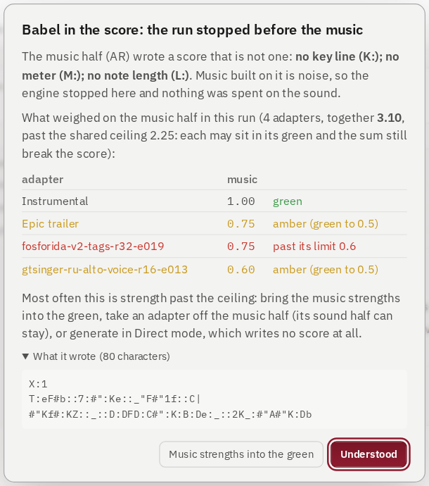

כשחצי המוזיקה כותב זבל במקום פרטיטורה (כך עושים מתאמים שנדחקו מעבר לגבולות שלהם: בלי סולם, בלי משקל, רצפים של נקודתיים), **המנוע עוצר את ההרצה לפני שנעשית על הפרטיטורה הזאת מוזיקה כלשהי**, תוך שניות במקום דקות. החלון אומר למה, אילו מתאמים הכבידו על חצי המוזיקה וכמה מעבר לגבולות שלהם, מראה מה נכתב, ויכול להחזיר את עוצמות המוזיקה לירוק בלחיצה אחת.

**שומר האקורדים.** אקורד שבלע את התווים שלו עוצר גם הוא את היצירה, והשיר מתוכנן מחדש פעם אחת עם זרע מוזיקלי חדש (זרע שקבעת נשאר שלך: אז החלון). אקורדים שמתנדנדים בין הטוניקה של הסולם לשכן שלה בחצי טון תיבה אחר תיבה, או עם דיאז כפול או במול כפול, נקובים מתחת לפרטיטורה וכשהשיר מגיע, עם **כתיבה מחדש של הפרטיטורה**: מוזיקה כרומטית עושה זאת גם בכוונה, אז הקשב קודם.

### הטייק <!-- #the-take -->

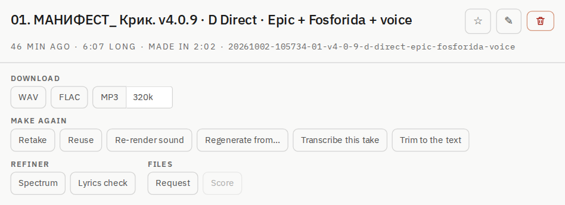

- **הכותרת**: ▶ והכפתורים של הטייק בשורה הראשונה שלה (👍 👎 ☆, הספרן, שינוי שם, מחיקה), ובסופה ⇆ ו-⤡, שמרימים מסגרת מעל החדר; מתחתיהם השם, בשורה אחת; ומתחת לזה, איך הטייק נוצר.
- **הורדה**: WAV, FLAC (אותן דגימות, בערך שלושה רבעים מהגודל), MP3 בביטרייט לבחירתך.
- **יצירה חוזרת**: *טייק חדש* (טייק חדש מאותה בקשה), *שימוש כבסיס* (הבקשה חוזרת אל הטופס), *רינדור מחדש של הצליל* (אותה מוזיקה, צליל חדש), *יצירה מחדש מ…* (ההתחלה נשמרת, והשאר נכתב מחדש), *תעתוק הטייק הזה*, *קיצוץ לפי הטקסט* (חיתוך הזנב שאחרי השורה המושרת האחרונה), *סיום ב…* (הטייק מסתיים ברגע שבוחרים, עם דעיכה ב-2 s האחרונות; מתוך הלטנטים השמורים שלו, תוך שניות), *פייד-אין…* (השניות הראשונות שלו עולות מהשקט, 2 s אלא אם תגיד אחרת; באותה דרך). *הארכה…* שומרת את כל הטייק וממשיכה מעבר לסופו, עוד 0:15 עד 2:00, עם שורות חדשות אחרי השורות שלו אם תיתן אותן (טייק שתוכנן עם פרטיטורה ממשיך במצב ישיר: הפרטיטורה שלו נגמרת היכן שהטייק נגמר).
- **עריכה** (כל פעולה יוצרת טייק חדש; הנוכחי נשאר): *חיתוך…* שומר את הרצף שבין קטע אחד לקטע אחר; *הסרת קטע…* מוציאה קטעים; *חזרה על קטע…* מנגנת פעמיים את הקטעים המסומנים, והעותק מיד אחריהם (הפזמון האחרון פעם נוספת); *הוספת חלק…* מציבה עותק של קטע אחד אחרי קטע אחר (פתיחה או ברייק כאינטרלוד); *מהירות…* מאיצה או מאטה אותו, וגובה הצליל נשמר. הכול על קווי התיבה של הפרטיטורה (הפרטיטורה של הטייק עצמו, או זו שנכתבה מתוך הצליל שלו), כל חיבור מאוחה בקרוספייד קצר, והפרטיטורה מחוברת בהתאם. כל אחד מחלונות הדו-שיח האלה, וגם אלה של התפריט של צורת הגל עצמה, מציג את צורת הגל של הטייק עם המקטעים מסומנים: מה מועתק, לאן הוא הולך, מה יוצא ומה נשאר, לפי הסימונים שלך.
- **מלטש**: *ספקטרום*, *בדיקת מילים*. **קבצים**: הבקשה והפרטיטורה. *לופ…*: 1, 2, 4 או 8 תיבות על קווי התיבה של הפרטיטורה, מהתיבה שבה עומד הנגן, בלי תפר (הסוף שלו זורם אל ההתחלה), נשמר כ-WAV שבשמו הטמפו והסולם שלו.
- **הערה**: מה הצליח, מה לתקן, לאן הוא הולך.
- הכרטיס שמתחת אומר איך הטייק נוצר: מצב, פורמט, VAE, מודל, צעדים, הצורה, ה-LoRA עם העוצמות והגלים שלהם, שני הזרעים (העתק אותם כדי לחזור עליו).
- **מעל החדר** (⤡) הטייק עומד בשתי עמודות: מה לעשות איתו, הסגנון והמילים שלו משמאל; איך הוא נוצר, ה-VAE והפרטיטורה שלו מימין. טייק חדש נפתח כשהסגנון והמילים שלו מקופלים; הכלים עומדים בקבוצות ממוסגרות.

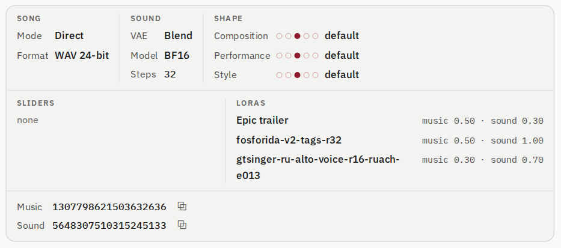

### החלפת קטע <!-- #replace-a-section -->

כשהנפחות תזמנה את המילים של טייק בשמיעה (הקטעים מצוירים על צורת הגל של הנגן), אפשר לשיר קטע אחד מחדש, ושאר הטייק נשאר כמו שהיה. לחיצה ימנית על צורת הגל מעל הקטע ← **החלפת הקטע הזה…**.

- **מה מושר**: כל קטע שנשמע בבירור הוא צ'יפ; זה שלחצת עליו מסומן, ואפשר לסמן עוד, עד שמונה. כל קטע מסומן מציג את השורות שלו כפי שהן כתובות במילים: שנה את המילים, או השאר אותן ותן רק למוזיקה להתחדש. חלון הדו-שיח אומר כשבמילים החדשות יש יותר הברות ממה שהיו בקטע (המודל שר אותן מהר יותר או חורג מעבר לחיתוך), או פחות. **שירה מחדש** מתחילה את זה.
- **מה מתקבל**: גרסה אחת או שתיים, כל אחת טייק בפני עצמו וצאצא של הטייק הזה, ששמה נגזר מהקטע ומטווח הזמן שלו ("Song · Chorus 1:02–1:25 anew A"). הן נוחתות במרחב של הטייק (ב"החלפת קטע" כשהמרחב ההוא לא מקבל טייקים חדשים) ומופיעות ב"טייקים", כל אחת כשהיא מוכנה.
- **איך זה מחובר**: החיתוכים נמצאים בהפסקות שזוהו בשמיעה סביב הקטע. המוזיקה של הטייק עד החיתוך הראשון נשמרת, הקטע מושר על זרע מוזיקה חדש ומחובר למוזיקה של הטייק עצמו שאחריו, בטוקנים של המודל עצמו, והכול מרונדר מחדש עם זרע הצליל של הטייק: מה שלא הוחלף נשמע כמו שנשמע, והחיבורים לא נשמעים. כמה קטעים מושרים בזה אחר זה והאורך נשאר זהה, כך שהחיתוכים המאוחרים יותר נשארים היכן ששמעת אותם.
- **בנגן** המקטע החדש צבוע ומוקף בקו, ומעליו "מחדש"; הכרטיס שלו אומר שהשאר הוא כמו שההורה שלו יצר אותו.
- **עריכות קטנות מצליחות הכי טוב**: שורה עם אותו מספר הברות, מילה, תגית. זרע חדש עלול גם לשיר קטע בלי המילים שלו: הקשב לשתי הגרסאות. בדיקה שכל גרסה שרה את המילים שלה תגיע ב-2.1.0.
- **שירה חוזרת…** ו**הוספת אינטרלוד אחריו…** (אותו תפריט): הקטע מושר שוב מיד אחרי עצמו, ישר או אחרי כ-4 או 7 s של מוזיקה, כווריאציה על זרע המוזיקה של הטייק + 1 (וגם + 2), לא כעותק; או כ-5, 7 או 10 s של מוזיקה אחריו, בלי ששום דבר מושר שוב. המודל מנגן כמה שהוא רוצה, ולכן הנפחות חותכת לפי הקול של הטיוטה עצמה, שמופרד על המעבד, ועל קווי התיבה של הפרטיטורה: נכנסות תיבות שלמות מהמוזיקה של הטיוטה (מהאמצע שלה, כשהיא ניגנה יותר זמן), והמוזיקה של הטייק עצמו אחריהן ממשיכה בפעמה שלה. טייקים חדשים; הנוכחי נשאר.
- **שירה מחדש של השורה הזאת…** (אותו תפריט, מעל שורה): רק השורה הזאת מושרת מחדש על זרע מוזיקה חדש, עם המילים שלה משונות או כמו שהן, והחיתוך באמצע הדרך אל השורות שסביבה; שאר הטייק נשאר כמו שהיה. היכן שהשורות זורמות זו לתוך זו בלי נשימה ביניהן, הקשב לשתי הגרסאות.
- **שירת חלון מחדש…** (אותו תפריט, בכל מקום על צורת הגל, בלי צורך בקטעים): מקטע שמניחים בגרירה על צורת הגל של הטייק, ומושר מחדש עם מתאמים משלו: בהתחלה המתאמים של הטייק עצמו, כל אחד עם עוצמת המוזיקה ועוצמת הצליל שלו והגל שלו לאורך החלון (שטוח, קשת, עלייה, ירידה), ואפשר להוסיף עוד מתוך loras/ שלך. על פני המעברים שלפניו ואחריו (2 s כל אחד בהתחלה) המתאמים של הטייק מפנים מקום למתאמי החלון ובחזרה, כך שהשינוי נכנס ויוצא במקום להתחלף בבת אחת; שאר הטייק נשאר כמו שהיה, ומרונדר מחדש על זרע הצליל שלו עצמו. גרסה אחת או שתיים, צאצאים של הטייק, שמסומנות בנגן כמו קטע שהוחלף.

### עורך הקטעים <!-- #the-section-editor -->

עריכה › **עורך הקטעים…** בתפריט של טייק פותח את השיר על פני כל חדר המוזיקאי, כפס של הקטעים שלו, אלה שצורת הגל של הנגן מציגה: בשמיעה, כשהמילים שלו כבר מתוזמנות, ואחרת לפי הסימונים של הפרטיטורה. העריכות שבוחרים ממתינות בתור ומושרות כטייק חדש אחד; בטייק עצמו לא נוגעים לעולם.

- **בחירה והאזנה**: לחץ על קטע או עבור ביניהם עם ← →; Space מנגן את הקטע שנבחר, מתחילתו ועד סופו.
- **עריכות**: מתחת לפס, שמונה העריכות שיש בתפריט של הטייק: *החלפת הקטע הזה*, *שירה מחדש של השורה הזאת*, *שירה חוזרת* וגם *הוספת אינטרלוד אחריו* (בשמיעה), *חזרה על קטע* וגם *הסרת קטע* (על קווי התיבה של הפרטיטורה), *שירה מחדש מכאן ועד הסוף* (מההפסקה של הקול שלפני הקטע) וגם *הארכה* (מעבר לסוף). התשיעית, *הוספת חלק אחריו*, מציבה עותק של אחד החלקים של הפרטיטורה ברווח שאחרי הקטע, על קו התיבה שלו: היא יושבת ברווח, לא על הקטע, ולכן לקטע עצמו יכולה להיות עריכה משלו, ו"החלפת הגשר והוספת אינטרלוד אחריו" היא הרכבה אחת. עריכה שאי אפשר להחיל על הקטע שנבחר מוצגת באפור, וחלונית העזרה שלה אומרת למה. כל אחת שואלת רק את מה שחלון הדו-שיח שלה שואל.
- **התור**: מה שמוסיפים ממתין לפי סדר השיר, עריכה אחת לכל קטע, ולכל אחת ✕; המילים שלצדו מציגות את הטקסט כפי שהוא יושר. שתי עריכות על קטע אחד, עריכה בתוך המקטע של עריכה אחרת, שני סיומים, או כל דבר אחרי שירה מחדש עד הסוף נדחים, עם הסיבה. התור נשמר לטייק גם אחרי טעינה מחדש של הדף.
- **הרכבת הטייק**: התור מושר כטייק חדש אחד, צאצא של הטייק הזה, שנשאר כפי שהוא. העריכות המושרות עוברות במנוע אחת אחרי השנייה, טיוטה לכל אחת, ואז הטייק כולו מרונדר פעם אחת על זרע הצליל שלו עצמו; "חזרה על קטע" ו"הסרת קטע" נחתכות על קווי התיבה תוך שניות. מה שמכניסים לתור במוזיקאי בינתיים מושר ראשון; הטיוטות מוסתרות ברגע שהן נוחתות, והולכות לפח. שלב שנכשל עוצר את התור ואומר למה: *המשך משלב…* או *השלך*. *הרכבה נוספת* שרה את אותו תור שוב על זרעים חדשים.
- **מה מתקבל**: הטייק החדש נוחת היכן שהטייק הזה נמצא, ושמו נגזר מהעריכות שלו ("Song · Chorus anew · an interlude after Bridge A"); ההערה שלו מונה אותן, והנגן צובע את מה שהושר מחדש ולוקח את הטייק החדש, בהשהיה, אלא אם הפעלת בינתיים טייק אחר.
- **המילים**: אחרי *חזרה על קטע*, *הסרת קטע* או *הוספת חלק אחריו*, המילים של הטייק החדש הולכות אחרי המוזיקה שלו (בית שהוסר נעלם, פזמון שחזר מושר פעמיים), ומוצגות עם ההבדלים שלהן לצד הפס; הכותב שומר אותן כתת-גרסה של הגרסה של השיר (v2.0.3 → v2.0.3.1), שנפתחת עם ההבדלים שלה לעומת הגרסה שממנה יצאה.

### הפרטיטורה <!-- #the-score -->

התוכנית של הטייק כחמשה או כ-ABC: הדפס אותה ל-PDF (US Letter, לאורך או לרוחב), ייצא MIDI או סמנים, *עריכה ורינדור מחדש* או פתח אותה במסך מלא.

## כותב <!-- #writer -->

### שירים כמסמכים <!-- #songs-as-documents -->

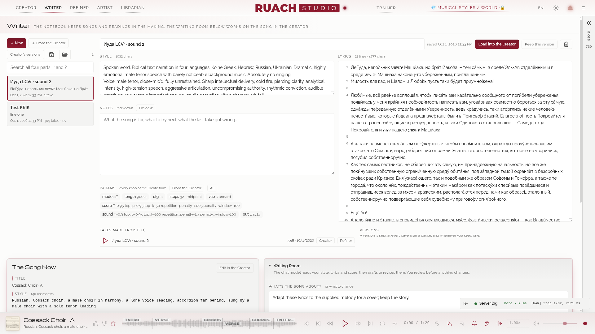

כל שיר יכול לחיות בכותב כמסמך: ה**סגנון**, ה**מילים**, ה**הערות** (Markdown, עם תצוגה מקדימה) וה**פרמטרים** שלו (כל הכפתורים בטופס של המוזיקאי). *חדש*, *מהמוזיקאי* (הטופס כמו שהוא), *טעינה למוזיקאי*.

- **גרסאות**: *שמירת הגרסה הזאת* בכל רגע; *שחזור הגרסה הזאת*, או לקחת אותה *כמסמך חדש*.
- **רוחב הרשימה**: גרור את הקצה שבין הרשימה למסמך (← → מהמקלדת, לחיצה כפולה מחזירה את הרוחב המקורי).
- **טייקים שנוצרו ממנו**: כל טייק שהבקשה שלו הגיעה מהמסמך הזה.
- **השיר עכשיו**: השם, הסגנון, הסולם, המשקל והטמפו של הפרטיטורה (הסגנון חייב להתאים להם), המילים; *עריכה במוזיקאי*.
- **כלי המילים** (2478, 2472): שדה המילים סופר כמו זה של המוזיקאי (פעמות לפי זמן, הסרגלים של הבית ושל הפזמון, בדיקת סימני ההטעמה); **aa** הופך כל אות רישית לקטנה, ו-Shift+לחיצה משאירה אות רישית שנושאת סימן הטעמה (базилиО́); **AA** הופך את הטקסט המסומן לרישיות. גרסה מוצגת מראה מה שונה בה ממה שיש עכשיו, שורה אחר שורה (2477).
- **ייצוא הכול** (הדיסקט) ו**ייבוא** (התיקייה): כל המחברת בקובץ אחד לגיבוי, כל מסמך עם הגרסאות שלו, הטייקים שנוצרו ממנו והפח; ייבוא מוסיף את מה שחסר, לא נוגע במה שזהה, ומניח מסמך ששונה ליד המסמך בעל אותו שם, כעותק: שום דבר לא נדרס.

### פרופילי טקסט <!-- #text-profiles -->

איך טקסט מודבק נעשה מוכן לקריאה: כללי החלפה לפי הסדר (טקסט מילולי או ביטויים רגולריים), ואחר כך הצורה (`[Intro]`, `[Verse]` בשורות ריקות, `[Interlude]` אחרי פסקאות ארוכות). *+ כלל*, ואז **ניסיון מתוך המילים** מראה מה ייצא, לפני השמירה.

### חדר הכתיבה <!-- #the-writing-room -->

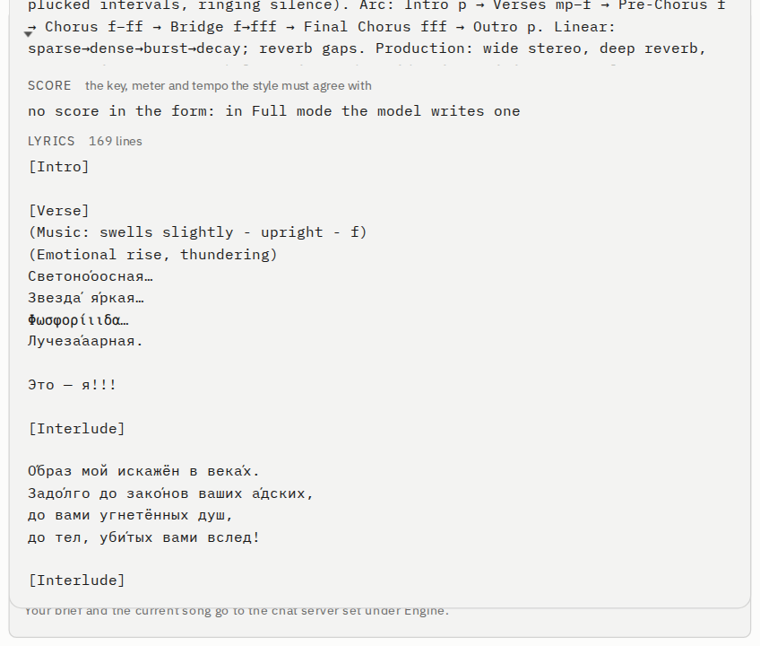

מודל צ'אט קורא את הסגנון, המילים והפרטיטורה שלך, ואז מנסח להם טיוטה או משכתב אותם. **שום דבר לא משתנה עד שתחיל את הטיוטה.**

- **על מה השיר?** או מה לשנות; **עזרה עם** הסגנון, המילים או שניהם; **מבנה**: סדר הקטעים למילים חדשות.
- הכותב: אלה שמסומנים תחת מנוע ← הכותב והעטיפה ועונים עכשיו (הכותב של הנפחות עצמה, vLLM, LM Studio, Ollama, OpenRouter), וכותב מקומי מוצג עם המודל שטעון בו; כשאין אף אחד, החדר אומר זאת ומראה את הדרך לשם (2097). שדה המודל של OpenRouter מציע את כל הרשימה שלו בזמן ההקלדה, כל מודל עם המחיר שלו למיליון טוקנים בקלט ובפלט ועם ההקשר שלו; המחיר של המודל שנבחר מופיע מתחת לשדה, ועל שם שהרשימה לא מכירה נאמר שהוא לא מוכר.
- **לאן הטיוטה הולכת** (2471): למסמך שפתוח במחברת, אלא אם הוא השיר שביד המוזיקאי, ואחרת לשיר של המוזיקאי; השורה שמעל הכפתור אומרת לאן, ולחיצה אחת הופכת את הכיוון. "החלה" כותבת למסמך ושומרת את הגרסה הקודמת בין הגרסאות שלו.
- **שליחת הבקשה ל-LLM** (Ctrl+Enter). עם הכותב של הנפחות עצמה, החדר סופר קודם את השאלה ואומר כמה נשאר לתשובה (הוא קורא 32 768 טוקנים); **עצירה** או Esc קוטעים את התשובה, ושום דבר לא משתנה בשיר שלך.
- הטיוטה: **החלת הטיוטה**, **שימוש במילים** או **שימוש בסגנון**; *ביטול פעולה* מבטל אותה. שדה שהמודל השאיר כמו שהיה מוקף בקו מקווקו ומסומן "ללא שינוי"; על טיוטה ריקה לגמרי מודיעים מעל הדף, והיא לעולם אינה מוצגת כמוכנה. כשהטיוטה משנה את המילים שלך, היא אומרת כמה שורות ומראה אותן, הישנה מעל החדשה, ו"החלה" שואלת קודם: עם המילים, בלעדיהן, או בכלל לא. טיוטה שהתבקשה לסגנון בלבד לעולם אינה נוגעת במילים, והמבנה נשלח רק עם המשימות שכותבות מילים.

### SOUL: מה המודל קורא <!-- #soul-what-the-model-reads -->

לכל אחד משני העולמות של הכותב, של המוזיקאי ושל הקריין, יש **SOUL** משלו: המילה הקבועה שלך למודל הצ'אט, שנקראת בכל טיוטה מיד אחרי ההוראות המובנות של אותו עולם. זה השדה **העדפות הכתיבה שלך** שמתחת לבריף: כשקריאה פתוחה במחברת, יש בו את ה-SOUL של הקריין, ואחרת את זה של המוזיקאי.

- **היכן הוא נמצא**: בנפחות, לא בדפדפן, בתיקייה של הכותב: `writer/soul-creator.md` (המוזיקאי) ו-`writer/soul-reader.md` (הקריין). העדפות שנפחות ישנה יותר שמרה בדפדפן עוברות מעצמן ל-SOUL של המוזיקאי, פעם אחת, כל עוד הוא ריק (2842).
- **מה הוא יכול**: הוא עומד מעל ההוראות המובנות; היכן ששניהם חלוקים, המודל הולך אחרי ה-SOUL. מלבד מגבלות האורך: הסגנון של שיר נשאר בתוך 200 תווים בלי רווחים ולעולם לא מעבר ל-400, והקול של קריאה בתוך 160 כולל הרווחים, מה שלא יבקש ה-SOUL.
- **גרסאות**: כל שמירה שומרת את הטקסט שלפניה כגרסה (30 האחרונות לכל עולם). **ייצוא הכול** ו**ייבוא** מעבירים את שני ה-SOUL יחד עם המחברת; SOUL מיובא ממלא רק SOUL ריק, ו-SOUL ששונה משלך נשמר לצידו כגרסה, ולעולם לא דורס אותו.
- **אין לערוך את קובצי ה-SOUL ידנית.** כתוב בשדה: הנפחות שומרת גרסאות רק של מה שעובר דרכו. SOUL שנשבר בעריכה ידנית (חצי משפט, יומן שהודבק, כלל שסותר את צורת התשובה) נקרא במלואו בכל טיוטה ומקלקל בשקט כל אחת מהן, בלי שום שגיאה שתראה זאת. *קריאת ההנחיות המלאות לכתיבת שירים* שמתחת לשדה מראה בדיוק מה המודל קורא.

## מלטש <!-- #refiner -->

### אחרי הרינדור <!-- #after-the-render -->

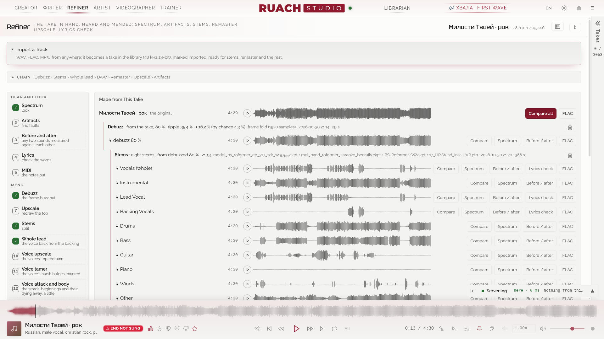

בחר טייק מימין; הכלים פועלים עליו, או על סטם שלו. העמודה מימין מחזיקה את **הטייקים שלוטשו כאן**, הליטוש החדש ביותר ראשון (*מלוטשים* שליד *מועדפים* מעביר אותה לכל הטייקים, כדי להתחיל ליטוש חדש), ואחרי טעינה מחדש החדר חוזר לטייק שהיה בליטוש.

השלבים הם צמתים על הקנבס שלמטה, משלושה סוגים לפי מהלך העבודה: **ניתוח** (ספקטרום, ארטיפקטים, מילים), **תיקון** (אנטי-זמזום, אפסקייל, סטמים) ו**גימור** (DAW, רימאסטר). לחיצה על צומת פותחת את השלב שלו בחלון מעל הקנבס, ומה שנוצר מהטייק תלוי על העץ שלו. שלבים שפלאגין מביא מצטרפים ל**גימור** עם מסגרת מקווקווה (ראה `docs/PLUGINS.md`). שלב של פלאגין שמסומן **GPU** רץ על הכרטיס של משימות המעבדה, בתורן, ושלב שנועד לסוג קובץ אחד (למשל, סטם קול) בוחר כמקור את הקובץ האחרון מהסוג הזה, עד שתבחר אחר.

כל מה שנוצר מטייק תלוי על ה**עץ** שלו (*מה שנוצר מהטייק הזה*), החדש ביותר למעלה: קודם **המקור**, עם הנגן שלו וה-FLAC שלו, ואחריו כל ענף, שאפשר לנגן אותו ולהשתמש בו כמקור לשלב הבא. מה שרץ נראה בכל מקום שמסתכלים בו: בראש החדר, בראש הבלוק של השלב עצמו, וכנקודה פועמת על הכרטיסייה שלו. הבלוק של כל שלב מפרט מה הוא יצר לטייק (*נוצר כאן*: לחיצה מוצאת את זה בעץ), והשלב הפתוח מאיר את הענפים שלו. **מחיקה** בקצה הכותרת של ענף מעבירה אותו לפח של הטייק (עם שאלה; ענף שנוצרו ממנו אחרים שואל שוב ולוקח אותם איתו); **פח** שמתחת לעץ מחזיר ענף, ו**ריקון הפח** מוחק לצמיתות. לעץ יש מקום משלו בסוף עמודת השלבים של המלטש: **מה שנוצר מהטייק הזה** תחת *הטייק הזה*, והסימון שלו הוא מספר הענפים; לחיצה פותחת אותו במקום שבו עומד שלב, והוא מאיר את הענפים של השלב שממנו הגעת. לכל מה שרץ על Forge יש גם פס משלו מעל הנגן בכל חדר, עם הזמן שנותר לו. כשמוניטור שמור ב**אודיו I/O** (יציאה שנייה ב-Forge), בכל שורה יש **ב-Forge**: הקובץ מתנגן דרכו מהמקום שבו עומד הנגן שלו, ולחיצה נוספת עוצרת אותו.

**השוואת הכול** (בשורה של המקור, או *השוואה* בכל ענף) פותחת את כל הגרסאות בנגן אחד, כמו ש-SUNO מחליף גרסאות: המקור, זה שעבר אנטי-זמזום, הרימאסטרים, האפסקיילים, הסטמים. לחיצה על גרסה אחרת, או המספר שלה (1–9), מנגנת אותה **מאותה שנייה**; Space מנגן ומשהה, ← → זזים חמש שניות, Esc סוגר. גם אותה מוזיקה בטייקים אחרים עומדת שם, אחרי המקור: הרינדורים החוזרים שלה עם VAE אחר או זרע צליל אחר, כל אחד בשם של ה-VAE שלו, של הזרע שלו ושל זמן יצירתו; טייק שנתת לו דיסלייק לא נכלל. כל גרסה נשמעת כמו שהיא, והעוצמה שלה כתובה בשורה שלה. מעל צורת הגל מופיעה השנייה שמתחת לסמן, ומתחתיה סרגל: הדקה היא השנתה הגבוהה ביותר, אחריה חצאי דקה ורבעי דקה, ואז השניות (פחות מהן בטייק ארוך). ⏪ ⏩ קופצים לסימונים של הצעד של הנגן עצמו; המתג שליד הזמן שומר על השנייה כשמחליפים גרסה, או מתחיל את האחרת מתחילתה (גרסה שהסתיימה תמיד מתחילה את הבאה מ-0); 👎 דולק מציג את הגרסאות שקיבלו דיסלייק, אפור מסתיר אותן, וזה נשמר בזיכרון. לחיצה ימנית על גרסה פותחת את התפריט של הטייק שלה: למלטש, יצירה חוזרת על התווים שלה, וכל השאר. מתג היישור (דולק, ונשמר בזיכרון) ממקם כל גרסה לפי הצליל שלה מול הראשונה, כך שהחלפה שומרת על המוזיקה ולא על השעון: הדפסה דרך ציוד חוזרת באיחור, והעיכוב שלה כתוב בשורה שלה. גרירה על הסרגל יוצרת לופ A–B שמנגן את המקטע הזה; לחיצה שם או Esc מסירה אותו. 🫣, שליד הדגל, הוא המצב העיוור: הגרסאות מעורבבות ונקראות A, B, C…, כל מה שמבדיל ביניהן מוסתר, והשמות שלהן חוזרים כשהוא כבוי. גרסה שבשם שלה מופיע "the original" (באותיות קטנות או גדולות) אינה מוסתרת: היא שומרת על השם שלה, על הקבוצה שלה ועל המקום הראשון, ורק האחרות מעורבבות ומקבלות שמות, כך שהמקור תמיד לנגד העיניים. 📄 פותח את הסגנון והמילים של הגרסה שמתנגנת בגיליון לצד החלון, והגיליון עוקב אחריה כשמחליפים; בכותרת החלון מופיע שם הגרסה שמתנגנת. הספרן משווה בין שניים לשנים-עשר טייקים מסומנים. ליד ⏪ ⏩ עומדים "המשך ניגון", "מעגל" ו"ערבוב" (כבויים עד שמדליקים אותם, ונשמרים בזיכרון): בסוף גרסה הבאה מתנגנת מתחילתה, "מעגל" חוזר מהאחרונה אל הראשונה, ו"ערבוב" מנגן כל אחת פעם אחת באקראי. הסליידר קובע את עוצמת הקול של החלון עצמו עד 150 %, באדום מעל 100 %; ×2 מכפיל את גובה הגל, כפתור הפסים צובע אותו (חם היכן שהבס מוביל, קר היכן שהגבוהים מובילים), ו"רחב" מרחיב את החלון עד 2000 px; הכול נשמר בזיכרון. +dB נמצא בכותרת החלון. טייק שמתנגן בנגן ממשיך בחלון מאותה שנייה, והגרסה שמתנגנת כשהחלון נסגר ממשיכה בנגן (לא במצב העיוור). הפקדים של הנגן עצמו (ניגון, הצעדים, המצבים, הזמן ועוצמת הקול) באים קודם; השאר עומד 20 px אחריהם. M מסמן את הרגע: מילה או שתיים נכנסות להערה של הטייק כשורה "1:23 — המילה", ודגל מוצב על צורת הגל.

**קנה מידה אחד לכל הגרסאות** (2094): חלון ההשוואה מצייר את צורת הגל של כל גרסה באותו קנה מידה, והחלק העליון שלו 2 עד 3 dB מעל השיא החזק ביותר מביניהן, כך שגרסה חזקה יותר נראית חזקה יותר ושקטה יותר נראית נמוכה יותר; סימוני ה-dB עומדים משמאל לגל, הקווים שלהם מתחתיו, והגל גבוה ב-10 px (ב-20 כשהוא כפול בגובהו).

### ייבוא רצועה <!-- #import-a-track -->

WAV, FLAC, MP3… מכל מקום: הקובץ הופך לטייק בספרייה (48 kHz, 24 ביט), מסומן *יובא* ומוכן לסטמים, לרימאסטר ולכל השאר. המילים אינן חובה; בדיקת המילים משווה אליהן.

### השלבים <!-- #the-steps -->

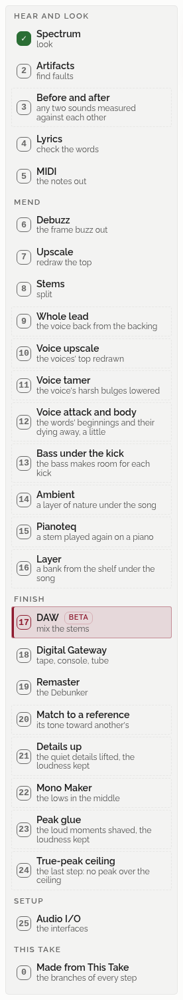

אין שרשרת מוכנה מראש: שרטט בעצמך את המסלול של הטייק על הקנבס, מצומת לצומת (ראה *המסלול שלך* למטה), או התחל מפייפליין, ו**הרצת המסלול** שבראש החדר מריצה אותו. במסלול שמפצל סטמים מהטייק שעבר אנטי-זמזום (ואפסקייל), הרימאסטר עושה להם מיקס, כך שגם הפריסט והדה-אסר שלו פועלים שם; אפסקייל לפני הפיצול נותן למפרידים לשמוע את כל השיר, ואפסקייל בסוף מצייר מחדש את הגבוהים שהסטמים והרימאסטר משאירים (היס מעל 20 kHz, כמעט כלום מעל 22). אחד אחד:

1. **ספקטרום**: ספקטרוגרמה, ספקטרום ממוצע, אנרגיה לפי פסים; הנח עליו טייק אחר כדי להשוות.
2. **ארטיפקטים**: טון שלא עוזב, זמזום 25 הפריימים של ה-VAE בגבוהים, קליקים, קליפינג, נשירות, סטריאו שנלחם בעצמו. לחיצה על זמן מנגנת משם.
3. **אנטי-זמזום**: המפענח של YuE2 כותב צליל בפריימים של 1920 דגימות, 25 בשנייה, והגבוהים שלו רועדים איתם. זה מסיר את החלק שנעול לשעון הפריימים הזה מעל 2 kHz. 80 % הוא הבחירה של האוזן; 100 % מדלדל את ההתקפה.
4. **מילים**: Whisper מאזין ומשווה את מה שהוא שומע למילים שלך, דקה אחר דקה; *תזמון השורות* לתזמון קריוקי. על סטם הווקאל הוא שומע את המילים בלי המוזיקה. השורות המתוזמנות יורדות כ-.lrc וכ-.srt, וגם כ-**.lrc (מילים)**, שבו לכל מילה זמן משלה, בשביל נגן ששר יחד (השורות נשארות שלך; רק הזמנים באים מ-Whisper).
5. **סטמים**: ארבעה סטמים (BS-Roformer לקול, ואז htdemucs_ft לתופים, לבס ולשאר; וגם האינסטרומנטל), שישה סטמים (אותו קול, ואז BS-Roformer-SW של jarredou: תופים, בס, גיטרה, פסנתר והשאר), שמונה סטמים (השישה, כשהקול מפוצל לשניים במודל קריוקי, **Lead Vocal** ו-**Backing Vocals**, וכלי הנשיפה מוצאים מתוך השאר), או ווקאל + אינסטרומנטל. כל סטם נושא את השם הנכון שלו (Lead Vocal, Drums, Winds…) בעץ, בהורדה שלו וב-DAW שלך. *מקור* הוא הטייק או קובץ שלו שעבר אנטי-זמזום או אפסקייל, ולכל מקור סט משלו; ה-DAW שלך מקבל את הסט החדש ביותר מכל סוג.
6. **רימאסטר**: מיקס של הסטמים או לקיחת הטייק עצמו; ניקוי, דה-אסינג, לפי הצורך כיוון מחדש 440 ← 432 Hz, עוצמה (LUFS) ושיא אמיתי. כל הרצה היא ענף חדש. הפריסט והדה-אסר פועלים על הסטמים לפני המיקס: כשהמקור הוא הטייק או כל קובץ בודד הם כבויים, ובמסלול הם פועלים כשהמסלול מפצל סטמים. **גוון** מניח שכבה מתחת לשיר לפני העוצמה: ויניל, סרט, חדר, קסטה (ההיס שלה, וואו ופלאטר), רדיו (הפס של רדיו ישן, מונו, עם הרחש הסטטי של השידור) או אולם, −60 עד −20 dB מתחתיו; קסטה ורדיו משנים גם את השיר עצמו.
7. **אפסקייל**: UniverSR מצייר מחדש את החלק העליון של הספקטרום; מתחת לתדר החיתוך המקור נשאר דגימה בדגימה. על רימאסטר (השלב האחרון של מסלול) כל הקובץ מונמך אם הגבוהים החדשים עוברים את תקרת השיא האמיתי של הרימאסטר.
8. **שער דיגיטלי**: הטייק או כל ענף דרך אופי אנלוגי במספרים על Forge: סרט (30, 15, 7.5 או 3.75 ips: בליטת הראש, הגבוהים, היס, וואו ופלאטר, אזימוט), קונסולה, מנורה (עם השקיעה שלה), שנאי או ויניל (נמוכים במונו, פצפוץ, נהמה). העקומה רצה באוברסמפלינג; התוצאה באותה עוצמה שבה הגיעה, השיא האמיתי שלה מתחת לסף של −0.3 dBTP, והעץ מראה מה היא מוסיפה לטון של −12 dBFS. נקודות הפתיחה קובעות אופי בלחיצה אחת; ענף שלו יכול להיות המקור של השער האנלוגי או של הרימאסטר.
9. **קול ראשי שלם**: בסט של שמונה סטמים, היכן שהפיצול הכניס את הקול הראשי ל-Backing Vocals (חזק שם יותר מאשר בראשי, חזק מספיק וממורכז), הוא מוחזר ל-Lead Vocal עם מעברים הדרגתיים קצרים. הקול הראשי וקולות הרקע יחד נשארים מה שהיו, דגימה בדגימה: המיקס לא משתנה, רק הסטם שמחזיק את הקול. שניהם חוזרים כגרסאות של הסטמים שלהם, בשביל ה-DAW והשלבים הבאים של המסלול; העץ מראה היכן הקול הועבר ולכמה זמן.
10. **אפסקייל לקולות**: UniverSR על סטמי הקול בלבד (הראשי וקולות הרקע, או הראשי לבדו) מצייר מחדש את האוויר, הנשימה והחדות של העיצורים שהמפרידים עמעמו, והשאר נשמר דגימה בדגימה מתחת לתדר החיתוך; כל אחד חוזר בקצב הדגימה של הסט עצמו כגרסה של הסטם שלו. ה**אפסקיילר** שלו הוא UniverSR לבדו (ברירת המחדל) או החבילה של שלושה, UniverSR, Apollo-vocal ו-FlashSR, שממוזגים מעל החיתוך: ממוצע (לפי המדידה, הכי קרוב לגבוהים של הקול עצמו), החזק ביותר, או אוויר (ממוצע עד 16 kHz, החזק ביותר מעל); **גבוהים מצוירים** מרים או מנמיך את מה שהם ציירו. הפייפליינים *קולות: עדין, רגיל, חזק, אוויר, בהיר* משתמשים בו. Apollo-vocal אינו מסחרי (CC BY-NC-SA 4.0): שיר שנעשה איתו מותר לשתף, לא למכור; FlashSR מגיע בשימוש הראשון, המשקלים שלו מהמודלים של הנפחות עצמה (Apache 2.0, כפי שהצהיר המחבר שלו) והקוד שלו ממנו.
11. **לפני ואחרי**: כל קובץ בעץ מול מה שממנו הוא נוצר (מיקס או רימאסטר של סטמים מול הקובץ שממנו פוצלו הסטמים; הטייק, כשאין שום דבר אחר), או מול כל קובץ שנבחר כ**לפני**: קובץ אחר בעץ, טייק אחר, ייבוא (הדפסה דרך ציוד, רפרנס). השניים מיושרים לנקודה שבה הם נפגשים (הדפסה דרך לולאה חוזרת באיחור) ומושווים בעוצמה שווה: עוצמה, שיא אמיתי, שיא מעל העוצמה, טווח עוצמה, קרסט, רוחב, קורלציה, שמאל מול ימין, רצפי קליפינג; הספקטרוגרמות של שניהם וההפרש ביניהן (אדום: חזק יותר אחרי, כחול: שקט יותר); הספקטרומים הממוצעים וההפרש ביניהם; הדינמיקה (מה איבדו הרגעים החזקים והשיאים החדים ביותר); מה שאף מסנן לא מפיק מהקובץ שלפני (עיוות, רעש, פאמפינג); פסק דין במילים. שתי תמונות ברזולוציה טובה להורדה ודף נוחתים בעץ.
12. **התאמה לרפרנס**: הטון של קובץ מוזז לכיוון הטון של רפרנס (קובץ מהעץ של הטייק הזה או טייק אחר), בלי קשר לעוצמה: עד שמונה פסים של ה-DAW עצמו (תדר, הגבר, Q), וכל אחד נשאר רק אם הוא עוזר ונשאר בתוך הגבול שקבעת. הקובץ חוזר עם אותו EQ ברינדור, בעוצמה שבה הגיע או כמו הרפרנס, ולעולם לא מעל −1 dBTP; **אל המאסטר של ה-DAW** בענף שלו מעביר את הפסים ל-EQ של המאסטר, כדי לשמוע אותם בזמן אמת על המיקס שלך.
13. **מונו בנמוכים**: מתחת לתדר מסוים (120 Hz, אלא אם תבחר אחר) הצד של הסטריאו מוסר, בלי הזזת פאזה, והאמצע נשאר כמו שהיה: הבס והקיק יושבים במרכז, והסטריאו שמעל נשאר איפה שהוא חי. הכלי הראשון של שאומרוב על אפיק הכלים ועל המאסטר; הענף מראה כמה מהנמוכים היה צד לפני ואחרי.
14. **הדבקת שיאים**: קומפרסור עדין לפני כל דבר אחר: רק הרגעים החזקים מאבדים את ה-dB שביקשת (3, אלא אם תבחר אחרת), הטרנזיינטים החדים ביותר עוברים, והקובץ חוזר באותה עוצמה שבה הגיע. הוא לא מחזיק תקרה: זה התפקיד של השלב הבא.
15. **תקרת שיא אמיתי**: השלב האחרון של מסלול: לימיטר עם אוברסמפלינג והסתכלות קדימה מחזיק −0.5 dBTP (או −0.3, −1), ומד שיא אמיתי בודק אותו. *כמו שהגיע* רק תופס את החריגות בעוצמה של הקובץ עצמו; יעד עוצמה (−14, −11, −9 LUFS) דוחף לתוכו, עם לכל היותר 6 dB של הגבלה.
16. **מאלף הקול**: על סטמי הקול, היכן שהספקטרום של הקול בולט באותו רגע מעל המהלך שלו עצמו (תהודה, אוברטון חד: הזאב שבקול), הבליטה מונמכת בחלק ממידת הבליטה שלה, לכל היותר 4 dB אלא אם תבחר אחרת, בכניסה וביציאה רכות; כברירת מחדל רק מה שעולה מעל הצבע הרגיל של הקול עצמו, ושום דבר מתחת ל-2.5 kHz, שם חיות התנועות. במה שאינו בולט לא נוגעים; "s" מצלצלת מתרככת היכן שהיא מצלצלת ולעולם אינה נקטעת; הגבר אחד לשני הערוצים שומר את הקול היכן שעמד. soothe2 ו-SpecCraft של שאומרוב, שנלקחו כרמז; הענף מראה כמה מהזמן הוא פעל והיכן.
17. **התקפה וגוף הקול**: על סטמי הקול, תחילות המילים מורמות מעט (לכל היותר 2 dB) וגם הדעיכה של צליל מעט (1.5 dB); תנועה מוחזקת והשקט נשארים כמו שהם: הקול יוצא קדימה בלי הלחיצה של קומפרסור. שני קומפרסורי הטרנזיינטים של שאומרוב על הקול, שנלקחו כרמז.
18. **בס מתחת לקיק**: הקיק מאותר בסטם התופים; בזמן שהוא נשמע, האוקטבה הנמוכה של סטם הבס (מתחת ל-120 Hz, אלא אם תבחר אחר, בפיצול בלי הזזת פאזה) יורדת עד 3 dB, במידה שהקיק חזק; בין הקיקים ומעל נקודת הפיצול הבס הוא מה שהיה. דורש סט שבו התופים והבס נפרדים; soothe2 של שאומרוב בסייד-צ'יין מהקיק, שנלקח כרמז.
19. **הרמת פרטים**: שלושה פסים; בכל אחד, הרגעים השקטים מורמים לעבר הרמה החזקה של הפס עצמו, החזקים לעולם לא נדחקים למטה, ורצפת הרעש וההיס נשארים; מעורבב ב-10 %, כמו ששאומרוב משתמש ב-OTT, ואז חוזר לעוצמה שבה הגיע: מה שעולה הוא הפרטים שמתחת לחלקים החזקים, לא הרמה.
20. **MIDI**: MuScriptor (Mirelo ו-Kyutai) כותב את הטייק, או כל קובץ בעץ שלו, כתווים: קובץ MIDI עם רצועה לכל כלי שהוא שומע (34 קבוצות עם שמות והתופים; הוא לא נותן עוצמות הקשה, כל תו ב-100). הוא יורד מהעץ או מדף הנתונים של הטייק, ו**פתיחה בפיאנו רול** מכניסה אותו לפרטיטורה של המוזיקאי (הסולם מנוחש מהתווים, הקול ל-Vocal, קו של כלי ל-Ins). סטם נותן רק את הכלי שלו. שלושת הגדלים שלו מגיעים ממנוע ← מודלים ו-LoRA ← צליל ל-MIDI; על המעבד, שיר של ארבע דקות לוקח בערך דקה וחצי בקטן, שלוש דקות בבינוני ואחת-עשרה בגדול. המשקלים של MuScriptor הם CC BY-NC 4.0: לשימוש לא מסחרי בלבד.
21. **אמביינט**: קמין, גשם, רעם, יער, מפל, נהר הררי, ציפורים טרופיות או כנרית מתחת לשיר, כערוץ משלו ב-DAW עם פיידר משלו; כשהוא נוצר מחדש, הוא גרסה של אותו ערוץ. *הקלטות* הן הקלטות שטח מהבנק של הנפחות (models/refiner/ambient), בלופ בלי תפר, וההקלטה הראשונה והשנייה של כל שכבה נבחרו באוזן; *סינתזה* רק לגשם קל ולרעם. השכבה יושבת מתחת לשיר ב-dB שקבעת היכן שהיא נשמעת, נכנסת ויוצאת בפייד, יכולה לנשום עם השיר, ובפתיחה יכולה לעמוד קרוב יותר ולשקוע מתחת לקול כשהוא נכנס; הרעם מכה קרוב ורחוק לסירוגין, בשיאי השיר או באקראי. *רק כאלה שמותר לשתף* (מופעל) מנגן רק הקלטות שהמקליט שלהן קבע להן רישיון חופשי (CC0 או סימן נחלת הכלל). בלי הבנק מתנגנת רק הסינתזה.
22. **Pianoteq**: סטם מהסט מנוגן מחדש על ידי Pianoteq, פסנתר במידול פיזיקלי שיש לקנות ולהפעיל בעצמך ב-modartt.com (הנפחות אינה כוללת דבר ממנו). חלץ את הארכיון שלו אל `models/refiner/instruments/pianoteq/` (או ציין את התוכנה שלו ב-`user/pianoteq.json` בתור `{"path": "…"}`), הפעל אותו פעם אחת, בצע אקטיבציה עם המספר הסידורי שלך וסגור אותו: השלב מוצא אותו שם ומנגן עם עותק של ההעדפות שלו, שבהן שמורה האקטיבציה, בלי לכתוב אליהן לעולם. בחר את הסטם (הפסנתר, אלא אם תבחר אחר), את הכלי (Steinway D, Bösendorfer 280VC, C. Bechstein DG, גיטרה קלאסית ועוד; כלי שלא קנית מנגן כדמו, וחלק מהקלידים שותקים), את הדינמיקה, מהסטם או אחידה, את המגע, את דוושת הסוסטיין שמוחזקת לאורך כל פראזה, את מה שהוא מנגן וטרנספוזיציה. ה-MIDI שלו הוא של הטייק עצמו כששלב **MIDI** יצר כזה מהסטם הזה, ואחרת הוא מתועתק כאן על ה-CPU; הרינדור חוזר ברמה ובאורך של הסטם, כערוץ משלו ב-DAW עם פיידר משלו, או כגרסה של הסטם. לפי הרישיון של Modartt אסור לאמן מודל על הצליל שלו: הענף אומר זאת. **החלון של Pianoteq עצמו** נפתח מהשורה שמתחת לשדות של השלב (הפריסט שלו, וכמה ממנו שינית): כל אחד מהפריסטים שלו מתוך דפדפן לפי קטגוריה וכלי, עם המילים שלהם וחיפוש, קודם מה שהרישיון שלך מנגן במלואו והדמואים במרחק סימון תיבה אחת, מסומנים; הפריסטים הקטנים שלו (ריוורב, כיוון, עקומת עוצמת הקשה, מיקרופונים, אקולייזר, אפקטים); ואחר כך כל הגדרה שהמהדורה שלך מאפשרת לשנות, במילים וביחידות של Pianoteq עצמו, שמונת המיקרופונים כמיקסר (מופעל, רמה, פאן), ומה ששונה מהפריסט מסומן וניתן להחזרה אחד אחד עם ↺ או הכול בבת אחת; A/B למצב שני להשוואה. **▶ האזנה** מנגנת איתו פראזה קצרה (אקורדים, ארפג'ים, מדרגות של דינמיקה, כל המקלדת) לפני שמנוגן סטם כלשהו, ו**שמירה ב-Pianoteq…** שומרת אותו כפריסט משלך בבנק "Ruach Studio", שם Pianoteq עצמו מוצא אותו. מה שהמהדורה שלך נועלת מופיע ברשימה עם הערכים שלו. השלב שומר את המצב (בפרופילים ובמסלול) רק כשהוא אומר יותר ממה שאומרת רשימת הכלים, והרינדור מנגן אותו כקובץ פריסט. החלון שואל את Pianoteq דרך השרת שלו עצמו, על עותק של ההעדפות שלו ועל התקן שמע שקט משלו: שום דבר לא נשמע ברמקולים שלך, והשרת נעצר עשרים שניות אחרי השאלה האחרונה.
23. **Organteq**: סטם מנוגן מחדש על עוגב צינורות על ידי Organteq, העוגב במידול פיזיקלי של Modartt: העותק שמותקן כאן, קנוי או גרסת הניסיון החינמית של Modartt (הנפחות אינה כוללת דבר ממנו). חלץ אותו אל `models/refiner/instruments/organteq/` (או ציין את התוכנה שלו ב-`user/organteq.json` בתור `{"path": "…"}`). הוא מנגן את סטם ה-piano, אלא אם תבחר אחר, על המנואל של העוגב (C2–C7: תו שמחוץ לטווח זז באוקטבות), בלי פדל; ה-MIDI שלו, הדינמיקה שלו והרמה והאורך של הרינדור הולכים כמו אצל Pianoteq. השלב מציג שנים-עשר עוגבים, מ-Romantic Cathedral ועד Royal Chapel of Versailles; החלון שלו, החלון של Pianoteq עצמו, מכיל את כל ה-56 ואת כל ההגדרות של כל אחד מהם, כולל הרגיסטרים.
24. **Airteq**: סטם מנוגן מחדש על ידי Airteq, הכלים המונעים באוויר של Modartt (חלילים, כלי עלה, קרנות, פדים קשתיים ונשופים, דרונים): העותק שמותקן כאן, קנוי או גרסת הניסיון החינמית, מחולץ אל `models/refiner/instruments/airteq/` (או מצוין ב-`user/airteq.json`). הוא מנגן את סטם ה-winds, אלא אם תבחר אחר (ואחריו other, vocals, instrumental, piano). השלב מציג שלושה-עשר פריסטים, מ-Classical Flute ו-Peruvian Flute ועד Reed of West, Jericho Horns ודרון שמתפתח מעצמו; החלון שלו מכיל את כל ה-176.
25. **מגבר (NAM)**: סטם מהסט מנוגן דרך לכידה של מגבר, פדל או שרשרת שלמה שנעשתה ב-Neural Amp Modeler (NAM), כמו ש-Pianoteq מנגן סטם: ערוץ משלו ב-DAW, או הגרסה של הסטם. ברשימה שלו הלכידות של ה-Studio (`models/refiner/nam/`) לפי סוג, כל אחת עם הציוד שלה, מי לכד אותה והרישיון שלה, ואחריהן שלך: כל קובץ `.nam` שתשים תחת `user/nam/` (את התיקייה ה-Studio יוצר בעצמו), שנקרא מחדש בכל פעם שאתה פותח את השלב. הלכידות של ה-Studio מגיעות עם ההתקנה כחלק *מגברי NAM* של **מנוע ← מודלים** (3 MB); איפה שהן עוד לא כאן, השלב אומר זאת עם כפתור אל החלק הזה. **קבינט** שם קבינט אחרי המגבר: הקבינט הכללי הוא מסנן, לא קבינט מוקלט (הפס של רמקול גיטרה, בערך 80 Hz עד 5 kHz, ועקומת האמצע שלו); *אוטומטי* שם אותו אחרי מגברי הגיטרה של ה-Studio שנלכדו בלי קבינט (ראשים) ומשאיר כמות שהם פדלים, מגברי בס, שרשראות והלכידות שלך. **דרייב** קובע כמה חזק הסטם פוגע בלכידה, **יציאה** את רמת התוצאה מול העוצמה של הסטם עצמו (אפס שומר על מקומו במיקס בכל dry/wet), **Dry/wet** כמה מגבר אתה שומע: תערובת בהספק שווה, מוחזרת לעוצמת הסטם. ה-Studio מנגן את הלכידה על המעבד, כל ערוץ במעבר משלו, ואומר במילים מה שהוא לא יכול: לכידה שנעשתה עם חלק של NAM שהוא עוד לא קורא מופיעה ברשימה מעומעמת עם הסיבה שלה, וסטם שקט או לכידה שלא נותנת צליל משאירים משפט, אף פעם לא טייק ריק.

**פייפליינים.** ליד **הרצת המסלול** עומד המסלול שביד: **המסלול שלי** או פייפליין כנקודת התחלה. הנפחות מגיעה עם *ליטוש מהיר*, *שיר: סטמים ורימאסטר*, *שיר: מיקס ה-DAW שלי*, *שיר: אוויר מלא*, *סרט חם*, *דיבור* וגם *רק מבט*, ופלאגין יכול להביא פייפליינים משלו. פייפליין משורטט על הקנבס מצומת לצומת; *עקיפה במסלול* בתפריט הלחיצה הימנית של צומת מדלג על שלב שלו. כל שלב פועל על מה שהשלב שלפניו יצר, קובץ או סט הסטמים כפי שתוקן עד אותה נקודה, כך שהרימאסטר וה-DAW עושים מיקס לקול הראשי השלם ולקולות שצוירו מחדש, ולא לסטמים כפי שפוצלו. *כפי שה-DAW מכוון* לוקח את המיקס שה-DAW מחזיק לטייק הזה. את החוטים של פייפליין אפשר לחתוך ולשרטט מחדש כמו את אלה של המסלול שלך: מהחיתוך או מהחוט הראשון הוא נעשה **המסלול שלי**.

**הרבה טייקים.** התאם קודם את המסלול על טייק אחד; ואז **סל** שליד **הרצת המסלול** מחזיק עד עשרה טייקים להריץ עליהם את המסלול: **+ הטייק שביד** מכניס את הטייק שביד, התפריט של הספרן מכניס טייקים מסומנים (**לסל של המלטש**), ✕ מוציא אחד, **ריקון** מרוקן אותו, ו**הרצת המסלול על N** מריצה את המסלול שביד עליהם, אחד אחרי השני על Forge, אחרי שהיא שואלת קודם. שורת האצווה שלידם אומרת כמה התקדמה, מה נכשל ואיזה טייק ביד; **עצירה** נותנת לטייק הזה להסתיים ומדלגת על השאר.

### הקנבס: צמתים וחוטים <!-- #the-canvas-nodes-and-wires -->

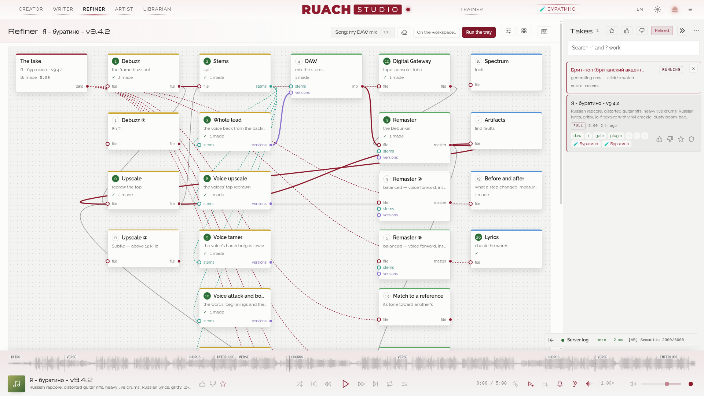

המלטש הוא קנבס של צמתים, כמו ש-ComfyUI פורש את שלו: הטייק וכל שלב בעמודות לפי מהלך התהליך, מחוברים בחוטים בכיוון שבו הצליל זורם, ובפינה השמאלית התחתונה מה שמזין אותם, ייבוא רצועה ואודיו I/O; בראש העמודה הימנית ביותר **מה שנוצר מהטייק הזה**, והחלון שלו הוא העץ של כל הקבצים שנוצרו מהטייק. המסלול שנבחר או שורטט עובר לאורך החלק העליון של הקנבס: קודם הטייק ואחריו כל שלב לפי הסדר, וכל בדיקה לצד השלב האחרון או מתחת לשלב שממנו היא מסתעפת; מה שמחוץ למסלול עומד מתחתיו בעמודות, מעומעם, וזרימה שנבחרת מהרשימה מסדרת את הקנבס מחדש לפי המסלול שלה. באודיו I/O נמצאים היציאה, הכניסה וקצב הדגימה של השער האנלוגי, וגם **בדיקת לולאה** שלו; מקרא החוטים עומד במקום פנוי בינו לבין הטייק. הקנבס הוא חלון בגובה כל מה שנשאר מהחדר, מעל העולם שבו עומדים הצמתים שלו: הגלגלת מזיזה אותו (**Shift**: הצידה), וכך גם גרירה על השטח הריק שלו; **Ctrl+גלגלת** משנה את קנה המידה שלו מ-50 % עד 200 % סביב הסמן, במקום את קנה המידה של הדף; **⤢** בפינה שלו מציג אותו כולו, והאחוזים שלצדו מחזירים ל-100 %. הצמתים ממוספרים לפי זרימת התהליך, קודם שלבי המסלול, ו-**1…9, 0** פותחים את הצומת בעל המספר הזה, ושתי ספרות שמוקלדות בתוך חצי שנייה פותחות צומת שמעבר לעשירי (**1** ואחריו **2**: השנים-עשר); כל צומת אומר מה הוא עושה כשהסמן עליו. לחיצה פותחת צומת בחלון מעל הקנבס, בגודל של מה שיש בו; **Alt+← →** עוברים לשלב הקודם ולבא, **Esc** חוזר; צומת הטייק פותח את הטייקים, כדי לבחור טייק אחר. גרור צומת לאן שתרצה: הוא נצמד לרשת של 10 px בקנבס. סמל הרשת בראש החדר, **סידור**, מסדר אותם מחדש. **Ctrl+גרירה** של מסגרת על השטח הריק בוחרת את הצמתים שהיא נוגעת בהם (עם **Shift**, הם מתווספים לנבחרים), ו-**Ctrl+לחיצה** מכניסה צומת אחד לבחירה או מוציאה אותו ממנה; גרור אחד מהנבחרים והאחרים זזים איתו; לחיצה על השטח הריק או **Esc** משחררת אותם. השלב שהמסלול מריץ עכשיו נושם בכתום, ניצוץ רץ לאורך הקצה העליון שלו, והחוט של המסלול שנכנס אליו זורם. **Ctrl+M** משתיק את הצמתים הנבחרים, או את זה שמתחת לסמן, כמו ב-ComfyUI: צומת מושתק נצבע אפור, לא רץ מהחלון שלו, והמסלול נעצר לפניו; **Ctrl+B** עוקף אותם במסלול. גרור את המקרא לאן שנוח (**סידור** מחזיר אותו למקומו); כשהוא מקופל, הוא **?** עגול בפינה השמאלית התחתונה של הקנבס.

**הצומת שרץ.** מתחת למילים שלו יש פס: הוא מתקדם לפי ההתקדמות של השלב עצמו כשהמשימה שלו מדווחת עליה, והזמן שנותר נקרא מהתנועה הזאת; אחרת, לפי הקצב שסוג כזה של שלב שמר בעבר על שיר באורך כזה (והוא אומר זאת במפורש), והפס הופך למפוספס ברגע שהשלב רץ יותר מזה; בהרצה הראשונה שלו הפס רק נושם וסופר את הזמן. **■** שלצדו עוצר את המסלול במקום שבו הוא נמצא, אחרי שאלה: התהליך של השלב עצמו מסתיים מיד, השלבים שאחריו נשארים כפי שהם, ומה שנוצר קודם נשמר.

**הפלט של הצומת.** בחלון של שלב יש שתי כרטיסיות: **ההגדרות שלו**, כמו קודם, ו**הפלט של הצומת**: מה שנכנס אליו (הטייק, קובץ או סט סטמים) ומה שהצומת הזה יצר מהטייק, החדש ביותר ראשון, בשורות של "מה שנוצר מהטייק הזה" עם הנגנים שלהן, "השוואה", "ספקטרום", "ב-Forge" ו-FLAC. הכרטיסייה שנבחרה נשארת בזמן שעוברים בין הצמתים.

**SIMPLE ו-FULL.** בכרטיס המלטש שבמנוע, תחת שתי הדרכים שבהן המלטש נפתח: **SIMPLE עם חלון אפשרויות קופץ** משאיר בצומת רק את השם שלו ואת מה שהוא עושה, וההגדרות שלו בחלון שלו; **FULL בסגנון ComfyUI** מציב את ההגדרות של כל שלב על פני הצומת שלו, כמו שהצמתים של ComfyUI נושאים את הווידג'טים שלהם: השדות שלו וכפתור ההרצה שלו נמצאים ממש שם, והצומת רחב יותר ובגובה שהם דורשים. כל הגדרה היא שורה אחת, כמו הווידג'טים של ComfyUI: השם שלה משמאל, הערך שלה מימין בין ◀ ל-▶, שמעבירים אותו לערך הקודם או הבא; לחיצה על בחירה פותחת את הרשימה שלה ממש מתחתיה, מספר נגרר הצידה או מוקלד אחרי לחיצה, ומתג נדלק וכבה. רוחב הצומת הוא כמה שהשורות שלו דורשות, 248 עד 340 px, והסלוטים שלו מתחת לכותרת שלו. גרור אותו בכותרת שלו; לחיצה על השם שלו פותחת רק את מה שנכנס אליו ואת מה שהוא יצר. ה-DAW, אודיו I/O ושכפול שומרים על החלון שלהם. בחזרה ל-SIMPLE, כל פאנל שוב בחלון שלו. ב-FULL, ה-▾ שבכותרת של צומת מקפל את ההגדרות שלו, כמו ש-ComfyUI מכווץ צומת (הצומת מצויר אז כמו ב-SIMPLE, וההגדרות שלו בחלון שלו); ▸ או לחיצה ימנית עליו מחזירים אותן.

**לחיצה ימנית** על צומת: *פתיחה*, *שינוי שם* (שם משלך, עד 48 תווים, לכל זרימה שם משלה, והוא נשמר בפרופיל; השם המקורי של הצומת נשאר בחלונית העזרה שלו, ושם ריק מחזיר אותו), *הרצה עד כאן* (המסלול עד הצומת הזה ולא הלאה, ושלב שנעקף בו מדולג), *עקיפה במסלול* (השלב שלו מדולג, והצומת נצבע אפור), *בדיקת המסלול עד כאן*, *הגדרה כיעד*, *הסרה מהמסלול*, *שכפול* וגם *סידור*.

**המסלול שלך.** את המסלול שרטט בעצמך, כרצונך. נפחות חדשה מתחילה עם הטייק לבדו: גרור חוט מהנקודה שלו אל השלב הראשון, ואז מהנקודה של השלב הזה אל הבא; נפחות שהריצה את השרשרת הישנה מוצאת אותה כאן בתור **המסלול שלי** הראשון שלה. לחיצה על חוט של המסלול חותכת אותו שם, והשלבים שאחריו יוצאים מהמסלול. חוט שנגרר מהנקודה של צומת אל צומת אחר מציב את השלב ההוא מיד אחריו במסלול (מהנקודה של הטייק: ראשון), והקובץ החדש ביותר של הראשון הופך ל**מקור** של השני. *הסרה מהמסלול* מוציאה שלב אחד ומחברת את השלבים שמסביבו. המסלול שמשורטט כך הוא **המסלול שלי**, לצד הפייפליינים, והדפדפן הזה שומר אותו; **מסלול חדש**, המחק שלצדו, מרוקן אותו כדי לשרטט מאפס; **Ctrl+Z** מחזיר את המסלול כפי שהיה לפני החיתוך, החוט או הריקון האחרונים. מסלול מתחיל מאחד משני מקורות: הטייק, או **ייבוא רצועה**. מסלול שמשורטט מ"ייבוא רצועה" רץ מעצמו על כל רצועה שתיובא מכאן והלאה. מסלול שאין עליו אף שלב לא מריץ כלום, ואומר זאת.

**סלוטים וחוטים.** הכניסות של צומת מסומנות בשמן משמאלו והיציאות מימינו, כמו הסלוטים של ComfyUI, בשלושה סוגים: קובץ (כתום), סט סטמים (טורקיז), סטם בודד (סגול). חוט יוצא מהסלוט של הסוג שלו ונוחת על הסלוט שמקבל אותו, בצבע שלו: ה-DAW מקבל סטמים ואת הגרסאות של הקולות ונותן מיקס; שלב שפועל על סטם אחד לוקח אותו מתוך סט. המסלול מצויר בקו עבה; מה נוצר ממה, בקו דק; המקור של השלב עצמו, בקו מנוקד, ורק מחוץ למסלול; בזמן שגוררים חוט, מוצגות הדרכים שהוא יכול ללכת בהן, ונדלקים רק הצמתים שיכולים לקבל אותו. חוט משלב שמחוץ למסלול מציב אותו במקום שבו עומד הסוג שלו (אחרי "סטמים", ו"סטמים" נוסף אם הוא חסר), ואת השלב השני אחריו; חוט שנכנס ל-DAW גם מכוון את הרצועות שלו לקבצים החדשים ביותר של השלב ההוא. המקרא שבפינת הקנבס אומר את זה, ואפשר לקפל אותו.

**בדיקה ויעד.** *בדיקת המסלול עד כאן* משרטטת את המסלול כפי שהוא זורם עד הצומת הזה ובודקת כל שלב מול מה שמגיע אליו: סט סטמים לשלב שממקסס אותם, הסטם ששלב מתקן, הממשקים באודיו I/O לשלב שעובר דרך חומרה. שום דבר לא רץ: החוטים זורמים, השלבים שעומדים בבדיקה נצבעים בירוק, והראשון שלא עומד בה נצבע באדום עם הסיבה. *הגדרה כיעד* מסמנת את הצומת ב-◎: **הרצת המסלול** רצה אז עד אליו ולא הלאה, וגם בדיקה מגיעה עד אליו; *ביטול היעד* מסירה את הסימון.

**שכפולים.** *שכפול* מציב לצד הצומת צומת שני של אותו שלב, נניח רימאסטר ②, עם הגדרות משלו: החלון שלו הוא הפאנל של השלב עם ההגדרות של השכפול, ההגדרות של השלב עצמו חוזרות כשהחלון נסגר, והרצה משם רצה עם ההגדרות של השכפול. המסלול מריץ את ההגדרות של השלב עצמו, לעולם לא של שכפול.

**פרופילים.** סמל הסליידרים בראש החדר שומר תצורות לפי שם. **שמירה בשם…** שומרת לאן כל שלב מכוון והיכן עומדים הצמתים, לעולם לא את המקורות של טייק או את נקודות החיתוך שלו; לחיצה על שם של פרופיל מכוונת הכול כמו שיד הייתה מכוונת; **שמירת התצורה כפי שהיא עכשיו תחת** כותבת את התצורה מעל פרופיל, ו**מחיקה** מסירה פרופיל. הנפחות שומרת אותם, ולכן כל דפדפן רואה אותם. הפרופיל שהוחל או נשמר אחרון הוא הפרופיל שביד, ונקודה על הסמל אומרת שהקנבס השתנה מאז. **Ctrl+S** שומר את המסלול כמו שהוא: מעל הפרופיל שביד כשתאשר זאת, או תחת שם חדש (**Ctrl+Shift+S** תמיד שואל שם); החלת פרופיל אחר מעל שינויים שלא נשמרו שואלת קודם. כל זרימה שומרת את הפריסה שלה, כך שאם בוחרים מהרשימה זרימה אחרת וחוזרים, הצמתים נמצאים במקום שבו הצבת אותם.

כל בחירה גלויה לעין, בלי תפריטים נפתחים: עד שמונה אפשרויות כעמודה של שורות (הקצרות בשורה אחת), ויותר מזה מאחורי כפתור שפותח את הרשימה מעל הדף, עם סינון כשהיא ארוכה.

**השוואה.** צומת מתחת ל"מה שנוצר מהטייק הזה" (ומקום ברשימה מתחת ל"הטייק הזה") עם שתי כניסות, **A** ו-**B**: כל שתי גרסאות של הטייק, המקור, קובץ של שלב או מיקס. **השוואת A ו-B** פותחת אותן בחלון ההשוואה, בהחלפה באותה שנייה. חוט מהטייק קובע את A, וחוט משלב קובע את B; מהצומת עצמו שום דבר לא רץ.

**קיפולים.** **▾** בפס המשימות מקפל אותו עד המשימה הראשונה שלו ומספר המשימות הנוספות.

### ה-DAW: סטמים על רצועות <!-- #the-daw-stems-on-lanes -->

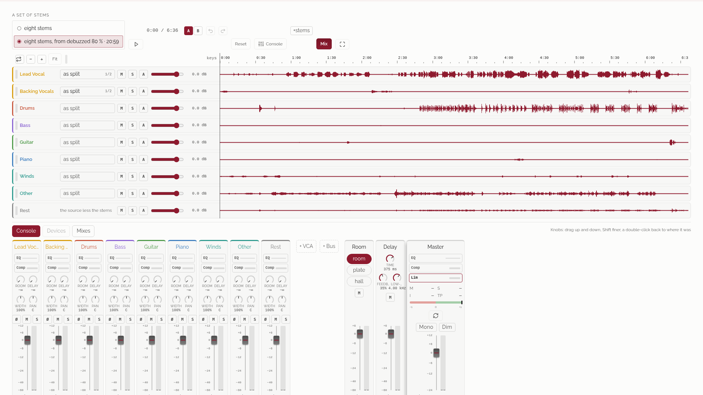

**תצוגה מקדימה.** השלב **DAW** (ב**גימור**, לפני הרימאסטר) פורש סט של סטמים של הטייק על רצועות, כמו ש-DAW עושה: כל סטם הוא רצועה, ועוד אחת, **שארית**, מה שיש במקור מעבר לסטמים (מה שההפרדה פספסה). כל הרצועות כמו שהן מחזירות את המקור עצמו, כך שהפספוסים של ההפרדה נשמעים רק במקום שבו משנים את המיקס. כל רצועה לובשת את הצבע של מה שיש בה: הקולות בכתום, התופים באדום, הבס בסגול, הגיטרה בירוק, הקלידים בכחול, והשאר באפור.

על כל רצועה: ה**גרסה** שלה (הסטם כפי שפוצל, או קובץ שנוצר ממנו, נניח קול מנוקה), **M** כדי להשתיק אותה ו-**S** כדי לשים אותה בסולו, ומד רמה בזמן הניגון. גרירה לאורך גל בוחרת מקטע (ראה "עריכה כמו בעורך אודיו" למטה), לחיצה מנגנת משם, ולחיצה ימנית על שקט מחזירה את הצליל. הכול נשמע בבת אחת, כל הרצועות על שעון אחד, דגימה מול דגימה, כפי שזה ייצא במיקס. **איפוס** מחזיר כל רצועה למצבה כפי שפוצלה, וגם את ערוצי החזרה ואת המאסטר. **A** לוקח לידיים את קו עוצמת הקול של הרצועה: לחיצה על הגל מציבה שם נקודה וגוררת אותה, לחיצה ימנית מסירה אותה, לחיצה כפולה קובעת אותה ל-0 dB; עוצמת הקול נשמעת ונכנסת למיקס אחרי הפיידר, בקו ישר ב-dB מנקודה לנקודה. לחיצה על הגרסה עוברת לבאה, כך שאפשר להשוות שתיים תוך כדי ניגון; לחיצה ימנית מציגה את כולן בהתקנים של הערוץ. הפינות העליונות של מקטע מושתק עושות פייד אל תוכו ומתוכו, באורך שאליו גוררים אותן (לחיצה כפולה מחזירה עשר מילישניות), והצדדים שלו מזיזים אותו. הרמה של הרצועה היא הפיידר שבקונסולה, ולכן לרצועה יש במקום זה כלים משלה: **S L R M** (שני הצדדים כמו שהם, השמאלי או הימני על שניהם, שני הצדדים מסוכמים על שניהם), **Ø** כדי להפוך את הקוטביות שלה, הצבע שלה (לחיצה על הנקודה שלה עוברת על פני הפלטה, Alt+לחיצה מחזירה לה את הצבע המקורי שלה), ▾ כדי לקפל אותה עד הבקרים שלה, והשם שלה, שגרירתו למעלה או למטה מעבירה את הרצועה לשם. **Alt+Shift+גרירה** על הגל שלה מזיזה את כל הרצועה בזמן, בצעדים של 10 ms (של 1 ms כשגם Ctrl לחוץ), עד 30 s לכל כיוון; התג שלה אומר בכמה, × מחזיר אותה ל-0, והחיתוכים וההעתקים שלה נשארים במקום שבו צוירו. **+ שכבה** מעל הרצועות מניח בנק מתחת לשיר כרצועה משלו. החלון שלו הוא המדף: כל בנק שיש לנפחות (הקלטות השטח של שכבות האווירה, כלי ה-SFZ שתחת `models/refiner/instruments`, ובנקים משלך ב-`banks/`, כל אחד מהם תיקייה עם קובצי ה-`.sfz` שלה ו-`bank.json` שאומר את השם, הסוג והרישיון שלו), לפי סוג ולפי מילים; הכרטיס של בנק אומר מה הוא, של מי הוא, היכן הוא נמצא, תחת איזה רישיון (והאם מותר להפיץ אותו) ומה גודלו. בנק SFZ מנגן כ**מצע** (תו אחד מוחזק לאורך השיר, ומנוגן שוב לפני שהוא גווע), כ**דרון** (הסולם של השיר, הטוניקה והקווינטה שלו, נמוך) או כ**תווים** של קובץ MIDI מהעץ (התווים של סטם, או תווים שלך), למעלה או למטה בחצאי טונים; בנק אווירה מניח את ההקלטות שלו בלופ ללא תפר. הרמה שלו ב-dB מול השיר במקום שבו שניהם נשמעים, הפייד-אין והפייד-אאוט שלו; **הנחת השכבה** יוצרת אותו ב-Forge, והוא מגיע כערוץ משלו, והעקומות שלו הן הקווים של הרצועה עצמה (A).

**הסרגל** מעל הרצועות: לחיצה עוברת לשם, גרירה מסמנת את הלופ ומפעילה אותו, והלופ מתנגן שוב ושוב עד ש-**L** מכבה אותו. **Ctrl+גלגלת** עושה זום סביב הסמן, **Shift+גלגלת** נעה לאורך השיר, **−**, **+** ו**התאמה** משמאל לסרגל עושים את אותו הדבר בצעדים; התצוגה עוקבת אחרי סמן הניגון. לחיצה על שם של רצועה בוחרת אותה עבור המקשים (ראה *קיצורים וטריקים*). מתחת לזמן, הקטעים של השיר כפי שהנגן תזמן אותם (התגיות של המילים עצמן, ש-Whisper מיקם): לחיצה על קטע עוברת לתחילתו, לחיצה כפולה שמה אותו בלופ, **[** ו-**]** עוברים לקטע הקודם ולבא. **סמנים** משלך: **K** מציב מרקר בסמן הניגון, **,** ו-**.** עוברים למרקר הקודם ולבא, לחיצה ימנית על מרקר בסרגל עוברת אליו, משנה את שמו או מוחקת אותו. הם נשמרים עם המיקס (בדפדפן הזה, בנפחות, במיקס בעל שם), ולעולם לא בתוך מה שממוקסס. הם יוצאים גם עם הטייק, כמרקרים בפרויקט REAPER וב-DAWproject.

כפתור המסך המלא של ה-DAW עצמו פורש אותו על כל החלון, כל רצועה בגובה משלה (72 px, והידית שבתחתיתה משנה אותו מ-40 עד 120 px), והרצועות נגללות בפנים; **F11** בכרטיסייה של הנפחות עושה את אותו הדבר כל עוד ה-DAW גלוי. **Esc**, **F11** או לחיצה נוספת על הכפתור מחזירים אותו.

**התפריט של רצועה.** לחץ לחיצה ימנית על שם של רצועה כדי לפתוח את התפריט שלה: השתקה, סולו, האוטומציה שלה, ההתקנים שלה בקונסולה, הגובה שלה, החזרת הרמה שלה ל-0 dB, הסרת השקטים וההזזות שלה, או הרצועה כפי שפוצלה. מאותו תפריט הצליל של רצועה הופך ל**פריסט** בעל שם (הטרים, ה-EQ, הגייט, הקומפרסור, הרוחב, הפאן והשליחות שלה; לעולם לא הרמה, ההשתקה או העריכות שלה), ואפשר להחיל אותו על כל רצועה בכל סט ולבטל אותו בפעולה אחת; הפריסטים נשמרים בהגדרות של הנפחות, ולכן הם קיימים בכל דפדפן.

**הקונסולה** לצד הרצועות, מימין (**קונסולה** בסרגל הכלים של ה-DAW מציגה ומסתירה אותה; בשורת הכרטיסיות שלה בוחרים אם היא **מעוגנת** כעמודה, **בריחוף** בקצה הימני, או **צפה** כפאנל נפרד שמזיזים בעזרת השורה הזאת) היא שולחן מיקס: כל רצועה היא ערוץ, אחריהם שני ערוצי החזרה, **חדר** ו**דיליי**, וה**מאסטר**, שנשאר גלוי מימין. ערוץ, מלמעלה למטה: השם שלו (לחיצה פותחת את ההתקנים שלו), האינסרטים שלו (**EQ** עם העקומה שלו בקטן, **קומפ** עם ההנחתה שלו בזמן הניגון), השליחות לחדר ולדיליי, רוחב ופאן, **Ø** לקוטביות, **M** ו-**S**, והפיידר עם מד הרמה שלו על אותה סקאלה: השיא וה-RMS של שני הצדדים, השיא מוחזק לרגע, ומתחתיו השיא החזק ביותר מאז האיפוס האחרון (לחיצה מאפסת). **+ VCA** אחרי הערוצים מוסיף VCA, פיידר אחד מעל קבוצת ערוצים (הערוץ שנבחר הוא החבר הראשון שלו): הפיידר שלו מוסיף את ה-dB שלו לפיידר של כל חבר, שנשאר במקומו, ה-**M** שלו משתיק אותם וה-**S** שלו משמיע רק אותם; בהתקנים שלו נותנים לו שם ובוחרים את החברים שלו, וערוץ יכול להיות ביותר מ-VCA אחד.

כפתורים ופיידרים: גרור למעלה ולמטה (**Shift** לכיוון עדין יותר), השתמש בגלגלת, או בחצים אחרי שבחרת אחד מהם; לחיצה כפולה מחזירה אותו למקומו. המספר של כפתור או של פיידר מקבל ערך מוקלד: לחיצה עליו, או ספרה כשאחד מהם נבחר, פותחת שדה; Enter קובע את הערך ביחידות שלו (dB, Hz עם k לאלפים, ms או s, %, 4:1, L30 או R30, −∞ לשליחה), Esc עוזב אותו כפי שהיה. **Ctrl+Z** מבטל ו-**Ctrl+Shift+Z** מבצע שוב, את כל המיקס צעד אחר צעד. **A** ו-**B** מחזיקים שני מיקסים של הסט להשוואה תוך כדי ניגון: B מתחיל כהעתק של A, ומה שמכוונים נכנס לזה שדולק.

**מיקסים**, הכרטיסייה השלישית של הקונסולה: המיקס שמכוונים עכשיו נשמר ב-Forge לצד הסטמים של הסט רגע אחרי שהיד נעצרת, כך שה-DAW נפתח כפי שהשארת אותו בכל דפדפן, בכל מחשב; **שמירה בשם** שומרת אותו תחת שם, לחיצה על שם מחזירה אותו (עם ביטול פעולה מאחוריו), ו-**✕** מוחק מיקס כשמאשרים זאת. אם Forge לא שמר אותו, הכרטיסייה אומרת למה.

ה**התקנים** של ערוץ (לחיצה על השם שלו, על ה-**EQ** שלו או על ה**קומפ** שלו): **כניסה** (טרים, קוטביות, הגרסה של הסטם), **EQ** (עד שמונה פסים: פעמון, מדף נמוכים וגבוהים, חיתוך נמוכים וגבוהים, חריץ; לחיצה כפולה על העקומה מוסיפה שם פס, גרור את הנקודה שלו, הגלגלת מעליה קובעת את הרוחב שלו, לחיצה ימנית מסירה אותו; מאחורי העקומה, הצליל של הערוץ עצמו בזמן הניגון), **קומפרסור** (סף, יחס, התקפה, שחרור, ברך ופיצוי, חמש נקודות פתיחה, העקומה וההנחתה שלו) ו**פלט** (רוחב, פאן, השליחות). ל**חדר** יש שלושה חללים, חדר 1.2 s, פלייט 1.6 s ואולם 2.4 s, וערוץ החזרה שלו; ל**דיליי** יש זמן (ב-ms, או ערך של תו בטמפו מסוים), פידבק, מעביר נמוכים שמכהה כל הד, וערוץ החזרה שלו. ה**מאסטר** מציג את העוצמה בזמן הניגון לפי BS.1770 (רגעית, לטווח קצר, ומשולבת מאז שנלחץ ניגון), את השיא האמיתי, את המתאם בין הצדדים ואת הספקטרום. **מונו** ו**עמעום** שמתחת למאסטר משנים רק את מה ששומעים, לעולם לא את המיקס. **מאזין אל** בקומפרסור גורם לו להאזין לערוץ אחר, כפי שהערוץ ההוא נכנס לקומפרסור שלו, ו**דאקינג** גורם לערוץ להאזין לשירה הראשית: הלהקה יורדת מתחת לקול. ההתקנים של המאסטר מציירים גם גוניומטר: האמצע למעלה, הצד לרוחב. ההתקנים של ה**מאסטר** מחזיקים את השרשרת שלו בסדר שבו הצליל עובר: **EQ**, **קומפרסור** (הוא מאזין לעצמו) ו**לימיטר** (הלימיטר של Plenio עם הסתכלות קדימה: תקרה, דרייב, שחרור), ואחר כך הפיידר שלו; ערוץ המאסטר מציג אותם כסלוטים, כל אחד עם ההנחתה שלו בזמן הניגון. **תערובת** בקומפרסור היא דחיסה מקבילית: הצליל שלו מעורבב עם הצליל היבש, ו-100 % הם הקומפרסור לבדו; נקודת הפתיחה **מקבילי** קובעת אותה ל-40 %, וכך גם המיקס ב-Forge. **גייט**, אינסרט שלישי בכל ערוץ, הוא אקספנדר כלפי מטה נגד הזליגה שהפרדה משאירה בין הפראזות: הוא מאזין לערוץ עצמו אחרי ה-EQ שלו, ומתחת ל**סף** שלו מנמיך אותו לפי ה**יחס** שלו, אבל אף פעם לא יותר מה**טווח** שלו; וכך גם המיקס ב-Forge. לכל ערוץ חזרה יש גם **חיתוך נמוכים** ו**חיתוך גבוהים** (כבויים ב-20 Hz וב-20 kHz; בדיליי הם חותכים את כל ההדים שלו באותה מידה, אחרי הפידבק שלו), ולחדר יש **פרי-דיליי**, נוסף על זה של החלל עצמו: המילה נשמעת צלולה לפני שהחדר שלה נכנס; וכך גם המיקס ב-Forge. ההתקנים של המאסטר מציגים לצדם עוד שני מספרים: LRA, טווח העוצמה מאז תחילת הניגון לפי EBU Tech 3342 (כמה נעה העוצמה לטווח קצר), ו-PLR, השיא האמיתי מעל העוצמה המשולבת (ככל שהוא קטן יותר, הצליל דחוס יותר); כשנוצר מיקס, ההודעה שלו מציינת גם את ה-LRA של הרינדור. **יעד** לצדם אומר בכמה LU העוצמה המשולבת עומדת מעל או מתחת לרמה של המקום שאליו השיר הולך (כברירת מחדל −14 LUFS ל-Spotify, ל-YouTube, ל-Tidal ול-Amazon; −16 ל-Apple Music, −15 ל-Deezer, −16 לפודקאסט, −23 לשידור, −9 למועדון או ל-CD): מעל היעד, השירות מנמיך את השיר באותה מידה. הוא רק מציין; שום דבר לא מנורמל.

**אוטומציה מעבר לעוצמת הקול.** **A** על רצועה לוקח קו לידיים, והצ'יפ שלצדו אומר איזה כפתור הקו מצייר: **עוצ'** (עוצמת הקול, אחרי הפיידר), **פאן** (המיקום בין שמאל לימין), **רוח'** (הרוחב), **חדר** ו**דיל'** (השליחות לחדר ולדיליי); לחיצה עוברת לבא. לחיצה על הגל מציבה נקודה וגוררת אותה, לחיצה ימנית מסירה אותה, לחיצה כפולה נותנת לה את מצב המנוחה של הכפתור (0 dB, המרכז, כמו שהוא, ללא). כפתור שיש לו קו מנגן את הקו שלו במקום הערך שלו עצמו, בזמן אמת ובמיקס, בקו ישר בין הנקודות.

**אינסרטים והדפסה.** ב**כניסה** של ערוץ יש **אינסרט**: הגרסה של הערוץ כפי שהיא מתנגנת, דרך ה**שער הדיגיטלי** (סרט, קונסולה, מנורה, שנאי, ויניל) או דרך שלב של פלאגין על קובץ, ב-Forge. מה שחוזר הופך לגרסה החדשה של הערוץ, נשמע מיד כפי שהוא ייצא במיקס, והגרסאות שלו שומרות את הדרך חזרה. **הדפסה** של המאסטר שולחת את המיקס כפי שה-DAW מחזיק אותו (הגרסאות שלו וכל כפתור) דרך השער הדיגיטלי: ענף בעץ לצד המיקסים של ה-DAW עצמו.

**אפיקי אודיו.** **+ אפיק** בקונסולה יוצר אפיק מהערוץ שנבחר: הצליל של החברים שלו (אחרי הפאן שלהם; השליחות שלהם עדיין יוצאות מהערוצים שלהם עצמם) מסוכם ועובר דרך ה-EQ, הקומפרסור, הפיידר, הרוחב והפאן של האפיק עצמו אל המאסטר. בהתקנים שלו בוחרים את החברים שלו (ערוץ הולך לאפיק אחד; ערוץ שנמצא באפיק אחר עובר לכאן), את השם, ה-EQ, הקומפרסור והפלט שלו; **M** משתיק את כולם. המיקס ב-Forge מסכם ומעבד אותם באותה דרך.

**עריכה כמו בעורך אודיו.** גרירה לאורך גל בוחרת מקטע; גרור את הקצוות שלו כדי לשנות אותו, **Shift** ולחיצה מותחים אותו, **Esc** משחרר אותו. גרור בתוך הבחירה כדי להזיז את מה שיש בה (עם **Ctrl**, העתק): הצליל של הרצועה עצמה זז ומקומו משתתק, ומקטע שהונח קודם זז בעצמו. **Ctrl+C** מעתיק, **Ctrl+X** גוזר (ושם מיד שקט), **Ctrl+V** מניח אותו בסמן הניגון על הרצועה שלו ובוחר אותו שם, **Delete** משתיק, **Ctrl+A** בוחר את כל הרצועה. לחיצה ימנית על הבחירה: "העתקה", "גזירה", "הנחה בסמן הניגון", "השתקה", "פייד-אין מהשקט", "פייד-אאוט אל השקט", "הגברה" או "החלשה" ב-3 dB, "פיצול בקצוות". הקו שמעל כל גל הוא הרמה שלו: תפוס אותו במקום שאין בו נקודה ומשוך למעלה לשיא או למטה לדעיכה (הנקודות השכנות מוצבות במרחק 30 px), גרור נקודה לאורכו, לחיצה כפולה מחזירה נקודה ל-0 dB, לחיצה ימנית מסירה אותה. **Ctrl+E** מפצל את הרצועה בסמן הניגון (בקצוות של בחירה), לחיצה כפולה בין פיצולים בוחרת את המקטע הזה בשלמותו (על מקטע מונח, את המקטע ההוא), לחיצה ימנית על פיצול מאחדת אותו. מקטע מונח מחליף את מה שהיה שם עם קרוספיידים של 10 ms ומונח מעל החיתוכים של הרצועה; ביטול פעולה מחזיר כל אחד מאלה, והמיקס ב-Forge עושה את זה באותה דרך. הקצוות של בחירה נצמדים בטווח של 6 px לקטעים של השיר, לפיצולים, לסמן הניגון ולקצוות של מקטע מונח או של שקט; החזק Alt כדי למקם אותם בחופשיות. המקום שממנו נלקח מקטע, או שנגזר ב-**Ctrl+X**, דועך אל השקט שלו ועולה ממנו, 30 ms כל אחד, כמו ב-ocenaudio: לחץ עליו בכפתור הימני וגרור כדי לצייר את הפייד הקרוב יותר (**Shift**: שניהם באותה מידה); שחרר, ותיבה קטנה עם סליידר לכל אחד מהם נשארת לצדו (**Esc** סוגר אותה). לחיצה ימנית על שקט בלי גרירה עדיין מחזירה את הצליל.

**קומפינג.** בחר מקטע ברצועה ולחץ עליו לחיצה ימנית: **לקחת מגרסה אחרת** מציג את הגרסאות האחרות של הסטם (נניח קול מנוקה), והגרסה שנבחרה מונחת על המקטע עם קרוספיידים של 10 ms, מצוירת עם הגל והשם של הגרסה ההיא, ונשמעת ונכנסת למיקס ממנה; בכל שאר המקומות מתנגנת הגרסה של הרצועה עצמה. לחיצה ימנית עליו או **ביטול פעולה** מסירים אותו; כשהוא מועתק, נגזר או נגרר, הוא שומר על הגרסה שלו.

**הרפרנס, נורית הסולו והפייד של השיר.** **מקור** בסרגל הכלים של ה-DAW (או **R**) מנגן את הצליל כפי שהגיע, זה שממנו פוצלו הסטמים, במקום המיקס ובעוצמה של המיקס לאורך מה שכבר התנגן, כך שמשווים את הצליל ולא את הרמה (חזק יותר תמיד נשמע טוב יותר); הכפתור אומר בכמה הצליל הוגבר או הונמך, גם **מונו** ו**עמעום** חלים עליו, ולחיצה שנייה מחזירה את המיקס. כל עוד רצועה בסולו, סרגל הכלים מציג **S · n**, כמה רצועות נשמעות, כי **מיקס** מייצר רק אותן: לחיצה עליו, או **Alt**+לחיצה על **S** כלשהו, מחזירה את כל הרצועות להישמע. ההתקנים של ה**מאסטר** מחזיקים את ה**פייד** של השיר: **פייד-אין** מעלה אותו מרמה של −60 dB, **פייד-אאוט** מוריד אותו עד −60 dB לפני הסוף שלו, ו**נקודת הסיום** קובעת את הסוף בסמן הניגון (אחריו שקט; **בסוף השיר** מחזיר את הסוף). הפייד ליניארי ב-dB, בא אחרי הפיידר של המאסטר, מצויר בכהה מעל הרצועות, וגם המיקס ב-Forge עושה אותו כך.

מה ששומעים הוא מה שנכנס למיקס: אותם פסי EQ, אותו קומפרסור של Plenio (בתהליכון האודיו של הדפדפן, או בתהליכון של הדף עצמו כשהנפחות נפתחת דרך כתובת הרשת שלה), הפאנר הסטריאופוני של הדפדפן וחוק הפאן שלו גם במיקס, אותה תגובת הלם של החדר, אותם הדים. הבדל אחד בלבד: אחרי קפיצה בשיר, הזיכרון של הקומפרסור מתחיל מחדש.

**מיקס** מרנדר את המיקס כפי שהוא נשמע, במחשב של הנפחות, על ה-EQ, הקומפרסור, החדר והדיליי של Plenio עצמו (Plenio 0.8.0, Apache-2.0, הועבר ללא שינוי): ענף חדש בעץ, והעוצמה שלו נמדדת; מיקס שהשיא שלו מעל −0.3 dBFS מונמך עד לשם ואומר בכמה. **+סטמים** לצדו כותב כל ערוץ כפי שהוא נשמע במיקס, וכל ערוץ חזרה, כקובץ נפרד לצד המיקס, בשביל DAW משלך. בזמן שהוא רץ, **עצירה** לצדו מפסיקה אותו ב-Forge, ושום דבר לא נוצר. גם את השרשרת של המאסטר ממקסס Plenio עצמו, כולל הלימיטר.

### Pianoteq, Organteq ו-Airteq <!-- #pianoteq-organteq-and-airteq -->

שלושת הכלים של Modartt בנויים במידול פיזיקלי: הם לא שומרים הקלטות של תווים אלא מחשבים את הצליל בזמן הנגינה (המיתרים והפטישים של פסנתר, הצינורות וזרם האוויר של עוגב, האוויר בצינור או בעלה), כך שאפשר לשנות כלי עד לחלקיו. הנפחות אינה כוללת אף אחד מהם. היא מנגנת את העותק שהתקנת: קנוי ב-modartt.com, או גרסת הניסיון החינמית של Modartt, ש-Modartt עצמה מברכת על השימוש בה בנפחות. כל אחד מהם הוא שלב במלטש (22 עד 24 למעלה), ומה שהוא מנגן חוזר כרצועה משלו ב-DAW, או כגרסה של הסטם.

**כדי להתקין** כלי, הורד את גרסת ה-Linux שלו מ-modartt.com (מאזור המשתמש שלך לכלי שנקנה, מדף המוצר לגרסת הניסיון שלו) וחלץ אותה לתוך `models/refiner/instruments/pianoteq/`, `organteq/` או `airteq/` של הנפחות, או ציין את התוכנה שלו ב-`user/pianoteq.json`, `organteq.json` או `airteq.json` כ-`{"path": "…"}`. בראש **מנוע ← Pianoteq** בוחרים על איזה מהשלושה מדובר, והדף מראה מה יש כאן: הגרסה, האם זו גרסת ניסיון או שבוצעה אקטיבציה ועם אילו חבילות, וכמה פריסטים מנגנים במלואם.

**כדי לבצע אקטיבציה** לכלי שנקנה, הדבק את המספר הסידורי מאזור המשתמש שלך ב-Modartt אל מנוע ← Pianoteq כשהכלי הזה נבחר: התוכנה במחשב של הנפחות שואלת את Modartt, והנפחות אינה שומרת עותק של המספר הסידורי. רישיון אחד מאפשר אקטיבציה בשלושה מחשבים; חבילה שנקנית מאוחר יותר מצטרפת ברגע שמבצעים אקטיבציה שוב עם אותו מספר סידורי. לביטול אקטיבציה אין כפתור, כי לתוכנות אין פקודה לכך: זה נעשה באזור המשתמש שלך. גרסת ניסיון לא צריכה מספר סידורי ומנגנת כפי ש-Modartt מאפשרת; ב-Pianoteq, כלי שלא קנית מנגן כדמו, וחלק מהקלידים שלו שותקים.

**החלון של הכלי.** מתחת לשדות של כל שלב, שורה עם הפריסט ועם מידת השינוי שעשית בו פותחת את החלון של הכלי עצמו: כל הפריסטים לפי מחלקה, עם התיאורים שלהם וחיפוש; הפריסטים הקטנים שלו (ריוורב, כיוון, עקומת ולוסיטי, מיקרופונים, אקולייזר, אפקטים); כל הגדרה שהמהדורה מאפשרת לשנות, במילים וביחידות של התוכנה עצמה (הרגיסטרים של עוגב נמצאים ביניהן, תחת "עוד"); A/B למצב שני; **▶ האזנה** מנגנת אקורדים, ארפג'ים, מדרגות של דינמיקה או את כל המקלדת עוד לפני שמנגנים סטם כלשהו; **שמירה ב-Pianoteq…** (ב-Organteq…, ב-Airteq…) שומרת את המצב כפריסט משלך בבנק "Ruach Studio", שבו התוכנה עצמה מוצאת אותו. החלון שואל את התוכנה דרך השרת שלה עצמה, על עותק של ההעדפות שלה ועל התקן שמע שקט: שום דבר לא נשמע ברמקולים שלך. בפעם הראשונה שכלי נפתח, נבנה הקטלוג שלו (ל-Organteq, עם 559 ההגדרות שלו, בפחות משתי דקות; ל-Airteq בעשרים שניות), והוא נשמר עד שהתוכנה או החבילות שלה משתנות.

**הרישיון שלהם.** מה שמנגנים בהם יכול לצאת במוזיקה שלך, אבל לא כספרייה של הצלילים שלהם, ואסור ללמד בצליל שלהם רשת נוירונים: הנפחות מרחיקה את הרינדורים שלהם מכל סט אימון, וכל ענף אומר זאת.

## צייר <!-- #artist -->

החדר שמצייר: עטיפה לכל טייק, 16:9 לווידאו שלו, 9:16 לשורט, מהמילים שלך, מתמונה שלך או משתיהן. הטופס משמאל, הבמה באמצע, הספרייה מימין. החדר כולו לעומק, כל פקד ואיך הוא בנוי מבפנים, עם מתכונים ומספרים: [הצייר לעומק](https://github.com/igrbible/Ruach_Studio/blob/main/docs/ARTIST.md).

### תמונות לשירים שלך <!-- #pictures-for-your-songs -->

כתוב במשפטים מה מצטייר לך בשביל השיר: Qwen-Image קורא פרומפט כתיאור, לא כרשימת תגיות. קודם מה שיש בתמונה, אחר כך האור, הצבעים והמדיום (שמן, דיו, צילום), ובסוף *no text* כשלא רוצים בה אותיות. **מהטייק** מכניס, כנקודת התחלה, את הפרומפט שממנו צוירה העטיפה של הטייק שביד, או פרומפט שנבנה מהשם והסגנון שלו.

**צורות**: **1:1** (1280 × 1280) לעטיפה, **16:9** (1920 × 1080) לווידאו, **9:16** (1080 × 1920) לשורט. הצורות של לחיצה אחת חולקות זרע, ולכן יוצאות כסדרה אחת: אותה סצנה באותם צבעים, וכל אחת בנויה בקומפוזיציה משלה למסגרת שלה, ולא תמונה אחת שנחתכה בשלוש דרכים. עם **וריאציות** מצוירים גם הזרעים הבאים (הזרע, הזרע + 1, …), כל אחד בכל הצורות.

**זרע**, ולצידו המצב שלו: **אקראי** (−1: זרע חדש בכל לחיצה, השדה ריק), **אקראי, קבוע** (זרע אקראי נכנס מיד ונשמר), **קבוע** (זה שכתוב בשדה), **הבא** ו**הקודם** (אחרי לחיצה, השדה מדלג אל מעבר לזרעים שהוריאציות שלה השתמשו בהם). מספר שמוקלד בשדה הוא הזרע עצמו (אקראי הופך לקבוע); שדה שרוקן הוא זרע חדש בכל לחיצה (קבוע הופך לאקראי); ⟲ מחזיר לאקראי. הזרע של תמונה שאהבת מצייר אותה שוב: כל הרצה מציגה את הזרע שלה, ו**אל הטופס** מחזיר אותו יחד עם הפרומפט.

**שלוש עמודות**: הפרומפט והכפתורים שלו משמאל, הבמה באמצע (שם מתפתחת ההרצה שמצוירת עכשיו, וההתקדמות שלה לרוחב החלק העליון; אחרת, התמונה שבחרת, הכפתורים שלה מתחתיה, ונתוני ההרצה שלה והפרומפט בחלונית עזרה לצידה, מעל הספרייה, כל עוד הסמן על התמונה), הספרייה מימין; גרור את הגבולות ביניהן כדי להרחיב עמודה (← → מהמקלדת, לחיצה כפולה מחזירה לרוחב המקורי שלה). הבחירות של העמודה נמתחות איתה, ואף פעם לא נעשות צרות משמות הציירים. מחלון בגובה 920 px ומעלה החדר נכנס בו כולו: הדף עומד במקום, הטופס והספרייה נגללים כל אחד בפני עצמו, והשורה של "ציור" נשארת בתחתית הטופס.

**תצוגה חיה** (מופעלת כברירת מחדל): המקום של התמונה שמצוירת מראה כל אחד מהצעדים שלה, מהרעש ועד התמונה, בשמינית מהגודל שלה ובלי המפענח, כך שזה לא עולה כלום; כשהיא כבויה, המקום מחכה לתמונה הגמורה. פס לרוחב החלק העליון של הבמה עוקב אחרי ההרצה, תמונה אחר תמונה וצעד אחר צעד.

**שתי הרצות בו-זמנית**: בזמן שאחת רצה, **ציור** מבקש את הבאה, והיא ממתינה מאחוריה (גם Ctrl+Enter); **עצירה**, שמופיעה ליד "ציור" בזמן שהרצה רצה, מסיימת את זו שמצוירת (אחרת, זו שממתינה יוצאת מהתור); התמונות שההרצה כבר סיימה נשארות.

### הציירים <!-- #the-painters -->

**המכחולים של הצייר** הם רשימה אחת של כל צייר וכל קובץ שיש כאן, מקובצים לפי מודל: Qwen-Image 2512 מ-GGUF (Q4, Q6), כל קובץ fp8 ב-`models/artist/Qwen-Image-2512/checkpoints/` (ה-BASE של 2512 עצמו והפיינטיונים) ו-Qwen-Image 2.1. **⚡ Lightning** מסמן מכחול שמצייר איתו כברירת מחדל; פיינטיון מסומן כפיינטיון. קובץ שמוכנס ל-`checkpoints/` הופך למכחול משלו כשהחדר קורא את הרשימה מחדש (אחרי הורדה, או כשהדף נטען מחדש). Krea 2 Muse עזב את הנפחות באוקטובר 2026: Qwen-Image 2512 נאמן יותר למילים וכותב כותרת כמו שצריך.

**הפיינטיונים של Qwen-Image 2.1**: קובץ fp8 יחיד ב-`models/artist/Qwen-Image-2.1/checkpoints/` (של ComfyUI; הראשון הוא FinalCut v1) הוא מכחול של 2.1, ושמו *פיינטיון · fp8 · השם שלו* ולא *משקלי בסיס* כמו קובץ ה-fp8 של 2512 עצמו. פיינטיון של 2.1 הוא 2.1 מכל בחינה אחרת: הרישיון שלו, עריכה במילים, כיתוב, טורבו.

**Qwen-Image 2512** (Apache-2.0) מ-GGUF ב-**Q4** (לכרטיס של 15.5 GB) או ב-**Q6** (20 GB), או **פיינטיון fp8** שלו (22.5 GB: קבצים יחידים של ComfyUI שמוכנסים ל-`models/artist/Qwen-Image-2512/checkpoints/`, כל אחד מכחול משלו); בערך חצי דקה לתמונה עם Lightning, אחרי דקה או שתיים של טעינה. **Qwen-Image 2.1**, תחת Qwen Research Licence (מחקר והערכה בלבד: לא לעטיפה שנמכרת), מצייר ממילים ועורך תמונת ייחוס לפי המילים של הפרומפט; גם מסכה וגם *ציור מסביב* דורשים את Qwen-Image 2512. על כרטיס שלא מכיל במלואם לא את מקודד הטקסט שלו ולא את הצייר שלו (כרטיס של 16 GB, או כרטיס תחת מגבלת VRAM נמוכה יותר), שניהם מוזרמים מה-RAM: תחת מגבלה של 15.5 GB על 3090, ציור ממילים לקח 135 s עם 4.1 GB בשיא, ועריכה 129 s עם 7.9 GB.

כל צייר מופיע רק כשהקבצים שלו כאן; השאר מוזכרים בשמם מתחת לבחירת הצייר. **מנוע ← מודלים ו-LoRA ← ציירי Qwen** מוריד את Qwen-Image 2512 ב-Q4 (31 GB) או ב-Q6 (34.5 GB) עם Lightning, ואת Qwen-Image 2.1 (33.1 GB), ולפני כל הורדה מופיעה שאלה עם הגודל שלה (ל-2.1 גם עם הרישיון שלו). מטרמינל: `heresy/fetch-heresy.sh --qwen 2512-q4`. **הורדת ציירים ומתאמים…** שמתחת לבחירת הצייר מציגה בחדר עצמו את מה שהנפחות יכולה להוריד לצייר: את ציירי Qwen, ארבעה פיינטיונים fp8 של Qwen-Image 2512 (Jib Mix Qwen, IntoRealism Qwen, Real-Qwen-Image ו-2512 עצמו, 20.4 GB כל אחד, משותפים במאגר המודלים של הנפחות ברשות היוצרים שלהם) וארבעה מתאמים, כל אחד עם הגודל שלו, ולצידו "כאן" או **הורדה**.

**איזה כרטיס מצייר**: לחיצה ממתינה בתור של המעבדה לכרטיס שיש בו מקום, כמו העטיפות של הטייקים והסטמים; בזמן שהיא ממתינה, **הוצאה מהתור** מחזירה אותה. כרטיס שאף אחד אחר לא משתמש בו לוקח הרצה שהצורך שלה נכנס בזיכרון שלו פחות 512 MiB (החלק של סביבת הריצה של CUDA עצמה); כרטיס שנמצא בשימוש לוקח אותה כשהזיכרון הפנוי שלו מכיל את הצורך. צייר Qwen-Image 2512 שאף כרטיס כאן לא יכול להכיל במלואו מזרים במקום זה את הבלוקים שלו מה-RAM: הבלוקים שנכנסים נשארים על הכרטיס, השאר מגיעים כל אחד ברגע שהוא נדרש, והתמונה זהה, רק איטית יותר במה שהאפיק לא מצליח להסתיר (עם ארבעה מתאמים על כרטיס של 24 GB, בערך שישית; כשכל בלוק מוזרם, הוא תופס 2.3 GB מהכרטיס, כך שגם כרטיס של 6 GB מצייר אותו, בתנאי שיש בערך 30 GB של RAM); צייר אחר שאף כרטיס לא יכול להכיל נדחה מיד, עם המספרים ועם הצייר שכן ייכנס. Qwen-Image קורא את הפרומפט עם מקודד הטקסט שלו (Qwen2.5-VL-7B, 15.5 GB) על הכרטיס כשהמקום הפנוי שם מכיל אותו, אחרת על המעבד, לפני שהצייר מגיע: התמונה זהה בשני המקרים.

**מסנן התוכן**: כל תמונה עוברת מסנן תוכן (nsfw_image_detection של Falconsai, Apache-2.0), לא משנה מי צייר אותה (הכלל של הנפחות לכל צייר): תמונה שהוא מסמן לא נשמרת, וההרצה אומרת זאת.

### Lightning <!-- #lightning -->

**מה זה**: Lightning (lightx2v, Apache-2.0) הוא מתאם שמלמד את Qwen-Image 2512 לצייר בכמה צעדים בלי הנחיה: הדרך הארוכה והמונחית של המודל עצמו, מזוקקת ל-8 צעדים. הקובץ שלו נמצא ב-`models/artist/Qwen-Image-2512/lightning/` (`Qwen-Image-2512-Lightning-8steps-V1.0-bf16.safetensors`, 0.85 GB) ומגיע עם ההורדה של ציירי Qwen.

**איך הנפחות משלבת אותו**: כש-Lightning מופעל, הצייר טוען אותו כמתאם נוסף מתחת ל-LoRA שלך, בעוצמה שלו: **1.0** ל-GGUF Q4 ו-Q6 ול-BASE ה-fp8 של 2512 עצמו (הבסיס שממנו הוא זוקק, ב-8 הצעדים שהיוצרים שלו קובעים), ו-**0.55** לפיינטיון fp8, ב-12 צעדים (פיינטיון כבר התרחק מהבסיס, ו-Lightning בעוצמה מלאה היה מושך אותו בחזרה; זו ההגדרה של ויקטור עצמו ב-ComfyUI). התזמון הופך לתזמון של Lightning עצמו: הסטה של log 3 בכל גודל, כמו שהוא אומן. ההנחיה כבויה (CFG אמיתי 1): מעבר אחד של המודל לכל צעד.

**כשהוא כבוי**, הצייר הולך בדרך של 2512 עצמו: 30 צעדים כברירת מחדל (10 עד 60) ו**הנחיה** 4 (CFG אמיתי עם הנגטיב הריק שלו: שני מעברים לכל צעד). שישים מעברים מול שמונה: הציור עצמו לוקח בערך פי שבעה יותר זמן, הטעינה נשארת אותו דבר, והוא נותן את הפרטים ואת האור של ריאליזם גמור.

**טורבו** הוא ההאצה של Qwen-Image 2.1 עצמו, כמו ש-Lightning הוא ההאצה של 2512: המתאם *Turbo 4step* (של AiMetatron) ב-`models/artist/loras/qwen-image-2.1/`, תחת אותו מתג *בדגימה*, ושם הוא נקרא טורבו; כבוי אלא אם מבקשים אותו (2.1 מצייר כמו תמיד, 30 צעדים), וכשהוא מופעל, 4 עד 16 צעדים. על RTX 3090 ב-1280²: 30 צעדים ב-96 s, ו-4 הצעדים של טורבו ב-42 s.

**ברירות המחדל שלו**: GGUF Q4 ו-Q6 מציירים איתו (טיוטות, כרטיסים קטנים יותר); פיינטיון fp8 מצייר בלעדיו אלא אם מפעילים אותו (ריאליזם גמור); העטיפה של טייק עצמו מצוירת איתו (*מנוע ← עטיפה*). הכלל שמאחוריהן: Lightning לטיוטות ולעטיפות, לא לריאליזם מקצועי.

**המתג**: בבלוק "דגימה", והעוצמה שלו לצידו; כשהוא מופעל, הצעדים הם 4 עד 16 וההנחיה מוסתרת; כשהוא כבוי, ההנחיה מוצגת. בלי הקובץ שלו אין מתג, ו-2512 מצייר בדרך שלו. העוצמה נשמרת לכל צייר; הסכום של המתאמים שלך (*ביחד*, בהמשך) לא סופר את Lightning.

**כמה זה עולה**: על RTX 3090 ב-1328 × 1328, Qwen-Image 2512 עם Lightning מצייר תמונה בכ-30 s ב-Q4 (14.3 GB בשיא) וב-32 s ב-Q6 (17.6 GB); פיינטיון fp8 על 0.55 ו-12 צעדים ב-37 s (21.0 GB). עטיפה של טייק עם Lightning לקחה בערך דקה וחצי, כולל הטעינה והפרומפט.

### סמפלרים ותזמונים <!-- #samplers-and-schedules -->

הבלוק **דגימה**, מתחת לבחירת הצייר, מקופל, והערכים שלו בשורת הסיכום שלו: הצעדים, הסמפלר והתזמון, שנשמרים לכל צייר; **איפוס** מחזיר את אלה של הצייר עצמו. הצעדים: ב-Qwen-Image 2512 עם Lightning, 4 עד 16; אחרת 10 עד 60; מספר מחוץ לטווח נשאר על הקצה שלו. הערכת הזמן בטופס סופרת את המעברים של הסמפלר.

**הסמפלרים**: בכל צעד המודל אומר לאיזה כיוון נמצאת התמונה; הסמפלר מחליט איך ללכת לשם.

- **Euler**: מעבר אחד לכל צעד, הצעד הפשוט; נקודת הייחוס, וזה ש-Lightning זוקק איתו.
- **Euler SDE**: Euler עם מעט רעש טרי בכל צעד: יותר גרעין, קצת פחות נאמנות.
- **ER-SDE**: פותר סטוכסטי מסדר שלישי (ER-SDE-Solver-3), מעבר אחד לכל צעד, ושני הצעדים שלפניו נשמרים: עדין יותר מ-Euler באותו זמן.
- **RES 2s** ו-**RES 3s**: השיטות החד-צעדיות של הפותר האקספוננציאלי המעודן, שניים ושלושה מעברים לכל צעד, ומחצית מהרעש מוחזרת אחרי כל אחד; התאומים **ODE** שלהם לא מחזירים רעש בכלל, כך שזרע אחד מצייר תמונה אחת, הקרובה ביותר לנתיב המדויק.
- **Heun++** (heunpp2): שלושה מעברים לכל צעד איפה שאפשר, אחר כך שניים, ואז אחד בסוף.
- **Exponential Heun** (exp_heun_2_x0, וגם ה-SDE שלו): שיטה אקספוננציאלית מסדר שני, שני מעברים לכל צעד; ה-SDE מחזיר את הרעש.

סמפלר של שניים או שלושה מעברים לכל צעד עולה פי שניים או פי שלושה מהזמן של Euler באותם צעדים; ב-8 הצעדים של Lightning הסדרים הגבוהים משנים את הפרטים, לא את הקומפוזיציה. מול הנתיב המדויק של זרימת צעצוע ב-8 צעדים הם מסתדרים בדיוק לפי הסדרים שלהם: Euler 0.138, Heun++ 0.111, Heun אקספוננציאלי 0.084, RES 2s 0.058, RES 3s 0.046 (השגיאה: נמוכה יותר פירושה קרוב יותר).

**התזמונים** אומרים איפה הצעדים מושקעים, מרעש מלא ועד בלי רעש בכלל:

- **Simple**: באופן שווה בזמן של הצייר עצמו, וההסטה שלו נשמרת.
- **Karras** ו-**Exponential**: יותר צעדים ברעש נמוך, בשביל הפרטים.
- **Beta** ו-**Beta 57**: צפוף בשני הקצוות, דליל באמצע (Beta 57 עם 0.5 ו-0.7).
- **KL optimal**: המרווחים ש-Align Your Steps מצאו אופטימליים.
- **SGM uniform**: אחיד בזמן, והצעד האחרון מושמט.
- **Bong tangent**: שני שיפועי ארקטנגנס, מרעש מלא עד חצי ומחצי עד אפס.

**מה הראו שתי מטריצות** (54 תמונות דרך מעבדת בדיקה, פרומפט אחד, זרע אחד): על Qwen-Image 2512 **עם Lightning, Karras, Exponential ו-KL optimal עלולים לצייר את הנושא פעמיים** (שני מגדלורים איפה שביקשו אחד): עם Lightning כדאי להישאר עם Simple, Beta, Beta 57, SGM uniform או Bong tangent. **בלי Lightning, Euler SDE מצייר את Qwen רך ומעורפל**: Euler, ER-SDE או RES שומרים על הפרטים. הטופס אומר את שני הדברים כשהם רלוונטיים.

**מאיפה הם באים**: נכתבו בשביל הנפחות מתוך המאמרים של השיטות ומהנוסחאות של ComfyUI (GPL-3.0, שה-AGPL של הנפחות יכול לקלוט); את אלה של RES4LYF קראו רק בשביל המתמטיקה שלהם, כי הרישיון שלו אוסר שירותים מסחריים: אין כאן שום קוד שלו; Heun++ הוא של Carzit (MIT).

### אזורים <!-- #regions -->

הבלוק **אזורים**, תחת *דגימה*, מקופל: עד שלושה חלקים של הפריים, לכל אחד מקום (חצי, שליש, רבע או האמצע; מפה קטנה לצידו מראה איפה) ומילים משלו. בכל צעד מבקשים מהצייר עוד פעם לכל אזור, עם הפרומפט ועם המילים של האזור, והתשובות שלו מתמזגות דרך תיבות עם קצוות רכים, כמו ש-Latent Couple עושה; שאר הפריים הולך לפי הפרומפט לבדו. כך הפרומפט אומר את הסצנה כולה, ואזור אומר מה עומד בו: *שתי חיות בקרחת יער מושלגת*, ואז *שועל אדום* בחצי השמאלי, ובחצי הימני *ינשוף לבן על גדם*. כל אזור עולה מעבר שלם נוסף לכל צעד (על 3090 ב-16:9, Qwen-Image 2512 fp8: 141 s בלי אזורים, 281 s עם שני אזורים). נשמר בדפדפן הזה; אזור בלי מילים לא נשלח; **שוב** מצייר עם האזורים של ההרצה עצמה. מיועד ל-Qwen-Image 2512; Qwen-Image 2.1 עורך במילים ומצייר בלעדיהם.

### כיתוב <!-- #lettering -->

הבלוק **כיתוב**, תחת *אזורים*, מקופל: כותרת, ושורה שנייה מתחתיה (האמן, האלבום), כתובות כחלק מהציור ולא מונחות מעליו. המילים שלו נכנסות לשדות משלהן, אף פעם לא לפרומפט: **שם**, **שורה שנייה**, **האותיות** (איך הן נראות, במילים; ריק: אותיות רישיות קלאסיות עם סריפים בזהב חם), **איפה** (למעלה, באמצע, למטה) ו**איך**: *מצויר יחד עם התמונה* (Qwen-Image 2512 או 2.1 מצייר את הסצנה של הפרומפט עם האותיות בתוכה; ה-"No text" של טייק מוסר מהפרומפט) או *על תמונת הייחוס* (Qwen-Image 2.1 מוסיף כיתוב לתמונה גמורה לפי מילים ושומר על השאר; **הוספת כיתוב** על תמונה הופכת אותה לייחוס ופותחת את הבלוק). הציירים טועים באיות של מילים שכמעט לא ראו ("RUOCH STUDIO"), ולכן כל תמונה נקראת בחזרה על ידי המאזין (Qwen2.5-Omni, בערך 5 s לתמונה), ותמונה עם שגיאת כתיב מצוירת שוב עם זרע אחר, עד שלוש פעמים: הראשונה שנכתבה בדיוק נשמרת, והאחרות עוברות לתיקייה misspelled/ של ההרצה. סימן ליד כל תמונה אומר איך היא נקראת: ✓ נכתב כמבוקש, ⚠ שגיאת כתיב בכל הניסיונות (חלונית העזרה שלה אומרת מה נקרא), ? לא נקראה בחזרה (המאזין לא נמצא במכונה). על 3090, Qwen-Image 2.1 הוסיף כיתוב לריבוע ב-118 s; Qwen-Image 2512 fp8 (בלי Lightning) צייר תמונה עם האותיות שלה ב-230 s, כולל הטעינה. גם קירילית, הכי בטוח באותיות רישיות. נשמר בדפדפן הזה; **שוב** מוסיף כיתוב עם המילים של ההרצה עצמה.

### מתאמים <!-- #adapters -->

**LoRA** מתחת לבחירת הצייר: המתאמים של המשפחה שלו (Qwen-Image 2.1, Qwen-Image 2512), עד ארבעה, כל אחד בעוצמה שלו (0 עד 1.5); לחיצה על אחת ממילות ההפעלה שלו מכניסה אותה לפרומפט. **הוספה…** פותחת את הספרייה: התיקיות משמאל, הכרטיסים עם התמונות שלהם, חיפוש. המתאמים נמצאים ב-`models/artist/loras/<family>/` של הנפחות (`qwen-image-2.1`, `qwen-image-2512`): כל תיקייה בפנים הופכת לקבוצה, ותמונה ליד קובץ, באותו שם (`NAME.jpg`, `NAME.png`, `NAME.preview.png`), מופיעה על הכרטיס שלו. הורד אותם מ-Civitai לפי מודל הבסיס שלהם (Qwen) ושים את ה-`.safetensors` שם; **חיפוש ב-Civitai** שולח את ה-SHA-256 של כל קובץ ותו לא, ושומר את התשובה לצידו (`NAME.civitai.info`: השם שלו, מודל הבסיס ומילות ההפעלה, והתמונה הראשונה שלו שדורגה כבטוחה, כשאין לו תמונה משלו). גם מה ש-LoRA Manager של ComfyUI או Stability Matrix כתבו ליד קובץ נקרא. מתאם שנעשה למודל אחר, שלא היה מגיע לאף אחת מהשכבות של הצייר, עוצר את ההרצה ואומר זאת. לחיצה ימנית על השורה של מתאם **משתיקה** אותו: הוא נשאר ברשימה בעוצמה שלו ויוצא מההרצה (**ביטול השתקה** מחזיר אותו); גם מתאם על אפס לא נטען. ארבעת המתאמים שהיוצרים שלהם התירו לשתף מגיעים מ-**הורדת ציירים ומתאמים…**.

**ביחד**: משני מתאמים ומעלה, פס מתחתיהם מראה את סכום העוצמות שלהם על הדרך, כמו במוזיקאי: ירוק עד 1.2, כתום עד 1.8, אדום מעבר לזה. מתאמים שנערמים זה על זה מצטברים, ומעבר לכ-1.8 תמונה נשרפת (הצבעים והקצוות שלה מוגזמים), לא משנה כמה צנוע כל אחד מהם; התחומים הם מידה ראשונה לתמונות, שעוד צריך לכוון בעין. גרור את הפס כדי להזיז את כולם בבת אחת, כל אחד ביחס למקום שבו עמד.

### תמונה לצייר ממנה <!-- #a-picture-to-paint-from -->

**תמונת ייחוס**: תמונה לצייר ממנה, כמו image to image: גרור אחת אל המקום שלה מתחת לפרומפט, הדבק אחת (Ctrl+V), בחר קובץ, או קח את התמונה שעל הבמה עם **כייחוס**. **כמה מותר לשנות** אומר כמה רחוק ממנה הציור מתחיל: 0.3 משאיר אותה כמעט כמו שהיא, 0.6 שומר על הקומפוזיציה שלה ומשנה את המרקם, 0.9 מצייר את הסצנה של הפרומפט באור ובצבעים שלה, 1.0 מצייר מחדש. כל צורה מכוסה בתמונה, שנחתכת מהאמצע שלה; **שוב** מצייר מהתמונה של ההרצה עצמה; ✕ מצייר שוב מתוך הרעש.

**שימוש בה** מתחת לתמונה אומר איך: *כדי לצייר ממנה* (כמו למעלה, בצייר שבטופס, עד כמה שאומר *כמה מותר לשנות*), *כדי לערוך במילים* או *רק בשביל הסגנון שלה*, שתי האחרונות בידי Qwen-Image 2.1 כשהוא כאן (אחרת הן כבויות). בעריכה במילים, הסצנה נשארת והפרומפט אומר מה משתנה (*אותו מגדלור בליל חורף מושלג*: השלג הגיע לאן שהוא שייך, המגדל והסלעים נשמרו). בשביל הסגנון, הסצנה של הפרומפט עצמו מצוירת בטכניקה, במשיכות המכחול, בפלטה ובאור של התמונה, ושום דבר מהנושא שלה לא נשמר (המגדלור בשמן נתן *שועל אדום ביער מושלג תחת הירח* במשיכות המכחול שלו). בכל מקרה ההרצה היא של Qwen-Image 2.1, לא משנה איזה צייר נבחר בטופס: המודל, הדגימה, המתאמים, המסכה והקנבס של הטופס לא נשלחים, והרישיון שלו (מחקר והערכה בלבד) חל. בערך שתי דקות לתמונה על 3090.

בעזרת **מסכה…** שלידה מציירים על התמונה את מה שצריך לצייר מחדש (צביעה, מחיקה, המכחול, היפוך, ניקוי): השאר נשאר בדיוק כמו שהיה, כמו inpainting. **ציור מסביב** מחזיק את כל התמונה באמצע של כל צורה ומצייר את השוליים מחדש (עטיפה ריבועית ל-16:9 או ל-9:16), כמו outpainting. **העטיפה של הטייק** לוקחת את העטיפה של הטייק שנבחר מימין. עם מסכה או **ציור מסביב**, ארבע אפשרויות מתחת לתמונה: **הרחבה** (המסכה מורחבת בכך וכך פיקסלים, או מכווצת), **קצה** (כמה רך הקצה שלה), **רכות** (ציור מחדש רך, כמו differential diffusion: איפה שהקצה אפור התמונה משתנה רק בצעדים האחרונים, כך שאין תפר) ו**גרעין** (כמה מהצבע החדש לוקח החלק השמור, והגרעין והאור שלו נתפרים לחדש; 0 שומר אותו בדיוק).

**קנבס…** ליד **מסכה…** פותח את הקנבס, כמו של InvokeAI: המסגרת של כל צורה היא כרטיסייה למעלה, שאומרת איך היא תצויר (**ממנה**: התמונה מכסה את המסגרת וההרצה מציירת ממנה, image to image בעוצמה שביקשו; **מסביב**: החלק של המסגרת שהיא משאירה ריק מצויר סביבה). על הלוח, **הזזה** (V) גוררת את התמונה, או פינה שלה כדי לשנות את גודלה כשהפינה הנגדית נשארת במקום; **מכחול** (B) ו**מחק** (E) מציירים עליה את מסכת האינפיינט; **יד** (H, או Space לחוץ) מזיזה את הלוח; הגלגלת עושה זום, Alt+גלגלת משנה את גודל התמונה סביב הסמן, והחיצים מזיזים אותה מעט. מימין השכבות (המסכה עם **היפוך** ו**ניקוי**, הייחוס עם האטימות שלו, שחלה על הלוח בלבד) והמקום שלה במספרים (רוחב, X, Y כחלק יחסי מהמסגרת); למעלה **התאמה**, **מילוי**, **מרכוז** ו**אותו דבר בכולן** (התמונה באותו גודל בפיקסלים במסגרות האחרות), ביטול פעולה וביצוע חוזר (Ctrl+Z). **סיום** שומר את המקומות יחד עם הייחוס והמסכה בטופס; מתחת לעוצמה הטופס אומר איך כל צורה מונחת, ו-✕ מוריד אותה מהקנבס.

### הבמה והספרייה <!-- #the-stage-and-the-library -->

לחיצה על תמונה מעלה אותה לבמה עם ההרצה שלה מתחתיה; לחיצה על התמונה שעל הבמה (או לחיצה כפולה על תמונה) פותחת אותה מעל הדף בצורה שלה (← → עוברים על ההרצה, או על הגלריה כשהיא נפתחה משם; Esc סוגר), עם ★, **אל הטופס**, **הגדרה כעטיפה** ו**הורדה** (PNG, בגודל מלא). על הבמה, **הערה…** שומרת הערה משלך עם התמונה בהרצה שלה (בשביל מה היא נעשתה, המילים שכתבו עליה את הכיתוב, מה לנסות בפעם הבאה); חלונית העזרה של התמונה מציגה אותה.

**הרצות או גלריה**: תצוגת ההרצות מציגה כל לחיצה על "ציור" עם הפרומפט והזרע שלה, החדשה למעלה; הגלריה מציגה כל תמונה מכל הרצה ברשת אחת, החדשות קודם, לפי צורה (1:1, 16:9, 9:16) או רק המסומנות בכוכב (☆ על תמונה מסמן אותה בכוכב), בשלושה גדלים, באריחים אחידים: עמודות שוות, כל אריח באותו גודל, וכל תמונה שלמה בתוכו.

**השוואה**: **השוואה…** שעל הבמה, ואז בחירת התמונה השנייה בספרייה: השתיים מונחות זו על זו מתחת למפריד שגוררים (← → מזיזים אותו), או זו לצד זו (S); X מחליף ביניהן, Esc סוגר. **Ctrl** (או ⌘) **+ לחיצה** בוחר תמונות, ו-**Shift + לחיצה** טווח: אז הסרגל של הספרייה מסמן אותן בכוכב או מעביר אותן לפח בבת אחת (Esc משחרר).

**תפריט התמונה**: לחיצה ימנית על כל תמונה (של הרצה, של הגלריה, של הבמה, זו שמעל הדף): **מעל הדף**, **אל הבמה**, **אל הטופס** (הפרומפט, הזרע והצורה שלה), **הכול אל הטופס** (גם הצייר, הפיינטיון, הדגימה והמתאמים שלה: "ציור" מצייר את התמונה הזאת שוב), **כייחוס**, **השוואה…**, **הגדרה כעטיפה**, **אפסקייל** (2K או 4K, עם הגדלים שהם נותנים), **סימון בכוכב**, **בחירה**, **העתקת הפרומפט**, **העתקת הזרע**, **הורדה**, **הקובץ בכרטיסייה חדשה**, **ההרצה שלה** (תצוגת "הרצות", והכרטיס שלה מואר), **לפח**. להרצה שמתפתחת על הבמה אין תפריט. מעל הדף, התפריט עומד מעל התמונה ומחזיק את המקשים כל עוד הוא פתוח: Esc סוגר את התפריט, וה-Esc הבא את התמונה.

### אפסקייל <!-- #upscale -->

**אפסקייל…** על הבמה הופך את התמונה ל-**2K** או **4K**: הצלע הארוכה שלה 2560 או 3840 px (עטיפה ריבועית 2560² או 3840², ו-16:9 של 2560×1440 או 3840×2160), עם אפסקיילר (ESRGAN, DAT, HAT, SPAN וקרוביהם, שנקראים על ידי spandrel) שנבחר בשורה שנפתחת (הבחירה נשמרת; 4x_Nomos8kDAT ראשון כשהוא קיים); חלונית העזרה של כל כפתור אומרת את הגודל שהוא נותן, ולתמונה שכבר גדולה כזאת הכפתור כבוי. המודל רץ כמה פעמים שהגודל דורש (פעמיים לכל היותר) והתוצאה מובאת לגודל המדויק. התמונה הגדולה היא הרצה משלה לצד המקור שלה, פחות מדקה על 3090; **שוב** עושה אפסקייל לאותה תמונה שוב, אולי עם מודל אחר. האפסקיילרים נמצאים ב-`models/artist/upscalers/` של הנפחות (`.pth` או `.safetensors`, אפשר בתיקיות); OpenModelDB מונה מאות: שים לב לרישיון של כל אחד.

**השלמת שוליים…** על הבמה מוסיפה לתמונה שוליים מצוירים: התמונה כולה באמצע של קנבס רחב יותר (16:9), גבוה יותר (9:16) או ריבועי, והשאר מצויר על ידי Qwen-Image 2.1 עם המתאם *Outpaint v2* (של AusBoss, ב-`models/artist/loras/qwen-image-2.1/`), והפיקסלים שלה עצמה מודבקים בחזרה מעל התוצאה. מילים על מה שנמצא מעבר לשוליים שלה הן משאלה, לא צורך. 25 צעדים; 1:1 ל-16:9 לקח 90 s על RTX 3090.

**מעבר שני…** לידו מצייר את התמונה מחדש בגודל גדול יותר, כמו שה-workflow של ויקטור ב-ComfyUI עושה אחרי המעבר הראשון שלו: התמונה מוגדלת **×1.5** או **×2** (לפי השכן הקרוב, כמו אצלו) ומצוירת שוב בידי הצייר, הפיינטיון, המתאמים, הפרומפט והזרע של ההרצה שלה עצמה, לא מתחילת הדרך (*כמה מותר לשנות*: 0.3 שומר על הרישום ומוסיף פרטים, 0.5 מחדד את המרקם, 0.7 מצייר מחדש את הצורות). הצעדים, הסמפלר, התזמון ו-Lightning הם של הטופס כשהטופס מצייר עם אותו צייר, ואחרת של ההרצה עצמה: המתכון שלו נותן למעבר השני הרבה צעדים ובלי Lightning. 16:9 של 1920×1080 יוצא 3840×2160. נמדד על 3090: Qwen-Image 2512 fp8 ב-3840×2160 תוך 220 s עם 12 צעדים ו-Lightning (22.9 GB). לא ל-Qwen-Image 2.1, שעורך במילים; בלי מסכה ובלי קנבס. **רעש נוסף** בשורה שלו (0.6 בהתחלה, כמו אצלו) ומתחת לשדה *כמה מותר לשנות* של ייחוס (0 בהתחלה) הוא ה-InjectLatentNoise של ה-workflow שלו: רעש טרי על התמונה לפני שהציור מתחיל ממנה; 0.3 מביא גרעין ופרטים חדשים, ומעל 1 הצורות של התמונה מתחילות להתפרק.

### עטיפה לטייק <!-- #a-cover-for-the-take -->

לתמונה ריבועית יש **הגדרה כעטיפה**: היא הופכת לעטיפה של הטייק שביד (בחר אחד מימין), בכרטיס שלו, בנגן וב-MP3 שלו. העטיפה שהייתה לו נשמרת לצד הטייק (`artwork-removed/`), כמו שגם ציור מחדש שומר אותה, והאות השנייה של זוג A/B מקבלת גם היא את החדשה כשאין לה עטיפה.

**העטיפה של הטייק עצמו** (*ציור עטיפה* בתפריט שלו, בספרן, לטייק אחד או לרבים) מצוירת בידי הצייר שב-**מנוע ← עטיפה**: לפי הכרטיסים (Qwen-Image 2512 Q6 או Q4 במלואו איפה שכרטיס מכיל אותו, אחרת Q4 מוזרם מה-RAM על כרטיס קטן יותר), או הצייר שבוחרים מבין ציירי Qwen שיש במכונה הזאת: Qwen-Image 2512 Q4 או Q6 וכל פיינטיון fp8 עם Lightning, ו-Qwen-Image 2.1 עם אזכור של הרישיון שלו (לא לשיר שנמכר). פיינטיון שנבחר ושכבר אינו כאן מפנה את מקומו לבחירה לפי הכרטיסים, והעטיפה אומרת מי צייר אותה.

### הפח של הצייר <!-- #the-artist-s-trash -->

ההרצות נשמרות בתיקייה `artist/` של הנפחות. **פח** על הרצה מעביר אותה ל-`trash/artist/`; **פח** שעל הבמה מניח תמונה בצד. תצוגת **פח** לצד "הרצות" ו"גלריה" מציגה קודם את התמונות שהונחו בצד, כל אחת עם **שחזור** ו-✕, ואת **שחזור הכול**; אחר כך את ההרצות שבפח, כל אחת עם **שחזור** ו**מחיקה לצמיתות**; **ריקון** בראש התצוגה מוחק את כל מה שהיא מציגה. כל מחיקה שואלת קודם ואי אפשר לבטל אותה.

**פח (תמונות)** בעמודה של הספרן, תחת "רחוק מהעין", מחזיק כאריחים את התמונות שפונו הצידה (לחיצה על אחד מסמנת אותו): ההרצות של הצייר שבפח, התמונות שהונחו בצד, והעטיפות שהוסרו מהטייקים (בציור מחדש, ב"הסרה", בעטיפה חדשה), כל אחד עם התמונה שלו וכמה הוא שוקל. סמן אותם כדי להחזיר אותם (עטיפה חוזרת לטייק שלה, וזו שיש לו עכשיו נשמרת במקומה) או כדי למחוק אותם לצמיתות, אחרי שאלה; כשאף אחד לא מסומן, **ריקון פח התמונות**. העטיפות של מרחב מוקפא נשארות כמו שהן.

### היומן של הצייר <!-- #the-artist-s-log -->

למסגרת של יומן השרת יש חמש תצוגות, **שרת**, **מוזיקאי**, **מאמן**, **מלטש** ו**צייר**, וכל חדר נפתח על התצוגה שלו: החדר של הצייר על זו של הצייר. היומן של הצייר, שנשמר בדפדפן הזה (400 השורות האחרונות שלו), אומר מה התבקש (הצייר, הפיינטיון, הצורות, הזרע, הדגימה, המתאמים), מה המעבדה ענתה (סירוב במילים שלה), את הדרך של כל הרצה עד הסוף שלה (ממתינה ולמה, מציירת על GPU N, הושלמה, נעצרה, נכשלה ולמה), ואת השורות של המעבדה עצמה על הצייר. **העתקה** לוקחת את השורות של התצוגה; כשהמסגרת מקופלת, היא מציגה את השורה האחרונה של התצוגה. **⧉** פותח את היומן בחלון משלו, ושתי התצוגות משקפות זו את זו: ב-Chrome הוא נשאר מעל כל החלונות (Document Picture-in-Picture); במקומות אחרים זה חלון שאפשר להעביר למסך אחר. החלון מציג לצד היומן גם את הכרטיסים בזמן אמת; המסגרת מתקפלת כל עוד הוא פתוח ונפתחת כשהוא נסגר, אם הייתה פתוחה. **מוזיקאי**, **מאמן** ו**מלטש** מציגים את השורות של השרת ששייכות לכל חדר: של המנוע ושל הדף למוזיקאי, של הרצת אימון למאמן, סטמים, רימאסטר, אפסקייל והמיקסים של ה-DAW למלטש; התצוגה שנבחרה נשמרת לחדר, וחדר שעוד אין לו שום דבר ביומן אומר זאת.

**חלון היומן, בכל גובה** (2087): החלון ש-⧉ פותח ממלא את הגובה שלו ועוקב אחרי שינוי הגודל: היומן נמשך עד התחתית שלו, והכרטיסים שלצידו חולקים את גובה העמודה, כל גרף גבוה או נמוך יותר יחד עם החלון ומצויר מחדש כשהוא משתנה; בחלון נמוך מדי בשביל כולם, העמודה נגללת.

### מה עוד יגיע לצייר <!-- #coming-to-the-artist -->

הגרסאות של התמונה של טייק; SeedVR כאפסקיילר (יחד עם פאזת ה-DAW, ב-2.1.0).

## וידאוגרף <!-- #videographer -->

הווידאוגרף (בטא), החדר שבין הצייר למאמן (Ctrl+Alt+6), מתכנן קליפ לטייק עוד לפני שנוצרת תמונה נעה כלשהי. מצא טייק לפי מילים מהשם או מהסגנון שלו; כשהוא נבחר, התוכנית שלו נפתחת כאן.

### החדר במבט אחד <!-- #the-room-at-a-glance -->

בראש החדר עומדים בשורה אחת שם החדר והכיתוב שלו, ובסוף השורה **🔍 חיפוש טייק…** ומסך מלא. **חיפוש טייק…** (Ctrl+K בחדר) פותח חלון: משמאל **כל הטייקים** והמרחבים של הספרייה, מימין הטייקים של המרחב שנבחר, החדשים קודם, ומילים מהשם או מהסגנון מצמצמות אותם; Enter בוחר את הראשון, ↓ ↑ עוברים ברשימה, Esc סוגר. הכפתור **⛶** (או F11 בחדר) פורש את החדר על כל המסך; Esc, F11 או הכפתור מחזירים אותו. עמודת הקליפים מימין נשארת פס צר ונשלפת מעל החדר כשהסמן עליה, ומתחבאת שוב כשהסמן עוזב, כך שהקנבס אף פעם לא משנה את הרוחב שלו. מתחת לסרגל יש ארבעה חדרים פנימיים, אחד גלוי בכל פעם ובגובה החדר כולו, כך שבמסך 1080p שום דבר לא נגלל, ולכל אחד הכפתורים שלו (🎨 🎬 ⇮ ב"שוטים"; "אנימטיק", "קליפ" והגדרות הקליפ ב"אנימטיק וקליפ"): **עריכה** (מוניטור התוכנית וציר הזמן), **שוטים** (שוט אחד בכל פעם: בוחרים אותו בלחיצה על הפס, ב-‹ › או ב-Alt+← →; בזמן שהטייק מתנגן, השוט שמתנגן עולה מעצמו), **הרעיון והמראה** ו**אנימטיק וקליפ**.

### התוכנית <!-- #the-plan -->

**יצירת התוכנית** חותכת את הטייק לשוטים לפי השורות המושרות שלו (התזמון של Whisper): לכל היותר 12 s לשוט, שורה ארוכה יותר נחתכת בין המילים שלה, מה שלא מושר נחתך לשוטים של 8 s לכל היותר, ואף שוט אינו קצר מ-2.5 s. כל שוט נושא את הזמן שלו, את הקטע שלו ואת המילים שלו. **חיתוך מחדש** בונה את השוטים מחדש מתוך התזמון; הסצנות והתמונות של אותם זמנים נשארות.

### הסצנות <!-- #the-scenes -->

**כתיבת הסצנות** שואלת את המודל של הכותב, תריסר שוטים בכל שאלה: קודם את המראה של הקליפ כולו (מי מופיע בו, איפה, הצבעים שלו, איך הוא נע לאורך השיר), ואחר כך את הסצנה של כל שוט: מה רואים, המצלמה, התנועה, האור. הוא כותב באנגלית, השפה שמודלי וידאו קוראים הכי טוב. הכול נשאר בידיים שלך, לשנות כרצונך: **שמירה** שומרת, ו**סטוריבורד (.md)** מוציא את הכול החוצה עם הפרומפט של כל שוט.

### הפס והנגן <!-- #the-strip-and-the-player -->

הפס שמעל השוטים הוא השיר, בלוק לכל שוט: בכתום היכן שמושר, עם קו תחתון היכן שהסצנה שלו כתובה, ועם סימון למעלה היכן שלשוט יש תמונה משלו. בזמן שהטייק מתנגן, קו רץ לאורך הפס, והשוט שמתנגן מואר שם וגם ברשימה. ▶ על שוט (או לחיצה כפולה על הבלוק שלו) מנגן את הטייק ממנו; ⧉ מעתיק את השוט כפי שמודל וידאו קורא אותו: הסצנה שלו, אחריה המראה של הקליפ, ואחריו האורך שלו.

### התמונות והקליפ <!-- #pictures-and-the-clip -->

ליד כל סצנה יש משבצת לתמונה של השוט עצמו. לחיצה פותחת את התמונות של הצייר (הרחבות קודם, בלי אלה שהונחו בצד) ואת **מהדיסק…**; תמונה שהוחלפה או הוסרה מונחת בצד, ולעולם לא נמחקת. 🎨 מכניס את פרומפט התמונה של השוט (מה רואים, מי ואיפה, המסגור, האור והצבעים) לטופס של הצייר, בפורמט רחב ועם הכיתוב כבוי; כשהתמונה מצוירת, תן אותה לשוט מהמשבצת שלו.

**אנימטיק** מציג את התוכנית בזמן של השיר: פריים לכל שוט, המילים והסצנה שלו מעל התמונה של השוט עצמו, ואם אין כזו, מעל העטיפה של הטייק, עם הצליל של הטייק, כקובץ MP4. **קליפ** חותך את הקליפ מהתמונות ב-1920 × 1080: כל שוט נע לאט כפי שאומרת המצלמה של הסצנה שלו (התקרבות, התרחקות, פאן; סטטי כשהמצלמה נייחת); שוט בלי תמונה משלו מציג את העטיפה של הטייק, או את המילים והסצנה שלו כשלטייק אין עטיפה. שניהם נוצרים על המעבד, בלי מודל תמונה או וידאו, בתוך דקות: שיר של 4:30 ב-37 שוטים לקח בערך שלוש. בכותרת של כל שוט כתובה התנועה שהוא מקבל: **אוטומטי** מציין את זו שהמצלמה של הסצנה שלו נותנת, או בחר אחרת.

### הרעיון והגיבור <!-- #the-idea-and-the-hero -->

**הרעיון של הקליפ**, מעל המראה שלו, הוא שורה אחת או כמה שאומרות מהו הקליפ: מצב הרוח שלו, הסיפור שלו. **כתיבת הסצנות** מעבירה אותו לכותב, והמראה וכל סצנה נכתבים כדי לשרת אותו. **הגיבור**, מתחת למראה, הוא תמונה אחת של הצייר: האדם שהקליפ הולך אחריו. **בחירת הגיבור** פותחת את התמונות של הצייר; **הסרת הגיבור** משאירה כל שוט למילים שלו. 👤 על שוט אומר אם הגיבור נמצא בו: בשוטים המושרים הוא נמצא מההתחלה, בשוטים של מוזיקה בלבד לא; לחיצה מחליפה את המצב, ושמירה שומרת אותו.

### הצייר מצייר את השוטים <!-- #the-artist-draws-the-shots -->

**🎨 ציור השוטים** בסרגל מבקש מהצייר תמונה לכל שוט שעדיין אין לו תמונה, שניים בכל פעם על הכרטיסים הפנויים, וכל תמונה נכנסת לשוט שלה ברגע שהיא מגיעה; הספירה עומדת ליד הכפתור. שוט עם הגיבור מצויר ב-Qwen-Image 2.1 לפי התמונה של הגיבור והסצנה של השוט, כך שהפנים, השיער והבגדים שלו נשמרים משוט לשוט; אחר כך Qwen-Image 2512 עובר עליו בעוצמה 0.35 בשביל האור והמרקם, והפנים נשמרות (ב-0.5 הפנים מתחילות לזוז). שוט בלי הגיבור מצויר ב-Qwen-Image 2512 לפי הסצנה שלו בלבד. כל שוט שומר את הזרע שלו, כך ששוט שמצויר מחדש יוצא אותו דבר. כשלכל השוטים יש תמונה, הכפתור מציע לצייר את כולם מחדש: התמונות שהיו להם מונחות בצד, לא נמחקות. בזמן הציור, אותו כפתור עוצר אותו ברגע שהשוטים שעל הכרטיסים מוכנים. על 3090 שוט של הגיבור לוקח כשלוש דקות, ושוט בלעדיו כדקה אחת כשכרטיס פנוי. כשהמתאמים skin detailer ו-film photography נמצאים ב-`models/artist/loras/qwen-image-2512/`, ה-2512 מצייר איתם (0.8 ו-0.5): נקבוביות, קמטים ואריג הבד במקום פלסטיק.

### מילים ומעברים <!-- #lyrics-and-transitions -->

המתג **מילים על הקליפ** שליד **קליפ** צורב לתוכו את השורות המושרות, כל אחת בזמן שלה לפי התזמון של הטייק (אותו תזמון שלפיו נחתכה התוכנית), בלבן עם שוליים כהים בתחתית התמונה, עם הופעה והיעלמות הדרגתיות. הבורר **בין קטעים** קובע איך הקליפ עובר מקטע אחד של השיר לבא: **חיתוך**, **דרך שחור** (השוט האחרון של קטע דועך החוצה והבא עולה פנימה, שליש שנייה כל אחד) או **הבזק** לבן אל הקטע החדש; בתוך קטע השוטים תמיד נחתכים ישירות. שתי הבחירות נשמרות בדפדפן לקליפ הבא. כשהמילים מופעלות, הקליפ מקודד פעם נוספת בסוף, עוד דקה או שתיים לשיר ארוך. **פורמט הקליפ** לידם: **16:9 רחב** (1920 × 1080) למסך, **9:16 גבוה** (1080 × 1920) לסטוריז ולשורטס בטלפון, **1:1 ריבוע** (1080 × 1080). כל פורמט הוא קליפ נפרד, שנשמר לצד האחרים, והנגן ו-**MP4** מציגים ושומרים את הפורמט שנבחר; תמונה רחבה מספיק נחתכת לפורמט סביב האמצע שלה, ותמונה צרה יותר עומדת בשלמותה מעל עותק מטושטש של עצמה. הכפתור **חיתוכים על הפעמה** שליד **כתיבת הסצנות** מזיז כל חיתוך בין שני שוטים לפעמה הקרובה ביותר בטייק (לא רחוק יותר מ-0.3 s, ואף שוט לא קצר מ-1.5 s); אחר כך על הכפתור כתוב **חיתוכים כפי שהושר** והוא מחזיר אותם, וגם Ctrl+Z על ציר הזמן מבטל את ההזזה. המתג **כותרות על הקליפ** שליד **מילים על הקליפ** מציב את שם השיר על השניות הראשונות של הקליפ ואת הקרדיטים על שבע השניות האחרונות שלו, שניהם בהופעה והיעלמות הדרגתיות; כותבים אותם ב**הרעיון והמראה**: **הכותרת המוצגת** (ריק: השם של הטייק עצמו) ו**קרדיטים**, אחד בכל שורה (מי שר, כתב, צייר, צילם). תחת **בין קטעים**, **דיזולב** נותן לקטע הבא לעלות מעל חצי השנייה האחרונה של הקטע שלפניו; כל שוט עדיין מתחיל בזמן שלו, והקליפ שומר על אורך השיר. **LUT** ליד הפורמט מניח צבע על הקליפ כולו, כמו שקולוריסט מניח 3D LUT ב-DaVinci Resolve. החלון שלו מציג כל לוק כעטיפה של הטייק כשהיא עוברת דרכו: שישה עשר הלוקים שהנפחות יוצרת בעצמה (CC0), סוגי הפילם של RawTherapee Film Simulation Collection (294 HaldCLUT, CC BY-SA 4.0, יורדים מהחלון כשמבקשים, 422 MB) והקבצים שלך, `.cube` או HaldCLUT `.png`, שהונחו ב-`user/luts/`. **עוצמה** מכוונת אותו מנגיעה קלה ועד מלואו. הלוק מונח מתחת למילים ולכותרות, וכל טייק שומר את הלוק שלו בדפדפן הזה. **גרעין** ו**וינייטה** באותו חלון מניחים על הקליפ שכבת פילם אחרי הלוק: גרעין שזז, חדש בכל פריים, ופינות מוחשכות כמו שעדשה ישנה מחשיכה אותן, כל אחד מכלום ועד כבד, ונשמרים יחד עם הלוק של הטייק.
**הוסף את קול הקריין…**, בלשונית *אנימטיק וקליפ*, מניח טייק של הקריין מעל הקליפ בקישור: הוא נשאר בעולם הקריין, הקליפ רק נוקב בשמו. הוא מתחיל בתחילת השיר, לפני השורה המושרת הראשונה, אלא אם תזיז אותו (**מתחיל ב**), והשיר יורד מתחתיו (**השיר מתחתיו**, 12 dB אם לא תקבע אחרת) תוך 0.3 שניות לפני הקול וחוזר תוך 0.8 שניות אחריו. **קליפ** הבא ממקסס אותו וכותב את מילותיו ככתוביות משלהן, בנטוי שורה מתחת לשורות המושרות, כל משפט בזמן שבו הוקרא; **החלף…** בוחר טייק אחר, **הסרה** מסירה אותו.


### שוטים בתנועה <!-- #moving-shots -->

🎬 על שוט מניע את התמונה שלו בעזרת MiniMax H3 על כרטיס פנוי: **טיוטה · 8 צעדים** ב-832 × 480 כדי למצוא את הקליפ, **סופי · 28 צעדים** ב-1344 × 768 לקליפ עצמו (אנכי 768 × 1344, ריבוע 1024 × 1024). על 3090 שוט של 4.4 s לקח 102 s כטיוטה ו-1271 s כגרסה סופית; שמונה צעדים ב-768p שומרים על הפרטים של עשרים ושמונה, רק כיתוב על התמונה דוהה לאט יותר. **צילום הכול** שולח כל שוט כטיוטה, שוט לכל כרטיס פנוי; כל אחד מראה כמה התקדם ליד הסצנה שלו וב-V1, והקליפ לוקח את הווידאו של שוט במקומו ברגע שהוא מגיע. **הסרת הווידאו שלו** מחזירה לשוט את התמונה שלו. את H3 מורידים ממנוע ← מודלים ו-LoRA ← וידאוגרף · MiniMax H3, ושם כתוב גם הרישיון שלו: אסור להריץ אותו מקומית בארצות הברית, באיחוד האירופי, בבריטניה או בדרום קוריאה, ושימוש מסחרי מעבר לסף שלו דורש רישיון מ-MiniMax.

### שוטים ארוכים <!-- #long-shots -->

כרטיס אחד של 24 GB מחזיק שוט של עד 4.4 s ב-768p (107 פריימים) או עד 11.5 s ב-480p (277 פריימים). שוט ארוך יותר נוצר בחלקים על הכרטיס שלו, אחד אחרי השני: כל חלק הבא מתחיל בפריים האחרון של החלק הקודם ונושא את הרגעים האחרונים שלו, והשוט כולו מפוענח במעבר אחד, כך שלא התמונה ולא הגרעין שלה קופצים בתפר. שוט של 8.7 s ב-768p נוצר ב-2 חלקים: 820 s בשמונה צעדים, שיא של 20.5 GB. כמה כרטיסים יוצרים כמה שוטים בבת אחת, שוט לכל כרטיס; שוט אחד לא מתחלק בין כרטיסים.

### אפסקייל לשוטים <!-- #upscaling-shots -->

**אפסקייל · 7B sharp, 1080p**, **אפסקייל · 7B sharp, 1440p** או **אפסקייל · 3B, 1080p (מהיר)** ב-🎬 של שוט מגדיל את הווידאו שלו בעזרת SeedVR2; **⇮ אפסקייל לכולם** לוקח כל שוט שיש לו וידאו. השוטים מחולקים בין הכרטיסים הפנויים, והמודל נטען פעם אחת על כל כרטיס לכל השוטים שלו; הווידאו המוגדל מונח לצד הווידאו של השוט והקליפ לוקח אותו, ווידאו חדש של השוט מבטל אותו. על 3090, שוט של 4.4 s: 3B ל-1080p ב-284 s; 7B sharp ל-1080p ב-367 s, ול-1440p ב-592 s; RAM של 10 GB ל-3B ושל 21 GB ל-7B. 7B sharp שומר על עור ועיניים חיים, היכן ש-3B מגזים בעיבוד המרקם. מורידים אותו ממנוע ← מודלים ו-LoRA ← וידאוגרף · אפסקיילר SeedVR2, או ב-`heresy/fetch-heresy.sh --upscaler 7b` (17 GB; `3b` 7.3 GB, `all` 41 GB).

### לעורך וידאו <!-- #for-an-editor -->

**פרויקט עריכה (.zip)** ליד **סטוריבורד (.md)** אוסף את התוכנית לקובץ zip אחד לעורך וידאו: ציר זמן של OpenTimelineIO (השוטים ב-V1 בזמן של השיר, הצליל של הטייק ב-A1) ואותו חיתוך כ-EDL ב-25 fps, השורות המושרות ככתוביות (.srt), הווידאו של כל שוט (האפסקייל שלו, אם יש), והיכן שלשוט אין וידאו או שהווידאו שלו קצר מהשוט, התמונה שלו, וגם הצליל של הטייק. ב-DaVinci Resolve: File → Import → Timeline…; ב-Kdenlive: ייבוא הפרויקט של OpenTimelineIO; שניהם מוצאים את תיקיית המדיה לצד ציר הזמן.

### כמה זמן נמשך שוט <!-- #how-long-a-shot -->

בקליפים שוט נמשך בדרך כלל 3–6 s בפופ וברוק, 8 s ויותר בשירים איטיים, 2–3 s בעריכה מהירה; בקליפים מהמצעדים של השנים האחרונות הפזמונים נחתכים בערך כל 3.5 s, והבתים כל 5–6 s. התוכנית חותכת לפי השורות המושרות, עד 12 s לשוט; על ציר הזמן **B** או **Ctrl+B** חותכים שוט ארוך בנקודת מפנה של השיר. שוט של עד 4.4 s הוא מעבר אחד ב-768p, וארוך יותר נוצר בחלקים, כך שאורך השוט הוא בחירה של הקליפ, לא של הכרטיס.

## ספרן <!-- #librarian -->

### כל הטייקים <!-- #every-take -->

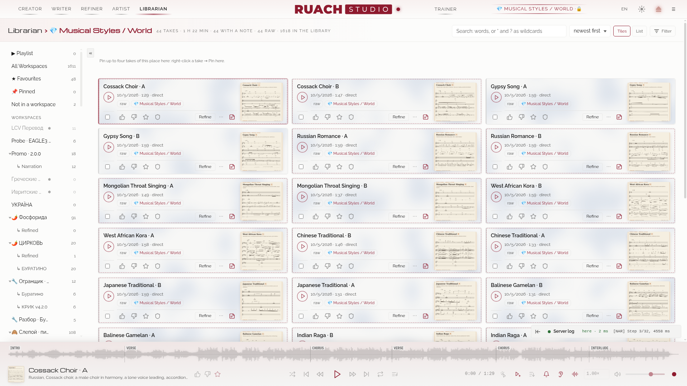

- **הכותרת** מציינת את האוסף הפתוח (*ספרן › Sketches*) ומה יש בו: טייקים, שעות, לייקים, מועדפים, הערות, ואיך הם נוצרו.
- **מרחבים** משמאל: הכול, מועדפים, מחוץ למרחבים, המרחבים שלך, *+ מרחב חדש*; מוסתרים והפח נמצאים רחוק מהעין. לחיצה ימנית על מרחב מביאה את ה**נעילות** שלו (*נעילת מחיקת המרחב*, *נעילת מחיקת הטייקים*): 🔒 ליד השם שלו, ושום דבר בו לא הולך לפח. מרחבי ה-💎 (הסטים הציבוריים של הנפחות) עומדים בתחתית העץ, לפי השם, ומרחבי ה-💎 … LoRA הכי למטה.
- **הפלייליסט** עומד ראשון בעמודה, מקום בפני עצמו: אי אפשר לשנות את שמו, למחוק אותו או להקפיא אותו. טייק נכנס אליו מהתפריט שלו (*הוספה לפלייליסט* › *ראשון*, *אחרון* או *אקראי*; בכרטיס מסומן, כל המסומנים), ו-× מוציא אותו מהפלייליסט בלבד, אף פעם לא מהספרייה. התצוגה שלו היא רשימה אחת של כרטיסים רחבים: ▶ ראשון, אחריו השם, מתי נוצר והאורך שלו, הסימונים שלו, והעטיפה אחרונה. גרור כרטיס למקומו; *ערבוב החפיסה* מחלק את כולם מחדש. *ניגון מההתחלה*, או ▶ על כל כרטיס, מנגן את הפלייליסט בסדר שלו עד הסוף, לא משנה מה אומר *המשך ניגון*, ופס דק מתחת לנגן מציין את הטייק שלפני, את המקום בפלייליסט (*פלייליסט · 3 / 12*) ואת הטייק שאחרי: לחיצה על שם מנגנת אותו, ו-× יוצא מהפלייליסט. הכפתור האחרון של הנגן פותח את אותה רשימה בחלון, והנגן נשאר גלוי מתחתיו. הטייק הבא נטען מראש בדף, כך שהוא מתחיל בלי לחכות לרשת; "הקודם" ו"הבא" מחליפים מיד. מרחב שלם נכנס מהתפריט שלו עצמו (*הוספה לפלייליסט, בשלמותו*, אחרי שאלה): כרטיס אחד שמנגן כל טייק שלו ושל המדורים שלו (חוץ מהמוסתרים), מהישן לחדש, ויוצא בשלמותו ב-×; הכותרת סופרת את הטייקים שהפלייליסט מנגן, את המרחבים שלו ואת הזמן הכולל.
- **אלבומים בפלייליסט**: פס בראשו מחזיק את *הכול*, את האלבומים שלך ואת *+ אלבום חדש*; תפריט הטייק › *הוספה לפלייליסט* › אלבום (או *אלבום חדש…*) מכניס אותו לשם. האריח של אלבום ריבועי, והעטיפות של הטייקים שלו מסודרות בו כפסיפס; כשהאלבום פתוח, הוא מנגן, מערבב וגורר רק את הטייקים שלו, ו-× מוציא ממנו טייק; לחיצה ימנית על האריח שלו משנה את שמו או מוחקת אותו (הטייקים נשארים). *הכול* מנגן את הטייקים של הפלייליסט עצמו, ואחריהם את אלה של כל אלבום. כפתור התגיות בכותרת הפלייליסט פותח את התגיות של הסגנונות של הטייקים שבתצוגה, לפי כמה פעמים הן מופיעות: כשהן מסומנות, הן מסננות את הפלייליסט ואת מה שמתנגן.
- **הפלייליסט מהסרגל, ה-⋯ של אלבום** (2058): כפתור הפלייליסט בסרגל המסומנים מכניס אותם לפלייליסט (*ראשון*, *אחרון*, *אקראי*) או לאלבום (או אל *אלבום חדש…*), כמו שתפריט הטייק עושה. גם מרחב שלם נכנס לאלבום, כפריט אחד כמו בפלייליסט (ה-⋯ שלו › *הוספה לפלייליסט, בשלמותו* › אלבום). האריח של אלבום מציג את ה-⋯ שלו (*שינוי שם האלבום…*, *עטיפה מ…*, *מחיקת האלבום…*): *עטיפה מ…* בוחרת איזו מהעטיפות של הטייקים שלו תהיה העטיפה של האלבום, ריבועית, ואילו *אוטומטי* מחזיר את העטיפות הראשונות שלו. כרטיס פלייליסט שנגרר אל האריח של אלבום נכנס לאלבום הזה. התגיות מסננות לפי אותם חלקים של הסגנונות שהן סופרות (*rock* כבר לא מוצא את *punk rock*), והחלונית שלהן נסגרת בלחיצה מחוץ לה וב-Esc. *פלייליסט* בעמודה סופר את כל הרשימה של השורש, לא משנה איזה אלבום או תגית פתוחים.
- **רחוק מהעין, ובחזרה**: ה-⋯ של מרחב › *העברה לארכיון…* מעבירה אותו, יחד עם המדורים שלו, אל **בארכיון** שתחת *רחוק מהעין*, בשלמותו עם הטייקים שלו: הם יוצאים מתוך *כל המרחבים* ומהחיפוש, וה-⋯ שלו שם מחזיר אותו או שולח אותו לפח. *הצגת המוסתרים מחדש* ב-⋯ של מרחב מציגה שוב את הטייקים המוסתרים שלו, ומרחב שיש בו טייקים מוסתרים מציג לוכסן ואת הסך הכולל שלו (*/208*), והספירות מופיעות כשהסמן עליו. העין בשורת הכותרת מציגה גם כאן את המוסתרים ואת אלה עם דיסלייק, מעומעמים; ⓘ שלידה נותן את המספרים של המקום (הטייקים המוצגים והמוסתרים שלו, תוכניות, זמן, סימונים, תגובות, ואיך הם נוצרו). החיפוש מנסה גם מילה שהוקלדה בפריסת המקלדת האחרת (*ghbdtn* מוצא את *привет*). בסרגל המסומנים, הוספה למרחב והעברה למרחב פותחות את העץ לבחירה, וכפתור ההורדה שליד הפח מחזיק את הפורמט, את מה שהולך עם הטייקים ואת ה-ZIP.
- **המוסתרים: ספירה והצגה מחדש** (2058): העין בשורת הכותרת (*הצגת המוסתרים ואלה עם דיסלייק*) מחזירה את אלה עם דיסלייק מעומעמים, כמו שהיא מחזירה את המוסתרים. *הצגת המוסתרים מחדש* נמצאת גם ב-⋯ של מרחב שבארכיון ושל מרחב מוקפא (טייק שהוקפא יחד עם המרחב שלו נשאר מוסתר), וגם ב-⋯ של *כל המרחבים*, *מחוץ למרחבים* וגם *מוסתרים* כל עוד יש בהם טייקים מוסתרים. היא מחזירה רק את הטייקים שהרשימה של המקום הזה מציגה (טייק שבארכיון, מתוך המרחב שלו שבארכיון). *בארכיון* והמרחבים שבו סופרים את הטייקים המוסתרים שלהם כמו שאר המרחבים. ⓘ סופר בנפרד את התוכניות *Full*, *ישיר*, *מנגינה בלבד*, *אינסטרומנטלי* וגם *מיובאים*, ואת המוסתרים משני הסוגים: אלה שהוסתרו ידנית, וגם, כל עוד המנוע מרחיק את אלה עם דיסלייק מהרשימות, אלה עם דיסלייק. העץ סופר באותה דרך: טייק עם דיסלייק שמורחק מהרשימות נספר כמוסתר במקום שלו. ⓘ סופר את הטייקים של המקום שהרשימה שלו מציגה; את אלה שרק מרחב מוקפא או הארכיון מציגים הוא מציין בנפרד אחרי המספר (*277 · עוד 1 במרחב מוקפא*). כשאין אף הצמדה ושום דבר לא מסומן, הפס שמעל הכרטיסים לא קיים בכלל.
- **המספר של מקום** (2089): בעץ, מרחב, מדור או *בארכיון* שיש בהם טייקים מוסתרים מציגים לוכסן ואת הסך הכולל (*/136*), כך שהעמודה שומרת לשמות את הרוחב שלהם; הסמן על המספר מציג את הספירות כמו ש-ⓘ סופר אותן: מוצגים, מוסתרים ידנית, מוסתרים בגלל דיסלייק, והטייקים שרק מרחב מוקפא או הארכיון מציגים. ה-⋯ של מרחב (או לחיצה ימנית) מציע *הצגת המוסתרים שוב (N)* כל עוד יש בו טייקים שהוסתרו ידנית, ואומר כמה טייקים עם דיסלייק העין מציגה (2089b).
- **חיפוש** במילים, ב-`*` וב-`?`; **מיון** (הכפתור עם החצים למעלה ולמטה: החדשים, הישנים, לפי שם, הארוכים, מעורבב); **אריחים** או **רשימה** (מצוירים כאייקונים): הכול בשורת הכותרת, ליד הספירות, ונתיב של מדור בשורה קטנה יותר מתחת לשם המרחב שלו. מילים נמצאות בכל מקום ובכל סדר; עם `*` או `?` הן שומרות על הסדר שלהן ("милости * 0.6"), ו-`!word` משמיט את הטייקים שיש בהם את המילה ("милост * !0.75"). הנתיב של מדור נשאר בשורת הכותרת כל עוד הוא נכנס בה, וכשלא, הוא יורד אל מתחת לאות הראשונה של שם המרחב שלו.
- **חיפוש טייק לפי ה-ID שלו** (2058): הקלד ID של טייק או חלק ממנו (שם התיקייה שלו "20261104-180155", השעה "180155", הזנב של טייק עיוור "1e53bb"), והחיפוש עובר על כל הספרייה, לא משנה איזה מקום פתוח ומה מסומן: כל המרחבים וגם מחוץ להם, מוסתרים, בארכיון, מוקפאים. כל כרטיס שנמצא אומר איפה הטייק נמצא; לחיצה על מקום פותחת אותו שם, עם הטייק בתצוגה (ועם העין מופעלת כשהוא מוסתר).
- **כרטיס** מציג את העטיפה של הטייק שלו בפינה הימנית העליונה, ליד השם, כשיש לו עטיפה (*ציור עטיפה* בתפריט הטייק); לחיצה מציגה את התמונה במלואה מעל הנפחות, ושם ‹ › ומקשי החצים עוברים בין התמונות של הכרטיסים המוצגים, ▶ מנגן את הטייק שלה ו-Esc סוגר. הכרטיס שמתנגן זוהר בשיאים של השיר עצמו. פס דק לאורך הצד השמאלי של כרטיס מראה את ההערכה שלך: צבע ההדגשה ל-★, ירוק ל-👍, אדום עמום ל-👎, אפור כשאין.
- **טייקים טריים**: טייק שעוד לא נוגן נושא קו מקווקו עדין; הניגון הראשון שלו מסיר אותו. טייק שנוצר מחדש נושא תג *יצירה מחדש* ושומר את ההערה, הלייק והכוכב שלו.
- **עץ משפחה**: "עץ משפחה…" בתפריט הטייק, כפתור העץ על כרטיס שיש לו משפחה, או 🌳 בכותרת הטייק (במוזיקאי ובמלטש) פותחים את המשפחה שלו במראה של חלון ההשוואה: כל טייק שממנו הוא בא וכל טייק שנוצר ממנו (נחתך, הושר מחדש, נוצר מחדש עם זרע חדש, יובא כגרסה שלו), ומתחת לכל טייק מה שהמלטש עשה בו, כמה שיש. שם של טייק מציג אותו בספרן (בחדר אחר הוא פותח אותו) והחלון נשאר; ▶ מנגן אותו; ה-👍 🔥 💎 👎 ★ שלו הם אותם אלה של הכרטיסים; "השוואת אלה" מכניסה את המשפחה לנגן ההשוואה. גרסה של המלטש שואלת קודם, ואז פותחת את המלטש על הטייק שלה, עם העץ שלו פתוח והגרסה מוארת; מהמלטש יש לכל טייק "הצגה בספרן", כך שהדרך חזרה תמיד שם. בראש החלון, לכל הרוחב, צורת הגל של הטייק שבנגן (כשהוא מהמשפחה; אחרת של הטייק המוצג) עם סרגל מתחתיה; לחיצה עליה מנגנת מאותה שנייה. השיאים שחיתוך השיאים הישן של המנוע (שהוסר ב-2.0.5) היה חותך אדומים בקצותיהם, הרמה שלו מסומנת בקו חיוור, והשורה שמעל הגל אומרת כמה דגימות, בכמה מקומות ובשביל כמה dB; בטייק שנוצר לפני 2.0.5 הפסגות השטוחות שלו אדומות.
- **עמודת המרחבים**: גרור את הקצה שלה כדי להרחיב או לצמצם אותה; « מקפל אותה, והכרטיסים מתרחבים: מספר העמודות שלהם נשאר, כך שהעין לא מאבדת את מקומה.
- **מדורים**: מרחב יכול להכיל מדורים, לכל היותר בשתי רמות עומק (⋯ ליד השם שלו ← *מדור חדש…*), כדי לסדר את מה שיש בו בלי לפתוח מרחב חדש בכל פעם. מרחב מציג גם את הטייקים של המדורים שלו. כל דבר שהמלטש עושה ממנו משהו נכנס מעצמו למדור *מלוטשים* של המרחבים שלו. למרחב עם מדורים יש משולש קטן בצד שמאל של השורה שלו: לחיצה מקפלת את המדורים שלו מהעמודה או מחזירה אותם, והמקופלים נשמרים בזיכרון. העמודה נגללת בפני עצמה ונשארת מתחת לכותרת החדר, כך שהחלק העליון שלה תמיד בהישג יד.
- **אימוג'י של מרחב** (2919): כל מרחב ומדור יכולים לשאת אימוג'י אחד לפני השם שלהם, שנבחר מתוך רשת בכפתור שבתוך שדה השם (*+ מרחב חדש*, *שינוי שם…*, *אימוג'י…* בתפריט שלו). העץ מציג אותם בעמודה אחידה, עם ערימה חיוורת היכן שלמרחב אין אימוג'י ו-🌿 חיוור היכן שלמדור אין; הוא מקבץ אותם לפי אימוג'י, ואחר כך מא' עד ת', עם סטי ה-💎 בתחתית, וכפתור המיון שליד *מרחבים* מציע מא' עד ת', הכי הרבה טייקים קודם, את שבארכיון בתוך העץ, והסתרת המוקפאים או הריקים. הסימנים של הנפחות עצמה (💎 סט שפורסם, 🙈 סט עיוור, 🚨 מדף הייבוא) נשארים בתוך השמות. בשמות שהתחילו באימוג'י, הוא הועבר פעם אחת לשדה משלו, בהפעלה הראשונה אחרי העדכון (עותק של קובץ הספרייה נשמר לצידו); שם שנשלח בדרך הישנה עדיין נוחת באותו מרחב.
- **גרור כרטיס אל מרחב** משמאל כדי להעביר אותו לשם (את כל המסומנים, כשהוא מסומן); החזק **Ctrl** כדי להוסיף אותו לשם ולהשאיר אותו גם כאן. הנפחות שואלת קודם, ו-Ctrl+Z מחזיר אותו.
- **טייקים מוצמדים**: עד ארבעה בכל מרחב, בפס בגוון משלו מעל הכרטיסים (לחיצה ימנית על טייק ← *ספרייה › הצמדה כאן*; × מבטל את ההצמדה). כשמסמנים טייקים, סרגל המסומנים תופס את מקום הפס, כך שכל עוד יש בפס הצמדות, הכרטיסים אף פעם לא זזים; כשאין הצמדה, הפס מופיע עם הטייק הראשון שמסומן ונעלם עם האחרון. הסרגל הזה הוא שורה של אייקונים ממוסגרים: הבחירה, הסימונים, המרחבים, הייצוא, והפח בסופו; כל אחד אומר מה הוא כשמרחפים מעליו.
- **סינון** (הכפתור בסוף שורת החיפוש) פותח חלון כמו שבוחר המרחבים עושה: סמן מה לחפש בשלוש קבוצות (איך נוצר: גולמי (ישר מהמודל), יובא, נוצר מחדש, רונדר מחדש; איך סומן: אהבתי, לא אהבתי, מועדפים, עם הערה, עם עטיפה; מה יש בו: סטמים, אנטי-זמזום, רימאסטר, אפסקייל), ליד כל אחד כמה טייקים של המקום, ואיך המסומנים מצטרפים: הכול (AND), לפחות אחד (OR) או אף אחד (NOR). *הצגה* מחילה אותם; אחר כך הכפתור אומר כמה מהם פעילים ואיך הם מצטרפים.
- **בחירה** של כמה טייקים, כמו במנהל קבצים: סמן אחד, ומשם והלאה לחיצה בכל מקום על כרטיס אחר מסמנת גם אותו (Shift: את כל הטווח). גרירה על השטח הריק שבין הכרטיסים מציירת מסגרת שמסמנת את מה שהיא נוגעת בו; **Ctrl+גרירה** מציירת אותה מכל מקום ושומרת את מה שכבר סומן. סרגל המסומנים מרחף מעל הנגן: מועדף, הוספה למרחב, העברה למרחב, הוצאה מהמרחב הזה, הסתרה, ייצוא ZIP, לפח.
- **הפח** מחזיר, או מתרוקן אחרי אישור. **פח (תמונות)**, לידו בעמודה, מחזיק את התמונות שהוצאו משימוש (ההרצות של הצייר שבפח, התמונות שהונחו בצד, העטיפות שהוסרו מהטייקים) ומחזיר אותן, או מוחק אותן לצמיתות אחרי אישור; העטיפות של מרחב מוקפא נשארות.

### התפריט של טייק <!-- #a-take-s-menu -->

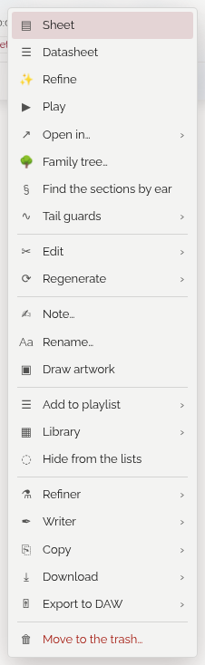

**יצירה מחדש עם זרע חדש** (בתפריט הטייק, בתוך **עריכה ›**): הטייק נוצר שוב מכל מה שהוא נוצר ממנו, אבל עם זרעים חדשים; החדש מקבל את המרחבים ואת ההערה של הישן, והישן מחכה במדור *מקור ליצירה מחדש* של המרחב שלו (המרחב שלו לא מציג אותו בין הטייקים שלו) עד שמרוקנים את המדור; החדש שומר את ההערה, הלייק, הכוכב והתמונה שלו. ניסוי יוצא באורכו המלא, שתי דקות. ניגון, פתיחה במוזיקאי או במלטש, הדף (הפרטיטורה שלו), דף הנתונים (כל מה שהוא נוצר ממנו: הסגנון והמילים, הפרטיטורה שצוירה, כל כפתור, ה-LoRA עם העוצמות והגלים שלהם; לטייק ישיר אין פרטיטורה, ואילו *כתיבה מתוך הצליל* מבקשת פרטיטורה מהמתעתק), הערה, שינוי שם, **מרחבים** (טייק אחד יכול לשבת בכמה), **העברה אל** מרחב אחד (בכרטיס מסומן: כל טייק מסומן, מתוך המרחב הפתוח), הסתרה, שליחה לכותב, העתקה, הורדה, **ייצוא ל-DAW** (פרויקט REAPER או DAWproject, בכל טייק: עם הסטמים שלו אחרי שהמלטש פיצל אותם), לפח. **בכרטיס מסומן, כשמסומנים גם אחרים**, התפריט פועל על כולם, והכותרת שלו אומרת על כמה: אהבתי, לא אהבתי, מועדף, עטיפה, הסרת העטיפה, מרחבים, הסתרה, ZIP; ציור עטיפות לכמה טייקים ויצירה מחדש של כמה שואלים קודם, כי הם עולים דקות של כרטיס. התפריט נפתח ב**דף** וב**דף נתונים**; **פתיחה ב… ›** מכילה את שאר החדרים לפי שם (מוזיקאי, מלטש, ספרן, וידאוגרף). **ספרייה ›** מכילה את *מרחבים*, *העברה אל* וגם *הצמדה כאן*. אהבתי, לא אהבתי ומועדף נמצאים על הכרטיס של הטייק, לא בתפריט של טייק בודד; כשמסומנים כמה, הם נמצאים תחת **סימונים ›**.

**ציור עטיפה**: מודל שפה קטן (Qwen3-4B) קורא את הסגנון והמילים של הטייק וכותב פרומפט תמונה אחד; Qwen-Image 2512 מצייר לפיו את התמונה עם Lightning (1328 px, נשמרת ב-1024), בתוך כשתי דקות על כרטיס של 16 GB כולל הפרומפט והבדיקה (בכרטיס קטן יותר הבלוקים שלו מוזרמים מ-RAM, קצת לאט יותר; את הצייר בוחרים תחת *מנוע ← עטיפה*). היא מופיעה בנגן, על הכרטיס, בלוח המדיה של שולחן העבודה, ובתוך קובץ ה-MP3 שמורידים (כעטיפה הקדמית שלו). ברגע שיש לטייק תמונה, בתפריט מופיעים *פתיחת העטיפה* (מעל הדף, כמו לחיצה על התמונה של הכרטיס או על הריבוע של הנגן) וגם *ציור מחדש של העטיפה* (פרומפט חדש ותמונה חדשה; הישנה נשמרת לצד הטייק, ב-`artwork-removed/`). כותב הפרומפטים ומסנן התוכן מגיעים עם `heresy/fetch-heresy.sh --artwork` (8.4 GB, אחרי שאלה), והצייר עם `--qwen 2512-q4` או `2512-q6`. תחת *מנוע ← עטיפה* מוצע כל צייר Qwen שיש כאן: Qwen-Image 2512 והפיינטיונים שלו ב-fp8 עם Lightning, וגם Qwen-Image 2.1 (ראה צייר › עטיפה לטייק).

**הוצאה מהמרחבים האחרים** (ספרייה ›, במרחב או במדור): הטייק, או המסומנים, נשארים במרחב הפתוח ובעץ שלו (ההורה שלו, המדורים שלו) ויוצאים מכל השאר, אחרי שאלה שמציינת אותם בשמם. בתפריטים של המרחבים ושל ההעברה, מדור עומד מתחת להורה שלו בשמו שלו. שינוי שם של מרחב או מדור שואל קודם, כדי שתנועת יד לא זהירה לא תזרוק שם ששונה.

**שומרי הזנב** (2056): ∿ בין המתגים של הנגן, כבוי אלא אם בוחרים בו (אותה אפשרות נמצאת בתפריט הטייק, *שומרי הזנב › על כל טייק חדש*, ובמנוע ← ברירות מחדל). כשהוא מופעל, הסוף של כל טייק שנוצר כאן נבדק ברגע שהוא נוחת: שומר הזנב מקשיב לצליל שחוזר אחרי שקט קרוב לסוף (הקודה של המודל אחרי שהשיר כבר נגמר), מסמן אותו בכתום, *זנב אחרי הסוף*, בנגן ועל הכרטיסים של הטייק, ואילו *סיום ב…* מציע את השנייה הזאת; טייק עם מילים מקבל גם *הושר עד הסוף?*, אבל רק כל עוד יש בכרטיס מקום ל-Whisper, אף פעם לא על המעבד, כך שכרטיס יחיד שעסוק בשירה משאיר את הבדיקה הזאת לכפתור שלה. *שומרי הזנב › בדיקת הסוף שלו עכשיו* בודקת טייק אחד מיד, כמו שהכפתורים עושים.

**המסומנים, מתפריט הטייק** (2059): בכרטיס מסומן כשמסומנים גם אחרים, התפריט עושה את מה שסרגל המסומנים עושה. במרחב או במדור, *ספרייה › הוצאת N מ-"…"* מוציאה אותם מהמרחב הפתוח, ורק ממנו (הם נשארים בספרייה ובכל מרחב אחר), אחרי אותה שאלה שהסרגל שואל. *הורדה › N כ-ZIP ›* מציינת את הפורמט, FLAC או WAV, לבד או עם מה שנוצר מהם (רימאסטרים, סטמים, אפסקיילים, קבצים אחרי אנטי-זמזום); ה-✓ מסמן את הבחירה של הסרגל עצמו, ומה שבוחרים כאן הופך גם לבחירה של הסרגל. כשמסומנים כמה, גם השורה המסומנת של המרחב הפתוח בתפריט *ספרייה › המרחבים של N ›* שואלת קודם את אותה שאלה, ואילו *הורדה ›* מכילה רק את ה-ZIP שלהם: הקבצים של הטייק עצמו (הפורמט שלו, ה-MP3 שלו, העטיפה שלו) הם לטייק אחד.

### הכלים שמתחת לסגנון <!-- #the-instruments-under-the-style -->

מתחת לשדה הסגנון, הנפחות מציינת את מה שהפרומפט שלך מבקש: צ'יפ לכל כלי וסגנון מהשליף שהיא מוצאת, צבוע לפי מה שהאוזן מצאה (ירוק: נשמע, כתום: מוטל בספק, אדום: לא מנוגן בשם הזה) ועם התמונה של הכלי. השאר את הסמן על אחד מהם כדי לראות את הכרטיס שלו: התמונה, המולדת שלו, איך הוא נשמע, ▶ A ו-▶ B עם הזרעים שלהם. לחיצה מציגה את התמונה במלואה. **Alt+I** פותח את השליף מכל מקום.

**המילים שבאוצרות המילים** (2051): לצידם, כל מילה בסגנון שנתוני האימון של הפיינטיונים הזכירו, ובסוגריים כמה רצועות הזכירו אותה בכל אוצר מילים: קודם של ה-First Wave, אחר כך של ה-Tsunami Wave, ואחר כך של כל אוצר מילים משלך מ-`user/vocab/` (*female vocals (130 · 82)*; "–" היכן שאוצר מילים לא מכיר אותה). גם צ'יפ של השליף נושא את המספרים שלו. חלק בסגנון שבין פסיקים שאף אוצר מילים לא מכיר מסומן בקו מקווקו: המודל מעולם לא שמע אותו באימון, ועשוי לקרוא אותו בדרכו שלו או לא לקרוא אותו כלל. כשהסמן על אחד מהם: המספרים והמילים שהוא הופיע איתן הכי הרבה; לחיצה פותחת עליו את אוצר המילים.

### עטיפה: מה מצייר אותה, מה הוא לא יכול, צייר אחר <!-- #artwork-what-draws-it-what-it-cannot-another-painter -->

**מה מצייר אותה.** מודל שפה קטן (Qwen3-4B) קורא את הסגנון והמילים של הטייק וכותב פרומפט תמונה אחד, עם הנושא שלו בראש; Qwen-Image 2512 מצייר לפיו את התמונה עם Lightning (ב-1328 px, נשמרת ב-1024), והבלוקים שלו מוזרמים מ-RAM היכן שהוא לא נכנס בשלמותו (*מנוע ← עטיפה*). כשהטייק קרוי על שם כלי (ניסוי של כלי), המראה של הכלי מוביל את הפרומפט מילה במילה (מה הכלי, ומה הוא לא), ו-Omni (המודל של המאזין) בוחן את התמונה לפי המראה הזה: תמונה שהוא לא מוצא בה את הכלי מצוירת מחדש, שלוש תמונות לכל היותר, וכשאף אחת לא מראה אותו באמת, הטייק נשאר בלי תמונה ולא עם תמונה כוזבת. בערך שתי דקות לתמונה על כרטיס של 16 GB, הכול כלול.

**מה הוא לא יכול** (הסתייגות, במילים פשוטות): הצייר מצייר את מה שהוא מכיר. כלי שהוא מעולם לא ראה בשמו (הדודוק, המורין חור, הכומוס, קערות שירה מקריסטל…) יוצא כניחוש: חליל עץ, כינור, קערות מטבח. היכן ש-Omni לא מצא את הכלי באף אחת משלוש התמונות, התמונה מסומנת **≈ ניחוש**, בתצוגת התמונה המלאה ובשליף הכלים. עטיפה היא מצב הרוח של הטייק, לא תמונת עיון של כלי: כדי לדעת איך כלי נראה, חפש אותו.

## מאמן LoRA <!-- #lora -->

המאמן נבדק על השירים והקולות שלנו, ולעת עתה הוא עומד על 90 %: הסטים והתרחישים שלך אינם שלנו, אז ספר לנו איך זה הלך (בתבנית *Trainer report* במאגר: הסט, המצב, ההגדרות, מה ששמעת).

### מה LoRA מלמד את YuE2 <!-- #what-a-lora-teaches-yue2 -->

LoRA הוא מתאם קטן מעל שני החצאים. **הסגנון בא בעיקר מחצי הצליל; ההיצמדות למילים, מחצי המוזיקה**, וחצי המוזיקה משנן סטים קטנים בעל פה מהר (ההפסד שלו יורד לכיוון 0). סוגים:

| סוג | נתונים | מה הוא לומד |
|---|---|---|
| **סגנון** | 20+ שירים בסאונד אחד | ז'אנר, הפקה, הסאונד של להקה |
| **קול** | קול אחד, שר או מדבר: שירה (רצוי א-קפלה), הקראות, ספרי שמע | גוון |
| **שפה** | הרבה קולות, מילים מדויקות | הדיקציה של שפה |
| **אמן** | קטלוג גדול ומגוון | הכול |

**מתאם קול לומד מכל צורה של הקול**, לא רק משירה: גם הקראות וספרי שמע מתאימים. נמדד כאן (05.10.2026): מתאם שאומן על הקראות של שחקן דיבר בקולו, וכששר, שר בצבע שלו. תן למתאם כזה שם לפי סוג הקול (בס, בריטנור, קונטרלטו…), לעולם לא לפי אדם: `lab/voice_kind.py` מודד את הקול של סט לפי גובה הדיבור שלו.

**כמה חזק מתאם קול.** נשמע על שיר (19.10.2026: מתאם של קריין, דרגה 32, על בלדה עממית טרגית): ב-1.0 הקול מטביע את המוזיקה והטייק נעשה לא יציב, 0.8 עדיין שורף אותו, 0.7 הוא התקרה שממנה כדאי להתחיל, ו-0.4–0.6 נושאים את הקול הכי טוב. עוצמה נמוכה משחררת את גובה הצליל של הפרסונה עצמה ושומרת על הטונאליות של הקול: השיר מקבל את הצבע שלו, לא את החותמת שלו. שני החצאים שלו אינם דומים: חצי המוזיקה (AR) כותב את הפרטיטורה יחד עם המודל, לשתי החמשות, וקול שאומן על דיבור משתיק את התווים כשעוצמתו גבוהה; השאר אותו על 0.5 לכל היותר, ותן לחצי הצליל (NAR), שנושא את הגוון, עד 1.0 (נשמע באותו יום: AR 0.4 עם NAR 1.0 שמרו על המוזיקה שלמה ועל הקול יציב). כך הסליידרים משרטטים את הדרך של מתאם קול: מתאם ששמו אומר voice או vocal נצבע באדום מעבר ל-0.5 בחצי המוזיקה ומעבר ל-1.0 בחצי הצליל.

### קול משלך: שאלות מהשטח <!-- #a-voice-of-your-own-questions-from-the-field -->

תשובות שניתנו ב-GitHub ([issue #2](https://github.com/igrbible/Ruach_Studio/issues/2)) ל-Steven Altsman (manchuwook), שחיפש קול ראשי בלבד, שמורות כאן.

- **טייק עם הקול לבדו.** YuE2 למד לשיר משירים שלמים, והפרייזינג שלו נשען על המוזיקה שמתחתיו: "a cappella" בסגנון גורם לו לחפש הרמוניות או את הלהקה. במקום זה בקש דבר שקט אחד מתחת לקול (פד רך, גיטרה אקוסטית אחת) עם `solo lead, single voice, no harmonies, no backing vocals, dry vocal, close mic`, ואז פצל את הטייק במלטש (שמונה סטמים): *קול ראשי שלם* מחזיר את מה שהפיצול שם בין קולות הליווי, *אפסקייל לקולות* מצייר מחדש את האוויר שהמפריד עמעם. ככל שיש פחות מתחת לקול, הסטם נקי יותר.
- **מתאם קול מההקלטות שלך.** שירה ראשית יבשה של זמר אחד עם המילים שלה, ב-44.1 או 48 kHz ממקורות ללא אובדן (lossless). אותו צליל חדר קל בכל הקליפים מזיק פחות מחדרים שונים, וקליפ עם ריוורב כבד עדיף להשאיר בחוץ מאשר לנקות אותו רק למחצה: מה שדה-ריוורב משאיר אחריו נלמד כחלק מהקול.
- **דרגה.** 16 לקול אחד, 32 לכל היותר: הדרגה קובעת כמה המתאם יכול לשנות, לא כמה קרוב הוא יגיע לזמר.
- **דמיון.** חצי הצליל נושא את הגוון: הגדר אותו על 0.8–1.0 ואת חצי המוזיקה על 0.3–0.5. ציין בסגנון את המין והרגיסטר של הזמר (`male baritone vocal`). שפוט אותו על המשקלים שעליהם אומן: מתאם שלמד על מודל הבסיס קרע את הקול על פיינטיון, אפילו בעוצמה נמוכה.
- **הכיפוף של העקומות בסוף.** כשהאפשרות *עצירה בפלאטו, ואז חצי הצליל לבד* מופעלת, חצי המוזיקה נעצר ברגע שחצי הצליל מפסיק להשתפר, וחצי הצליל ממשיך לבדו: שם העקומות משנות את צורתן, ובאפוקים האחרונים האלה הקול יוצא לעתים קרובות הכי נקי. כש-ar_ce מתקרב ל-0, חצי המוזיקה יודע את הקליפים בעל פה: האזן לאפוק מוקדם יותר (הצ'יפים הירוקים).

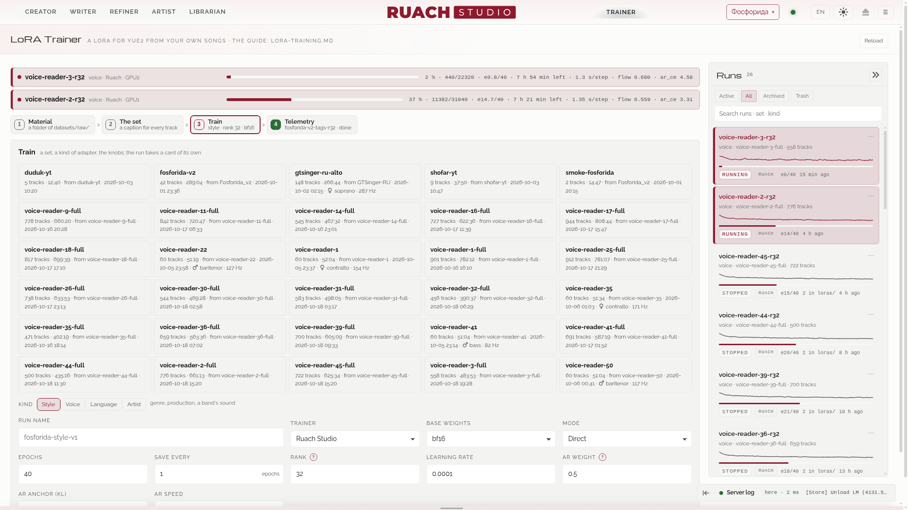

### למה מתאמים משלך <!-- #why-your-own-adapters -->

מודל פתוח בלי תוספות, חזק ככל שיהיה, עדיין לוקה בחסר בכלים, בסגנונות ובקולות: הוא יודע את מה שהאימון שלו שמע, והסאונד שלך רק לעתים רחוקות נמצא שם. המתאמים שלך סוגרים את הפער הזה; הם השריון של לוחם אודיו ומוזיקה מקצועי. הצעד הבטוח ביותר קדימה: אסוף את הרצועות הטובות ביותר שלך, אלה שיצרת ב-SUNO (בתוכנית בתשלום הן שלך) או בכל מקום אחר שהזכויות עליהן שלך, ואמן עליהן מתאם **סגנון**, עם המילים המדויקות לצד כל אחת. אז YuE2 כותב בסאונד שלך, ולא בסאונד שרק קרוב אליו: הכלים שלך, העיבודים שלך, ההפקה שלך. הוסף מתאם **קול** לזמר הרצוי, והשירים יושרו בצבע הזה. סגנון שאומן על עשרים מהשירים שלך מרים את המודל רחוק יותר מכל מקום שפרומפט מסוגל לדחוף אותו אליו.

### 1 חומר <!-- #1-material -->

**הרצה שנבחרה** בעמודה מימין הופכת את שלבים 1–3 לשלה: *חומר* אומר ממה נעשה הסט שלה, *הסט* את הסט והרצועות שלה, *אימון* את הסוג, הדרגה, קצב הלמידה, האפוקים והמאמן שלה (הרצה של תוסף במילים שלה); כל לוח הוא דף ההרצה, לקריאה בלבד, עם *טלמטריה ›*. הטופס שייך להרצה חדשה: **ריצה חדשה** פותחת אותו מאפס, בלי שום דבר שהשאיר בו טופס קודם, והכפתור **ריצה חדשה לפי זו** ממלא אותו מההרצה שנבחרה (הסט, הסוג והכפתורים שלה; את השם נותן אתה, כי אותו שם היה ממשיך את ההרצה ההיא).

שים תיקיית שירים ב-`datasets/raw/` ובחר בה. בחר אילו רצועות נכנסות, תן לכל אחת את המילים שלה (הן נמצאות לידה לפי השם, כשהן קיימות) ואם צריך, גם סגנון משלה. רצועות קצרות מ-30 שניות נשארות בחוץ כברירת מחדל; ארוכות הן בסדר (חצי המוזיקה לומד על השיר כולו).

**קול**: *מדידת הקול* מאזינה לכל היותר לשתים עשרה רצועות מהתיקייה ואומרת, על דיבור, אם הקול גברי או נשי ומה הרגיסטר (בס, בריטון, בריטנור, טנור; קונטרלטו, מצו, סופרן) עם גובה הדיבור, ומציעה שם לסט שייבנה מהן, כמו שנקראים מתאמי הקול שפורסמו (`voice-ru-m-baritenor-117`): בלי שם של אדם. על שירה היא נותנת את המנעד שהושר ומשאירה את הקול לאוזן שלך. היכן שגובה הצליל לבדו לא מכריע (140–175 Hz בדיבור), ציין ♂ או ♀ ומדוד שוב. זו טיוטה לפי מדידה: האוזן מחליטה, והקול שבו YuE2 ישיר אחר כך עשוי לשבת גבוה או נמוך יותר.

**רופא הסט**, מתחת לתיקייה שנבחרה, בודק כל רצועה מול המדריך הזה: כמה שירים שונים ובאיזה אורך (סגנון צריך 20 או יותר, קול 30 או כמה שעות, שפה 100 ויותר), גרסאות של שיר אחד ואותו קובץ פעמיים, מתחת ל-0:30 או מעל 6:00, מקורות עם אובדן (lossy) וגבוהים חתוכים סביב 16 kHz (MP3, אפילו בתוך WAV או FLAC), מתחת ל-44.1 kHz או מונו, קליפינג, שקט של יותר מ-3 s בקצה, עוצמה שרחוקה ביותר מ-6 dB משאר הרצועות, ופיזור הטמפו. תיקייה של עד 60 רצועות נבדקת כשבוחרים בה, גדולה יותר בלחיצה (לכל היותר 400 רצועות, פזורות על פני התיקייה); הדוח נשמר עד שהתיקייה משתנה. הוא אומר; ההחלטה שלך.

### 2 הסט <!-- #2-the-set -->

**מילת הפעלה** (מילה לא שגרתית, למשל `sunveil`) קוראת לסגנון בשמו בהמשך; **שורת סגנון משותפת** אומרת מה שומעים. *הרכבת הסט* כותבת את `datasets/prepared/NAME/`: אודיו ב-48 kHz וכיתוב לכל רצועה.

**המאזין** (Qwen2.5-Omni, על כל כרטיס עם כ-8 GB פנויים) מאזין לכל רצועה ומנסח טיוטה של התגיות שלה; תקן אותן ולחץ על *כתיבה לתוך הכיתובים*. זו טיוטה בכל גודל של מודל: קרא אותה.

### 3 אימון <!-- #3-train -->

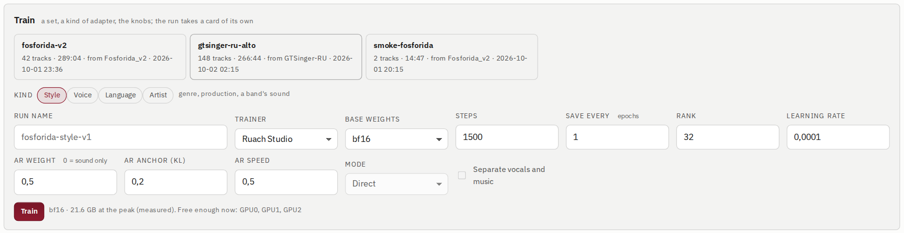

בחר סט שהורכב בשלב 2, ואז **סוג**: הוא מכוון את הכפתורים למה שמלמדים (הטבלה מתחת לרשימה), ואת כל אחד מהם אפשר לשנות לפני *אימון*. הטופס, שדה אחר שדה:

- **סוג**: סגנון, קול, שפה או אמן.
- **שם ההרצה**: התיקייה של ההרצה (`training/NAME/`) והשמות של המתאמים שלה (`loras/NAME/NAME-eNNN`, מיד בין ה-LoRA של המוזיקאי). שם שייך להרצה אחת: כשהוא תפוס, הדף מבקש שם אחר.
- **מאמן**: **נפחות רוח**, המאמן של הנפחות עצמה, על משקלי bf16 ללא קוונטיזציה; את מטמון הייצוגים הלטנטיים של הסט הוא בונה בעצמו; ישיר או עם פרטיטורה, על השירים כמו שהם או מופרדים. הועבר שורה אחר שורה מ-**AI-Toolkit** של Ostris (MIT), שאת העקומות שלו הוא שחזר אפוק אחר אפוק על אותו סט; AI-Toolkit עצמו עזב את הנפחות ברגע שכל מה שהוא אימן היה כאן.
- **משקלי בסיס**: bf16, המודל כולו (כרטיס של 24 GB), או int8 לכרטיסים קטנים יותר, קצת פחות מדויק. הקובץ של מודל הבסיס לא משתנה לעולם: רק המתאם לומד.
- **כרטיסים**: כמה כרטיסי GPU ההרצה תופסת, 1, 2 או 3, מתוך הכרטיסים שהוקצו לאימון תחת מנוע ← כרטיסי GPU. כל כרטיס מחזיק את המודל כולו ולומד את השירים שלו; השיעורים שלהם ממוצעים בכל צעד (מקביליות נתונים, data-parallel), כך ששני כרטיסים עוברים אפוק מהר בערך פי שניים, ושלושה בערך פי שלושה, במספר אי-זוגי כמו בזוגי. האצווה גדלה עם הכרטיסים וקצב הלמידה הולך אחריה (× √כרטיסים): אין עוד מה להגדיר. חיתוך של מטריצה אחת בין כרטיסים (מקביליות טנזורים, tensor parallelism) אינו בשימוש: YuE2 נכנס שלם לכרטיס של 24 GB, ובכרטיסים בלי NVLink חיתוך של כל שכבה עולה יותר ממה שהוא נותן.
- **אפוקים**: כמה פעמים ההרצה עוברת על הסט, כל רצועה פעם אחת באפוק, רצועה אחת בכל צעד: מספר הצעדים שלה הוא מספר הרצועות בסט כפול המספר הזה (2016 רצועות ב-12 אפוקים הן 24 192 צעדים). חצי הצליל שומע חלון של 60 שניות מהרצועה, שנחתך במקום אקראי בכל פעם; חצי המוזיקה קורא את השיר מתחילתו.
- **שמירה כל N אפוקים**: מתאם בסוף כל N אפוקים, כל אחד מהם לשמיעה ולהשוואה, כולם נשמרים, ולצד החדש ביותר מצב האופטימייזר (הרצה שנעצרה שומרת את מה שלמדה). **עצירה בפלאטו, ואז חצי הצליל לבד** (מופעל כברירת מחדל): שתיים מכל מאה רצועות מוחזקות בצד ונשמעות בכל אפוק; כשחצי הצליל מפסיק להשתפר עליהן במשך 3 אפוקים, חצי המוזיקה נעצר באפוק הטוב ביותר שלו וחצי הצליל ממשיך לבד, עד 12 אפוקים נוספים. כך יצא קול נקי יותר. N יורד עד עשירית אפוק (0.1: עשר שמירות באפוק, בשמות e001.3 וכן הלאה), כדי שאפשר יהיה לשמוע סט גדול בזמן שהוא נלמד.
- **דרגה**: כמה רחב המתאם; החלק שלו מהמשקלים והגודל שלו מופיעים בחלונית העזרה של השדה (מה עולה כל דרגה ואיזו מתאימה למה: בהמשך).
- **קצב למידה**: כמה גדול כל צעד של חצי הצליל (AdamW, אותו קצב לכל ההרצה); הקצב של חצי המוזיקה הוא הערך הזה כפול **מהירות AR**. הסוגים שומרים על 0.0001; חצי ממנו עדין יותר, להרצה ארוכה על סט גדול; גבוה יותר לומד מהר יותר ושוכח יותר.
- **דעיכת LR, אפוקים** ו-**LR בסוף, %**: לאורך האפוקים האחרונים של ההרצה קצב הלמידה יורד בקו ישר, עד מה שנשאר ממנו בצעד האחרון (0 % מכבה אותו לגמרי): הדרך המקובלת לסיים הרצה, כשהשמירות האחרונות מתייצבות במקום להמשיך לצעוד באותה חוזקה. הדעיכה הולכת לפי אורך ההרצה, כך שהרצה שהמשיכה לעוד אפוקים דועכת בסוף החדש שלה, והמשך ההרצה לוקח את כל ערכי הכפתורים שניתנו לה, ובהם הדעיכה. 0 אפוקים, כמו בברירת המחדל: בלי דעיכה, הקצב זהה עד הסוף.
- **משקל AR**, **עוגן AR (KL)**, **מהירות AR**: שלושת הכפתורים של חצי המוזיקה, בהמשך.
- **מצב**: **ישיר** מיועד לשירים שנוצרו במצב ישיר; **מלא (פרטיטורה)** ו**מנגינה**, לשירים שנוצרו במצבים האלה, מלמדים את חצי המוזיקה גם לכתוב קודם פרטיטורה, שהמנוע מתעתק מכל שיר לפני ההרצה; חצי מהצעדים עוברים בלי הפרטיטורה, כדי שהמצב הישיר לא יישכח. **הפרדת ווקאל ומוזיקה**: כל שיר מפוצל קודם לקול ולמוזיקה על ידי המפריד של הנפחות (פעם אחת לסט, כמה דקות לשיר), וחצי המוזיקה לומד גם את הקול מהמילים לבדן ואת המוזיקה מהתגיות לבדן.
- מתחת לכפתור: ה-VRAM שנמדד בהרצות קודמות, ואיזה כרטיס פנוי מספיק עכשיו.

| סוג | דרגה | צעדים | משקל AR | עוגן AR | מהירות AR | למה |
|---|---|---|---|---|---|---|
| **סגנון** | 32 | 1500 | 0.5 | 0.2 | 0.5 | סאונד: ז'אנר, הפקה, הסאונד של להקה |
| **קול** | 16 | 1500 | 0.3 | 0.3 | 0.5 | גוון: חצי המוזיקה מוחזק קרוב לבסיס |
| **שפה** | 32 | 3000 | 1.0 | 0.1 | 1.0 | דיקציה: חצי המוזיקה אמור להשתנות |
| **אמן** | 32 | 3000 | 0.7 | 0.2 | 0.7 | הכול |

### הדרגה ושאר הכפתורים <!-- #rank-and-the-other-knobs -->

**דרגה** היא כמה רחב השינוי שהמתאם עושה בכל מטריצה. LoRA מתאים 224 מטריצות של YuE2, 112 לכל חצי; כל אחת ברוחב 2048, בעומק 28 שכבות, 1.41 מיליארד משקלים לכל חצי. מה עולה דרגה, כפי שנמדד על הצורות האלה:

| דרגה | מהמשקלים שהוא מתאים | קובץ, לכל חצי (bf16) |
|---|---|---|
| 16 | 1 % | 29 MB |
| 32 | 2 % | 59 MB |
| 64 | 4 % | 117 MB |
| 128 | 8 % | 235 MB |
| 256 | 17 % | 470 MB |

- **קול אחד, כלי אחד, סאונד אחד** (20 עד 50 שירים): **16**, לכל היותר 32.
- **סגנון או אמן** (קטלוג מגוון): **32**.
- **סט גדול של קולות רבים** (שעות של הקלטות, תגית לכל קול): **64**, ו-**128 לכל היותר**, רק כש-64 לא מספיק באופן מדיד. המאמן עוצר ב-128: דרגה 256 הייתה משנה שישית מהמשקלים שהיא נוגעת בהם, יותר ממה שכל סט כאן צריך.
- הקובץ של מודל הבסיס לא משתנה לעולם. הסיכון של דרגה גבוהה הוא המתאם עצמו: בעוצמה מלאה הוא שוכח את מה שלא הראו לו (שירה, אם למד מדיבור).
- **אפוקים**: חצי המוזיקה משנן סט קטן בעל פה מהר (ההפסד שלו יורד לכיוון 0): האפוקים הירוקים בטלמטריה הם אלה שכדאי לשמוע קודם, לעתים קרובות הרבה לפני האחרון.
- **קצב הדגימה של החומר**: חצי הצליל פועל ב-48 kHz, חצי המוזיקה שומע ב-24 kHz. הקלטה ב-24 kHz מלמדת את חצי המוזיקה הכול, אבל את חצי הצליל רק גבוהים עמומים: דגימה מחדש לא מוסיפה דבר מעל חצי מקצב הדגימה המקורי. לגוון, תן לו 44.1 או 48 kHz.
- **זיכרון**: כרטיס של 24 GB הוא קנה המידה. משקלי ה-bf16 תופסים 7.5 GB; המתאם, הגרדיאנטים שלו והאופטימייזר שלו 16 בתים לכל משקל (דרגה 32: פחות מ-1 GB; דרגה 128: 3.8 GB; דרגה 256: 7.5 GB); השאר הוא האקטיבציות של השיעור, וחצי המוזיקה קורא את השיר כולו: נמדדו 17.7 GB בשיא עם דרגה 32 על שירים באורך של כמה דקות, כ-11 GB על קליפים קוליים קצרים. **מתחת ל-16 GB, אל תאמן דרגות גבוהות**: משקלי int8, דרגה 16 עד 32, קליפים קצרים. דרגה 256 על כרטיס של 24 GB היא על הקצה.
- **כל שמירה היא ממוצע נע** של המתאם לאורך האפוק האחרון שלו בערך (EMA), בשני החצאים, ורצועות הבקרה נשמעות עליו: הרעש של צעדים בודדים מוחלק החוצה ממה ששומעים וממה שעוצר את ההרצה. המשקלים הגולמיים שממשיכים מהם נשמרים לצדו (`resume.safetensors.raw`).

### שלושת הכפתורים של חצי המוזיקה <!-- #the-music-half-s-three-knobs -->

כל צעד מלמד את שני החצאים בנפרד. חצי הצליל תמיד לומד את הצליל: להסיר את הרעש מהחלון שלו מתוך הרצועה (הפסד ה-flow). חצי המוזיקה לומד רק כש**משקל AR** גדול מ-0, ואז שני כוחות מושכים אותו בבת אחת:

- **השיעור שלו** (ar_ce): לחזות את הטוקנים של השיר עצמו מתחילת השיר, מילה אחר מילה ותו אחר תו: דיקציה, פרייזינג, הרגלים מלודיים, הצורה של שיר;
- **העוגן** (ar_kl): בכל אחד מהמקומות האלה המאמן שואל את מודל הבסיס, אותו חצי מוזיקה כשהמתאם כבוי, מה הוא היה כותב שם, וקונס את המתאם על כל צעד שבו הוא מתרחק מזה.

ההפסד של צעד הוא flow + משקל AR × ar_ce + עוגן AR × ar_kl. מה כל כפתור עושה:

- **משקל AR** קובע אם חצי המוזיקה לומד בכלל, וכמה חזק השיעור שלו מושך נגד העוגן. ב-0 חצי המוזיקה נשאר מודל הבסיס (החלק שלו במתאם נשאר ריק: כולו אפסים, נמדד), המתאם הוא גוון על חצי הצליל בלבד, והעוגן לא עושה דבר.
- **עוגן AR** מושך את חצי המוזיקה חזרה אל מודל הבסיס, כדי שישמור את מה שהסט לא מראה: שירה אחרי סט של הקראות, שפות אחרות, היצמדות למילים חדשות, כתיבת פרטיטורה. בלי עוגן הוא נסחף לאן שהסט מוביל.
- **השניים מושכים זה נגד זה, ורק היחס ביניהם קובע, לא הגודל שלהם.** AdamW מכייל כל צעד לפי הגודל של הגרדיאנטים האחרונים שלו עצמו, כך שהפסד שהוכפל במספר מלמד את מה שלימד קודם: 0.5 עם עוגן של 0.2 זהה ל-1.0 עם 0.4. קרא את העוגן כחלק מהמשקל: עשירית ממנו נותנת לחצי המוזיקה לזוז (שפה), עוגן בגודל המשקל מחזיק אותו קרוב לבסיס (קול).
- **מהירות AR** היא המצערת האמיתית של חצי המוזיקה: קצב הלמידה שלו הוא קצב הלמידה כפול הערך הזה, הכפתור היחיד שגורם לחצי המוזיקה ללמוד מהר יותר או לאט יותר. הסוגים שומרים אותה על 0.5 (שפה על 1.0): חצי המוזיקה משנן סט קטן בעל פה הרבה לפני שחצי הצליל משיג את הגוון שלו.

נמדד כאן (10.10.2026: 40 צעדים על סט של 60 הקראות, דרגה 16, זרע אחד; *תזוזה* היא כמה גדול יצא השינוי של המתאם במטריצות של חצי המוזיקה):

| משקל AR · עוגן · מהירות | תזוזה | הפרש מהשורה הראשונה | ar_kl, עשרת הצעדים האחרונים שלו |
|---|---|---|---|
| 0.5 · 0.2 · 0.5 (של סגנון) | 1.32 | אותה הרצה שוב: 1 % | 0.257 |
| 1.0 · 0.4 · 0.5 (שניהם כפולים) | 1.36 | 5 % | 0.262 |
| 0.5 · 0 · 0.5 (בלי עוגן) | 1.44 | 23 % | — |
| 0.5 · 0.5 · 0.5 (עוגן בגודל המשקל) | 1.21 | 17 % | 0.132 |
| 0.5 · 0.2 · 1.0 (מהירות כפולה) | 2.32 | 99 % | 0.443 |
| 0 · 0 · 0.5 | 0 | לא נלמד כלום | — |

הכפלת שניהם שינתה את המתאם ב-5 %, לעומת 1 % לאותה הרצה פעמיים; החלק של העוגן הזיז אותו בשישית עד רבע; הכפלת המהירות לקחה אותו רחוק יותר בשלושה רבעים. חצי הצליל חולק עם חצי המוזיקה רק את חיתוך הגרדיאנט: בין השורות הוא נבדל ב-4 עד 13 %, לעומת 2 % לאותה הרצה פעמיים.

מה לסובב, לפי מה ששומעים ורואים:

| מתי | מה לסובב |
|---|---|
| רוצים גוון בלבד (קול מהקראות, כלי) | משקל AR נמוך עם עוגן בגודל שלו (של קול: 0.3 ו-0.3), או משקל AR 0 |
| רוצים דיקציה של שפה, פרייזינג של סגנון | משקל AR 1.0, העוגן עשירית ממנו, מהירות AR 1.0 (של שפה) |
| ar_ce יורד מתחת ל-0.3 מוקדם: חצי המוזיקה יודע את השירים בעל פה | מהירות AR למטה, או החלק של העוגן למעלה; או האזן לאפוק מוקדם יותר |
| המתאם שר את המנגינות של שירי האימון על מילים חדשות, או מאבד את המילים | החלק של העוגן למעלה: בגודל המשקל, או יותר |
| ar_kl נשאר ליד 0 והדיקציה לא הגיעה | מהירות AR למעלה, או החלק של העוגן למטה |

### 4 טלמטריה <!-- #4-telemetry -->

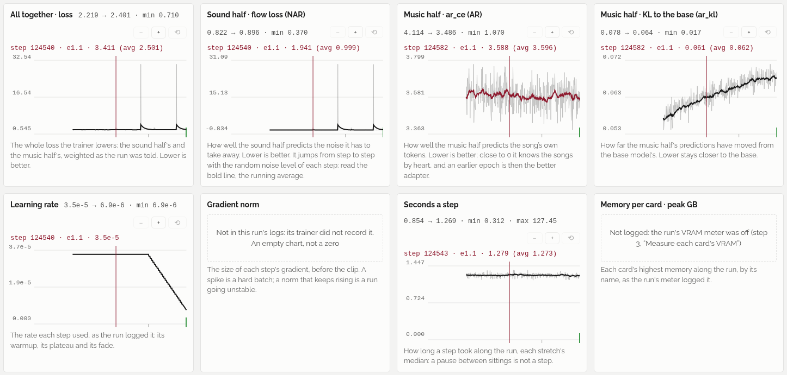

ההרצות שמתאמנות עכשיו עומדות בראש החדר עם ההתקדמות שלהן, הזמן שנותר ושני ההפסדים. הטלמטריה של הרצה מציגה את ההתקדמות שלה, ואחר כך אריחים: המהירות שלה, הזמן שהיא רצה והזמן שנותר לה, הערכים האחרונים של flow, ar_ce ו-**ar_kl** (עד כמה חצי המוזיקה התרחק ממודל הבסיס: 0 כל עוד משקל AR הוא 0), שיא ה-VRAM והכרטיס; ואחר כך שמונה גרפים, זהים לכל הרצה, כל אחד משורטט ממה שההרצה עצמה רשמה (גרף שההרצה לא רשמה עומד ריק ואומר זאת, לעולם לא קו באפס):

- **הכול יחד · הפסד**: כל ההפסד שהמאמן מוריד, שני החצאים משוקללים כפי שנקבע להרצה.
- **חצי הצליל · הפסד flow**: כמה טוב חצי הצליל חוזה את הרעש שעליו להסיר. הוא קופץ מצעד לצעד (כל צעד מגריל רמת רעש אקראית): קרא את הקו המודגש, הממוצע הנע.
- **חצי המוזיקה · ar_ce**: כמה טוב חצי המוזיקה חוזה את הטוקנים של השיר עצמו. קרוב ל-0 הוא יודע את השירים בעל פה; אז אפוק מוקדם יותר הוא המתאם הטוב יותר.
- **חצי המוזיקה · KL ביחס לבסיס**: עד כמה התחזיות של חצי המוזיקה התרחקו מאלה של מודל הבסיס.
- **קצב למידה**: הקצב שבו השתמש כל צעד: החימום, הפלאטו והדעיכה.
- **נורמת הגרדיאנט**: הגודל של הגרדיאנט של כל צעד לפני החיתוך. קפיצה היא אצווה קשה; נורמה שממשיכה לעלות היא הרצה שמאבדת יציבות.
- **שניות לצעד**: כמה זמן לקח צעד לאורך ההרצה, החציון של כל מקטע, כך שהפסקה בין ישיבות אינה נחשבת לצעד.
- **זיכרון לכל כרטיס**: שיא הזיכרון של כל כרטיס לאורך ההרצה, לפי שם הכרטיס (בהרצה שבה *מדידת ה-VRAM של כל כרטיס* מופעלת, או בהרצה של תוסף).

העבר את הסמן מעל עקומה כדי לקרוא את הצעד, את האפוק שלו ואת הערך שם. **השוואה עם…** מניחה את העקומות של הרצה אחרת מעל אלה, בקו מקווקו. הכפתור שליד **היומן** מסדר את הגרפים זה מתחת לזה, כל אחד ברוחב מלא, או שוב זה לצד זה. **היומן** נפתח בתחתית החדר, ברוחב השורות שלו, לצד יומן השרת.

**ביחד.** העקומות יכולות לחלוק גרף אחד, כל אחת בקנה המידה שלה (הטווח שלה מופיע על התיבה שלה ובחלונית העזרה שלה): הערכים של רצועות הבקרה מסומנים על העקומות שלהם כנקודות, והאירועים של ההרצה (מגדל שהוקפא, חידוש, קצב למידה ששונה) כקווים דקים עם המילים שלהם, והממוצע אינו נמשך דרכם. **החלקה** נעה מ-0 (הנקודות הגולמיות) עד 0.99, כמו ב-TensorBoard, והקו הגולמי חיוור מתחת לקו המוחלק; קצב הלמידה, הזיכרון ונקודות הבקרה לעולם לא מוחלקים. הרצה שעדיין מתאמנת מסיימת את הציר שלה עשירית אחרי הצעד האחרון שלה.

**בכל תצוגה** האירועים של ההרצה עומדים כקווים דקים עם המילים שלהם, ונקודות ה-held-out של העקומות יחד הן לכל היותר בערך 120 במה שמוצג: היכן שהן צפופות יותר, כל נקודה היא ממוצע של כמה שמירות, כל ערך בחלונית העזרה שלה.

### האפוקים ששווה לשמוע קודם <!-- #the-epochs-worth-hearing-first -->

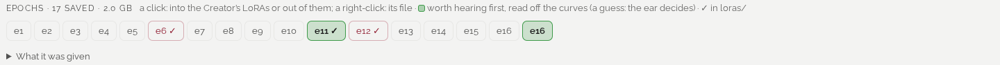

כל אפוק שנשמר הוא צ'יפ. את ה**ירוקים** שווה לשמוע קודם, כפי שהם נקראים מהעקומות: האפוק הראשון שהפסד הצליל שלו התייצב, זה עם הפסד הצליל הנמוך ביותר, והאחרון לפני שחצי המוזיקה יודע את השירים בעל פה. זה ניחוש; האוזן מחליטה. בחר אפוק: **אל loras/ ← למוזיקאי** (הוא מופיע מיד בין ה-LoRA), **הוצאה מ-loras/**, או **הורדה**.

> **מתאם שאומן בלי פרטיטורה (ישיר) שייך לחצי המוזיקה רק כשיוצרים במצב ישיר.** ב"תוכנית מלאה" חצי המוזיקה שלו יכול לשבור את הפרטיטורה אפילו בעוצמה נמוכה: שם תן לו רק את חצי הצליל.

### 5 סטריאו <!-- #5-stereo -->

השלב החמישי מעמיד מרחב של ניסויים מול מודל הבסיס על אותם כרטיסים (אותו סגנון ואותן מילים), קודם עם אותו זרע. כל מודל שם (מודל הליבה שלו, המתאמים שלו עם העוצמות שלהם, המפענח שלו כשהוא אינו Standard) מקבל חציון על פני הזוגות שלו: של הצד מול האמצע בארבעה תחומים (בס, אמצע, גבוהים, אוויר) ושל פריסת הפנורמה מול זו של הבסיס. **צר יותר** (כתום) ו**צר מדי** (אדום) הם הגבולות שמעבר להם זה נאמר: כברירת מחדל, הגבול של צר יותר הוא −1.5 / −0.5 / −0.5 / −1 dB, ובפנורמה −7 %, והגבול של צר מדי הוא −3.5 / −1 / −1 / −4 dB, ובפנורמה −15 %; הם נקבעו לפי הזירה, שבה הצדדים של Tsunami Wave מצרים מעט את הבס, את האוויר ואת הפנורמה, ואת האמצע בכלל לא. `user/stereo-guard.json` מזיז אותם. **מדוד** מודד כל טייק פעם אחת ושומר את המספרים שלו; בסיס שהושר במרחב הזה קודם לכל בסיס מהספרייה. מהטרמינל, לניסויים היומיים של אימון: `lab/stereo_guard.py "WORKSPACE"`.

### הרצות <!-- #runs -->

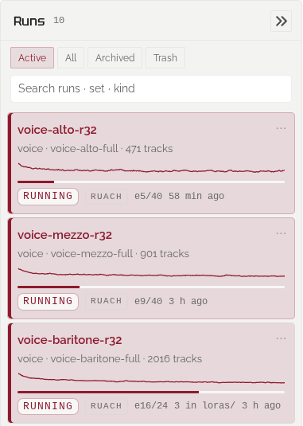

כל הרצה היא כרטיס מימין: *פעילים*, *הכול*, *בארכיון*, *פח*, עם חיפוש. הרצה שמתאמנת מוארת כמו טייק שמתנגן. ⋯ על כרטיס: הטלמטריה שלה, היומן שלה, העברה לארכיון, עצירה, או מחיקה לפח (הדף שואל אם המתאמים שלה ב-loras/ הולכים איתה). מהפח היא חוזרת, או נמחקת לצמיתות. מתחתיהם, ההרצות לפי מצב: **אימון**, **מושהה**, **סיום**, **נעצר**, **נכשל**, כל אחד עם הספירה שלו, אחד בכל פעם (לחיצה נוספת מציגה את כולן). **השהיה** על הרצה שמתאמנת שומרת את מה שלמדה וממתינה; **המשך** ממשיך מהשמירה הזאת עם אותו סט, אותם ערכים ואותם כרטיסים.

### בנקי SFZ: כלי מההקלטות שלך <!-- #sfz-banks-an-instrument-from-your-recordings -->

המתג בראש המאמן, **LoRA | בנקי SFZ**, הופך את החדר לבונה הבנקים: הקלטות של כלי נשיפה אחד הופכות לבנק SFZ עבור *+ שכבה* של ה-DAW ועבור תזמורת ה-MIDI. בנק נבנה בארבעה שלבים, וכל אחד משאיר את העבודה שלו ב-`datasets/banks/NAME/`, כך שאפשר לבצע שלב מחדש בלי אלה שלפניו; הבנקים שבבנייה עומדים מימין.

**חומר**: תיקייה ב-`datasets/raw/` (קובץ `.info.json` של yt-dlp לצד קובץ נותן את הכותרת שלו, את מי שהעלה אותו ואת הרישיון), שם הכלי (מה שאומרים למאזין לצפות לו; המנעד של דודוק, E3–E5, מונע מדרון שמתחת למנגינה להיחשב לתו) והסוג שלו: *תווים* לכלי מלודי שמוקלט קליד אחר קליד (דודוק), *תקיעות* לכלי של כמה נשיפות, כל סוג על קליד משלו (שופר: תקיעה על C3, שברים D3, תרועה E3, תקיעה גדולה F3, וקובץ .sfz שני שבו התקיעה בגובה הצליל שלה על פני כל הקלידים).

**ניקוי** עובר על כל קובץ בחתיכות של עשר דקות; מהקלטה ארוכה משעה, שש חתיכות כאלה הפזורות לאורכה. לתווים, כלי הנשיפה מופרדים משאר הצליל (מודל כלי הנשיפה של UVR) ושנייה נשמרת כשהם עומדים 12 dB מעל כל השאר ויש להם גובה צליל; לתקיעות ההקלטה נמדדת כמו שהיא (מודל כלי הנשיפה לא מזהה שופר ככלי נשיפה מעץ). BS-Roformer מאזין לקול (דודוק נוחת לעתים קרובות בסטם הקול, ולכן קול בגובה הצליל של הכלי עצמו נחשב לכלי), והמאזין (Omni) נשאל כן או לא על כל עשר שניות שאפשר לשמור: כלי נשיפה, קול אנושי, תופים, כלי מיתר או קלידים, קהל או רעש. על כרטיס הוא תופס 16 GB; כשבאף כרטיס אין מקום, הוא מציע את המעבד (כמה תהליכים בבת אחת, לאט יותר מכרטיס). כל קובץ מקבל פס, וכל שנייה בו עמודה: ירוק נשמר, אדום נדחה (קול, או שהמאזין שמע משהו אחר), צהוב מעל מצע, אפור מצע; לחיצה מאזינה משם, להקלטה או לכלי הנשיפה לבדם.

**תווים** מוצא אותם בשניות שנשמרו: גובה צליל יציב של 0.35 s ומעלה, גם תווי לגאטו (נחתכים אחרי הגלישה שלהם מהתו הקודם), כל אחד עם הסנטים שלו, הוויברטו, העוצמה ביחס לקובץ שלו, הדרון שמתחתיו והזנב שלו. קליד מציג את התווים שלו, וכל אחד מהם אפשר לשמוע; הטובים ביותר נכנסים לבנק, אלא אם בוחרים ביד. **הבנק** חותך אותם לסמפלים (48 kHz, FLAC של 24 ביט, מכוונים לפי הסנטים שלהם, בלופ עם קרוספייד היכן שחלק יציב נסגר ללופ נקי), עם שכבות velocity היכן שהנגינה עצמה הייתה חלשה וחזקה, ועם round robin, אל `banks/NAME/` עם ה-`.sfz` וה-`bank.json` שלו (המקור והמקום של כל סמפל, המנעד, הרישיון). הקלטות שהרישיון שלהן לא אומר שמותר להפיץ אותן יוצרות בנק פרטי: הנפחות לעולם לא מפיצה אותו, והמדף אומר זאת. ב-DAW, *+ שכבה* מוצאת אותו מיד: כמצע, כדרון בסולם של השיר (מועבר למנעד של הבנק), או כשהוא מנגן את התווים של קובץ MIDI.

**לופים על פני הוויברטו** (2061): תו שמתנודד עובר לופ על פני מחזורים שלמים של הוויברטו שלו, כך שגובה הצליל שלו מסתובב בלי קפיצה במקום שבו הלופ נסגר. בונה הבנקים שומע את קצב הוויברטו בגובה הצליל של התו עצמו (בעוצמה שלו, כשיש בו מעט מדי גובה צליל), מחפש סוף שנמצא מספר שלם של מחזורים אחרי ההתחלה, שבו הצליל משני צדי התפר תואם, ועושה קרוספייד לתפר בתוך הסמפל עצמו; תו קצר, החל מ-0.9 s, יכול לעבור לופ על פני מחזור יחיד. תו שגובה הצליל שלו עומד במקום עובר לופ כמו קודם. הכרטיס של בנק שנבנה אומר כמה מהסמפלים שלו בלופ. ב-DAW, מצע או דרון מחזיקים סמפל בלופ ומפעילים אותו מחדש כל שמונה שניות, ומפעילים מחדש סמפל שאין לו לופ כשהוא נגמר (כל round robin לפי האורך שלו, שנמדד פעמיים כדי שנגינה שנקטעה לא תיחשב), במרווח של שתי שניות לפחות; סמפל קצר מ-1.5 s (פריטה, פיציקטו) מופעל כל שמונה שניות, כמו קודם, ושותק בין הפעלה להפעלה.

## מנוע <!-- #engine -->

המנוע נפתח מעל החדר שבו נמצאים (☰ › מנוע, או Ctrl+Alt+9), והכרטיסים שלו, מסודרים לפי נושא, יושבים בכרטיסיות שמשמאל, בסדר שבו עוברים עליהן: **שרת ויומן**, **חומרה** (הכרטיס, חישוב ו-MIDI בשורה אחת, וכרטיסי ה-GPU מתחתיהם), **מודלים ו-LoRA** (עם ה-VAE וה-LoRA), **הכותב והעטיפה**, **תיקיות ואבטחה**, **מראה**, **עדכונים ואודות**. ↑ ו-↓ עוברים בין הכרטיסיות, והמנוע נפתח שוב על הכרטיסייה שבה עזבת אותו; Esc, **סגירה** או לחיצה על החדר המעומעם שסביבו סוגרים אותו.

### המכונה <!-- #the-machine -->

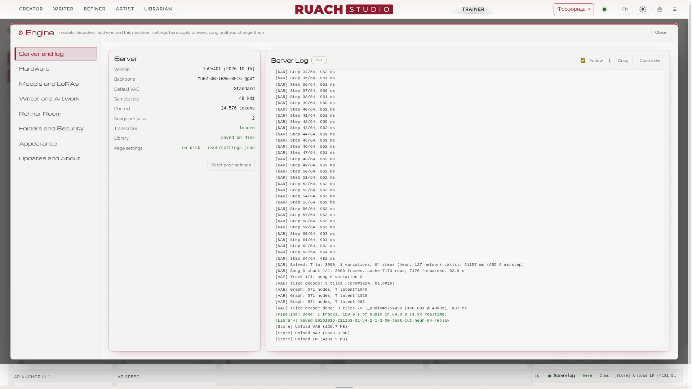

- **שרת**: מה שהמנוע מריץ: המודל, המפענחים, ההקשר, הספרייה.
- **חישוב**: עותק **המודל** (BF16 7.2 GB, Q8_0 3.8 GB, Q6_K ו-Q5_K_M קטנים יותר), **פריסט זיכרון GPU** (*אוטומטי* מתאים את ההקשר ואת אריחי ה-VAE לכרטיס; *אוטומטי ל-N GB* עושה זאת עבור הכמות הזאת, ויתרת הכרטיס נשארת למה שעוד רץ עליו (במחשב נייד עם 16 GB, 14); *ידני* משאיר אותם בידיים שלך), **השארת המודלים טעונים**. **סריקת המכונה** אומרת מה יש במכונה ומה מתאים לה (מודל הליבה, הכפתורים של מצב אוטומטי, הצייר), כמו שנפחות חדשה עושה פעם אחת בהפעלה הראשונה שלה. מיזוגים שהורדת (**מודלים נוספים**) מופיעים ברשימה אחרי המודלים של m-a-p עצמה, לפי השושלת שלהם: IRA, IRAE, IRAEv2, IRAEv3; כל אחד בפורמטים שלו, המלא ביותר ראשון. ברירת המחדל של הנפחות היא **RS-TW 2.0x0.75** (2065), הפיינטיון השני של נפחות רוח, ה-Tsunami Wave, שאומן מעל RS-FW 2.4x0.75 של הגל הראשון ומוזג בחזרה לתוכו: הטוב שבמיזוגים של הנפחות, ובטוח בעוצמה שלו. הוא מגיע עם ההתקנה בפורמט של מודל הליבה, ומופעל בכל פעם שלא נבחר מודל, בפורמט המלא ביותר שיש כאן (BF16, אחרת Q8_0, אחרת Q6_K); *סריקת המכונה* מציעה אותו בפורמט שהכרטיס מכיל (BF16; Q8_0 בכרטיס קטן יותר או בכרטיס בלי ליבות טנזור BF16; Q6_K בקטן ביותר). היכן שהוא לא נמצא, RS-FW 2.4x0.75 תופס את מקומו, ואחריו המודל של m-a-p עצמה. מודל שבחרת נשאר שלך; נפחות שעודכנה מגרסה קודמת, והמנוע שלה על מודל אחר, שואלת פעם אחת אם לעבור ל-RS-TW 2.0x0.75 (2077): *מעבר ל-RS-TW* מוריד אותו בפורמט שבו מודל הליבה שלך רץ, אם הוא לא נמצא כאן (7.2 GB ב-BF16, 3.8 GB ב-Q8_0, 2.9 GB ב-Q6_K; עם מודל ליבה Q5_K_M לא נשאלים), מפעיל מחדש את המנוע כדי שיראה אותו, ואז מעלה אותו; *השארת המודל שלי* לא משנה דבר, וכל אחת משתי התשובות נשמרת. הפיינטיון הראשון של נפחות רוח, הגל הראשון, **RS-FW** (שבעה מיזוגים של YuE2-RS-FW, שכל אחד מהם נקרא לפי האפוק והעוצמה שלו), נמצא תחת **מודלים נוספים**, וכך גם RS-TW 2.0x0.9, ה-Tsunami Wave בעוצמתו הנועזת ביותר: הכי הרבה אש בהאזנה העיוורת, ובלי שום הבטחה ליציבות.
- **חומרה**: הזיכרון של הכרטיס כרגע; **פריקת המודל** משחררת אותו מיד.
- **טופולוגיה** (2085): איך הכרטיסים יושבים על האפיק, מתחת לכרטיסי ה-GPU: צומת ה-NUMA של כל כרטיס, קישור ה-PCIe שלו כפי שהוא רץ עכשיו, המקסימום שלו עצמו והמקסימום של החריץ (כרטיס שמאחורי מתג משלו, כמו Arc, נקרא באותו מתג), וכתובת ה-PCI שלו; המטריצה של NVIDIA מ-`nvidia-smi topo -m` (X, PIX, PXB, PHB, NODE, SYS, NV#) מתחת למקרא בן שורה אחת, ו-P2P בין כל זוג מ-`nvidia-smi topo -p2p r` היכן שהדרייבר מוסר אותו. נבדק מחדש בכל פעם שהמנוע נפתח; כשאין כרטיס NVIDIA, הוא אומר זאת.

### כרטיסי GPU: איזה כרטיס עושה מה <!-- #gpus-which-card-does-what -->

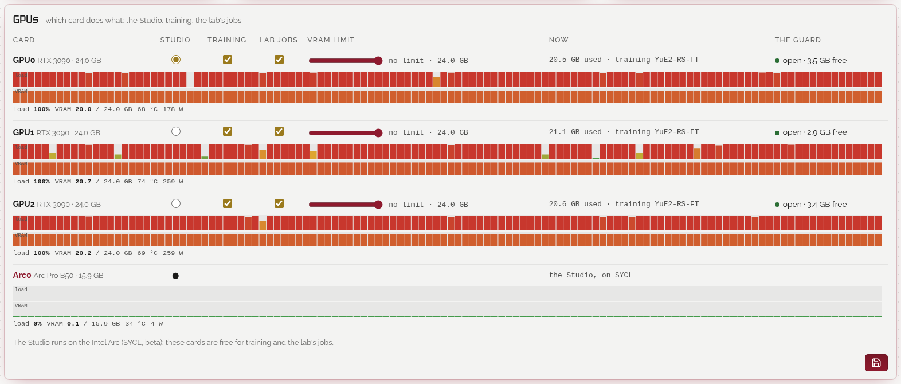

במכונה עם כמה כרטיסים, תן לכל אחד את התפקיד שלו: את **הנפחות** (הסינתזה) על כרטיס אחד, את **האימון** על הכרטיסים שתקצה לו, ואת **משימות** המעבדה (המאזין, Whisper, סטמים, רימאסטר, אפסקייל) על הכרטיסים שלהן. כשהרצה מתאמנת על הכרטיס של הנפחות עצמה, סינתזה ממתינה, והדף אומר למה. עם כרטיס אחד, כך זה פועל: קודם מאמנים, אחר כך יוצרים. כרטיס חדש לנפחות נכנס לתוקף אחרי הפעלה מחדש (הכפתור מופיע כשיש בה צורך). משימות המעבדה נצמדות לכרטיסים שסומנו עבורן, והצייר ביניהן: כשהכרטיסים האלה מלאים, משימה ממתינה לאחד מהם (Whisper עובר למעבד) ולעולם לא לוקחת כרטיס שלא סומן למעבדה. הרצה של הצייר הולכת לכרטיס שבו מודל הצייר שלה מוחזק מההרצה הקודמת, כשהמשקלים כבר ב-RAM.

**Intel Arc (בטא).** הסינתזה של הנפחות רצה גם על כרטיס Intel Arc, עם מנוע שנבנה באמצעות `./build.sh --sycl` (INSTALL.md, "Intel Arc (beta)"): שירים, מתאמים, תוכנית מלאה, הארכה. הכרטיסים שמופיעים כאן הם של NVIDIA; מנוע ה-Arc מחשב על הכרטיס שלו, בעוד האימון והקאברים נשארים על כרטיסי NVIDIA. כרטיס Intel מופיע גם במנוע ← כרטיסי GPU: בחר אותו בעמודה של הנפחות, והנפחות תריץ עליו את מנוע ה-SYCL שלה אחרי הפעלה מחדש (ובחזרה לכרטיס CUDA באותה דרך), עם מגבלת VRAM כמו כל כרטיס; האימון ומשימות המעבדה הם PyTorch על CUDA, ולכן שתי העמודות האחרות שלו אומרות למה הן נשארות ריקות. הדף קורא לו כמו שהוא קורא לכל מעבד (2733): Intel Arc הוא XPU (XPU0 · Arc Pro B50), כרטיס NVIDIA הוא GPU (GPU0 · RTX 3090), AMD Radeon הוא GPU · Radeon והדגם שלו, וה-backend נקרא בשמו שלו (CUDA, SYCL, Vulkan).

**מבט אחד להרבה שאלות** (2060): מנוע ← כרטיסי GPU, הבדיקה שלפני סינתזה ומאמן LoRA שואלים כל אחד את המעבדה על הכרטיסים, לעיתים קרובות בבת אחת כשהדף נפתח; המעבדה מסתכלת עליהם פעם אחת (nvidia-smi, השומר, כרטיסי Intel) ועונה על כל שאלה שמגיעה ב-2 s הבאות מתוך אותו מבט: בודקים את הכרטיסים פעם אחת לכל השאלות, ולא פעם אחת לכל שאלה, ולכן אף שאלה לא מגיעה לפסק זמן.

**המודל של הכותב שנשאר מאחור** (2060): כשהמעבדה מופעלת מחדש בזמן שהכותב של הנפחות עצמה מחזיק כרטיס (ידנית; תחת systemd הכותב נעצר יחד עם המעבדה שלו), המעבדה החדשה מאמצת את השרת הזה כשלה: מנוע ← כותב מציג אותו על הכרטיס שלו, *פריקה* משחררת את הכרטיס, הוא עוזב אחרי 10 דקות בלי שאלות, וחדר של הנפחות שצריך את הכרטיס שלו מקבל אותו.

### מפענחים, מתאמים, המודל של הכותב, המראה <!-- #decoders-adapters-the-writer-s-model-the-look -->

- **VAE**, **LoRA**: כל קובץ שהנפחות מצאה, עם המקור שלו ומה שהוא עושה.
- **מודלים ו-LoRA**: מה שההתקנה מביאה, חלק אחר חלק (המפענחים הנוספים, Whisper, המודלים של הסטמים, UniverSR, ה-LoRA), כפי שההרצה האחרונה שלה מצאה אותו, ו**בדיקה חוזרת** כדי לבדוק מחדש. חלק שאינו שלם מפרט מה חסר בו ויש לו **הורדה** משלו; **הורדת מה שחסר** מורידה את כולם; הורדה שנקטעה ממשיכה מהמקום שבו נעצרה. **מודלים נוספים**: מודל ליבה אחר (BF16 לצד Q8_0), מאזין הסגנון, מודל הצייר, הבסיס של המאמן, כל אחד עם הווריאנטים והגדלים שלו, וריאנט שכבר נמצא כאן מסומן ככזה, ועל כל אחד שואלים קודם, עם הגודל שלו. מודל ליבה או מפענח חדש מגיע למנוע בהפעלה הבאה שלו (**הפעלה מחדש של המנוע**); LoRA חדשים, מיד. ביניהם מיזוגי IRA ו-IRAE: YuE2 עם מתאמים של הקהילה ממוזגים לתוכו (Instrumental ו-Real Audio של Mothersuperior; ב-IRAE, Epic Trailer של monsterovich, בשלוש עוצמות). **לפי חדר** מוריד את המודלים של חדר בבת אחת, בגדלים שמתאימים לכרטיס של המכונה הזאת (הכותב, המלטש, הצייר, הווידאוגרף, מאמן ה-LoRA, שאר מנועי הצליל): מה מהם כבר כאן, מה נשאר ומה גודלו, ו**הורדת הדרג**, שיוצאת לדרך רק כשיש בדיסק מקום בשבילה ועוד 2 GB בעודף; המקום הפנוי מצוין מעליהם ובסוף כל שאלה של הורדה. כמה תופס כל חדר: README › What It Downloads.
- **מזוהים לפי התוכן**: מתאם או קובץ מודל ששמו שונה, שהועבר לתיקייה משלך או שכותרת הקובץ שלו נכתבה מחדש, עדיין נמצא כאן: הנפחות וההתקנה שלה מזהות אותו לפי ה-SHA-256 שלו, ובקובץ `.safetensors`, לפי ה-SHA-256 של הטנזורים שלו (מתוך `MANIFEST.tsv` של מאגר המודלים), ולא מורידות שום דבר שוב.
- **עטיפה**: מי מצייר את העטיפה של טייק: לפי הכרטיסים (Qwen-Image 2512 Q6 או Q4 בשלמותו היכן שכרטיס מכיל אותו, אחרת Q4 בהזרמה מ-RAM על כרטיס קטן יותר), או צייר שנבחר מבין ציירי ה-Qwen שיש במכונה הזאת (Qwen-Image 2512 Q4 או Q6 וכל פיינטיון fp8, עם Lightning; Qwen-Image 2.1 עם ציון הרישיון שלו).
- **כותב** (2097): חמישה כותבים, לכל אחד תיבת סימון משלו: פונים רק אל המסומנים, והכותב, "הידוק", הצעות הסגנון והווידאוגרף כותבים עם אלה מביניהם שעונים. הכותב של הנפחות עצמה (הקוונט שלו, *כתיבה איתו*, *פריקה*); vLLM, LM Studio ו-Ollama, כל אחד בכתובת משלו (ריק: ברירת המחדל שלו, פורטים 8000, 1234 ו-11434); OpenRouter עם המפתח שלו ומודל ברירת מחדל. את המפתח הנפחות שומרת ב-`user/secrets.json` במכונה הזאת, אף פעם לא בדפדפן; הוא לא מוצג שוב לעולם, מלבד ארבעת התווים האחרונים שלו, ולא נכנס לשום גיבוי; הנפחות מוסיפה אותו לקריאות שלה עצמה ל-OpenRouter. לכל אחד יש *בדיקת חיבור*. ב-https הנפחות פונה ל-vLLM, ל-LM Studio ול-Ollama דרך המעבדה שלה, מהמחשב שלה עצמה; ב-http הדפדפן פונה אליהם בעצמו, וכל אחד מהם צריך CORS מופעל. היכן רץ הכותב של הנפחות עצמה (2463): אוטומטי, כרטיס CUDA, ה-Intel Arc (SYCL או Vulkan) או המעבד; על ה-Arc הוא ממתין לתורו לצד השירים והקריין ומפנה את הכרטיס ברגע שהם צריכים אותו. במקום זאת, מפתח ה-OpenRouter יכול להישאר רק בכרטיסיית הדפדפן הזאת, בלי להיכתב לקובץ לעולם (2473).
- **Pianoteq**: כרטיסייה משלו: מה ש-Pianoteq אומר על עצמו כאן (הגרסה שלו, אם בוצעה לו אקטיבציה ועם אילו חבילות, כמה פריסטים מתנגנים במלואם, כמה המהדורה הזאת מאפשרת לשנות), הכלים שלו, שדה למספר הסידורי שלו (שנמסר ל-Pianoteq דרך ה-RPC שלו עצמו ולא נשמר בשום מקום), ואיך להתקין אותו, לבצע לו אקטיבציה, לעדכן אותו ולבטל את האקטיבציה; לביטול האקטיבציה אין כפתור, כי Pianoteq לא מספק כזה: עושים את זה באזור המשתמש שלך ב-Modartt. בראש הכרטיסייה, Pianoteq, Organteq או Airteq: הכרטיסייה מדברת על זה שנבחר, על כל אחד באותה דרך.
- **מראה**: 22 ערכות נושא (שנבחרו ליצירה: צלולות ושקטות), פינות, ארבעת הגופנים (טקסט, כותרות, מספרים, שמות החדרים). **זמן הטייק**: הזמן של טייק בכרטיס שלו ובכל מקום שבו הוא מוצג, לפני כמה זמן (ברירת המחדל) או התאריך והשעה המדויקים; לחיצה על הזמן בכרטיס מחליפה את אופן התצוגה שלו עבור הטייק הזה.
- **סמלים**: *צבע אחד* (שלנו, בצבע הטקסט: ברירת המחדל) או *דו-גוניים*: הצורות של סמלי הקו ממולאות קלות בצבעים של ערכת הנושא עצמה (צבע ההדגשה למה שיוצר, אדום למה שמסיר, ירוק למה ששומר), כך שכל ערכת נושא צובעת אותם בדרכה שלה.
- **גופנים**: מלבד הטקסט, הכותרות, המספרים ושמות החדרים, גם *סימוני קטעים* על צורת הגל (IBM Plex Mono כברירת מחדל) וגם *כפתורים* (הגופן של הטקסט כברירת מחדל); לכל אחד מהם מלבד הטקסט יש גודל ביחס לטקסט, בטווח −2 עד +2 pt. **עברית** ו**יוונית** (2066): הגופנים של האותיות האלה בכל מקום שבו הן מופיעות, במילים, בשמות, בסגנונות ובכל הנפחות, יהיה הגופן של שאר השורה אשר יהיה: כברירת מחדל David CLM (Culmus) לעברית ו-GFS Didot ליוונית; *כמו הטקסט* משאיר את האותיות האלה לגופן של השורה עצמה, וגופן של המחשב הזה יכול לתפוס כל אחד משני המקומות.
- **יומן השרת**: היומן כולו; **אודות**: בשורה הראשונה, המאגר של הנפחות עצמה, המחבר שלה והרישיון שלה (AGPL-3.0); אחר כך, כל אחד עם קישור, שלנו קודם, המודלים שהנפחות משתמשת בהם, והקוד שממנו היא צמחה. מתחת לכך: זכויות היוצרים, התנאים הנוספים של סעיף 7 ברישיון (עותק או פורק שומרים את הייחוס למחבר גלוי לעין ואינם לוקחים לעצמם את השם או הלוגו של הנפחות) והעובדה שהנפחות מגיעה ללא אחריות.
- **עדכונים**: הגרסאות של נפחות רוח ב-GitHub לעומת הגרסה הזאת: באיזו תדירות לבדוק (כל יום, שבוע, חודש, אף פעם), גם גרסאות מועמדות לשחרור, וכשיוצאת גרסה, לשאול או להתעדכן מעצמה כששום דבר לא רץ (מעצמה רק היכן שהנפחות היא שכפול של המאגר שלה; במקומות אחרים הבחירה עדיין בידיך, והשורה שמתחתיה מסבירה למה היא שואלת בינתיים ואיך לעדכן ידנית). נפחות חדשה, וכל עדכון, מציעים את סטי ה-💎 שעוד אין לה.
- **אבטחה**: מי רשאי לפתוח את הנפחות: המחשב הזה בלבד, המחשב הזה ורשתות פרטיות (ברירת המחדל; גם Wi-Fi של בית קפה או של מלון נחשב לרשת כזאת), או המחשב הזה והרשתות שתפרט (10.0.0.0/24); המנוע שומר את הבחירה ב-`user/access.json` ועונה לפיה מיד. נפחות שהמשתמש שלה מעולם לא החליט שואלת בהפעלה שלה, עם מדריך קצר ועם "זו החלטה מודעת שלי". בחירה שהייתה סוגרת אותה בפני המחשב שממנו שואלים נשאלת שוב; מחיקת `user/access.json` מחזירה לרשתות פרטיות. כשהיא נפתחת ב-http פשוט ממחשב אחר, הנפחות מציעה דלת https משלה (פורט 7443) ועוברת אליה אחרי שתי דקות, וההגדרות שלך איתה: דפדפן לא נותן לדף ב-http פשוט ממחשב אחר התקני MIDI, חלון משלו לקונסולה או לוח העתקה. ההחלטה להישאר ב-http נשמרת ומצוינת; מתג כאן מכבה את השאלה. כאן גם מורידים את רשות האישורים של הנפחות עצמה עם טביעת האצבע שלה: אחרי שנותנים בה אמון פעם אחת בדפדפן או במערכת, אף דפדפן של המחשב הזה לא מזהיר עוד על האישור של הנפחות. אם נותנים בה אמון כשהדף כבר פתוח, הדפדפן עלול להמשיך להציג את האזהרה הקודמת לכתובת הזאת עד שיופעל מחדש (ב-Chrome, chrome://restart). ב-https, או במחשב הזה, Chrome ו-Edge מציעים **להתקין** את הנפחות כאפליקציה (כפתור ההתקנה בשורת הכתובת): היא נפתחת בחלון משלה עם הסמל שלה והיא אותה נפחות, ששום דבר ממנה לא נשמר במטמון; כשהנפחות לא רצה, החלון הזה אומר זאת ומנסה שוב כל חמש שניות.
- **תיקיות**: היכן שוכן כל מה שיצרת (השירים יחד עם המרחבים שהורדו מ-Hugging Face, הפח, התמונות של הצייר, המסמכים של הכותב), מה כל תיקייה מכילה וכמה מקום נשאר בדיסק שלה. **העברה…** מעבירה תיקייה לכל תיקייה או דיסק: הנפחות אומרת קודם מה היא תעשה (באותו דיסק, שינוי שם; בדיסק אחר, העתקה שנבדקת קובץ אחר קובץ, ואחר כך החלפת הקישור) ומעבירה רק אחרי "כן" שני, כששום רינדור לא רץ; העותק הישן נשאר, בשם אחר, עד שתסיר אותו. **החזרה הביתה** מחזירה תיקייה לתוך התיקייה של הנפחות; **קישור מחדש** מפנה את הנפחות לתיקייה שהדיסק שלה חזר. המודלים, ה-LoRA וסטי האימון נשארים במקומם.
- **גיבויים של הנתונים שלך** (2083): תמונות מצב של הקבצים שמחזיקים את היצירה והבחירות שלך (ההגדרות, הסגנונות והפרופילים, המרחבים של הספרן, הערות, סימונים, הפלייליסט והאלבומים, המסמכים של הכותב, הגרסאות של המוזיקאי, התוכניות של הווידאוגרף, אוצרות המילים שלך), כל שעה (נשמרות 24 האחרונות) וכל יום (30 האחרונות, וגם הכרטיס של כל טייק), כל תמונת מצב היא `.json.gz` אחד ב-`user/backups/`; הפעלה או כיבוי, כמה לשמור, **גיבוי עכשיו**, והשעה והגודל של תמונת המצב האחרונה. קובץ חוזר מתמונת מצב רק כשהוא באמת פגום: בהפעלת הנפחות, או כשכבר אי אפשר לקרוא אותו, תמונת המצב החדשה ביותר שנקראת בשלמותה תופסת את מקומו, הקובץ הפגום נשאר ב-`user/backups/broken/`, והנפחות אומרת פעם אחת איזה קובץ ומאיזה מועד. שום כפתור לא מחזיר תמונת מצב על פני נתונים תקינים.

**ניפוי באגים** (2054): מנוע ← ניפוי באגים שומר יומן של היום האחרון בשביל מי שמתקן את הנפחות, כבוי אלא אם תבחר להפעיל אותו; כל עוד הוא מופעל, סימון DEBUG קטן מופיע בסרגל (לחיצה פותחת את הכרטיסייה). הוא שומר על מה לחצו (לפי ה-id של הרכיב, אף פעם לא לפי המילים שלו), מקשים שנלחצו כפקודות (אף פעם לא מה שמקלידים), החדרים והחלונות שנפתחו, כל בקשה לנפחות (הנתיב והתשובה שלה, אף פעם לא הערכים שלה) והשגיאות של הדף; *עם שובל מפורט של סמן העכבר* מוסיף לאן הסמן הלך. *הורדת היומן* וגם *שליחת היומן…* מצרפות אליו קודם את היומנים של הנפחות ושל המעבדה עצמן מאותן שעות, ומנקות את הכול: סגנונות, מילים, שמות, פרטיטורות והערות נחתכים, השמות של טייקים ומרחבים הופכים לסימונים כמו `take#1a2b3c`, ותיקיית הבית שלך, שמות המשתמש והמחשב, כתובות, דואר ומפתחות מוסרים; אחר כך השומר קורא הכול פעם נוספת ואומר מה עוד מצא. *שליחה* שולחת את ה-ZIP לנקודת הקבלה של הנפחות עצמה ונותנת לך מספר פנייה: ב-GitHub מספיק לציין ב-issue את המספר הזה, והיומן עצמו לעולם לא נעשה ציבורי. שום דבר לא יוצא בלי ה"כן" שלך. מאז 2.0.6 (2102) היומן מבחין בין קו שנתקע לבין דף שנתקע: מקשים נרשמים לפי הקוד שלהם (**Ctrl+Shift+2**), אף פעם לא מקש משנה לבדו, ושום דבר לא נשמר משדה של סיסמה או מפתח; הוא מסמן כרטיסייה מוסתרת, את סוג החיבור, איך הדף נטען ואת ה-build שלו לצד כל שגיאה, את המשימות הארוכות של הדף ואת הזיכרון שלו, וכל כתיבה שנדחתה, נשלחה שוב או אבדה; בניקוי, אתר אחר הופך ל-`external`, וכתובת הופכת ל-`lan#…` ברשת הזאת או ל-`wan#…` מחוצה לה.

## DAW <!-- #daw -->

**ניסיוני.** הדרך אל DAW פועלת ונבדקה, אבל היא עדיין צריכה מבחני קריסה על מכונות ופרויקטים אחרים, ועוד פיתוח.

### שתי דרכים החוצה מהנפחות <!-- #two-ways-out-of-the-studio -->

הנפחות מוציאה שיר החוצה באחת משתי דרכים, ורק בשתיים האלה:

1. **הרצועה הממוקסת**, כפי שהנפחות יצרה אותה והמלטש השלים אותה: WAV, FLAC או MP3, בלי DAW באמצע.
2. **הטייק כולו אל ה-DAW שלך**, כפרויקט של אותו DAW: מכאן והלאה, הכול קורה מחוץ לנפחות. שום אודיו ושום פרויקט לא חוזרים פנימה: הנפחות לא קוראת פרויקט של DAW (REAPER יכול לתת לה את מה ששיר עשוי ממנו: המילים שלו ומנגינה).

הבחירה הזאת נפתחת מהמלטש, לצד הטייק שביד ובשלב הסטמים שלו. **ייצוא ל-DAW** בתפריט של הטייק עצמו (לחיצה ימנית עליו) אורז את הטייק הזה מיד, כפרויקט REAPER או כ-DAWproject. הדף מציג אילו DAW יש במחשב של הנפחות עצמה (REAPER, Waveform, Bitwig), עם הגרסאות שלהם. כשהנפחות רצה על מחשב אחר מזה שעליו ה-DAW שלך (שרת בבית, מחשב נייד בדרכים), לחיצה על *אני משתמש בזה* מסמנת את שלך.

| DAW | מה הנפחות נותנת לו | מצב |
|---|---|---|
| **REAPER** | פרויקט משלו (.RPP): המיקס, הסטמים, הפרטיטורה כ-MIDI, טמפו ומשקל, קטעים, מילים, המתכון | מוכן, נבדק על ידי REAPER עצמו |
| **Waveform** (Tracktion), 14 ומעלה | DAWproject: המיקס והסטמים, הפרטיטורה כרצועות תווים, הקטעים כסמנים, טמפו ומשקל | מוכן, נבדק מול הסכמה של הפורמט |
| **Bitwig** | DAWproject, אותו דבר | מוכן, נבדק מול הסכמה של הפורמט |
| **Studio One, Cubase** (Windows, macOS) | DAWproject, אותו דבר | מוכן |

### REAPER: התקנה <!-- #reaper-install -->

- **Linux**: מ-reaper.fm, קובץ ה-tarball של *Linux x86_64*; חלץ אותו והרץ את `./install-reaper.sh`: הוא מותקן ב-`/opt/REAPER`, בלי שום דבר נוסף.
- **Windows, macOS**: תוכנת ההתקנה מ-reaper.fm.
- REAPER נותן 60 יום עם כל הפונקציות, ואחר כך מבקש רישיון ($60 לשימוש אישי או לעסק קטן).

### הפרויקט המלא ביותר: קודם שלושה צעדים <!-- #the-fullest-project-three-steps-first -->

מה שהפרויקט נושא תלוי במה שיש לטייק. כדי לקבל הכול:

1. **תוכנית מלאה** כשיוצרים את השיר: הפרטיטורה הופכת לרצועות ה-MIDI ונותנת את הטמפו ואת המשקל. (לטייק במצב ישיר אין פרטיטורה: אין MIDI; הטמפו נלקח מ-"NN bpm" בסגנון, או נשאר על 120 כממלא מקום.)
2. **מלטש ← סטמים**: כל סטם מקבל רצועה משלו (שניים: ווקאל ואינסטרומנטלי; ארבעה: עם תופים, בס והשאר).
3. **מלטש ← בדיקת מילים**: Whisper מתזמן כל שורה; השורות עולות על ציר הזמן, והקטעים ([Verse], [Chorus]…) הופכים לאזורים (regions).

אף אחד מהשלושה אינו הכרחי: הפרויקט לוקח את מה שיש ואומר מה היה חסר לו.

### REAPER: ייצוא ופתיחה <!-- #reaper-export-and-open -->

1. פתח את הטייק (במוזיקאי, במלטש או בספרן), ואז **ייצוא ל-DAW ← REAPER ← ייצוא הטייק**; או לחיצה ימנית על טייק כלשהו ← **הורדה ← פרויקט REAPER**.
2. הנפחות אורזת את הטייק: האודיו כ-WAV של 24 ביט ב-48 kHz, כך ששיר של שבע דקות עם שני סטמים שוקל בערך 350 MB. הדפדפן שומר את `TITLE.reaper.zip`.
3. חלץ אותו לכל מקום, את כולו: `TITLE/TITLE.RPP` ו-`TITLE/audio/` נשארים זה לצד זה.
4. פתח את `TITLE.RPP` ב-REAPER (File → Open project, או לחיצה כפולה).

### מה יש בפנים <!-- #what-is-inside -->

| רצועה | מה היא |
|---|---|
| **Mix** | השיר כפי שהנפחות רנדרה אותו; **מושתק** כשיש סטמים, כך שהסטמים נשמעים והמיקס ממתין כרפרנס |
| **Vocals**, **Instrumental** (או Drums, Bass, Other) | הסטמים, כל אחד מ-0 לאורך כל השיר |
| **Score · Vocal**, **Score · Ins** | הפרטיטורה כ-MIDI, רצועה לכל קול. זו הפרטיטורה *כפי שנכתבה* — השיר כפי שהושר עשוי לסטות ממנה. היא לא משמיעה צליל עד שתיתן לה כלי (ה-FX של הרצועה: ReaSynth, או כל VSTi) |
| **Lyrics** | כל שורת מילים כאייטם ריק שהשורה כתובה בהערה שלו, במקום שבו Whisper שמע אותה |

- **אזורים** (Regions): הקטעים של המילים, מהשורה המתוזמנת הראשונה של כל קטע ועד הקטע הבא.
- **טמפו ומשקל**: מהפרטיטורה (ה-`Q:` וה-`M:` שלה), אחרת "NN bpm" בסגנון, אחרת 120 ב-4/4 כממלא מקום; הערות הפרויקט אומרות מאיזה מקור.
- **הערות הפרויקט** (בהגדרות הפרויקט של REAPER): השם, הסגנון, שני הזרעים, השם של הטייק עצמו: הדרך חזרה אל הטייק בספרן.

### REAPER: כשמשהו נראה לא בסדר <!-- #reaper-when-something-looks-wrong -->

| מה רואים | למה | מה לעשות |
|---|---|---|
| media offline | תיקיית ה-audio לא נמצאת לצד קובץ ה-.RPP | חלץ את כל ה-ZIP, ושמור את `audio/` ליד הפרויקט |
| אין מילים, אין אזורים | הטייק מעולם לא תוזמן | מלטש ← בדיקת מילים, ואז ייצוא מחדש |
| אין רצועות MIDI | טייק במצב ישיר, או טייק בלי פרטיטורה | צור אותו במצב תוכנית מלאה, או הבא פרטיטורה משלך במוזיקאי |
| הטמפו מראה 120 | לטייק אין טמפו משלו | קבע אותו ב-REAPER, או כתוב "NN bpm" בסגנון בפעם הבאה |
| ה-MIDI מקדים את הקול או מפגר אחריו | הפרטיטורה היא התוכנית, והשירה היא הביצוע שלה | השתמש ב-MIDI כסקיצה, או מתח אותו לפי הסטמים |
| מילים בעברית או ביוונית מוצגות כריבועים | לגופן של REAPER חסר הכתב הזה | גופן עם הכתבים האלה בערכת הנושא או בהעדפות של REAPER |

### REAPER: שירים מתוך REAPER <!-- #reaper-songs-from-inside-reaper -->

שלוש פעולות (Actions) של REAPER ב-`extras/reaper/` (ReaScript, Lua) פונות לנפחות דרך ה-API שלה, מהמחשב של הנפחות עצמה או ממחשב אחר ברשת שלך. הצליל זורם בכיוון אחד: שירים יוצאים מהנפחות אל REAPER, ושום אודיו או פרויקט לא חוזרים פנימה. מה ש-REAPER נותן לנפחות הוא מה ששיר עשוי ממנו: המילים שלו, והמנגינה שלו.

- **Ruach - Generate here**: שואלים על הסגנון, האורך והמצב; השיר נוצר בנפחות ונוחת ברצועה חדשה בתחילת בחירת הזמן (time selection), ואורכו כאורך הבחירה. המילים נלקחות מההערות של האייטמים הנבחרים (הפרויקט המיוצא שומר שם את המילים של כל קטע), או מתיבת הדו-שיח. **אייטמי MIDI נבחרים הם המנגינה של השיר**: התווים שלהם הופכים לפרטיטורה שלו (הרצועה העליונה ביותר מושרת; רצועת אקורדים אינה נמסרת כקו, שכן כלי יכול היה לקחת את המנגינה), בטמפו ובמשקל של הפרויקט, בסולם של ה-key snap של הטייק או בסולם שהתווים מרמזים עליו, והשיר נוצר במצב *מנגינה בלבד*; ההערות של האייטם החדש אומרות איך המנגינה נקראה. REAPER נשאר פנוי בזמן שהנפחות יוצרת.
- **Ruach - Bring a take**: מילים לחיפוש (בשם או בהערה, עם `*` ו-`?`), מרחב אם תרצה, והטייק שתבחר נוחת בסמן העריכה (edit cursor).
- **Ruach - Settings**: הכתובת של הנפחות, הטוקן שלה אם היא מבקשת אחד, והמרחב שאליו נוחתים שירים מ-REAPER.

התקנה: העתק את התיקייה אל `Scripts` של REAPER, ואז *Actions → New action → Load ReaScript* לכל השלושה, והרץ את *Settings* פעם אחת. הם צריכים את `curl` (הוא קיים בכל Linux, ב-macOS וב-Windows 10 ואילך). את השאר מספר ה-README של התיקייה.

### DAWproject (Bitwig, Studio One, Cubase) <!-- #dawproject-bitwig-studio-one-cubase -->

לחיצה ימנית על טייק ← **הורדה ← DAWproject**, או *ייצוא הטייק* בכרטיס של Waveform או של Bitwig בחלון ה-DAW: קובץ `.dawproject` אחד עם המיקס וכל סטם (המיקס מושתק כשיש סטמים), הפרטיטורה כרצועות תווים, רצועה לכל קול, הקטעים כסמנים לאחר שהטייק תוזמן, בטמפו ובמשקל של הטייק; הסגנון והמילים מגיעים בהערות שלו. פתח אותו בייבוא DAWproject של ה-DAW: Waveform 14 ומעלה (*File > Import Other > Import a DAWproject file*; הנפחות דורשת לפחות Waveform 14), Bitwig, Studio One, Cubase. נבדק מול הסכמה של הפורמט עצמו (Project.xsd).

### מתוך הסקריפטים שלך <!-- #from-your-own-scripts -->

כל מה שלמעלה הוא גם ה-API של הנפחות: `POST /api/v1/takes/NAME/reaper` אורז את הפרויקט ואומר מאיפה להוריד אותו. ראה **docs/API.md**: שירים, משימות, טייקים, סימונים, מרחבים, ושרת MCP לסוכנים.

## פרטיטורה <!-- #score -->

בתוכנית מלאה חצי המוזיקה כותב פרטיטורה לפני שנשמע תו אחד, והשיר הולך אחריה תיבה אחר תיבה; עם *פרטיטורה משלך* הפרטיטורה היא שלך. הכרטיסייה הזאת קוראת אותה שורה אחר שורה: הניב ש-YuE2 ו-SheetSage2 כותבים בו, איך שני הקולות שלה מתחלקים בתיבות, ואיך לשנות אותם בלי לשבור את השיר.

### מה הפרטיטורה עושה <!-- #what-the-score-does -->

הפרטיטורה היא טקסט ABC: כותרת, ואחריה השיר בקבוצות של תיבה אחת עד ארבע תיבות, כל קבוצה פעם אחת בשביל הקול (**Vocal**) ופעם אחת בשביל הכלים (**Ins**), על רשת תיבות אחת. המנוע קורא אותה לפני המוזיקה: התווים של הקול נושאים את המילים, האקורדים מובילים את ההרמוניה, התיבות נותנות את הזמן.

- **אורך הטייק הוא כאורך הפרטיטורה שלו.** שישה טייקים בתוכנית מלאה הסתיימו בטווח של 0.5–5 s מהאורך של הפרטיטורה שלהם. תיבות שאחרי המילים האחרונות עדיין מתנגנות: זה זנב (*סיום ב…* חותך אותו, או הוצא את התיבות האלה מהפרטיטורה).
- **מה שאין בפרטיטורה לא מושר.** אם בתוכנית יש פחות קטעים מאשר במילים, הבתים האחרונים נשמטים או שבית מוקדם יותר חוזר שוב.
- **הנפחות קוראת אותה בקפדנות.** מה שהבדיקה לא מכירה היא דוחה, ואומרת איפה: הקבוצה, הקול, התיבה. המנוע אולי עדיין ינגן פרטיטורה כזאת, אבל ה-MIDI, הסמנים, הזזת הקול והדקלום צריכים את הניב המקורי.

### הכותרת <!-- #the-head -->

שמונה שורות, תמיד אותן שורות, בסדר הזה:

```
X:1
T:
M:4/4
L:1/16
Q:1/4=85
V: Vocal clef=treble name="Vocal Melody" snm="Vocal"
V: Ins clef=treble name="Ins Melody" snm="Inst."
K:D#m
```

- `X:1` ו-`T:` ריק כמו שהם: שם השיר נמצא בטופס.
- `M:` המשקל כשבר: `4/4`, `3/4`, `6/8`, `2/4`; המספר התחתון שלו הוא חזקה של שתיים.
- `L:` היחידה: תו בלי מספר נמשך באורך הזה. YuE2 כותב `L:1/16`, שש-עשרית, וכל מה שלמטה נספר ביחידה הזאת.
- `Q:1/4=` הטמפו: רבעים לדקה, במספר שלם.
- שתי שורות ה-`V:` מילה במילה: לפיהן המנוע מזהה את הקולות.
- `K:` הסולם: מז'ור לפי השם שלו (C, G, D, A, E, B, F#, C#, F, Bb, Eb, Ab, Db, Gb, Cb) או מינור עם m (Am, Em, Bm, F#m, C#m, G#m, D#m, A#m, Dm, Gm, Cm, Fm, Bbm, Ebm, Abm). כתיב אחר של אותו סולם נדחה: `Eb`, ולא `D#`.

### קבוצות, קולות ותיבות <!-- #groups-voices-and-bars -->

אחרי הכותרת השיר בא בקבוצות:

```
% verse
V: Vocal
"Gm"B2B2B2B2B2B2B2G2|"Eb"B2B2B2B2B2B2B2F2|"F"F2F2F2F2F2G2F2F2|"Gm"G4z12|
V: Ins
Z4|
```

- קבוצה: הערת קטע במקום שבו קטע מתחיל (`% verse`), אחר כך `V: Vocal` ושורה אחת של תיבה אחת עד ארבע תיבות, אחר כך `V: Ins` ושורה אחת של **אותו מספר תיבות**. כל שורה מסתיימת ב-`|`; בלי `||`, בלי חזרות.
- `Z` היא תיבה שלמה של הפסקה, `Z2`, `Z3`, `Z4` מספר כזה של תיבות; `z` היא הפסקה עם משך, כמו תו.
- משקל או סולם חדשים באים כשורת `M:` או `K:` מיד אחרי שורת ה-`V:` של קבוצה, אותו דבר בשני הקולות: הבדיקה רוצה ששני הקולות יעמדו על רשת אחת ובסולם אחד בכל רגע. בתוך תיבה, שינוי סולם נכתב `[K:Em]`.

### תווים ומשכים <!-- #notes-and-their-lengths -->

- האותיות הן גבהים: `C D E F G A B` האוקטבה מדו האמצעי (C4), באותיות קטנות `c d e f g a b` האוקטבה שמעליה; `'` מעלה אות באוקטבה ו-`,` מוריד אותה: `B,` הוא B3, `c'` הוא C6.
- `^` דיאז, `_` במול, `=` בקר (`^^` ו-`__` כפולים): סימן חל על אותה אות עד סוף התיבה. הדיאזים והבמולים של הסולם עצמו לא צריכים סימן.
- המספר אחרי תו הוא המשך שלו ביחידות (ב-`L:1/16`): `1` שש-עשרית, `2` שמינית, `3` שמינית עם נקודה, `4` רבע, `6` רבע עם נקודה, `8` חצי, `12` חצי עם נקודה, `16` שלם; `24`, `32` ו-`48` לארוכים יותר. רק אלה: משך אחר נכתב כשני תווים מקושרים (`F4-F` לחמש יחידות).
- `-` מקשר תו לתו הבא באותו גובה, גם מעבר לקו תיבה: תו אחד מוחזק, הברה אחת.
- **כל תיבה מסתכמת בדיוק במשקל שלה**: ב-`L:1/16` שש-עשרה יחידות ב-4/4, שתים-עשרה ב-3/4 וב-6/8. תיבה שחסרה לה יחידה או שיש בה יחידה מיותרת נדחית, עם המספרים שלה.

### אקורדים <!-- #chords -->

- אקורד הוא השם שלו במירכאות לפני התו שבו הוא מתחיל: `"Gm"B2`. הוא נמשך עד האקורד הבא. אקורדים נמצאים רק ב-**Vocal** (הבדיקה דוחה אותם ב-Ins): הם ההרמוניה של הלהקה, לא התווים של הזמר.
- השם מורכב מצליל יסוד (A עד G, עם `#` או `b`) ומאחד מאלה: מז'ור (בלי כלום), `m`, `dim`, `aug`, `7`, `maj7`, `m7`, `dim7`, `m7b5`, `sus4`, `sus2`, `6`, `m6`, `7sus4`, `m(maj7)`; בס אחרי לוכסן: `C/E`.
- הפסקה יכולה לשאת אקורד: `"Bmaj7"z16` היא תיבה של האקורד הזה כשהקול שותק, כמו בפתיחה.
- עם אקורדים, פרטיטורה מתנגנת ב**תוכנית מלאה**; בלי אף אקורד, ב**מנגינה בלבד** (תוכנית של מנגינה, והליווי חופשי). המנוע מזהה איזו מהשתיים לפי הפרטיטורה עצמה.

### קטעים <!-- #sections -->

- `% intro`, `% verse`, `% chorus`, `% bridge`, `% outro` בשורה משלהם לפני קבוצה מסמנים איפה קטע מתחיל. הם מגיעים ל-DAW שלך כסמנים (*סמנים*, ובתוך פרויקט ה-REAPER), ובהם התוכנית פוגשת את המילים שלך.
- תן לפרטיטורה את הקטעים של המילים שלך, בסדר שלהם, ולכל אחד מקום לשורות שלו. המתכנן כותב לפעמים פחות: בראפ ארוך אחד, בין 2 ל-17 קטעים מול 32 בטקסט. הוסף אותם, או קצר את המילים, לפני *יצירת שיר*.

### זמן <!-- #time -->

- תיבה נמשכת מספר הרבעים שלה × 60 ÷ הטמפו, בשניות (הטמפו סופר רבעים): ב-4/4, ב-85 BPM: 2.82 s, ב-103 BPM: 2.33 s; ב-3/4, ב-90 BPM: 2 s.
- השיר נמשך מספר התיבות שלו × הזמן הזה. שורת הבדיקה שמתחת לפרטיטורה אומרת את זה: `✓ Native YuE2 score · Em · 90 BPM · 3/4 · 11 bars · ≈ 0:22 long · 0 sections`.
- שורת מילים צריכה את הזמן של ההברות שלה: בשמינית להברה, תיבה של 4/4 מכילה 8 הברות, בשש-עשרית 16 (הבתים של ראפ יכולים לרוץ כך: `FFFFFEEEE2zDDDDD`).
- כדי לסיים את השיר מוקדם יותר, הוצא תיבות בסוף הפרטיטורה, בשני הקולות; לקטע סיום, הוסף שם תיבות.

### המקום של הקול: Vocal <!-- #the-voice-s-space-vocal -->

- Vocal הוא מה שמושר: בערך הברה לכל תו, תו מקושר הוא הברה אחת מוחזקת, הפסקות במקומות שבהם הזמר נושם. הטבלה של הבדיקה אומרת כמה תווים יש, כמה בדקה, מה המנעד, ובכמה מהזמן הקול נשמע.
- תווים והברות: כשיש יותר תווים מהברות, המודל מותח הברות על פני התווים, או מוסיף כמה משלו; כשיש פחות, הוא דוחס את המילים. משקל המילים בהלחנה מודד כל שורה לפי הזמן שהיא לוקחת: תן לשורה בערך מספר כזה של תווים.
- ראפ צפוף (שש-עשריות על גובה אחד או שניים: הריתמוס נושא אותו), ולבלדה יש תווים ארוכים. השאר הפסקה בסוף שורה: שם הקול נושם והכלים עונים.
- הזזת הקול שמתחת לפרטיטורה (*הזזה*) מזיזה את Vocal בדרגות הסולם (טרצה, קוורטה, אוקטבה) כשהוא יושב גבוה מדי או נמוך מדי בשביל הזמר; האקורדים ו-Ins נשארים. נמדד ב-21.10.2026: המודל הולך אחרי Vocal שהוזז אוקטבה למטה (הוא שר נמוך יותר ב-9 עד 10 חצאי טונים), וקול יכול לשנות איתו את הרגיסטר שלו: קונטרלטו נשי שהוזז למטה יצא טנור או בריטנור גברי, וקול גברי שהוזז למעלה עשוי לצאת נשי; גם הלהקה יכולה לרדת. ה-▼ ▲ שליד מתאם קול (בתוכנית מלאה, עם פרטיטורה) עושים את אותו הדבר פעם אחת.

### המקום של הכלים: Ins <!-- #the-instruments-space-ins -->

- Ins הוא הקו של הכלים עצמם: הריף של הפתיחה, התשובות בין הפראזות, סולו, הסיום. מנגינה, לא האקורדים (הם עומדים ב-Vocal): קו אחד, ו-YuE2 מעבד סביבו את הלהקה.
- **מתחת לקול, Ins בעיקר שותק.** הקאברים הרשמיים שומרים `Z4` מתחת לכל קבוצה מושרת ומנגנים בפתיחה, בין הקטעים ובסוף; הטייקים של ויקטור בתוכנית מלאה עושים אותו דבר (ארפג'ו בפתיחה, `Z4` מתחת לבתים, פיל במעברים). Ins עמוס מתחת לשורה מושרת הוא מנגינה שנייה מול הקול, והפרטיטורות המקוריות נמנעות מזה.
- הבדיקה מסכמת את זה כ-**Ins : Vocal**, התווים של האחד מול התווים של האחר: מעל 1.5 הכלים נושאים את רוב התווים, מתחת ל-0.67 הקול נושא אותם, וביניהם בערך שווה בשווה.
- שיר אינסטרומנטלי: Vocal שותק (`Z`) לאורך כל השיר ו-Ins נושא את המנגינה. *הפיכה לאינסטרומנטלי* מעבירה את מנגינת השירה של הפרטיטורה ל-Ins (המתכון הרשמי) ומסמנת את *אינסטרומנטלי*. מתאם פרטיטורה אינסטרומנטלי בעוצמה מלאה, עם מילים לשירה, נותן קול בלי תווים: החזק אותו נמוך כשיש מילים (מוזיקאי › VAE ו-LoRA).

### לשנות אותה בנפחות <!-- #changing-it-in-the-studio -->

- **יצירת פרטיטורת ABC**, קרא אותה ושנה אותה, ואז **יצירת שיר**: הדרך הבטוחה ביותר לפרטיטורה שרוצים. או כתוב פרטיטורה משלך תחת *פרטיטורה משלך*.
- הבדיקה שמתחת לפרטיטורה קוראת אותה תוך כדי הקלדה: ✓ עם הסולם, הטמפו, המשקל, התיבות, האורך והקטעים, טבלה לכל קול ושורת **Ins : Vocal**; או ✗ עם מה שלא בסדר ואיפה: `group 3, Ins, bar 9: duration 15/4 quarter notes != meter duration 4`.
- **סולם** מעביר את כל הפרטיטורה (לקרוב ביותר, למעלה או למטה); *הזזה* מזיזה רק את Vocal או רק את Ins, בדרגות הסולם.
- **MIDI** החוצה בשביל DAW (רצועה לכל קול, הקטעים כסמנים), ופנימה מ-DAW (קו מלודי אחד לכל קול); **סמנים**: הקטעים עם השניות שלהם, כקובץ CSV.
- *כתיבה מתוך הצליל* וגם *תעתוק הטייק הזה*: SheetSage2 מאזין להקלטה וכותב את המנגינה והאקורדים שלה בניב הזה (עם האקורדים, או רק את המנגינה, כפי שבוחרים תחת *קאבר או רמיקס*).
- *הנחת המילים על הפרטיטורה הזאת…*: השורות שלך על התיבות של הפרטיטורה; הכרטיסייה הבאה מספרת איך זה נולד.
- הפרטיטורה של הטייק כחמשה, במסך מלא, ומודפסת ל-PDF: מוזיקאי › הפרטיטורה.

### כשהבדיקה אומרת לא <!-- #when-the-check-says-no -->

| היא אומרת | המשמעות | מה לעשות |
|---|---|---|
| `duration … != meter duration …` | תיבה לא מסתכמת נכון | ספור את היחידות שלה: 16 ב-4/4 ב-`L:1/16` |
| `unsupported duration 5` | משך מחוץ ל-1 2 3 4 6 8 12 16 24 32 48 | קשר שניים: `F4-F` |
| `voices have different measure counts` | ל-Vocal ול-Ins יש מספר שונה של תיבות בקבוצה | הוסף לקצר מביניהם תיבות `Z` |
| `Native chord symbols belong in Vocal, not Ins` | אקורד ב-Ins | העבר אותו ל-Vocal, לאותה תיבה |
| `unresolved tie at end of score` | התו האחרון מקושר לשום דבר | הסר את ה-`-` שלו |
| `tie changes pitch` | קישור בין שני גבהים שונים | קשר גובה רק לעצמו |
| `Unsupported key` | סולם מחוץ לרשימה | אותו סולם, כפי שהרשימה כותבת אותו: `Eb`, ולא `D#` |
| `expected 1–4 measures` | שורה של יותר מארבע תיבות | פצל את הקבוצה לשתיים |
| `Preserve native Vocal and Ins voice definitions` | הכותרת שונתה | שמונה השורות, כמו למעלה |

## קולות על פרטיטורה <!-- #voices -->

איך הפרומו של הנפחות קיבל את הצליל שלו: קריין שאומר את השורות של הפרומו מעל מצע מוזיקלי, קולות נשיים ששרים בין השורות, כל שורה קרוב לרגע שהסצנה שלה דרשה, והכול בטייק אחד. הדרך הזאת מתאימה לכל טקסט מדובר, הקראה או ראפ מעל מצע; *הנחת המילים על הפרטיטורה הזאת…* עושה בשבילך את החלק האמצעי שלה.

### המצע והשעון שלו <!-- #the-bed-and-its-clock -->

- קודם המוזיקה בלי מילים: טייקים בסגנון של המצע (בפרומו: טריילר אפי, D#m, 103 BPM, 128 s), עד שאחד מהם נשמע נכון.
- אחר כך *כתיבה מתוך הצליל* על הטייק הזה: SheetSage2 כותב את הפרטיטורה של המצע עצמו, את האקורדים ואת התיבות שלו. הפרטיטורה הזאת היא השעון: ב-103 BPM וב-4/4 תיבה נמשכת 2.33 s ושש-עשרית 0.146 s, כך שכל עוד המשקל לא משתנה, תיבה n מתחילה ב-n × 2.33 s.
- כשהשיר החדש מושר בתוכנית מלאה על הפרטיטורה הזאת, הוא שומר על השעון הזה: אותם אקורדים באותן תיבות, והמילים איפה שהפרטיטורה שמה אותן.

### שורה על התיבות שלה <!-- #a-line-on-its-bars -->

- לכל שורה היה רגע שבו היה צריך לומר אותה: הסצנה שלה. היא הולכת לתיבה שמתחילה הכי קרוב לרגע הזה; אם השורה הקודמת עדיין נשמעת שם, לתיבה הפנויה הבאה.
- השורה הופכת לתווים: הברה בשמינית על צליל מהאקורד של התיבה שלה, השם המוטעם ברבע, גבוה יותר, נשימה אחרי פסיק (שמינית) ואחרי נקודה (רבע), ההברה האחרונה של השורה ברבע, נמוכה יותר. קריין צריך מעט גבהים: הצלילים של האקורד מספיקים, והאקורדים באים מהמצע.
- בתיבה הראשונה של השורה הפרטיטורה מקבלת את הערת הקטע שלה, והמילים את אותה תגית: שם `% verse`, כאן `[Verse]`. שורה לכל קטע: התוכנית והמילים נפגשות אחד לאחד, ושום דבר לא נשמט.
- מילים שהמודל מטעים לא נכון מקבלות את הסימנים של ויקטור: אקוט על התנועה המוטעמת (обе́щано), והשם נכתב כפי שהוא נשמע (рУ́ах ברוסית, רוּ-אַח באנגלית).

### שני קולות בטייק אחד <!-- #two-voices-in-one-take -->

- הקריין והנשים הם טייק אחד, לא מיקס. הסגנון נוקב בשניהם: `male baritone narrator, spoken word, clear English diction, female a cappella vocalise, oooh aaah, epic cinematic trailer`, ובטמפו, `103 bpm`.
- המילים נותנות כל שורה, ואחריה, בסוגריים, את הווקאליז: `(Ooh, aah)`. בטייקים של הפרומו הנשים שרו אותו.
- הפרטיטורה נותנת לווקאליז תווים משלו בתיבות שבין השורות: תו חצי על הצליל העליון של האקורד, ואז שאר התיבה על צליל הדקלום שלו, שתי אוקטבות מעל התווים של הקריין. הווקאליז של המצע עצמו נשאר בסוף: הסיום שומר את התיבות של המצע, כולל התווים.
- מתאם קול יכול לתת לקריין קול; החזק אותו נמוך (0.45 בחצי המוזיקה ו-0.3 בחצי הצליל הספיקו), אחרת הוא משתלט על המוזיקה.

### הרבה טייקים, ואז הטוב ביותר <!-- #many-takes-then-the-best -->

- שישה זרעים לכל שפה, תוכנית מלאה, הנחיה 1.6, האורך קבוע על 128 s של המצע, הפרטיטורה והמילים כפי שנעשו. כל טייק אומר את השורות שלו קצת אחרת: אחד נוחת קרוב יותר, אחר מדבר ברור יותר.
- איפה השורות נמצאות באמת: מלטש › מילים › *תזמון השורות* נותן את הזמן של Whisper לכל שורה, מילה אחר מילה. המקטעים של Whisper עצמו גסים מדי בשביל זה: מקטע מתחיל לעתים קרובות על הווקאליז שלפני שורה.
- השווה את הזמן של כל שורה לתיבה שלה: בטייק הטוב ביותר של הפרומו 7 מתוך 11 שורות התחילו בטווח של 1.5 s מהתיבה שלהן (1.7 s בממוצע, הרחוקה ביותר 7.5 s); הטייקים האחרים סטו יותר. הפרטיטורה מובילה את הקול, היא לא מקבעת אותו.
- דרג אותם: קודם השורות שבטווח 1.5 s, אחר כך השורות שנשמעו, אחר כך המרחק הממוצע; האזן לכמה הראשונים.

### הטבעת הכפולה <!-- #the-double-ring -->

- ויקטור אומר: קודם לעשות את הרצועות כמו שצריך, ואז להתאים אליהן את הסרטון, גם אם האורכים שלהם שונים. כך התמונה הולכת אחרי הטייק: סצנה עולה רגע לפני השורה שלה, כיתוב בזמן שהמילים שלו נאמרות, וכרטיס הסיום נשאר עד השנייה האחרונה של הטייק.
- לכן שורה לא חייבת לנחות על התיבה שלה בדיוק של עשירית שנייה: הסרטון זז אליה. אותו דבר נכון גם בלי סרטון: הקראה שמותאמת לשקופיות, ראפ שמותאם לקטעים של ביט.

### בנפחות עכשיו <!-- #in-the-studio-now -->

- *הנחת המילים על הפרטיטורה הזאת…* (מוזיקאי › קאברים, רמיקסים ופרטיטורה משלך) עושה את החלק של "שורה על תיבות" לכל פרטיטורה שבטופס: הקטעים שלך, הברה בשמינית על הצלילים של האקורד, הנשימות, פתיחה וסיום, והווקאליז כשמסמנים אותו.
- *תזמון השורות* (מלטש › מילים) נותן את הזמן של כל שורה; *סיום ב…* מסיים טייק אחרי השורה האחרונה שלו.
- מה שעוד אין בנפחות: כל שורה בשנייה שבוחרים (רגעי הסצנות של הפרומו) ודירוג הטייקים לפי מרחק. הפרומו עשה את אלה בסקריפטים משלו.

## קיצורים וטריקים <!-- #shortcuts -->

**בספרן:** **Ctrl+A** מסמן את כל הטייקים המוצגים, **Esc** מבטל את הסימון של כולם, **Delete** שולח את המסומנים לפח (קודם שואל), **Ctrl+Z** מחזיר את השינוי האחרון (העברה, מרחב, הסתרה, הצמדה, סימונים, הפח); בתווית שמעל הנגן יש את אותו ביטול פעולה למשך עשר שניות.

### מקשים <!-- #keys -->

| מקש | איפה | מה הוא עושה |
|---|---|---|
| **Space** | בכל מקום חוץ משדה טקסט | ניגון או השהיה של הטייק שביד |
| **←** **→** (עם **Shift**: 30 s) | בכל מקום חוץ משדה טקסט או תפריט | 5 שניות אחורה או קדימה |
| **M** | בכל מקום חוץ משדה טקסט | כיבוי הצליל והחזרתו |
| מקשי המדיה | המקלדת, אוזניות, לוח המדיה של שולחן העבודה | ניגון, השהיה, הקודם, הבא |
| **Ctrl+Alt+1** … **9** | בכל מקום | **1** מוזיקאי, **2** קריין, **3** כותב, **4** מלטש, **5** צייר, **6** וידאוגרף, **7** מאמן, **8** ספרן, **9** המנוע (Ctrl+1…9 הן הכרטיסיות של הדפדפן עצמו; את **Ctrl+0** הנפחות לא תופסת אף פעם: הוא מחזיר את הזום ל-100 %) |
| **Ctrl+1** … **9** | האפליקציה המותקנת (2082) | אותם חדרים כמו **Ctrl+Alt+1** … **9** (בכרטיסייה של דפדפן הם נשארים של הדפדפן עצמו); לחיצה ימנית על הסמל של האפליקציה מציעה *שיר חדש* ואת כל אחד מהחדרים, וכתובת עם `?room=` פותחת את החדר הזה |
| **Esc** | בכל מקום | סוגר את מה שפתוח: תפריט, דיאלוג, המדריך, תצוגת מסך מלא, חדר המנוע |
| **C** **H** **L** **D** **F** **P** **E** | הספרן, כשיש טייקים מסומנים | כפתורי סרגל המסומנים במקש אחד, בכל פריסת מקלדת וגם עם **Shift**: **C** השוואה, **H** הסתרה (תחת *מוסתרים*: הצגה מחדש), **L** אהבתי, **D** לא אהבתי, **F** הוספה למועדפים, **P** הוספה לפלייליסט, **E** הורדה; כל כפתור מציג את המקש שלו. אף אות לא מעבירה טייקים בין מרחבים ולא מוחקת אותם, וזה בכוונה |
| **F1** (או **Shift+F1**) | בכל מקום | המדריך הזה, על החדר שבו נמצאים; לחיצה נוספת סוגרת אותו (העזרה של הדפדפן עצמו לא נפתחת) |
| **Shift+Tab** | המוזיקאי | המקש של המסגרות, לא הדרך אחורה בין השדות: מסגרת מורמת מתחלפת בשנייה, וכשאף מסגרת לא מורמת, מורמת המסגרת של הטופס (הלחנה); דיאלוג, תפריט וסרגל החיפוש שומרים על ה-Shift+Tab שלהם |
| **F5**, **Ctrl+R**, **Ctrl+Shift+R** | בכל מקום, חוץ מ-**F5** לבד בספרן | אחרי כל דבר שהוקלד (מאז שהדף נטען או מאז **Ctrl+S**) הם שואלים קודם, ואחרת טוענים מחדש מיד; כשהם שואלים, הם אומרים מה הולך לאיבוד בטעינה מחדש ומה נשאר; כשיש שיר בטופס, *שמירה בכותב וטעינה מחדש* שומרת אותו גם שם; **Ctrl+F5** טוען מחדש מיד (בספרן **F5** קורא מחדש את הספרייה) |
| **Enter** / **Esc** | דיאלוג, שינוי שם במקום, ערך מוקלד של LoRA | אישור / ביטול; בדיאלוג עם טקסט ארוך **Shift+Enter** הוא שורה חדשה |
| **Enter** | *התחלה מרעיון* | מודל הצ'אט כותב טיוטה של השיר; **Shift+Enter** הוא שורה חדשה |
| **Ctrl+S**, **Ctrl+Shift+S** | בכל מקום | שמירה של הכול עכשיו: השיר שבטופס, המסמך הפתוח בכותב, ההגדרות (אף פעם לא שמירת הדף של הדפדפן) |
| **Ctrl+N** | בכל מקום, בחלון שמשאיר את המקש לדף | שיר חדש במוזיקאי (שואל קודם כשיש מילים בטופס); דפדפן שומר לעצמו את Ctrl+N, לחלון חדש |
| **Ctrl+H** · **Ctrl+J** | בכל מקום (בשדות של שיר **Ctrl+H** נשאר חיפוש והחלפה) | היסטוריית ההשמעות · היסטוריית ההורדות, כמו ש-☰ פותח אותן; לחיצה נוספת סוגרת; ההיסטוריה וההורדות של הדפדפן עצמו נשארות סגורות |
| **Alt+K** · **Alt+J** | המילים, של המוזיקאי ושל הכותב | סימון השורה שבה עומד הסמן או ביטול הסימון · מעבר לסימון הבא (**Alt+Shift+J** לקודם, **Alt+Shift+K** מנקה את כולם) |
| **Alt+E** | המוזיקאי | מרים את המילים מעל הכול ומחזיר אותן למקומן; **Shift+Tab** מעליהן מכניס אותן לטופס המורם |
| **Alt+E** | הכותב | מרים את הטקסט של המחברת מעל הכול, עם המשקל, הסרגלים וסימני ההטעמה שלו, ומחזיר אותו למקומו; גם **Esc** מחזיר אותו |
| **Alt+O** · **Alt+L** · **Ctrl+Y** · **Alt+↑ ↓** | המילים, כמו ב-mcedit | ניקוי הסימונים · מעבר לשורה לפי המספר שלה · מחיקת השורה · הזזת השורה (או השורות שנבחרו) |
| **Ctrl+F** · **F4**, **Ctrl+H** | המילים, הסגנון, השדות של הכותב | חיפוש בשדה הזה בלבד · חיפוש והחלפה (**Enter** את ההתאמה הנוכחית, **Ctrl+Enter** את כל ההתאמות; **Alt+C** רישיות כפי שהוקלדו) |
| **↑ ↓** · **→** · **←** | תפריט | תנועה · פתיחת תת-תפריט · יציאה ממנו |
| **החצים** | בורר ערכות הנושא | מעבר בין ערכות הנושא |
| **+** **−** **0** | חמשה או ספקטרום במסך מלא | הגדלה, הקטנה, חזרה להתאמה למסך; **Ctrl+גלגלת** עושה זום במקום שבו נמצא הסמן |
| **[** · **]** · **Ctrl+Z** · **Ctrl+Shift+Z** | ה-DAW | הקטע הקודם · הקטע הבא · ביטול פעולה · ביצוע חוזר |
| **K** · **,** · **.** | ה-DAW | מרקר בסמן הניגון · המרקר הקודם · המרקר הבא |
| **Space** · **Home** · **L** | ה-DAW כשהוא מוצג | ניגון ועצירה · להתחלה (של הלופ, כשהוא מופעל) · הפעלה וכיבוי של הלופ |
| **M** · **S** · **↑ ↓** | ה-DAW, הרצועה שנבחרה בלחיצה על השם שלה | השתקה שלה · סולו שלה · בחירת רצועה אחרת |
| **+** **−** **0** · **Ctrl+גלגלת** · **Shift+גלגלת** | ה-DAW | הגדלה, הקטנה, כל השיר · זום סביב הסמן · תנועה לאורך השיר |
| **F11** | הכרטיסייה של הנפחות | ה-DAW המוצג על כל המסך ובחזרה; בכל מקום אחר, הנפחות כולה במסך מלא |
| **← →** (עם **Shift**: צעדים גדולים יותר) · **Home** | הקצה של עמודה, כשהוא בפוקוס | העמודה צרה או רחבה יותר · שוב הרוחב המקורי שלה |
| **Enter** או **Space** | כרטיס של הרצה במאמן LoRA | פתיחת ההרצה |

### העכבר <!-- #the-mouse -->

- **לחיצה ימנית** על טייק בכל מקום (רשימת הטייקים, כרטיס, טייק מוצמד) פותחת את התפריט שלו; לחיצה ימנית על מרחב פותחת את הנעילות שלו, שינוי שם ומחיקה.
- **לחיצה כפולה**: על טייק ברשימת הטייקים מנגנת אותו; על שם של מרחב משנה את שמו; על הקצה של עמודה מחזירה לה את הרוחב המקורי שלה; על החמשה או הספקטרום פותחת אותם במסך מלא; על ערך של LoRA מאפשרת להקליד אותו במדויק.
- **בספרן, כמו במנהל קבצים**: ברגע שכרטיס אחד מסומן, לחיצה בכל מקום על כרטיס אחר מסמנת גם אותו; **Shift**+לחיצה מסמנת את כל הטווח; גרירה על המקום הריק שבין הכרטיסים משרטטת מלבן בחירה שמסמן את מה שהוא נוגע בו; **Ctrl**+גרירה משרטטת אותו מכל מקום והופכת את מה שהוא חוצה: כרטיסים לא מסומנים מסומנים, ומסומנים מאבדים את הסימון. הדף ממשיך לגלול כשהמלבן מגיע לקצה.
- **סימונים לרבים**: כשכמה טייקים מסומנים, 👍, 👎 או ★ על כל אחד מהם (או בסרגל המסומנים) מסמנים את כולם; כשלכולם כבר יש את הסימון הזה, הוא מוסר. הוצאה של כמה טייקים ממרחב שואלת קודם; הפח תמיד שואל.
- **ריחוף** מעל שם של מרחב שנקטע: השם מוצג במלואו, מעל הרשת.
- **המהירות** בנגן (0.5× עד 2×) שומרת על גובה הצליל: האט כדי לשמוע פרט, האץ כדי לעבור ברפרוף.

### טריקים קטנים <!-- #small-tricks -->

- השאר את **זרע המוזיקה** ושנה את **זרע הצליל**: אותו שיר, מרונדר מחדש.
- האזן לכלי על **כמה זרעים** לפני ששופטים אותו: YuE2 מכניס אותו כשהזרע והשיר מאפשרים זאת.
- **הצמד** את הטייקים שחוזרים אליהם שוב ושוב (ארבעה בכל מרחב); **מוצמדים** משמאל מציג את כולם.
- **⋯** על כרטיס הוא תפריט הלחיצה הימנית שלו, בשביל משטח מגע.

## טיפים <!-- #tips -->

### כשמשהו משתבש <!-- #when-something-goes-wrong -->

| מה רואים | מה זה | מה לעשות |
|---|---|---|
| *בבל בפרטיטורה* | חצי המוזיקה כתב זבל במקום פרטיטורה | עוצמות לאזור הירוק, פחות מתאמים בחצי המוזיקה, או מצב ישיר |
| פקד מעומעם, השורה שלו נוקבת במודל | המודל הזה אינו ב-Studio הזה (2955): המתמלל, Whisper, Refined, BF16, צייר | **מנוע ← מודלים** בשורה הזאת פותח את מודלים ו-LoRA בשורה שלו: שם *הורדה* |
| הזמר מדבר מעל לופ | מתאם פרטיטורה אינסטרומנטלי חזק מדי בשביל שיר מושר | השאר אותו על 0.3–0.5 |
| *GPU0 עסוק באימון…* | הרצת אימון רצה על הכרטיס של הנפחות עצמה | חכה, עצור את ההרצה, או תן לאימון כרטיס אחר (מנוע ← כרטיסי GPU) |
| *הנפחות כבר פתוחה בחלון אחר*, או **קריאה בלבד** בראש החלון | הנפחות יוצרת בחלון אחד בכל פעם (2081): כרטיסייה בפורט 7777, כרטיסייה ב-https בפורט 7443 והאפליקציה המותקנת הן נפחות אחת, ושני חלונות בבת אחת עלולים לדרוס זה את השינויים של זה | **יצירה כאן** מעבירה את היצירה לחלון הזה והופכת את השני לחלון לקריאה בלבד (הוא עדיין מציג ומנגן, ויש בו **יצירה כאן** משלו כדי להחזיר אליו את היצירה); **סגירת החלון הזה** סוגרת את החלון החדש; בחלון שבקריאה בלבד הפקדים שכותבים מואפרים, ושינוי שמנסים לעשות שם אומר מה לא נשמר, ולמה (2098) |
| ענן עם מספר בסרגל | זה מספר השינויים שנשלחו לנפחות ועדיין לא קיבלו תשובה (2099): הקו איטי או שהנפחות עסוקה; בכתום ברגע שאחד מהם נשלח שוב | חכה: כל אחד נשלח שוב מעצמו עם אותו מזהה, והנפחות מבצעת אותו פעם אחת בלבד; כשהדף אומר *לא נשמר*, עשה את זה שוב כשהקו חוזר |
| חוליה שבורה בסרגל, *הקו תקוע* בפס של יומן השרת | שלוש בקשות או יותר חיכו 8 s ושום דבר לא ענה (2101): הדרך לנפחות תקועה (הרשת, ה-VPN), בעוד שהנפחות עצמה אולי בסדר גמור | חכה: הבקשות ברקע מושהות עד שמשהו עונה, והסימן נעלם מעצמו; אם הוא נשאר, בדוק את הרשת או את ה-VPN |
| הדף אומר שהשרת לא זמין | הנפחות הופעלה מחדש | חכה כמה שניות; אחרי עדכון, טען מחדש את הדף (F5) |
| טייק נשמע מתכתי בגבוהים | זמזום 25 הפריימים של ה-VAE | מלטש ← אנטי-זמזום על 80 % |
| המילים המושרות סוטות מהטקסט | חצי המוזיקה איבד את המילים | מלטש ← בדיקת מילים; *יצירה מחדש מ…* החל מהדקה שבה זה השתבש |
| השיר נעצר לפני השורות האחרונות שלו | הטייק נגמר לפני שהמילים נגמרו, או שחצי המוזיקה ויתר עליהן | **הושר עד הסוף?** בדף הנתונים; *יצירה מחדש מ…* החל מהשנייה שבה השירה נעצרה (הוא מציע אותה) |
| הכלי שביקשת לא נמצא שם | YuE2 מחליט מתי כלי נכנס, והזרע קובע הרבה | אותו פרומפט עם **זרע מוזיקה אקראי**; האזן לכמה טייקים לפני ששופטים |
| הכלי מנגן, אבל לא כמו הכלי האמיתי | זה מה ש-YuE2 יודע עליו | LoRA של כלי (מאמן LoRA) |

### הרגלים טובים <!-- #good-habits -->

- השאר את **זרע המוזיקה** כשהשיר מוצלח, ושנה רק את **זרע הצליל** כדי לשמוע את הצליל שלו מחדש.
- רשום מה הצליח ב**הערה** של כל טייק: בשבוע הבא כבר לא זוכרים איזה זרע זה היה.
- תן לכל פרויקט **מרחב** משלו, ונעל את אלה שהסתיימו.
- אמן על מה שרוצים לשמוע: המתאם לומד את הצליל של הסט, כולל הפגמים שלו.
