# Руах Студія · посібник

Пісні зі слів, на твоїй власній машині: кожна кімната, для чого в ній кожна річ, і цифри, які ми заміряли.

## Почни звідси <!-- #start -->

### Що це таке <!-- #what-this-is -->

Руах Студія перетворює рядок стилю й текст на готову пісню за допомогою **YuE2**, відкритої моделі пісень, на твоїй власній відеокарті. Ніщо не покидає машину. Довкола моделі — ціла студія: кімната письма з чат-моделлю, постпродакшн (стеми, ремастер, апскейл, перевірка тексту), зібрання всіх семплів і кімната, що тренує адаптери LoRA на твоїх власних піснях.

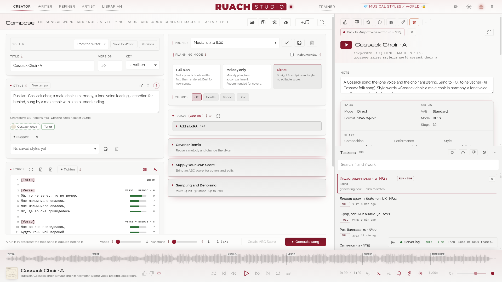

У YuE2 **дві половини**, і майже все, що ти налаштовуєш у студії, націлене на одну з них:

| половина | за що відповідає | чим ти там керуєш |
|---|---|---|
| **Музика** (AR, мовна модель) | пише пісню: спершу партитуру (нотація ABC), потім музичні токени, 25 за секунду | режим планування, партитура, музичний сід, музична сила LoRA |
| **Звук** (NAR + VAE) | перетворює токени на звук | звуковий сід, VAE, звукова сила LoRA, кроки й розв'язувач |

### Сім кімнат <!-- #the-seven-rooms -->

| кімната | для чого |
|---|---|
| **Творець** | форма пісні й семпл, який ти слухаєш |
| **Письменник** | твої пісні як документи з версіями; чат-модель пише чернетки й править разом із тобою |
| **Огранювач** | після рендеру: спектр, артефакти, антигул, перевірка тексту, стеми, ремастер, апскейл |
| **Художник** | картинки для твоїх пісень за твоїм власним промптом: квадратна, широка й висока з одного сіда; квадратна стає обкладинкою семплу (ранній показ) |
| **Відеограф** | кліп, спланований для семпла (бета): кадри за проспіваними рядками, їхні сцени, картинка на кожен, аніматик і кліп |
| **Тренер LoRA** | адаптери LoRA з твоїх власних пісень: набір, ран, його телеметрія і його епохи |
| **Бібліотекар** | усі семпли: простори, пошук, вподобання, нотатки, дії над багатьма, кошик |

### Панель <!-- #the-bar -->


Кімнати відкривають панель за ходом пісні: Творець, Письменник, Огранювач, Художник (ранній показ: картинки для твоїх пісень), Відеограф (бета) і Тренер; логотип стоїть посередині, одразу за ним Бібліотекар; праворуч — простір, лампа рушія (зелена: готовий; бурштинова: зайнятий; червона: щось зламалося) і кілька кнопок. Вказівник на лампі (або клацання) відкриває **що йде і що чекає**: пісні, реджени та справи лабораторії на відеокартах (обкладинки, стеми, апскейл, Whisper). Те, що чекає, знімається з черги своїм ✕, натиснутим двічі (перше натискання питає); те, що вже йде, зупиняється там, де його показано: пісня — у своєму запуску, тренування — у Тренері.

- **Простір**: простір, що в руках. Список семплів показує лише його, і кожен новий семпл лягає в нього. *Усі простори* показує все. Де панель вузька (без логотипа), слово *Простір* теж зникає; поле лишається.
- **Жодного семпла поза простором**: усе, що створює семпл (Створити, Замінити секцію, Імпорт), чекає простору в руці, який приймає нові семпли, — ніколи не 💎-набору, його розділів чи замороженого простору. Єдиний відкритий береться в руку сам, нова інсталяція отримує *Мої пісні*, інакше студія питає; поки простір не вибрано, нічого не надсилається, і поки Бібліотекар не відповідає — теж.
- **UK** (дві літери мови): сторінка іншою мовою, зберігається разом із твоїми налаштуваннями: English, Русский, Українська, Беларуская, Ελληνικά, Español, Italiano, Français, Português, Deutsch, 日本語, 中文, кожна названа своїми словами. Числа й дати йдуть за мовою, і цей посібник відкривається нею.
- **☀ / ☾**: день, ніч або як скаже система.
- У шапці Творення: **Зберегти** промпт (усе, що пішло б у генерацію) як JSON або YAML і **Відкрити** його знову; **Очистити** слова (назву, стиль, текст, партитуру, сіди), не чіпаючи решти, або почати **Нову пісню** (режим, семплінг і LoRA теж до типових; *Звук і вивід* лишається). **Відкрити** каже, що з файлу форма не прийняла і що тримає натомість.
- **Експорт у DAW** (у ☰, а ще в Огранювачі: поруч із семплом у руках і в його Стемах): вихід зі студії. Або зведений трек як є (WAV, FLAC, MP3), або весь семпл у твою власну DAW, де решта відбувається вже поза студією. Сторінка знаходить REAPER, Waveform і Bitwig на машині студії, або ти називаєш свою. Будь-який семпл виходить зі свого меню (клацання правою кнопкою): *Експорт у DAW → Проєкт REAPER* або *DAWproject* (Waveform, Bitwig, Studio One, Cubase), твоя DAW першою; вкладка DAW цього посібника каже, що всередині.
- **Вивантажити модель**: одразу прибирає з пам'яті GPU всі моделі, що простоюють; червонувата, поки модель завантажена.
- **☰**: решта. Карта та її пам'ять, копія моделі, декодер звуку (VAE), **Експорт у DAW**, теми, кімната Рушія і цей посібник. **Text size** там задає розмір тексту всієї сторінки від −2 до +4 pt (розкладка не змінюється), а піднятий фрейм додає свої −, + і ⟲ поверх (від −4 до +6 pt); у кожного екрана свій. Коли в `user/plugins/` лежить твій власний плагін, **Свої плагіни** там вимикають його для цього браузера: Огранщик, DAW і MIDI показують тоді лише те, що має публічна Студія, — для перевірки публічного шляху, промо чи картинок; нічого не видаляється, сторінка перезавантажується.

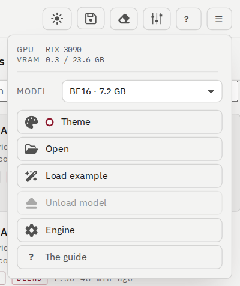

### Твоя перша пісня за шість кроків <!-- #your-first-song-in-six-steps -->

1. Дай їй **Назву** й обери **Тональність**, якщо маєш її на думці (або лиши *як записано*).
2. Напиши **Стиль**: мова, жанр, голос, інструменти, темп. Одного-двох простих рядків досить. ♪ поруч із ним перелічує 200 інструменти з тим, що YuE2 справді грає (див. *Творець*).
3. Встав **Текст** із тегами розділів на окремих рядках: `[Verse]`, `[Chorus]`, `[Bridge]`, `[Outro]`.
4. Лиши режим планування **Повний план**: YuE2 спершу пише мелодію й акорди, потім пісню.
5. Натисни **Створити пісню**. Запуск показує свої стадії: партитура, музичні токени, звук, декодування.
6. Семпл відкривається посередині, зі своїм плеєром, своєю партитурою і всім, щоб створити його знову.

> Заміряно на RTX 3090: пісня 6:12 у режимі «Напряму» забрала 135 секунд, пісня 7:25 у «Повному плані» — 212 секунд (спершу пишеться партитура). Коротші пісні швидші.

### Плеєр, семпли і лог сервера <!-- #the-player-the-takes-and-the-server-log -->

- **Плеєр** унизу: хвиля на всю ширину, одна м'яка хмара, де вже почута частина горить акцентом (клацання стрибає туди); під нею семпл (його обкладинка, коли вона є, назва, перші слова стилю, 👍 👎 ★), далі **упереміш**, назад, грати, вперед і **повтор** (вимк · увесь список знову · цей семпл знову, з позначкою 1), далі час (клацання по загальній тривалості перемикає на час, що лишився), *грати по клацанню* (клацання в списку одразу грає семпл), *грати далі* (коли семпл закінчується, починається наступний у списку), *грати нові семпли* (пісня, створена тут, грає, щойно готова, якщо нічого не грає), 🔔 *звук наприкінці запуску* (дві ноти вгору, коли готово, один раз на чергу запусків, дві вниз, коли запуск зірвався; поверх нової пісні, що заграла сама, звуку немає), **швидкість** (від 0.50× до 2.00×, висота тону зберігається), гучність і крапка стану (б'ється, поки семпл грає). Те, що зараз не потрібне, лишається блідим, доки не прийде вказівник; кожна іконка каже, для чого вона, коли на ній затримується вказівник. Вказівник над хвилею показує час, куди стрибнуло б клацання. Медіаклавіші клавіатури й гарнітури керують плеєром, а медіапанель стільниці показує семпл. ⏪ і ⏩ ведуть до попередньої чи наступної мітки через кожні 15 секунд від 0:00, ← і → — до міток через 5 секунд (із Shift через 30). Плашка стану в правому кінці плеєра (зелена, поки грає семпл, кольору акценту, поки його творять) відкриває семпл або прогін; коли Compose піднято над кімнатою, вона перемикає фрейм на фрейм семплу. Клацання правою кнопкою по хвилі, картинці чи назві відкриває меню семпла, як у списку. На хвилі видно секції семпла: теги самого тексту, кожна там, де Whisper чує її перший рядок (один раз на семпл, близько пів хвилини; сама на машині з двома картами й більше, інакше меню семпла → *Find the sections by ear*); у семпла, якого ще не слухали, видно позначки його партитури. Тонка риска на початку кожної, її назва внизу; клацання біля риски веде в самий початок секції; вказівник над хвилею показує картку з секцією, її часом і рядками, як вони написані, а рядок, що звучить під вказівником, підсвічено; секцію зі знаком ? почуто неясно. Вказівник, що затримався на хвилі, піднімає над плеєром спектрограму всього семпла (вимикач спектра поруч із 🔔 її вимикає): завширшки з хвилю й урівень із нею за часом, близько третини висоти вікна, а картка секції над нею; у ній секції, спектральний центроїд пурпуровою лінією (де центр ваги звуку: його яскравість), RMS на смузі внизу з пунктиром середньої по семплу, курсор відтворення; під вказівником його час, спектр цієї миті поруч із лінією з найгучнішою частотою та нотою, а вище, у самій картинці, частота там, її нота й рівень. У шапці *Лог* або *Лінійна*; клацання веде туди, як на хвилі; вказівник геть або Esc її прибирають. Семпл вимірюється один раз, лабою, як для його «Спектра». Гучність сягає 150 %: понад 100 % вона підсилює тихий семпл, а повзунок спершу зупиняється на 100 % (відпусти й потягни знову, щоб пройти далі).
- **Два ряди чи один**: хвиля над кнопками плеєра лишається там, де пісні слухають і порівнюють (Творець, Огранювач, Бібліотекар); у Письменнику, Художнику, Тренері й Рушії плеєр в один ряд, як і в Творці, поки фрейм піднято або текст понад усім. Після перезавантаження (F5) він повертається зі своїм семплом і місцем. У Художнику семпли спершу згорнуті, а лог сервера стоїть ліворуч.
- **Карти наживо**: у Engine → GPUs під кожною картою свій рядок, її навантаження й пам'ять стовпчиком раз на дві секунди за чотири хвилини, з температурою й потужністю; розгорнутий лог сервера показує поруч карти, що мають роль, над кожною її роль, карта студії в рамці. Заміри йдуть весь час, тож розгорнутий лог одразу показує останні хвилини.
- **Лінія до студії** видна поруч із логом сервера (*Forge · 85 мс*, або *тут* на тій самій машині). Коли студія далеко, вподобання, обране чи закріплення видно одразу, а студія лише підтверджує їх.
- **Семпли** праворуч: пошук словами, `*` і `?`; *Обране*; згорни колонку кнопкою »; ⋯ — власні дії списку. У ⋯ пункт *З усіх просторів* показує в цій колонці семпли всіх просторів, простір у руці лишається тим самим.
- **Семпли згорнуто**: миша на смузі » розгортає список поверх семпла; за секунду після того, як миша піде, він знову згортається (кнопка «Згорнути», натиснута тоді, лишає його відкритим). Меню ⋯ розгортається вгору, якщо під ним немає місця через плеєр.
- **Лог сервера** стоїть просто над плеєром у кожній кімнаті: згорнутий, він показує останнє, що сказав рушій (червоним, коли щось зламалося); розгорнутий — десять рядків, *Стежити*, *Копіювати* і шлях до всього логу в Рушії. Коли фрейм піднято над кімнатою, лог стоїть ліворуч і не закриває кнопок фрейму. Стрілка на його внутрішньому краї переносить його на інший бік сторінки, і кожна кімната пам'ятає свій бік (у Художника — лівий). Його зовнішній край тягнеться ширше, до 1200 px (ширина запам'ятовується; подвійне клацання повертає свою); з картами поруч він завширшки 920 px, їхня колонка 390. У рамки два вигляди, **Server** і **Artist** (власний лог Художника: що просили, що відповіла лаба, шлях кожного заходу до кінця), і кожна кімната відкриває свій; **⧉** відкриває лог в окремому вікні — у Chrome над усіма вікнами, в інших браузерах вікно, яке можна віднести на інший монітор. Поки навчається LoRA, над логом стоїть своя смужка, по рядку на ран: його карта, крок, скільки виконано й скільки приблизно лишилося; клацання відкриває Тренера.

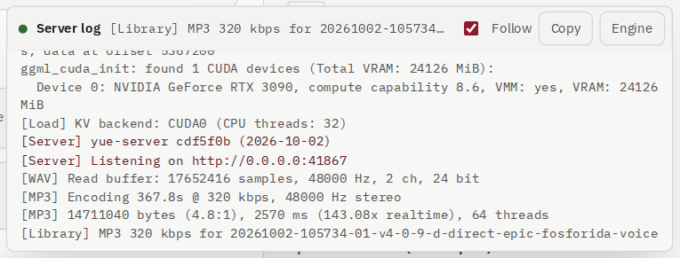

## Творець <!-- #creator -->

### Творення: форма пісні <!-- #compose-the-song-form -->

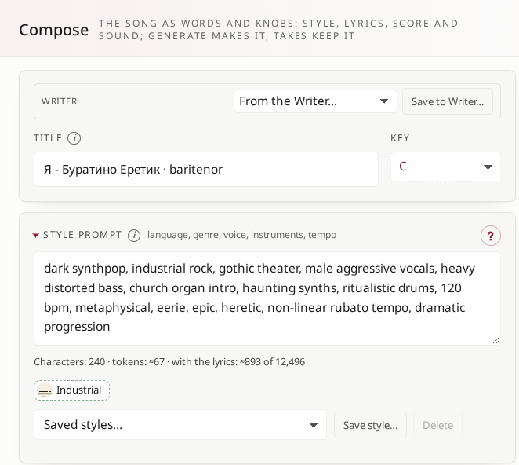

- **Почати з ідеї**: один рядок про пісню; чат-модель Письменника пише чернетку назви, стилю й тексту (*Написати бриф*).
- **Назва**, **Тональність**: тональність іде в партитуру (`K:`). Коли у формі є партитура, нова тональність переносить її туди; коли нема, вибір чекає і перенесе ту партитуру, що прийде.
- **Версії** (поруч із *Зберегти в Письменнику…*): форма зберігається під своєю назвою на кожен Generate, на Ctrl+S, після того як піано-рол записав партитуру, і перед усім, що її перезаписує (приклад, семпл, Письменник, версія), разом із параметрами, тож правка не губиться; клацання вибирає версію, друге показує дві як дифф, *У форму* повертає одну; зірка, мітка, замок. Видалення семпла його версій не чіпає. **Версія** поруч із Назвою приймає цифри й крапки (4.2.3): семпл називається «Назва v4.2.3», як заведено називати треки, а версії тримають одне дерево на назву й по гілці на версію (назва, набрана з версією, сама ділиться на два поля). *Видалити дерево…* відправляє все дерево назви до кошика версій; *Версії Творця* в Письменнику повертають його.
- **Музичний сід** і **Звуковий сід**: кості для двох половин. Порожньо — випадково; число повторює семпл. Лиши музичний сід і зміни звуковий, щоб почути ту саму пісню, озвучену інакше. Вони стоять першими в розділі *Семплінг і розшумлення*. Поруч із кожним — його **режим**: *Random (−1)* — щоразу новий (поле порожнє), *Random, fixed* — випадковий вписується й тримається, *Fixed* — вписаний, *Next* і *Previous* після кожного Generate зсувають його за використані сіди (версії для музики, варіації для звуку). Сід Художника має ті самі режими. Закріплений сід музики під наглядом: якщо від його минулого запуску зрушили адаптери (їхні музичні половини) чи базова модель, або він зламав план із цими самими адаптерами, запуск спершу спитає: **Новий сід** чи **Лишити сід**. План більше не вписує свій сід у поле, а **Нова партитура** бере нові сіди. Вручну сід — від 1 до 999 999 999 (довший стане 999 999 999); −1, 0 або не число — новий сід на кожен прогін, з діапазону від 1000 до 999 999 999. Власний сід дубля, поставлений при повторній генерації, береться як є, навіть довгий сід старого дубля; *Next* іде по колу в цьому діапазоні, а *Previous*, дійшовши до нуля, знову дає −1.
- **Стиль**: мова, жанр, голос, інструменти, темп. *Зберегти стиль…* зберігає його під іменем. **♂** і **♀** у його шапці кладуть у нього *male vocals* або *female vocals* (на місце слова іншої статі, інакше перед BPM); той, що світиться, прибирає свій тег. **Вільний темп** поруч із ними пише музику за партитурою без її темпових позначок (Q:): голос і ритм дихають самі, лірика більше не прив'язана до такту (рубато, нелінійність); вмикається сам, коли Стиль просить rubato чи non-linear і не називає BPM, а BPM у Стилі за ввімкненого темпу названо під полем. Партитура, створена окремо (*Створити партитуру ABC*), теж приходить без темпу.
- **Нелатинські літери** у Стилі називаються під ним: YuE2 читає стиль як англійські теги. **✦ Підказати** (✦ Suggest) читає лірику цілком (до 8000 знаків). Збережені стилі, профілі, текстові профілі й документи Письменника вибираються у власному діалозі студії з фільтром на довгому списку, як простір.

### Шпаргалка інструментів ♪ <!-- #the-instruments-cheat-sheet -->

♪ поруч зі стилем відкриває таблицю 200 інструментів, які студія випробувала: їхня родина, батьківщина, як вони звучать (англійською та російською) і слова, що їх кличуть. ▶ A і ▶ B грають дві 60-секундні проби кожного. Вердикт у кожному рядку дає людське вухо: почуто, під питанням або **NOT IDENTIFIED IN YUE2** (YuE2 його не знає; потрібен вигадливіший промпт). Клацання копіює назву й питає, куди її: у кінець стилю окремим рядком чи замість нього; назву, що вже є в стилі, позначено в таблиці, а текст таблиці можна виділити й скопіювати.

**YuE2 сам вирішує, коли вступає інструмент.** Рядок стилю — це прохання, а не наказ: хоч як наполегливо просиш, модель вводить інструмент там, де, за її навчанням, пісня його хоче, і сід вирішує дуже багато. Той самий промпт дав один семпл з інструментом і один без нього. Послухай кілька сідів, перш ніж судити про інструмент.

**Чути, але не так правдиво, як живий.** Багато інструментів таки грають, але менш чітко й менш правдиво, ніж справжні: це те, що YuE2 про них знає. Вердикти кажуть, чи грає YuE2 інструмент узагалі, а не наскільки справжнім він звучить. Наблизити його до справжнього — справа **LoRA інструмента**: кілька десятків його чистих записів, натренованих у Тренері LoRA.

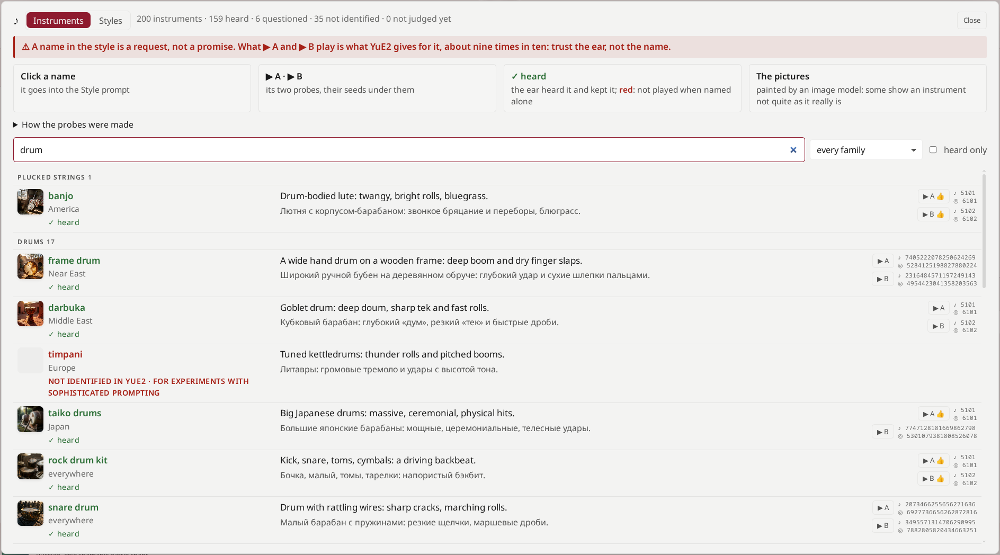

### Словник Першої хвилі <!-- #the-first-wave-s-vocabulary -->

**YuE2-RS-FW**, власний файнтюн студії (*Engine → Models and LoRAs → RS-FW merge*), навчався на 32 633 треках, і кожне слово їхніх стильових рядків пораховано в **[його словнику](fw-vocabulary/index.html?lang=uk)**: жанри, інструменти, голос, настрій, слова емоцій, які дав сам звук, тональності й BPM, і ключі партитур (розділи, розміри, темпи, акорди). Шукай, фільтруй за видами й джерелами, дивись, з якими словами траплялося кожне. Клік ставить слово в стильовий рядок у тому порядку, якого навчилася модель; *Копіювати* бере рядок для поля Style. Слово із сотень треків модель розуміє, слово з двох — лише натяк. Той самий довідник документом — на [сторінці моделі](https://huggingface.co/goldhub/YuE2-RS-Finetunes/blob/main/FW-VOCABULARY.md).

### Текст і текстові профілі <!-- #lyrics-and-text-profiles -->

- Теги розділів на окремих рядках; YuE2 знає `[Intro]`, `[Verse]`, `[Pre-Chorus]`, `[Chorus]`, `[Bridge]`, `[Interlude]`, `[Outro]`.
- Інструментальний тег на кшталт `[Instrumental Outro]` лишай без слів: слова під ним раз у раз відводять хвіст у вигаданий спів. Останні слова став під `[Breakdown]` перед ним.
- **Текстовий профіль**: встав увесь текст, обери профіль, *Застосувати*: його правила (очищення, фонетика) і його форма (`[Intro]`, `[Verse]` на порожніх рядках, `[Interlude]` після довгих абзаців) готують текст до читання. *Скасувати* повертає текст. Профілі створюються в Письменнику.

### Лічильник лірики і фонетична рука <!-- #the-lyrics-meter-and-the-phonetic-hand -->

- **Лічильник** поруч із лірикою: у кожного рядка його склади смугою проти лінійки його групи — куплет і міст одна група, передприспів своя, приспів своя, будь-який інший розділ своя. Пауза, брейк, тиша, інтерлюдія, прелюдія чи інструментальна вставка всередині співаного розділу нової групи не відкривають: їхнє ім'я стоїть поруч блідо, а лінійка розділу йде далі. Теги не рахуються ніколи: рядок із самих тегів (`[Break] [Silence]`) не рахується зовсім, тег усередині рядка з лічби випадає. Лінійка стоїть на звичайній довжині групи; в межах складу смуга зелена, на два-три склади повз — бурштинова, далі — червона. Те, що в круглих дужках, домальоване за смугою штрихуванням: YuE2 може це заспівати. Під полем: знаки, склади й рядки самої лірики, теги розділів, дужки та фонетична рука; перевірка орфографії браузера мовою лірики (там же вимикається); розтягнуте рукою поле тримає свою висоту до *Автовисоти*.
- **Номери рядків і мітки**: поле лірики нумерує рядки, як редактор коду (перенесений рядок — один раз, на першому; *Line numbers* під полем їх вимикає). **Alt+K** ставить мітку на рядок курсора або знімає її, **Alt+J** веде до наступної мітки, **Alt+Shift+J** — до попередньої, **Alt+Shift+K** знімає всі; номер позначеного рядка бурштиновий, і мітки йдуть за своїми рядками, коли пишеш вище. Кожен [тег] лежить під тонким бурштиновим шаром. У ліриці Письменника те саме. Як у mcedit: **Alt+O** теж знімає мітки, **Alt+L** веде на рядок за номером, **Ctrl+Y** видаляє рядок, **Alt+↑** і **Alt+↓** пересувають рядок (або виділені рядки) разом із міткою. *Keys* під полем перелічує їх усі, а мітка LYRICS у Письменника називає їх при наведенні. **⤢** поруч із Lyrics піднімає поле понад усім, на 60 % ширини екрана й на чотири десятих більше, з усім цим і зі своїми −, + і ⟲ для розміру тексту (запам'ятовуються в цьому браузері); Esc повертає його. Поруч із **⤢** дві кнопки тримають лірику голим текстом: перша зберігає її в `.txt` з ім'ям за *Назвою*, друга ставить на її місце `.txt` (UTF-8): спитає, якщо в полі є слова, а **Ctrl+Z** у полі поверне їх; порожня *Назва* бере ім'я файлу.
- **Дужки під перевіркою**: «[», не закрита у своєму рядку, «]» без відкривної, «[» всередині тегу й порожній тег фарбують номер рядка червоним, а *Tags not closed or astray* під полем веде від однієї до наступної; кругла дужка, лишена відкритою або закрита без відкривної, — бурштинова (луна може тягтися далі). «[», яку ще набирають, не чіпається, доки курсор не піде з рядка. **Generate питає спершу**, якщо тег зламано: те, що йде за незакритою «[», може зникнути з пісні, а її кінець — піти криво; *Go to the line* або *Generate as it is*.
- **Наголоси повз**: знак не на голосній — на початку рядка, після пробілу чи розділового знака, на приголосній, другий на тій самій літері або окремий ´ на його місці — дає червону кнопку під полем (*Stress marks off a vowel*) і позначку перед лічбою рядка; кнопка виділяє їх по черзі. Слово з двома знаками дає жовту: так задумано чи описка? У лічбі знак наголосу складом не рахується; ע і латинська голосна всередині російського слова — рахуються. Склад — це один голосний звук, одна нота, і кожна мова рахується за своїми правилами: в українській, російській і білоруській одна голосна літера — один склад (а що лічильник міряє час, слово без голосної — с, в, к, з, й, ў — і проривний перед африкатою всередині слова — глу-п-цо́в — беруть свою долю, вона намальована блідіше: «Я же вижу глупцо́в с приду́рческим планом» — 12 складів і 2 такі долі, 14); у грецькій αι, ει, οι, ου, αυ, ευ — один (діереза чи наголос їх розділяють: τσά-ι); в іспанській та італійській слабка i чи u пристає до сусідньої (cie-lo, cuo-re), дві сильні — два склади (po-e-ta); в англійській німа кінцева e складу не дає (make, але ta-ble); іврит рахує свої огласовки; китайська, японська й корейська — по знаку на склад. Латинські слова рахуються як англійські, іспанські чи італійські: за назвою мови в стилі, інакше за службовими словами самої лірики.
- **Арка**: куплети нумеруються 1, 2, 3… (без пропусків, без повторів, без куплета без номера серед пронумерованих); усередині циклу куплета Verse › Pre-Chorus › Chorus › Post-Chorus — секцію можна пропустити, але не повернути назад; Bridge чи інструментальна частина відкриває цикл знову; Intro лише до початку пісні, після Outro нічого не співається. Її промахи — **Арка** (Arc to look at) бурштиновим, натискання веде до наступного.
- **Ctrl+F** у ліриці чи в стилі (і в полях Письменника) шукає тільки в цьому полі: Enter і Shift+Enter ходять по збігах, Esc з поля пошуку повертає курсор з виділеним збігом; із самого поля (якщо ти клацнув деінде) закриває пошук і лишає курсор, де стоїть, а набране тим часом вигляд не зсуває. Знак наголосу пошуку не заважає, ё — це е, а о й а знаходять і ע, і латинські o та a. **F4** або **Ctrl+H** відкривають другий ряд, заміну: **Enter** ставить нові слова на місце знахідки під рукою і йде до наступної, **Ctrl+Enter** (або *All*) замінює всі знахідки разом, і один **Ctrl+Z** у полі повертає як було; **Aa** (**Alt+C**) шукає лише з тим регістром, що набрано.
- **Теги по «[»**: «[» на початку рядка лірики (у Творця й у Письменника) відкриває теги розділів, як редактор коду підказує слова, у тому порядку, у якому їх проходить пісня, від Intro до End. Літери після «[» звужують список (і в українській чи російській розкладці), число нумерує тег (`v2` — це `[Verse 2]`), а якщо куплети в ліриці пронумеровані, пропонується наступний. ↑ ↓ вибирають, Enter чи Tab ставлять тег окремим рядком (Ctrl+Z скасовує), Esc чи `]` закривають список. Intro, Outro й End, що вже є в ліриці, стоять на своєму місці, бліді, з номером свого рядка: ↑ ↓ доходять до них і дають прочитати, що це, але двічі їх не поставити. Ctrl+Space відкриває список, а на початку рядка сам ставить «[». Список стоїть у дві колонки: теги, а поруч — що це за тег (нашими словами, за гідом Genius про розділи пісні) і скільки разів його пишуть 110 офіційних прикладів; вікно не змінює розміру, коли список звужується. Розділи, яких немає в жодному з них, позначено TEST. **Другий і третій тег** у рядку: «[», набрана одразу після тегу рядка, сама дістає пробіл і пропонує несекційні теги (хто співає, як пишуть приклади; Female Vocals, Break і Silence з позначкою TEST); Enter ставить тег у той самий рядок, а «…» у ньому виділено під твої слова; Ctrl+Space і тут набирає « [».
- **Фонетична рука** (Віктора, з SUNO; YuE2 ведеться на неї так само):
  - **Знак наголосу** (комбінований акут, U+0301) після голосної: `обе́щано`, `сули́т`. Тримає приблизно у 90 % рядків; решта — удача сіда.
  - **Велика наголошена голосна** штовхає наголос туди, куди просить рима, всупереч словнику: `базилиО́`. Сама велика літера без знака (`дрОв`) наголос зсуває рідко.
  - **«е», заспівана як «ё».** Модель іноді співає `е` як `ё` («вЁрный» замість «вЕрный»), всупереч будь-якій фонетиці й тому, на чому вона вчилася. Щоб цього уникнути, тим паче коли `е` наголошена, став знак наголосу (`ве́рный`) або велику `Е` (`вЕрный`).
  - **ע (айн) усередині російського слова** співається м'яким о/а, як ненаголошене о в живій мові: `кעмо́рка`, `пעле́но`, `Ка́рлע`. Він же пригальмовує реп, що дедалі розганяється.
  - **Латинська o всередині російського слова** співає тверде, відкрите о там, де модель сказала б а: `Кo дну`.
  - **Розтягнута голосна** (`о-о-о`, `БУ… РА… ТИ… НО`) тримає ноту; там, де в музиці є для неї місце, а не в кожному рядку.
  - **[Interlude]** між частинами ставить паузу в репі й гальмує мову, що дедалі прискорюється (не завжди).
  - **Круглі дужки** — не команда: одне-два слова мовою лірики в них здебільшого співаються луною хору; ремарка в них (`(Music slowly fades)`) здебільшого пропускається або співається. Команда пишеться в квадратних дужках.
  - **Ведучий і хор** (знахідка Віктора, 20.10.2026): поділити лірику на рядки ведучого голосу й відповіді хору. Якщо в стилі є `female choir backing` і `solo lead`, короткий рядок у круглих дужках мовою пісні найчастіше співає хор — окремим рядком або в кінці рядка ведучого. Спрацьовують два способи: просто дужки, найнадійніше (`это же (божественный экстаз!)`), і `(Choir: …)`, що бере не щоразу; `(Choir backing: …)` провалюється цілком. З англомовною лірикою прості дужки можуть часом збоїти. За такого поділу ведучий голос виходить із великою кількістю повітря. **Три крапки** (`...`) після слова дають коротку паузу. Так написана пісня може вийти довгою (у нього дійшла до 8:27) або, з тими самими словами, коротшою, ніж була, — і тоді лишається місце для інструментальних програшів.
  - **Єврейське слово з огласовками** (`רוּחַ`) модель вимовляє вірніше, ніж у транслітерації.
  - **Квадратні дужки — команда** для YuE2: секція, голос, як рядок співати чи казати. Тут можна гратися дуже довго.
- **Голоси** (не секція: рядки лишаються в секції перед ними). Форма Віктора: `[Vocal: Female - …]` або `[Vocal: Male - …]` для проспіваного рядка, `[Spoken: Female - …]` або `[Spoken: Male - …]` для сказаного; спершу хто, після тире як (`[Spoken: Female - Soft Whisper, Intimate, Sacred]`). Тег мовлення може вести сам рядок: `[Spoken: Female - Soft Whisper] Ты слышишь?`. На довгій баладі з чоловічим голосовим адаптером і жіночим голосом оповідачки (13.10.2026) YuE2 слухався таких тегів приблизно у 95 % випадків, стабільніше, ніж SUNO. **Solo** у тегу голосу не чути (приклади тримають його для інструментів: `[Guitar Solo]`): називай голос. «[» пропонує їх після секцій з позначкою *не секція*.
- **Один склад зсуває всю пісню.** YuE2 читає лірику одним ланцюжком, перш ніж пише музику: зміни склад, «», тег — і той самий сід піде іншою дорогою звідси до кінця. Сід — це кості, а не пісня. Щоб змінити рядок і зберегти решту, заміни його секцію (правий клік по хвилі плеєра); щоб судити про нові слова, слухай їх на кількох сідах.
- **Довжина**: YuE2 тримає пісню на 8–9 хвилин, більше, ніж 6:15 у SUNO v6. *Макс. довжина* сягає 15 хвилин для оповіді, але далі 9 — це вже удача сіда.

### VAE і LoRA <!-- #vae-and-loras -->

- **VAE** перетворює написану пісню на звук: **Стандартний** (найкращий звук), **Колишній** (той, що з бенчмарку), **Суміш** (суміш обох, доповнення). Готовий семпл може пізніше додати ще одне декодування зі своєї сторінки. Обирається в меню **☰**, під моделлю, для наступних пісень; семпл перекодовується іншим зі своєї картки за секунди (з rc2 кожен семпл зберігає свої латенти; створений раніше перераховує звук наново).
- **LoRA**: адаптери для музичної половини, звукової або обох, кожен зі своєю силою: повзунок музичної половини починається з акорду, звукової — з хвилі (вказівник на значку назве його). Ім'я, довше за свою колонку, обрізане й під вказівником показується повністю. **Додати LoRA** тримає адаптери, яких немає в пісні, за одним рядком: пошук знаходить їх за будь-яким словом (ім'я, вид, половини, тег, тригер, опис), види їх фільтрують (*голос*, *вокал*, *стиль*, *інструмент*, *партитура*), кожен вид має свою смужку ліворуч на плитці (голос диктора має другу, її колір за першою літерою імені, як у контактах телефона), дві колонки на екрані 1080p і більше на широкому, своя прокрутка понад 800 px.

**Хвиля LoRA.** Адаптер тисне своєю силою з першої секунди до останньої — рівно. Маленька картинка в кінці його рядка відкриває його хвилю: **Рівно** так і лишає; **Арка** дає йому піднятися до повної сили посередині пісні й м'яко відступити до обох кінців; **Малювати** — форма від руки: тягни точку вгору — спалах, униз — згасання, уздовж пісні — зсув; подвійне клацання додає точку, подвійне клацання по точці прибирає її. Задана сила — верх хвилі; два файли пари (музична половина і звукова) йдуть однією хвилею. Музична половина проходить її токен за токеном, поки пишеться музика, звукова — кадр за кадром, поки збирається звук, від початку до кінця довжини пісні; хвиля йде в запит семпла, тож перестворений семпл іде тією самою хвилею, а картка семпла каже *хвиля*. **Секції** — адаптер звучить лише в позначених секціях, з коротким переходом на кожній межі: межі беруться з тактів партитури, якщо вона є, інакше приблизно за рядками лірики.

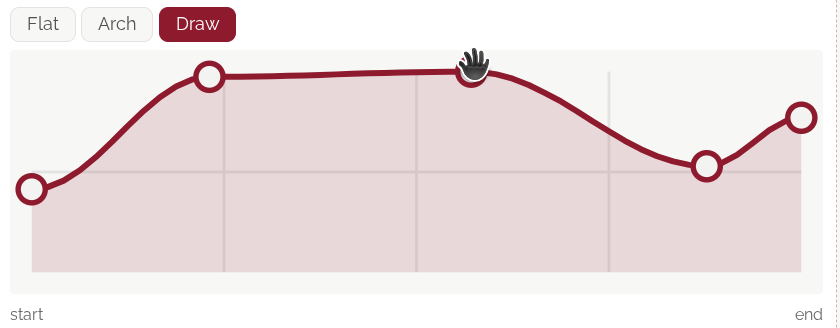

**Сітка хвилі.** Графік рахує силу чвертями, а пісню — хвилинами й секундами. Час іде по довжині, заданій у **Виводі** (Макс. довжина), а не по довжині самої пісні: рушій розтягує хвилю на цю довжину. Впиши в **Пісня ≈** приблизну довжину пісні: пунктир позначить її кінець, і те, що намальовано після нього, не прозвучить. **Shift** тримає точку, яку тягнеш, на сітці, правий клац прибирає точку, а рядок над графіком каже, де стоїть вказівник. Кнопка поруч із назвою LoRA піднімає їх поверх сторінки, до 1800 px завширшки, щоб тонко рухати точки; Esc повертає на місце. Став **Вивід** близько очікуваної довжини, щоб хвиля прозвучала вся: семпл, замовлений на 9:00, що скінчився на 6:37, лишив останню чверть своїх хвиль нечутою.

**Емоційна арка.** Голосовий адаптер на арці зростає до середини пісні й стихає до країв, і пісня дихає разом із ним. У режимі **За порядком**, коли два адаптери разом переходять червону лінію, те, що відпускає хвиля верхнього, бере нижній: дудук на арці над голосом передає пісню між ними. Це чути й міряється: у семплі, де адаптер дудука намальовано високо, потім низько, потім із підйомом, стем духових, відділений від пісні, пройшов ту саму лінію (−30 дБ на початку, −59 дБ посередині, −36 дБ під кінець).

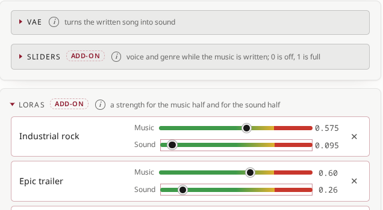

Кожна сила стоїть на **дорозі**: зелене — безпечно, жовте — її межа, червоне — за нею. Межі заміряні:

- усі адаптери однаково, на десятих частках повзунків: музична половина зелена до **0.4**, червона з **0.5**, щонайбільше **0.75** (адаптер партитури, той, що планує ABC, тримає свої: зелений до 1.0);
- звукова половина зелена до **0.6**, червона з **0.75**, щонайбільше **1.0**;
- **Музика разом** і **Звук разом**: сили адаптерів додаються, і кожна може стояти у своєму зеленому, а сума однаково зламає партитуру. Поки модель пише партитуру, музична половина разом зелена до **1.2** і червона на **1.4**, своїй межі: на планах Студії (13–20.10.2026) до 1.0 разом не зламався жоден із 6, від 1.0 до 1.2 — 14 із 35 (на IRAEv3 — 8 із 10), понад 1.2 — 8 із 9. З партитурою у формі музична половина її не пише, і смуга йде до 3.5 (на справжніх семплах ціла до 2.25, зламана з 2.5). Звукова половина разом зелена до 1.2, щонайбільше 1.5. У плану є ще запобіжник: у «Повному плані» без своєї партитури адаптери із сумою понад **1.0** (на IRAEv3 — **0.8**) планують партитуру, пропорційно знижені до неї, а пісня співається за нею на їхніх власних силах. Зламаний план не співається: за випадкового сіду музики він планується наново один раз; після цього або на закріпленому сіді вікно Вавилона каже, що на нього тиснуло (адаптери, базова модель, сід, запобіжник), і на слово планує наново з новим сідом.

**Бюджет.** Коли адаптерів два й більше, під дорогою стоїть **Бюджет**. Жоден режим не світиться — бюджету немає: кожен іде своєю силою, як досі; той, що світиться, натиснутий ще раз, бюджет відпускає. **Частками**: адаптери, що тиснуть на ті самі шари, ділять один бюджет на половину, його стеля — червона лінія; за нею кожен поступається пропорційно. **За порядком**: силу першим бере верхній рядок, наступний — те, що лишає червона лінія, а що відпускає хвиля, те бере наступний; перетягни рядки за назву, щоб задати їхній порядок. Рушій тримає бюджет у кожну мить пісні. Які адаптери ділять шари, студія міряє сама: підказка на імені адаптера показує, де він тисне (шари кожної половини, увага проти MLP, на скільки він зсуває шар при 1.0), а нотатки поруч з іменем LoRA кажуть, коли двоє ділять шари і як тягнуть: в один бік (разом тиснуть сильніше, ніж кажуть їхні сили), один проти одного чи впоперек. Сила, яку бюджет притримує, показує, що справді йде: її число жовтіє, доріжка за зрізом тьмяніє, а підказка пояснює чому; **Музика разом** і **Звук разом** показують, що йде із запитаного (сума в обох режимах одна, різняться рядки). Повзунки ходять десятими; подвійне клацання вписує соті.

**Вище лімітів.** Пташка в кінці рядка бюджету пускає кожен повзунок вище його максимуму (музичну половину до 1.5, звукову до 2), спільні теж; дороги зберігають кольори, тож заміряний червоний і далі видно, а бюджет нічого не тримає. Це для адаптера, чия хвиля грає лише частину пісні (дудук гучно у вступі, далі мовчить): йому не треба забирати частку в інших на всю пісню. Партитура все одно планується з музичною половиною, зниженою до запобіжника плану (1.0 разом, 0.8 на IRAEv3), а співається на виставлених силах. **Поза партитурою** (правий клік по рядку): його музична половина співає партитуру, але не пише її; план складається без нього, рядок позначено *лише співає*.

**Подвійне клацання** по числу — ввести силу точно. Підказки під блоком кажуть, що важливо: слово-тригер, якого нема в стилі, адаптер, натренований в іншому режимі планування, сила за межею. Поки вказівник стоїть на повзунку або тягне його, над ним видно точну силу в кольорі дороги. Адаптер Instrumental упирається в 1.0, з якої й починає: вище його партитури збиваються.

**Навчений на іншій моделі.** Адаптер вчиться на тих вагах, на яких його навчають: вивчений на YuE2 рветься на файнтюні RS-FW (голос розлазиться, стиль розмазується), а вивчений на RS-FW так само поводиться на YuE2. Студія знає, на чому навчений кожен (це каже його файл або ран у Тренері, що його створив; файл, який мовчить, вважається адаптером YuE2, як і будь-який адаптер YuE2 поза студією), і звіряє його з поточною моделлю: **⊘** — чужої моделі, перед додаванням питає (**Однаково взяти**); **≈** — той самий файнтюн на іншій епосі, лише позначений. Під час зміни моделі адаптери пісні, навчені на іншій, приглушуються з поясненням і самі повертаються, коли модель знову їхня; правий клік по рядку поверне будь-який і так. IRA та IRAE вважаються YuE2 (це YuE2 із вплавленими адаптерами).

> **Інструментальний адаптер партитури зі словами для співу.** Такий адаптер планує партитури *без вокальної лінії*. На 1.00 він дав семпл з однією нотою на 127 вокальних тактів: співак проговорював поверх двох зациклених тактів. З текстом тримай його низько, 0.3–0.5. ⚠ поруч із назвою LoRA каже про це, коли так стається.

### Профілі й режими планування <!-- #profiles-and-planning-modes -->

- **Профіль** разом задає режим, довжину, семплінг, ведення, кроки, VAE, LoRA і вивід; тексти й сіди лишаються. *Зберегти профіль…* зберігає поточні ручки під іменем.
- **Режим планування**:
  - **Повний план**, типово: спершу пишуться мелодія й акорди (партитура, яку можна правити), потім пісня. Найкраще для нових пісень.
  - **Лише мелодія**: план мелодії, вільний акомпанемент. Рекомендовано для каверів.
  - **Напряму**: одразу з тексту й стилю, без партитури. Адаптерам, натренованим без партитури, місце тут.
  - **Інструментал**: без вокалу, офіційний рецепт YuE2. Стоїть праворуч у рядку режиму планування.
- **Акорди**, під режимами: *Вимк.*, *М'яко*, *Різноманітно* або *Сміливо* — наскільки далеко можуть відходити акорди партитури, яку планує модель. Сам собою планувальник схильний ганяти одну послідовність через усю пісню; *М'яко*, *Різноманітно* і *Сміливо* велять акорду, що прозвучав серед недавніх змін, повернутися пізніше й тримають перші акорди секції осторонь від попередньої, а *Сміливо* ще й дозволяє акорду часом вийти з тональності. Діють, лише коли партитуру пише модель: «Повний план» або «Лише мелодія», без твоєї партитури або з самим її початком. Замір на плані однієї пісні: вимкнено — шість акордів і та сама четвірка акордів тринадцять разів; із силою *Різноманітно* — дев'ять акордів, а найчастіша четвірка чотири рази. Слідом за Yeufonic, через yue2.cpp від timoncool. Типово — *М'яко*.
- **Повний план чи Напряму.** Слово Віктора після тижня пісень: «Напряму» — це влучив-схибив у дусі SUNO (за його рахунком близько двох вдалих семплів на сотню); «Повний план» — шлях для всіх, навіть для тих, хто не читає жодної ноти в ABC: теги дотримано, звук усталюється, вимова тримається, темп передбачуваний. Заміряно на його репі, по чотирнадцять семплів кожного режиму, слухав Whisper: найкращий семпл з усіх — «Повний план» з його консервативним рецептом (почуто 84 % слів, в останній чверті 76 %). Якщо «Повний план» підводить, то наприкінці: семпл триває стільки, скільки його партитура, а план може тримати менше секцій, ніж текст (тоді останні куплети випадають або повторюється ранній); після останніх слів догравають решту тактів партитури — це і є 10–15 с після правильного згасання пісні, а не CFG. Слухай кінець семплу в «Повному плані»: *End at…* відрізає хвіст, *Перестворити з…* пише втрачений кінець наново.

### Кавери, ремікси і своя партитура <!-- #covers-remixes-and-your-own-score -->

- **Кавер або ремікс**: візьми мотив запису (*Транскрибувати*: лише його мелодію, без слів і голосу співака) або мелодію одного зі своїх семплів і дай їй новий стиль.
- **Звірити секції** (поруч із *Транскрибувати*, коли партитура запису вже у формі): Whisper чує, де в записі починається кожен блок твоєї лірики, і кожен блок отримує тег секції партитури, в якій його заспівано. Слова не змінюються: блок, уже названий за своїм родом, зберігає тег, нерозчутий лишається на місці (під питанням), приспів, написаний один раз, копіюється туди, де його співають знову, а секції, де голос не співає, отримують порожній тег. Пропозицію видно й можна правити до того, як вона ляже у форму; попередня лірика зберігається версією. Слідом за YuE2-Studio від timoncool і Cover Studio від HOT-Step.
- **Своя партитура**: партитура ABC, якої дотримуються «Повний план» і «Лише мелодія». Транспонуй її (найближче, вгору чи вниз), зсувай один голос по ступенях гами, імпортуй файл MIDI (одна мелодична лінія на голос), експортуй MIDI або маркери для DAW, завантаж приклад, перетвори її на інструментальну. **Generate** із заповненою партитурою спершу питає: на цій партитурі чи нова (поле очищається, музична модель пише свою). Партитура пам'ятає адаптери й музичні сили, з якими її написали (план, власна партитура семплу); якщо зараз стоять інші, про це скаже рядок під нею і саме питання: за інших сил музика може відійти від партитури, найдужче в Industrial Rock та інструменталах. У Full партитура лишається відкритою, доки в ній щось є. **Лише початок**, під партитурою: партитура в полі — тільки початок пісні, кілька тактів, зіграних на піано-ролі чи MIDI-клавіатурі, наспіваних і записаних зі звуку або набраних руками, а решту пісні модель допише від нього, у його тональності й розмірі; уся партитура, твій початок першим, співається і лишається партитурою семпла. «Повний план» або «Лише мелодія»; *Акорди* правлять те, що дописує модель. Слідом за hum-to-song від Mothersuperior, через yue2.cpp від timoncool.
- **Піано-рол** (кнопка з нотним станом поруч із *Прибрати партитуру*): партитура на все вікно. Угорі вона на папері двічі: як її написав YuE2 і якою вона є зараз. Нижче час тече згори вниз до двох клавіатур, Vocal над Ins; клавіші одного розміру на будь-якому екрані, октави за краями чекають біля країв (при наведенні — маленька клавіатура цих октав). Клацання пише ноту довжиною сітки, тягти — рухати, за нижній край — довше, права кнопка чи Delete — прибрати; голос YuE2 співає по ноті за раз, тож нота, покладена поверх іншої, її тіснить. Склади лірики стоять на нотах Vocal. **Shift** і клавіші разом дають акорд на такт курсора; клавіші комп'ютера грають півтори октави (білі на A…', чорні на W…], Z і X — октава), грає й MIDI-клавіатура (**MIDI**), а з **Rec** зіграна клавіша пишеться в курсор. **Грати** (Пробіл) звучить від курсора, оригінал або виправлене, Ins клавішами, Vocal співається назвами нот, або обидва. **Записати в партитуру** повертає лише змінені рядки. Уночі папір темний, удень сірий. Аркуші йдуть за стрічкою (за відтворенням, курсором чи туди, куди прокрутили стрічку), такт у руці підсвічено на обох; аркуш, прокручений рукою, веде за собою другий і стрічку, а клацання по ноті на аркуші ставить курсор на її такт. Ins звучить роялем; Vocal співає самі голосні — а, е, і, о, у, як їх тягнуть співаки VocalSet, без шуму перед ними. **Звук ▾** поруч із **Play** тримає **Педаль** (*Довгі ноти*, типово: нота від долі й довше звучить після свого кінця, згасаючи, доки педаль не змінять на наступній тактовій рисці; *Завжди*: кожна нота; *Вимк.*), **Акустику** довкола рояля й голосу (*Сухо*, *Кімната*, *Зал*) і **Кришку** рояля (*Піднята*; *Закрита* — темніше й м'якше). Підказка з клавіш лежить бліда над нижніми октавами стрічки, її прапорець згортає її. **Рушій → Залізо → MIDI** вмикає MIDI для всієї студії: клавіатура грає в ролі, DAW-порт M-Audio Oxygen (Mackie Control) веде Play, Stop і Record. Браузер дає MIDI лише сторінці, відкритій як localhost або через https: з іншого комп'ютера виконай `ssh -L 7777:localhost:7777` на машину студії й відкрий http://localhost:7777. Стрілки біля країв клавіатури зсувають клавіші на октаву, ◎ повертає їх на ноти партитури; важіль між аркушами й ролом дає більше місця одному чи другому (запам'ятовується; подвійне клацання — як було), а на високому екрані клавіші Ins отримують повну рояльну довжину. **Грати** грає в темпі поруч (партитура у вільному темпі його не має, і рол бере останній заданий), ↑ повертає аркуш до початку. Vocal співає фразу одним голосом, складами лірики чи *До Ре Мі*. Колесо висоти MIDI-клавіатури веде курсор у часі, колесо модуляції задає довжину нової ноти. **⇅ Транспонувати**: протягни по номерах тактів ліворуч, щоб вибрати сегмент, і намалюй зсув лінією точок — на півтон, чверть, третину чи половину октави, октаву чи дві, сходинками чи плавно; *У мінор* чи *У мажор* переводить частину разом з акордами, *У ладу* тримає її ноти в ладу; *Застосувати* — один крок скасування. Число клавіш у шапці відкриває свій список: скільки клавіш має твоя MIDI-клавіатура (88, 61, 37 або 25, при кожному сказано, що це) і які октави на виду; темп, жирна кнопка поруч із **Play**, відкриває свій: −4, −1, +1, +4, повзунок і власний темп партитури. Якщо такти не вибрано, **⇅ Transpose** бере секцію під курсором. Слова стоять і під станом Vocal на обох аркушах, а кілька нот, які вступ віддає голосу перед куплетом, співають перші склади куплета. Партитура, де YuE2 написав такт не в розмір (скажімо, 18/16), теж відкривається: рол читає такий такт вирівняним (зайве зрізано, короткий такт доповнено паузою) і каже про це, а рядок, якого ти не торкаєшся, іде назад, як його написав YuE2. Слова на аркуші набрано Noto Sans, стиснутим, як у друкованій партитурі: імена голосів до 76 %, акорди й слова до 90 %.
- **Прочитати текст на партитурі** (*Lay the lyrics on this score…*, під партитурою, коли вона читається): оповідач із промо Студії — для твоїх слів. Кожен рядок лягає на такти партитури: склад на восьму (на шістнадцяту, як читають реп, де восьмими рядки не вмістилися б) на тоні акорду свого такту, вдих після коми й крапки, останній склад рядка — на чверть нижче; кожна секція починається з двотактової фрази після такту паузи або після вокалізу, якщо його позначити. Інструменти, акорди, тональність і темп лишаються; секції партитури йдуть за твоїми тегами, зі вступом і кінцівкою довкола. Для речитативу, начиток і репу поверх підкладки: створи підкладку, *Записати її за звуком*, потім це; спершу питає, а Ctrl+Z у кожному полі повертає попередній текст.
- **Акордова підкладка** (*Акордова підкладка* під партитурою: тональність, розмір, темп і *Написати підкладку*): партитура без мелодії, лише її каркас. Кожен розділ твоєї лірики отримує такти, близько 2.5 с на проспівану строку парами тактів, програш, вступ і кінцівка — по кілька своїх, і на кожному такті акорд; такти голосу — паузи, такти інструментів порожні. Тональність і темп беруться зі стилю, коли він їх називає, а кожне натискання тягне нові послідовності: куплетам одну, приспівам іншу, бриджам третю. Режим планування переходить у *Повний план*. Мелодію модель пише сама й співає твої слова поверх цієї гармонії: ти обираєш акорди й форму, вона знаходить наспів. Замір на двох семплах (22.10.2026): звук ішов за акордами підкладки такт за тактом, ближче, ніж усі 300 перетасовок тих самих акордів і ніж ті самі акорди в будь-якій іншій тональності; модель співала поверх пауз (голос звучить у 75 % і 34 % кадрів проти 79 % і 49 % на спланованій партитурі); і довжину семпла підкладка не тримає: обидва йшли близько 70 с на підкладці в 40 с і продовжували її останню послідовність. Перенесено з YuE2-Studio автора timoncool (MIT).

### Семплінг і розшумлення <!-- #sampling-and-denoising -->

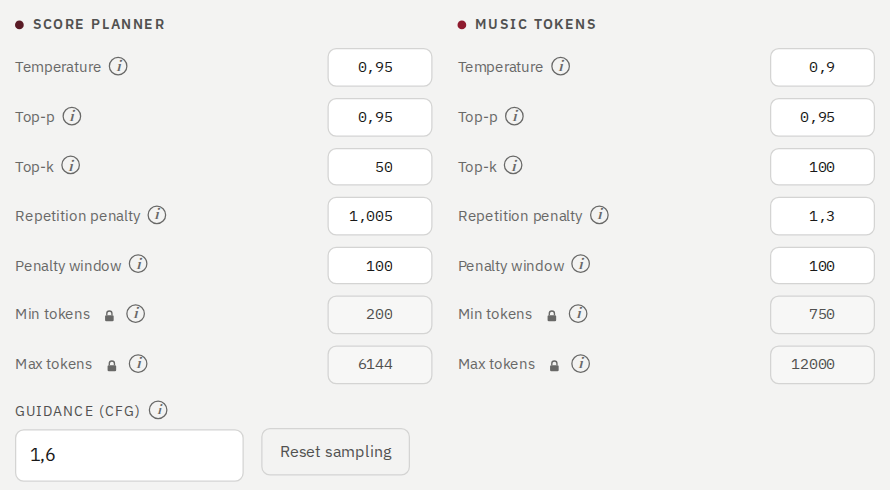

Типові значення налаштовані. Три ряди **форми** (Композиція, Виконання, Вплив стилю) рухають ручки разом, п'ятьма ступенями; самі ручки — нижче.

- **Планувальник партитури** і **Музичні токени**: температура, top-p, top-k, штраф за повтор, вікно штрафу.
- **Мін. токенів** і **Макс. токенів** **замкнені** від випадкової правки: клацни 🔒 поруч із назвою, щоб змінити їх, і ще раз, щоб замкнути. Нижні пороги — запобіжники: партитура не може закінчитися раніше за 200 токенів, музика — раніше за 750 (30 секунд; коротша замовлена довжина опускає поріг до неї). Максимум музики показано як **Макс. довжина**, часом (25 токенів на секунду), без замка: це найбільша довжина пісні, і задається вона тільки тут (у «Звук і вивід» поля довжини немає).
- Кожна ручка тримається в розумних межах; значення за ними повертається назад, і сторінка про це каже.
- **Ведення (CFG)**: ведення музики, тяжіння стилю на стадії музики; 1.6 типово в кожному режимі.
- **Ведення лірики**: власне в лірики, окремо від стилю: третя гілка, промпт без лірики, поруч із двома, що були у ведення завжди; 2.2 типово. Вухо Віктора на одній народній пісні: ведення 4.0 з лірикою 2.2 — найяскравіше, 3.0 з 2.2 — так само, 3.0 з 1.6 — своя глибина, лірика на 2.6 виводить уперед пісочну шумілку; на 1.6 слова тонуть, оксамитово розчиняючись. За рівних половина лірики йде в галюцинацію, губиться С і наголоси на голосних косять: тримай два ведення на 0.4–1.0 нарізно. Вогник біля кожного поля каже про це: зелений у його межах (музика 1.0–4.0, лірика 1.0–2.6, нарізно на 0.4 і більше), жовтий трохи далі, червоний далеко за ними; нічого не затискається. Порожньо — лірика йде за веденням, як раніше.
- **Звук і вивід**, нижній розділ того ж блоку: **Кроки розшумлення** і **Розв'язувач** для звукової половини, **Формат** (WAV 24 біти, 16 біт, 32 біти з рухомою комою або MP3 з його бітрейтом) і **Зріз піків**; *Скинути вивід* повертає їх. Із розв'язувачів *Midpoint · реліз* і *Heun* кличуть мережу двічі на крок, *Multistep · AB2* (Адамс — Башфорт другого порядку: бере в діло крок перед собою) раз на крок, а *Euler · чернетка* раз, першого порядку. Після них **Декод звуку**: *Уся пісня · стандарт* (типово й єдиний декод у всіх інших місцях Студії) або *Драбинка · експериментально*: звукова половина рівними шматками приблизно по 20 с, кожен чує 2 с за своїми краями, стики зведено кросфейдом; на тих самих кодах і сідах виходить близько до декоду всієї пісні, але не те саме.

**Консервативний рецепт для російської** (Віктора, на слух): Composition *low*, Performance *low*, Style influence *high*: планувальник партитури на температурі 0.85, top-p 0.92, top-k 40, музичні токени на 0.85, 0.93, 80, штрафи повтору 1.005 і 1.3 у вікні 100, ведення 1.6 і власне ведення лірики 2.2; 32 кроки розшумлення з Midpoint. Без пришвидшень, реп у помірному темпі. Це вбудований профіль *Musical Heresy of Creator's Ear*, його налаштовує Віктор: «Зберегти» поверх нього в профілях тримає його значення на Кузні, «Видалити» повертає ці.

### «Створити партитуру ABC» і «Створити» <!-- #create-abc-score-and-generate -->

- **Створити партитуру ABC** пише партитуру й зупиняється: прочитай її, поправ, і тоді *Створити* озвучить саме цю партитуру. Партитура, що вже є в полі, замінюється після запитання.
- **Проби** і **Варіації**, поруч із «Створити»: Проби — скільки проб, у кожній музика пишеться наново, у кожної свій музичний сід (seed, seed + 1…); рушій пише їх стільки за раз, скільки дозволяє його батч, решту — наступними проходами. Варіації — скільки разів звук кожної проби рендериться з її однієї музики, у кожної свій звуковий сід, однаковий для всіх проб: кожна коштує приблизно часу одного звуку, пам'яті майже не додає. Проби × Варіації — стільки семплів вийде: 2 × 4 = 8.
- **Створити пісню** виконує все. Запуск показує свої стадії по ходу.

### Вавилон у партитурі <!-- #babel-in-the-score -->

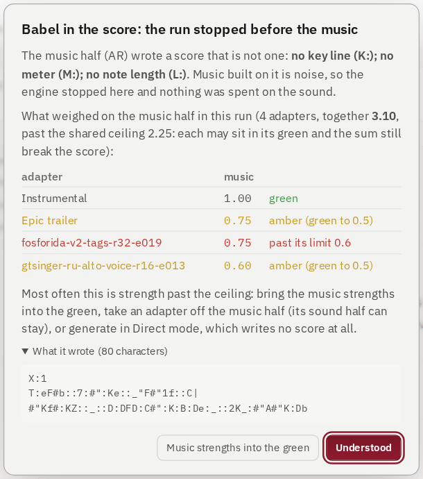

Коли музична половина пише сміття замість партитури (так чинять адаптери, підняті за свої межі: ні тональності, ні розміру, двокрапки поспіль), **рушій зупиняє запуск, перш ніж на ній буде створено бодай якусь музику**, за секунди замість хвилин. Вікно каже чому, які адаптери тиснули на музичну половину і наскільки за межами, показує, що було написано, і може одним клацанням повернути музичні сили в зелене.

### Семпл <!-- #the-take -->

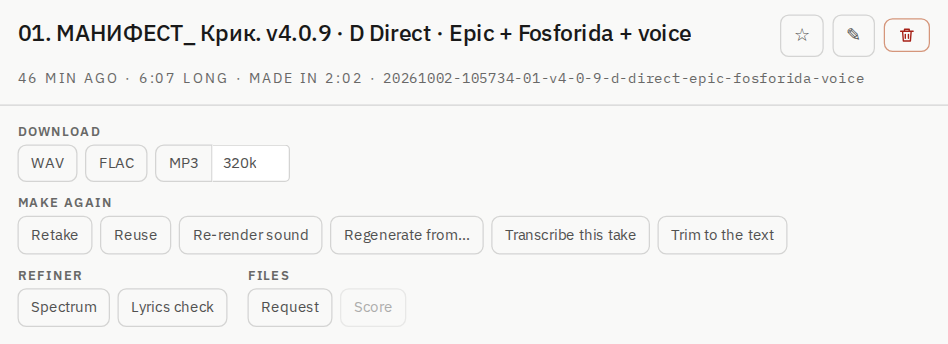

- **Шапка**: ▶ і кнопки семплу в першому рядку (👍 👎 ☆, Бібліотекар, перейменувати, видалити), а в його кінці ⇆ і ⤡, що піднімають фрейм над кімнатою; нижче назва в один рядок; ще нижче — як його створено.
- **Завантажити**: WAV, FLAC (ті самі відліки, близько трьох чвертей розміру), MP3 з бітрейтом, який ти обереш.
- **Створити ще раз**: *Новий семпл* (новий семпл із того самого запиту), *Взяти за основу* (запит назад у форму), *Перемалювати звук* (та сама музика, новий звук), *Перестворити з…* (лишити початок, решту написати наново), *Зняти партитуру з цього семплу*, *Обрізати по тексту* (відрізати хвіст після останнього проспіваного рядка), *End at…* (семпл закінчується в обрану мить, останні 2 с згасають; зі збережених латентів, за секунди), *Fade in…* (перші секунди семплу наростають із тиші, 2 с, якщо не сказати інакше; тим самим шляхом). *Подовжити…* зберігає весь дубль і веде його далі за кінець, ще на 0:15–2:00, з новими рядками після його власних, якщо ти їх даси (дубль, спланований за партитурою, продовжується в Direct: його партитура закінчується там само, де дубль).
- **Правити** (щоразу новий дубль; цей лишається): *Обрізати…* лишає відрізок від однієї секції до іншої; *Прибрати секцію…* виймає секції; *Повторити секцію…* грає позначені секції двічі, копію одразу за ними (останній приспів ще раз); *Вставити частину…* ставить копію однієї секції після іншої (вступ або програш як інтерлюдію); *Швидкість…* прискорює чи сповільнює, висота лишається. Усе по тактових лініях партитури (власної в дубля або написаної за його звуком), кожен стик загоєний коротким кросфейдом, партитура склеюється разом. Кожен із цих діалогів, як і діалоги з меню хвилі, показує хвилю дубля з позначеними відрізками: що копіюється, куди стає, що йде і що лишається, — слідом за твоїми позначками.
- **Огранювач**: *Спектр*, *Перевірка тексту*. **Файли**: запит і партитура. *Loop…*: 1, 2, 4 або 8 тактів по тактових рисках партитури від такту, де стоїть плеєр, без шва (кінець перетікає в початок), зберігається як WAV із темпом і тональністю в назві.
- **Нотатка**: що працює, що поправити, куди воно йде.
- Картка нижче каже, як семпл створено: режим, формат, VAE, модель, кроки, форма, LoRA з їхніми силами й хвилями, обидва сіди (скопіюй їх, щоб повторити).
- **Над кімнатою** (⤡) семпл стоїть у дві колонки: дії з ним, його стиль і лірика ліворуч; як його створено, його VAE і партитура праворуч. Новий семпл відкривається зі згорнутими Style і Lyrics; інструменти стоять групами в рамках.

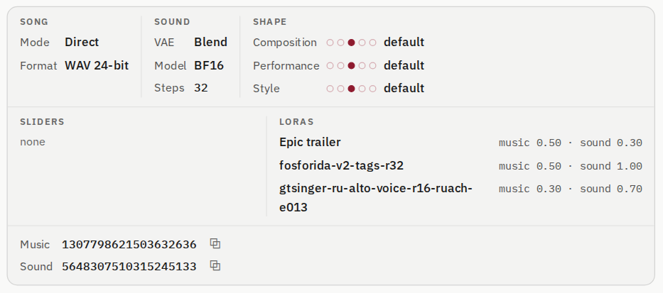

### Заміна секції <!-- #replace-a-section -->

Коли студія розмітила текст семпла на слух (секції намальовані на хвилі плеєра), одну секцію можна заспівати наново, а решту залишити як було. Правий клік по хвилі над секцією → **Замінити цю секцію…**.

- **Що співається**: кожна чітко почута секція — фішка; та, по якій ти клацнув, позначена, можна позначити й інші, до восьми. У кожної позначеної видно її рядки, як вони стоять у тексті: зміни слова або залиш їх, і тоді новою буде тільки музика. Діалог скаже, якщо в нових словах складів більше, ніж було в секції (модель заспіває їх швидше або вибіжить за зріз), або менше. **Заспівати наново** запускає.
- **Що приходить**: одна або дві версії, кожна — окремий семпл і дитя цього, з назвою за секцією та її відрізком («Song · Chorus 1:02–1:25 anew A»). Вони лягають у воркспейс семпла (у «Заміна секції», якщо той нових семплів не приймає) і з'являються в Семплах у міру готовності.
- **Як зшивається**: зрізи лежать у паузах, почутих довкола секції. Музика семпла до першого зрізу зберігається, секція співається на новому музичному сіді, стикується з власною музикою семпла після неї в токенах самої моделі, і все рендериться наново зі звуковим сідом семпла: те, що не замінено, звучить як звучало, і стиків не чути. Кілька секцій співаються по черзі, довжина не змінюється, тож дальші зрізи лишаються там, де ти їх почув.
- **На плеєрі** новий відрізок підфарбований і обведений, над ним «наново»; його картка каже, що решта така, якою її створив батько.
- **Найкраще лягають малі правки**: рядок з тим самим числом складів, слово, тег. Новий сід може й заспівати секцію без слів: слухай обидві версії. Перевірка, чи заспівала кожна версія свої слова, прийде в 2.1.0.
- **Заспівати ще раз…** і **Вставити програш після неї…** (те саме меню): секція співається ще раз одразу за собою, тут-таки або після близько 4 чи 7 с музики, варіацією на музичному сиді дубля + 1 (і + 2), а не копією; або після неї близько 5, 7 чи 10 с музики, без нового співу. Модель грає скільки хоче, тому студія ріже за голосом самої чернетки, виділеним на процесорі, і за тактовими лініями партитури: входять цілі такти її музики (із середини, якщо вона грала довше), і власна музика дубля після них іде у своєму ритмі. Нові дублі; цей лишається.
- **Переспівати цей рядок…** (те саме меню, над рядком): лише цей рядок співається заново на новому музичному сиді, його слова змінені або залишені, розріз посередині до сусідніх рядків; решта в дублі лишається як була. Де рядки зливаються без вдиху між ними, послухай обидві версії.
- **Заспівати вікно наново…** (те саме меню, будь-де на хвилі, секції не потрібні): відрізок, який ви кладете протягуванням по хвилі дубля, співається наново зі своїми адаптерами: спершу це адаптери самого дубля, у кожного своя сила музики й звуку та своя хвиля по вікну (рівно, арка, підйом, спад), можна додати й інші з вашої теки loras/. На розтяжках до і після вікна (по 2 с спочатку) адаптери дубля поступаються адаптерам вікна й назад, тож зміна входить і виходить, а не клацає; решта дубля лишається як була й рендериться наново на його власному сиді звуку. Одна чи дві версії, діти дубля, на плеєрі позначені як замінена секція.

### Партитура <!-- #the-score -->

План семплу як нотний стан або як ABC: друк у PDF (US Letter, книжкова чи альбомна), експорт MIDI або маркерів, *Правити й перемалювати* або відкрити на весь екран.

## Письменник <!-- #writer -->

### Пісні як документи <!-- #songs-as-documents -->

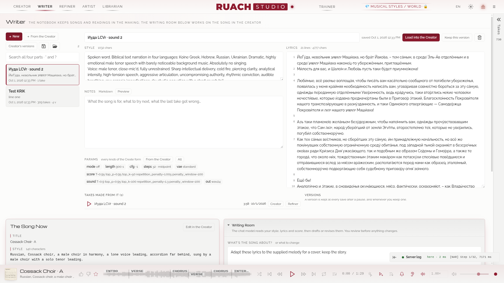

Кожна пісня може жити в Письменнику як документ: її **стиль**, **текст**, **нотатки** (Markdown, з переглядом) і **параметри** (кожна ручка форми Творця). *Новий*, *З Творця* (форма як є), *Завантажити в Творця*.

- **Версії**: *Зберегти цю версію* в будь-який момент; *Повернути цю версію* або взяти її *Як новий документ*.
- **Ширина списку**: тягни край між списком і документом (← → з клавіатури, подвійне клацання — початкова ширина).
- **Семпли з неї**: кожен семпл, чий запит прийшов із цього документа.
- **Пісня зараз**: назва, стиль, тональність партитури, розмір і темп (стиль мусить із ними погоджуватися), текст; *Правити в Творці*.
- **Експорт усього** (дискета, *Export all*) і **Імпорт** (тека, *Import*): увесь записник одним файлом для бекапу — кожен документ із версіями, семплами з нього й кошиком; імпорт додає відсутнє, однакове лишає, а документ, що відрізняється, кладе поруч із тезком копією: нічого не перезаписується.

### Текстові профілі <!-- #text-profiles -->

Як вставлений текст стає готовим до читання: правила заміни по черзі (буквальні або регулярні вирази), потім форма (`[Intro]`, `[Verse]` на порожніх рядках, `[Interlude]` після довгих абзаців). *+ Правило*, потім **Спробувати на тексті** показує, що вийде, перш ніж ти збережеш.

### Кімната письма <!-- #the-writing-room -->

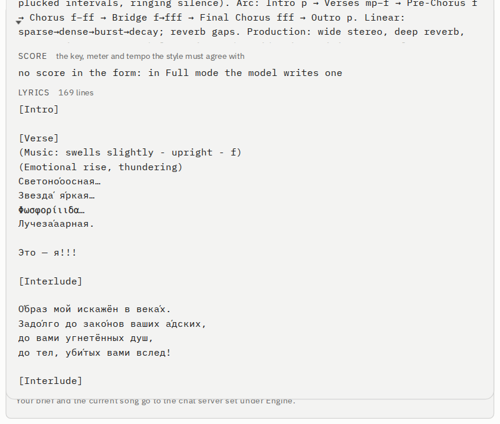

Чат-модель читає твій стиль, текст і партитуру, а потім пише чернетку або править їх. **Ніщо не змінюється, доки ти не застосуєш.**

- **Про що пісня?** або що змінити; **Допомогти з**: стиль, текст або обидва; **Структура**: порядок розділів для нового тексту.
- Модель: локальний чат-сервер (vLLM, LM Studio, Ollama: будь-що з чат-ендпоінтом `/v1`, задається в Рушії) або будь-яка модель OpenRouter з її API-ключем. Поле підказує весь список OpenRouter під час набору, у кожної моделі — ціна за мільйон токенів на вхід і на вихід і її контекст; ціна вибраної стоїть під полем, а ім'я, якого в списку немає, так і назване.
- *Створити чернетку*, потім **Застосувати чернетку**, **Взяти текст** або **Взяти стиль**; *Скасувати* повертає назад.

## Огранювач <!-- #refiner -->

### Після рендеру <!-- #after-the-render -->

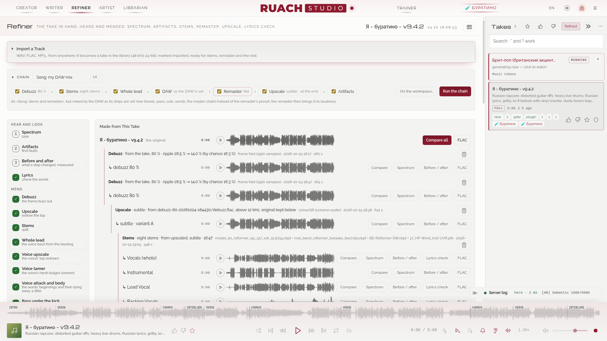

Обери семпл праворуч; інструменти діють на нього або на його стем. Колонка праворуч тримає **семпли, огранені тут**, найсвіжіша огранка першою (*Огранені* поруч з *Обраним* перемикає її на всі семпли, щоб почати новий), а після перезавантаження кімната повертається до семплу, який огранювала.

Кроки — ноди на полотні нижче, трьох родів за ходом справи: **Розбір** (Спектр, Артефакти, Текст), **Чистка** (Антигул, Апскейл, Стеми) і **Мастер** (DAW, Ремастер). Клацання по ноді відкриває її крок у вікні над полотном, а те, що створено із семпла, висить на його дереві. Власні кроки плагіна стають у **Мастер** із пунктирною рамкою (див. `docs/PLUGINS.md`). Крок плагіна з позначкою **GPU** іде на відеокарті завдань лабораторії, у їхній черзі, а крок, призначений для свого роду файлу (скажімо, стем голосу), сам бере джерелом останній такий файл, доки ти не обереш інший.

Усе, що створено із семплу, висить на його **дереві** (*Створено з цього семплу*), найновіше вгорі: спершу **оригінал**, зі своїм плеєром і своїм FLAC, далі кожна гілка — її можна грати й брати джерелом для наступного кроку. Те, що йде, видно там, куди дивишся: у шапці кімнати, вгорі блоку самого кроку і пульсуючою крапкою на його вкладці. Блок кожного кроку перелічує, що він створив для семплу (*Створено тут*: клацання знаходить це в дереві), а відкритий крок підсвічує свої гілки. **Видалити** в кінці шапки гілки забирає її до кошика семплу (із запитанням; гілка, з якої створено інші, питає ще раз і забирає їх із собою); **Кошик** під деревом повертає гілку, а **Очистити кошик** видаляє назавжди. У дерева своє місце в кінці колонки кроків Огранювача: **Створено з цього семплу** під *Цей семпл*, на його мітці число гілок; клац відкриває його там, де стоїть крок, і воно підсвічує гілки кроку, з якого ти прийшов. Усе, що йде на Кузні, ще й показує свою смугу над плеєром у будь-якій кімнаті, з часом, що лишився. Якщо в **Audio I/O** збережено монітор (другий вихід на Кузні), кожен рядок має **На Кузні**: файл грає через нього з того місця, де стоїть його плеєр, а повторне клацання зупиняє.

**Порівняти всі** (у рядку оригіналу, або *Порівняти* на будь-якій гілці) відкриває кожну версію в одному плеєрі, як SUNO перемикає версії: оригінал, після антигулу, ремастери, апскейли, стеми. Клацання на іншій версії або її номер (1–9) грає її **з тієї самої секунди**; Пробіл грає й ставить на паузу, ← → зсувають на п'ять секунд, Esc закриває. Там само, після оригіналу, стоїть та сама музика в інших семплах: її перемальовані версії з іншим VAE чи звуковим сідом, у кожної підписані VAE, сід і час; невподобаний семпл не показується. З **Рівною гучністю** (увімкнена, доки не вимкнеш) кожну версію притишено до гучності найтихішої, виміряної на Кузні, і її рядок це показує: вухо порівнює звук, а не рівень.

### Імпорт треку <!-- #import-a-track -->

WAV, FLAC, MP3… звідки завгодно: він стає семплом у бібліотеці (48 кГц, 24 біти), з позначкою *імпортований*, готовий до стемів, ремастеру й решти. Текст необов'язковий; перевірка тексту звіряє з ним.

### Кроки <!-- #the-steps -->

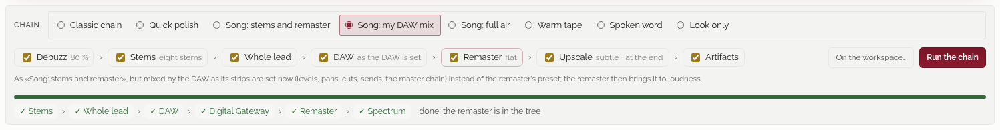

Готового ланцюжка немає: шлях семпла ти проводиш полотном сам, від ноди до ноди (див. *Свій шлях* нижче), або починаєш із пайплайна, а **Прогнати шлях** у шапці кімнати його проганяє. На шляху, що ріже стеми із семпла після Антигула (і Апскейла), ремастер їх зводить, тож його пресет і де-есер діють і там; апскейл до розділення дає розділювачам почути всю пісню, а апскейл наприкінці наново малює верх, який лишають стеми й ремастер (шипіння вище 20 кГц, майже нічого вище 22). По одному:

1. **Спектр**: спектрограма, середній спектр, енергія смуг; наклади інший семпл, щоб порівняти.
2. **Артефакти**: тон, що не йде геть, 25-кадровий гул VAE у верхах, клацання, кліпінг, провали, стерео, що бореться саме з собою. Клацання по часу грає з того місця.
3. **Антигул**: декодер YuE2 пише звук кадрами по 1920 відліків, 25 за секунду, і його верхи тремтять разом із ними. Цей крок вилучає ту частину, що прив'язана до цього кадрового годинника, вище 2 кГц. 80 % — вибір вуха; 100 % стоншує початок.
4. **Текст**: Whisper слухає і звіряє почуте з твоїм текстом, хвилина за хвилиною; *Розмітити рядки за часом* — для таймінгу караоке. На вокальному стемі він чує слова без музики. Розмічені рядки завантажуються як .lrc і .srt, а також як **.lrc (по словах)**, де кожне слово має свій час, — для плеєра, що підспівує (рядки лишаються твоїми; від Whisper лише час).
5. **Стеми**: чотири стеми (BS-Roformer для голосу, далі htdemucs_ft для ударних, баса й решти; і інструментал), шість стемів (той самий голос, далі BS-Roformer-SW від jarredou: ударні, бас, гітара, піаніно й решта), вісім стемів (шість, де голос ділить надвоє караоке-модель, **Lead Vocal** і **Backing Vocals**, а духові вийнято з решти) або вокал + інструментал. Кожен стем має своє ім'я (Lead Vocal, Drums, Winds…) у дереві, у завантаженні й у твоїй DAW. *Джерело* — сам семпл або його файл після Антигулу чи Апскейлу, у кожного джерела свій набір; у твій DAW іде найновіший набір кожного виду.
6. **Ремастер**: зведи стеми або візьми семпл; очищення, деесер, за бажання перестроювання 440 → 432 Гц, гучність (LUFS) і справжній пік. Кожен запуск — нова гілка. Пресет і деесер діють на стеми, перш ніж їх зведено: коли джерело — семпл чи будь-який окремий файл, вони вимкнені, а на шляху діють, коли він ріже стеми. **Забарвлення** кладе під пісню шар до гучності: вініл, стрічка, кімната, касета (її шипіння, плавання й детонація), радіо (смуга старого радіо, моно, з тріском ефіру) або зала, на −60…−20 дБ під нею; касета й радіо змінюють і саму пісню.
7. **Апскейл**: UniverSR малює верх спектра наново; оригінал лишається відлік у відлік нижче частоти зрізу. На ремастері (останній крок шляху) весь файл стишується, якщо новий верх перевищує стелю справжнього піку ремастеру.
8. **Цифровий шлюз**: семпл або будь-яка гілка через аналоговий характер у цифрах на Кузні: стрічка (30, 15, 7.5 або 3.75 ips: горб голівки, верх, шипіння, детонація, азимут), пульт, лампа (з просіданням), трансформатор або вініл (низи в моно, тріск, гуркіт). Крива йде з передискретизацією; результат такий самий гучний, як прийшов, його справжній пік під −0.3 dBTP, а дерево каже, що він додає до тону −12 dBFS. Стартові точки ставлять характер одним клацанням; його гілка може стати джерелом аналогового шлюзу або Ремастера.
9. **Голос цілком**: на наборі з восьми стемів там, де розділення відвело провідний голос у Backing Vocals (там він гучніший, ніж у провідному, достатньо гучний і стоїть по центру), його повернуто в Lead Vocal з короткими спадами. Провідний і бек-вокал разом лишаються тим, чим були, відлік у відлік: мікс не змінюється, змінюється лише те, який стем тримає голос. Обидва приходять версіями своїх стемів для DAW і наступних кроків шляху; дерево каже, де голос повернуто і на скільки секунд.
10. **Апскейл голосів**: UniverSR лише на голосових стемах (провідний і бек-вокал або сам провідний) малює наново повітря, подих і край приголосних, які притупили розділювачі; решта нижче частоти зрізу лишається відлік у відлік. Кожен приходить на частоті свого набору версією свого стема. Його **Апскейлер** — сам UniverSR (типово) або зв'язка трьох, UniverSR, Apollo-vocal і FlashSR, змішана вище зрізу: середнє (за виміром найближче до власного верху голосу), найгучніший або повітря (середнє до 16 кГц, найгучніший вище); **Намальований верх** піднімає чи опускає намальоване. Ним користуються пайплайни *Голоси: м'яко, нормально, сильно, повітря, яскраво*. Apollo-vocal некомерційний (CC BY-NC-SA 4.0): піснею з ним можна ділитися, але не продавати її; FlashSR приходить під час першого використання: ваги з моделей самої Студії (Apache 2.0, як сказав автор), код від автора.
11. **До і після**: будь-який файл дерева проти того, з чого його створено (мікс або ремастер стемів — проти файлу, з якого стеми розділено; семпл, коли більше нічого), зі своєю кнопкою біля кожного файлу: гучність, істинний пік, діапазон гучності, пік-фактор, ширина, кореляція і частка чотирьох смуг поруч, середні спектри за рівної гучності та їхня різниця, короткочасна гучність через усю пісню; картинка й сторінка чисел лягають у дерево.
12. **Припасування до зразка**: тон файлу зсувається до тону зразка (файлу дерева цього семпла або іншого семпла), гучність осторонь: до восьми власних смуг DAW (частота, підсилення, Q), кожна лишається, лише якщо допомагає й не виходить за задану межу. Файл приходить із тим самим еквалайзером, відмальованим, гучністю як прийшов або як зразок і ніколи вище −1 dBTP; **На мастер DAW** біля його гілки ставить смуги на еквалайзер мастера, щоб чути їх наживо на твоєму міксі.
13. **Моно в низах**: нижче частоти (120 Гц, якщо не обереш іншу) сторона стерео прибирається без зсуву фази, середина лишається як була: бас і бочка стають у центр, а стерео вище живе там, де жило. Перший інструмент Шаумарова на шині інструментів і на мастері; гілка каже, яка частка низів була стороною до і після.
14. **Склейка піків**: м’який компресор раніше за все інше: лише гучні місця втрачають попрошені дБ (3, якщо не обереш інше), найгостріші транзієнти проходять, і файл повертається тієї ж гучності. Стелі він не тримає: це справа наступного кроку.
15. **Стеля true peak**: останній крок шляху: лімітер із пересемплінгом і зазиранням уперед тримає −0.5 дБTP (або −0.3, −1), це перевіряє вимірювач true peak. *як прийшла* лише ловить перевищення на власній гучності файлу; ціль за гучністю (−14, −11, −9 LUFS) вганяє в нього, не більше 6 дБ лімітування.
16. **Приборкувач голосу**: на стемах голосу там, де спектр голосу цієї миті здувається над власним ходом (резонанс, різкий обертон: вовк у голосі), горб опускається на частину того, наскільки стирчить, — не більше 4 дБ, якщо не обереш інше, з плавним входом і виходом; за замовчуванням лише те, що піднімається над звичною барвою самого голосу, і нічого нижче 2.5 кГц, де живуть голосні. Чого не стирчить, того не торкається; дзвінка «с» м'якшає там, де дзвенить, і ніколи не коротшає; одне підсилення на обидва канали тримає голос там, де він стояв. soothe2 і SpecCraft Шаумарова як підказка; гілка каже, скільки часу він тримав і де.
17. **Атака й тіло голосу**: на стемах голосу початки слів трохи піднімаються (не більше 2 дБ), згасання звуку теж трохи (1.5 дБ); протяжна голосна й тиша лишаються як є: голос виходить уперед без стиснення компресора. Два транзієнтні компресори Шаумарова на голосі як підказка.
18. **Бас під бочку**: бочку знайдено на стемі барабанів; поки вона звучить, нижня октава стему басу (нижче 120 Гц, якщо не обереш інше, поділ без зсуву фази) опускається до 3 дБ — настільки, наскільки гучна бочка; між бочками й вище поділу бас такий, яким був. Потрібен набір, де барабани й бас окремо; soothe2 Шаумарова з ключем від бочки як підказка.
19. **Деталі вгору**: три смуги; у кожній тихі місця піднімаються до її власного гучного рівня, гучні донизу не тиснуться ніколи, підлоги й хісу не торкається; підмішується на 10 %, як Шаумаров бере OTT, і повертається до гучності, з якою прийшов: піднімається деталь під гучними місцями, а не рівень.
20. **MIDI**: MuScriptor (Mirelo і Kyutai) записує дубль або будь-який файл його дерева нотами: MIDI-файл із доріжкою на кожен почутий інструмент (34 іменовані групи й ударні; сили натискання модель не дає, кожна нота на 100). Його завантажують із дерева або з паспорта дубля, а **Відкрити в піано-ролі** кладе його в партитуру Творця (тональність вгадано за нотами, голос у Vocal, лінія інструмента в Ins). Стем дає лише свій інструмент. Три розміри завантажуються в Рушій → Моделі й LoRA → Звук у MIDI; на процесорі пісня на чотири хвилини займає близько півтори хвилини на малій, три на середній і одинадцять на великій. Ваги MuScriptor під CC BY-NC 4.0: лише некомерційне використання.
21. **Амбієнт**: камін, дощ, гроза, ліс, водоспад, гірська річка, тропічні птахи або канарка під піснею — окремою доріжкою в DAW зі своїм фейдером; створений знову, він стає версією цієї доріжки. *Записи* — польові записи з банку студії (models/ambient), закільцьовані без шва, перший і другий у кожному шарі обрано на слух; *Синтез* — лише для легкого дощу й грози. Шар стоїть під піснею на задані dB там, де звучить, плавно входить і виходить, може дихати разом із піснею, а у вступі стояти ближче й відходити під голос, коли той вступає; грім б'є по черзі близько й далеко — на піках пісні або врозкид. *Лише вільні* (увімкнено) грає тільки записи, автор яких сам поставив вільну ліцензію (CC0 або знак суспільного надбання). Без банку звучить лише синтез.

**Пайплайни.** Поруч із **Прогнати шлях** стоїть шлях у руках: **Мій шлях** або пайплайн як початок. Студія приносить *Швидке полірування*, *Пісня: стеми й ремастер*, *Пісня: мій мікс у DAW*, *Пісня: усе повітря*, *Тепла стрічка*, *Читання* і *Лише погляд*, а плагін може принести свої. Пайплайн намальовано на полотні від ноди до ноди; *Обійти на шляху* в меню правої кнопки ноди пропускає його крок. Кожен крок бере те, що дав попередній: файл або набір стемів, виправлений до цього місця, тож Ремастер і DAW зводять голос цілком і наново намальовані голоси, а не стеми, як вони розділилися. *Як виставлено DAW* бере мікс, який DAW тримає для цього семпла. Дроти пайплайна можна різати й тягти наново, як дроти свого шляху: перший розріз чи дріт перетворює його на **Мій шлях**.

**Багато семплів.** Спершу налаштуй шлях на одному семплі; потім **Кошик** поруч із **Прогнати шлях** тримає до десяти семплів, на яких його прогнати: **+ Семпл у руках** кладе туди семпл у руках, меню Бібліотекаря кладе позначені семпли (**У кошик Огранювача**), ✕ прибирає один, **Спорожнити** очищає його, а **Прогнати шлях на N** проганяє шлях у руках по них один за одним на Кузні, спершу спитавши. Рядок пакета поруч каже, скільки готово, що не вийшло і який семпл у руках; **Зупинити** дає закінчити цей семпл і пропускає решту.

### Полотно: ноди й дроти <!-- #the-canvas-nodes-and-wires -->

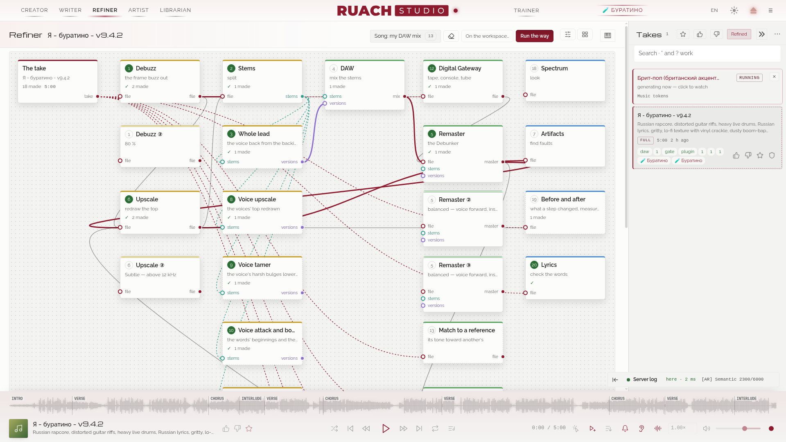

Огранювач — полотно нод, як у ComfyUI: семпл і кожен крок стовпцями за ходом справи, з'єднані так, як іде звук, а внизу ліворуч те, що їх живить, — Імпорт треку й Audio I/O; угорі крайнього правого стовпця **Створено з цього семплу**, його вікно — дерево всіх файлів, створених із семплу. Вибраний чи намальований шлях іде його верхом: спершу семпл, потім кожен крок за порядком, кожна перевірка — поруч з останнім кроком або під тим, від якого відходить; те, що поза шляхом, стоїть під ним стовпцями, приглушене, а потік, вибраний зі списку, розкладає полотно наново за своїм шляхом. В Audio I/O — вихід, вхід і частота аналогового шлюзу та його **Тест петлі**; легенда дротів стоїть на вільному місці між ним і семплом. Полотно — вікно заввишки в залишок кімнати над світом, де стоять ноди: коліщатко рухає його (**Shift** — убік), так само й перетягування по порожньому місцю; **Ctrl+коліщатко** масштабує його від 50 % до 200 % довкола вказівника замість сторінки; **⤢** у його куті показує його цілком, а відсотки поруч повертають 100 %. Ноди пронумеровано за ходом справи, спершу кроки шляху, і **1…9, 0** відкривають ноду з цим номером, а дві цифри поспіль у межах пів секунди — ноду після десятої (**1**, потім **2**: дванадцяту); кожна нода під вказівником каже, для чого вона. Клацання відкриває ноду у вікні поверх полотна, завбільшки з те, що в ньому; **Alt+← →** — крок до і після, **Esc** — назад; нода семплу відкриває Семпли, щоб узяти інший. Ноду можна перетягти куди хочеш: вона прилипає до сітки полотна з кроком 10 px. Іконка сітки в шапці кімнати, **Розкласти**, розставляє їх наново. **Ctrl+перетягування** рамкою по порожньому місцю виділяє ноди, яких вона торкається (з **Shift** — додає до виділених), а **Ctrl+клацання** додає чи прибирає одну ноду; потягни одну з виділених — решта поїде з нею; клацання по порожньому місцю або **Esc** знімає виділення. Крок, який шлях жене зараз, дихає бурштином, його верхньою крайкою біжить іскра, а дріт шляху в нього тече. **Ctrl+M** глушить виділені ноди або ту, що під вказівником, як у ComfyUI: заглушена нода сіра, не запускається зі свого вікна, і шлях зупиняється перед нею; **Ctrl+B** обходить їх на шляху. Легенду можна перетягти куди зручно (**Розкласти** повертає її на місце); згорнута, вона — кругла **?** унизу ліворуч на полотні.

**Нода, що йде.** Під її словами смуга: її рухає власний поступ кроку, коли його задача про нього каже, і час, що лишився, рахується з цього руху; інакше темп, який такий крок тримав раніше на пісні такої довжини (так і сказано), а коли крок іде довше, смуга стає смугастою; уперше вона лише дихає й рахує час. **■** поруч зупиняє шлях там, де він стоїть, спершу спитавши: процес кроку закінчується зараз, кроки після нього лишаються, створене раніше лишається.

**Права кнопка** на ноді: *Відкрити*, *Прогнати до цієї ноди* (шлях до цієї ноди й не далі, обійдений на ньому крок пропускається), *Обійти на шляху* (її крок пропущено, нода сіріє), *Перевірити шлях до цієї ноди*, *Призначити ціллю*, *Зняти зі шляху*, *Клонувати* і *Розкласти*.

**Свій шлях.** Шлях малюєш ти. Нова Студія починає з одного семпла: тягни дріт від його точки на перший крок, потім від точки цього кроку на наступний; Студія, де проганявся старий ланцюжок, знайде його тут як свій перший **Мій шлях**. Клацання по дроту шляху розрізає його там, і кроки після розрізу сходять зі шляху. Дріт, протягнутий від точки однієї ноди на іншу, ставить цей крок одразу за нею (від точки семплу — першим), а найновіший файл першої стає **Джерелом** другої. *Зняти зі шляху* виймає один крок і змикає кроки довкола нього. Так намальований шлях — це **Мій шлях**, поруч із пайплайнами, і зберігається він у цьому браузері; **Новий шлях**, гумка поруч, спорожнює його, щоб малювати з нуля; **Ctrl+Z** повертає шлях, яким він був до останнього розрізу, дроту чи спорожнення. Шлях починається з одного з двох джерел: із семплу або з **Імпорту треку**. Шлях, проведений від імпорту треку, сам проганяється на кожному наступному імпортованому треку. Шлях без жодного кроку нічого не жене й каже про це.

**Слоти й дроти.** Входи ноди підписано ліворуч, виходи праворуч, як слоти ComfyUI, трьох класів: файл (бурштиновий), набір стемів (бірюзовий), один стем (фіолетовий). Дріт виходить зі слота свого класу й входить у слот, що його приймає, і має його колір: DAW приймає стеми й версії голосів і віддає мікс; крок на одному стемі бере його з набору. Шлях намальовано жирно; що з чого створено — тонко; власне джерело кроку — пунктиром і лише поза шляхом; поки тягнеш дріт, видно дороги, якими він може піти, і світяться лише ноди, здатні його прийняти. Дріт від кроку поза шляхом ставить його туди, де стоїть його рід (після Стемів, а нема їх — Стеми ставляться теж), а інший — слідом; дріт у DAW ще й ставить його доріжкам найновіші файли того кроку. Легенда в куті полотна каже те саме й згортається.

**Перевірка й ціль.** *Перевірити шлях до цієї ноди* малює шлях, як він тече до цієї ноди, і звіряє кожен крок із тим, що до нього приходить: набір стемів для кроку, що їх зводить, стем, який крок лагодить, інтерфейси в Audio I/O для кроку, що йде через залізо. Нічого не запускається: дротами біжить потік, кроки, що витримали, зеленіють, а перший, що не витримав, червоніє й каже чому. *Призначити ціллю* мітить ноду знаком ◎: тоді **Прогнати шлях** жене до неї й не далі, і перевірка йде до неї; *Прибрати ціль* знімає мітку.

**Клони.** *Клонувати* ставить поруч другу ноду того самого кроку, скажімо «Ремастер ②», зі своїми налаштуваннями: її вікно — панель кроку з налаштуваннями клону, при закритті повертаються налаштування самого кроку, а прогін звідти йде з налаштуваннями клону. Шлях проганяє налаштування самого кроку, ніколи не клону.

**Профілі.** Іконка повзунків у шапці кімнати зберігає сетапи за іменем. **Зберегти як…** запам'ятовує, як стоїть кожен крок і де стоять ноди, але ніколи не джерела семплу й не точки зрізу; клацання по імені профілю ставить усе так, як поставила б рука; **Зберегти сетап як зараз під** перезаписує профіль нинішнім сетапом, **Видалити** прибирає профіль. Зберігає їх студія, тож їх бачить будь-який браузер. Профіль, поставлений або збережений останнім, — у руках, а крапка на іконці каже, що полотно відтоді змінилося. **Ctrl+S** зберігає шлях як є: поверх профілю в руках, якщо скажеш, або під новою назвою (**Ctrl+Shift+S** завжди питає назву); інший профіль поверх незбережених змін спершу питає. У кожного потоку своє розкладення: обери зі списку інший, повернися — ноди там, де ти їх поставив.

Кожен вибір на виду, без випадних списків: до восьми — стовпцем рядків (короткі — в ряд), більше — за кнопкою, що відкриває список поверх сторінки, з фільтром, коли він довгий.

**Згортки.** **▾** на смузі завдань згортає її до першого завдання й числа решти.

### DAW: стеми на доріжках <!-- #the-daw-stems-on-lanes -->

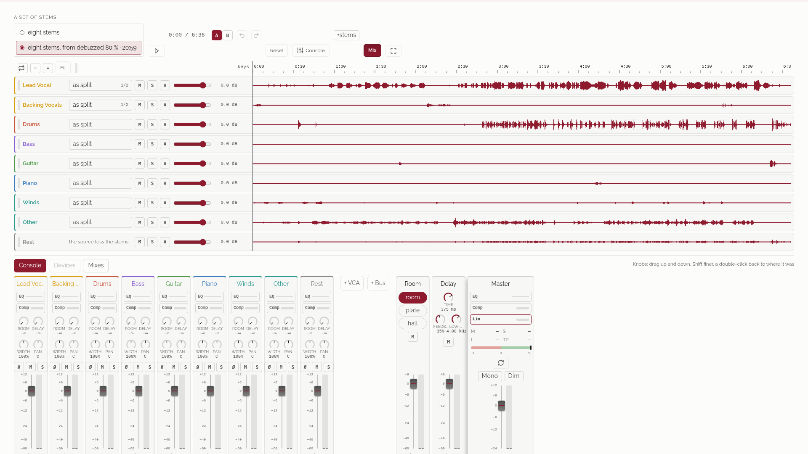

**Попередній перегляд.** Крок **DAW** (у групі **Мастер**, перед Ремастером) розкладає набір стемів семплу по доріжках, як у DAW: кожен стем — своя доріжка, і ще одна, **Решта**: те, що джерело тримає понад стеми (що розділення пропустило). Усі доріжки як є дають назад саме джерело, тож хиби розділення чутно лише там, де ти змінюєш мікс. Кожна доріжка має колір того, що в ній: голоси бурштинові, барабани червоні, бас фіолетовий, гітара зелена, клавішні сині, інше сіре.

На кожній доріжці: її **Версія** (стем як розділено або файл, створений із нього, скажімо очищений голос), рівень від −60 до +12 дБ (подвійний клац повертає 0), **M**, щоб заглушити її, і **S**, щоб лишити її соло, і вимірювач під час гри. Протягни вздовж хвилі, щоб заглушити відрізок; правий клац по ньому повертає звук, клац грає звідти. Усе чутно одразу, усі доріжки на одному годиннику, відлік у відлік, так, як буде зведено. **Скинути** повертає кожну доріжку до розділеної, повернення й мастер теж. **A** бере в руки лінію гучності доріжки: клац по хвилі ставить туди точку й тягне її, правий клац прибирає, подвійний ставить її на 0 дБ; гучність чутно й зводиться після фейдера, прямо в дБ від точки до точки. Клац по версії перемикає на наступну, так дві порівнюються на ходу; правий клац показує всі в пристроях каналу. Верхні кути заглушеного відрізка задають згасання в тишу й вихід із неї, наскільки протягнеш (подвійний клац повертає десять мілісекунд), а його краї пересувають його.

**Лінійка** над доріжками: клік переносить туди, протяжка малює петлю й вмикає її, і петля грає по колу, доки **L** її не вимкне. **Ctrl+коліщатко** наближає довкола вказівника, **Shift+коліщатко** веде вздовж пісні, **−**, **+** і **Вписати** ліворуч від лінійки — те саме кроками; вид іде за точкою відтворення. Клік по імені доріжки вибирає її для клавіш (див. *Гарячі клавіші й хитрощі*). Під часом — секції пісні, як їх розмітив плеєр (теги самої лірики, розставлені Whisper): клац по секції веде до її початку, подвійний клац закільцьовує її, **[** і **]** ведуть до секції до й після.

Власна кнопка DAW «на весь екран» кладе її поверх усього вікна, доріжки такої висоти, яку дає екран; **F11** на вкладці студії — те саме, поки DAW на виду. **Esc**, **F11** або та сама кнопка повертають назад.

**Консоль** під доріжками (кнопка **Консоль** у смузі DAW показує й ховає її) — це мікшерний пульт: кожна доріжка — канал, далі два повернення, **Кімната** й **Ділей**, і **Мастер**, завжди видний праворуч. Канал згори вниз: ім'я (клац відкриває його пристрої), вставки (**EQ** з маленькою кривою, **Комп** із придушенням під час гри), посили в кімнату й ділей, ширина й панорама, **Ø** для полярності, **M** і **S**, і фейдер із вимірювачем на одній шкалі: пік і RMS обох сторін, пік, утриманий на мить, і під ним найгучніший пік від останнього скидання (клац скидає). **+ VCA** після каналів додає VCA, один фейдер над групою каналів (вибраний канал — перший учасник): його фейдер додає свої дБ до власного фейдера кожного учасника, а ті лишаються на місці, його **M** глушить їх, а **S** лишає тільки їх; у його пристроях — ім’я та учасники, і канал може бути в кількох групах.

Ручки й фейдери: тягни вгору й униз (**Shift** тонше), коліщатко або стрілки, коли ручку вибрано; подвійний клац повертає її як було. Число ручки чи фейдера приймає й набране значення: клік по ньому або цифра, поки ручку вибрано, відкривають поле; Enter ставить його в її власних одиницях (дБ, Гц з k для тисяч, мс або s, %, 4:1, L30 чи R30, −∞ для посилу), Esc лишає як було. **Ctrl+Z** скасовує, а **Ctrl+Shift+Z** повторює, увесь мікс крок за кроком. **A** і **B** тримають два мікси набору, щоб порівнювати на ходу: B починається копією A, а виставлене йде в той, що світиться.

**Мікси**, третя вкладка консолі: мікс, який ти виставляєш, зберігається на Кузні поруч зі стемами набору за мить після того, як рука зупинилася, тож DAW відкривається як ти її лишив у будь-якому браузері, на будь-якій машині; **Зберегти як** зберігає його під ім'ям, клац по імені повертає його (за ним Скасувати), а **✕** видаляє мікс, коли скажеш. Де Кузня його не зберегла, вкладка каже чому.

**Пристрої** каналу (клац по його імені, по **EQ** або по **Комп**): **Вхід** (трим, полярність, версія стема), **EQ** (до восьми смуг: дзвін, полиці НЧ і ВЧ, зрізи НЧ і ВЧ, режекція; подвійний клац по кривій додає туди смугу, точку тягни, коліщатко над нею задає ширину, правий клац прибирає; за кривою — власний звук каналу, поки він грає), **Компресор** (поріг, ступінь, атака, відновлення, коліно й компенсація, п'ять точок відліку, його крива й придушення) і **Вихід** (ширина, панорама, посили). У **Кімнати** три простори, кімната 1,2 с, пластина 1,6 с і зала 2,4 с, і її повернення; у **Ділею** час (у мс або нотою в темпі), зворотний зв'язок, ФНЧ, що темнить кожне відлуння, і його повернення. **Мастер** показує гучність під час гри за BS.1770 (миттєву, коротку, інтегральну від натискання ▶), true peak, кореляцію сторін і спектр. **Моно** й **Тихіше** під мастером змінюють лише те, що ти чуєш, але не мікс. **Слухає** у компресора прив'язує його до іншого каналу, яким той входить у свій компресор, а **Під голос** прив'язує канал до провідного голосу: група присідає під вокалом. Пристрої мастера малюють і гоніометр: середина вгору, боки впоперек. Пристрої **Мастера** тримають його ланцюжок у порядку ходу звуку: **EQ**, **Компресор** (він слухає сам себе) і **Лімітер** (лімітер Plenio із зазиранням уперед: стеля, натиск, відновлення), потім його фейдер; канал мастера показує їх слотами, кожен зі своїм придушенням, поки грає. **Суміш** компресора — паралельна компресія: його звук разом із сухим, 100 % — лише компресор; початкова точка **Паралельно** ставить 40 %, мікс на Кузні так само. **Гейт**, третя вставка на кожній смузі, — низхідний експандер проти протікання, яке розділення лишає між фразами: він слухає саму смугу після її еквалайзера; нижче рівня **Поріг** він опускає її із силою **Ступінь**, але не глибше, ніж **Глибина**; мікс на Кузні так само. У кожного повернення є також **Зріз НЧ** і **Зріз ВЧ** (на 20 Гц і 20 кГц вимкнені; на ділеї вони ріжуть усю його луну однаково, після зворотного зв'язку), а в кімнати — **Пре-ділей**, понад затримку самого простору: слово звучить чисто, перш ніж вступить його кімната; мікс на Кузні так само. У пристроях мастера поруч із ними ще два числа: LRA — діапазон гучності від початку відтворення за EBU Tech 3342 (наскільки гуляє короткочасна гучність), і PLR — істинний пік над інтегральною (що менше, то сильніше стиснуто); коли мікс зведено, його повідомлення називає й LRA рендера.

**Автоматизація не лише гучності.** **A** на доріжці бере лінію в руки, а фішка поруч каже, яку ручку малює лінія: **Гучн** (гучність, після фейдера), **Л–П** (панорама), **Шир** (ширина), **Кімн** і **Діл** (посили в кімнату й у ділей); клацання переходить до наступної. Клацання по хвилі ставить точку й тягне її, права кнопка прибирає, подвійне клацання дає їй спокій ручки (0 dB, центр, як є, нічого). Ручка з лінією грає свою лінію замість свого значення, наживо й у міксі, прямо між точками.

**Інсерти й Друк.** У **Вході** доріжки є **Інсерт**: версія доріжки, як вона звучить, через **Цифровий шлюз** (стрічка, пульт, лампа, трансформатор, вініл) або крок плагіна на файлі, на Кузні. Те, що повернулося, стає новою версією доріжки й одразу звучить так, як буде зведено, а версії зберігають шлях назад. **Друк** мастера надсилає мікс, як його тримає DAW (його версії й кожну ручку), через Цифровий шлюз: гілка в дереві поруч із власними міксами DAW.

**Аудіошини.** **+ Шина** на пульті створює шину з обраної доріжки: звук її учасників (після їхньої панорами; посили й далі йдуть з їхніх власних доріжок) сумується й іде через власні еквалайзер, компресор, фейдер, ширину й панораму шини в мастер. У її пристроях обирають учасників (доріжка йде в одну шину; доріжка з іншої шини переходить сюди), ім'я, еквалайзер, компресор і вихід; **M** глушить їх усіх. Мікс на Кузні сумує їх і веде так само.

**Перенесення й копія.** **Shift** і протягування по доріжці обирають відрізок (просте протягування, як і раніше, глушить). **Ctrl+C** копіює його, **Ctrl+X** бере для перенесення, **Ctrl+V** кладе біля курсора на його ж доріжці: те, що там було, замінюється з кросфейдами по 10 мс, відрізок малюється зі своєю хвилею, а в перенесеного джерело замовкає (наступний Ctrl+V кладе копію). **Delete** глушить обраний відрізок, **Esc** відпускає його, права кнопка на покладеному відрізку прибирає його; скасування повертає все це. Покладений відрізок лягає поверх вирізок доріжки, і мікс на Кузні кладе його так само.

**Еталон, вогник соло і фейди пісні.** **Ориг.** на панелі DAW (або **R**) грає звук як був, той, з якого розділено стеми, замість міксу й тієї ж гучності, що мікс, на зіграному відрізку, тож порівнюється звук, а не рівень (гучніше завжди здається кращим); кнопка каже, на скільки його піднято чи опущено, **Моно** й **Тихіше** чують і його, а друге натискання повертає мікс. Поки якась доріжка в соло, на панелі світиться **S · n**, скільки доріжок чутно, адже **Звести** зведе лише їх: клік по ньому або **Alt**+клік по будь-якій **S** — і знову чутно всі доріжки. У приладах **мастера** — **Наростання і згасання** пісні: **Наростання** піднімає її від −60 дБ, **Згасання** опускає до −60 дБ перед кінцем, а **Закінчується на** ставить кінець на курсор (після нього тиша; **На кінці пісні** повертає кінець). Фейд лінійний у дБ, іде після фейдера мастера, малюється темним поверх доріжок, і мікс на Кузні має його так само.

Що чуєш, те й зводиться: ті самі смуги EQ, той самий компресор Plenio (у звуковому потоці браузера або у власному потоці сторінки, коли студію відкрито за її мережевою адресою), стереопанорамер браузера і його закон у міксі, той самий імпульс кімнати, ті самі відлуння. Різниця одна: після стрибка в пісні пам'ять компресора починається наново.

**Звести** зводить мікс так, як він чутний, на машині студії, на власних EQ, компресорі, кімнаті й ділеї Plenio (Plenio 0.8.0, Apache-2.0, перенесено без змін): нова гілка на дереві, її гучність виміряна; мікс із піком вище −0.3 dBFS опускається до цього рівня й каже, на скільки. **+стеми** поруч пише кожен канал так, як він звучить у міксі, і кожне повернення окремим файлом поруч із міксом — для своєї DAW. Поки воно йде, **Зупинити** поруч припиняє його на Кузні, і нічого не створюється. Ланцюжок мастера зводить теж сам Plenio, лімітер включно.

## Художник <!-- #artist -->

Кімната, яка малює: обкладинку для кожного семплу, 16:9 для його відео, 9:16 для шортса — за твоїми словами, за твоєю картинкою або за тим і іншим. Ліворуч форма, посередині сцена, праворуч бібліотека.

### Картинки для твоїх пісень <!-- #pictures-for-your-songs -->

Напиши реченнями, що ти бачиш для пісні: Qwen-Image читає промпт як опис, а не як перелік тегів. Спершу те, що на картинці, потім світло, барви й матеріал (олія, туш, фотографія), а наприкінці *no text*, коли літер на ній бути не має. **From the take** ставить промпт, за яким намальовано обкладинку семплу в руках, або промпт із його назви й стилю, щоб було з чого почати.

**Форми**: **1:1** (1280 × 1280) для обкладинки, **16:9** (1920 × 1080) для відео, **9:16** (1080 × 1920) для шортса. Форми одного натискання ділять сід, тому виходять однією серією: та сама сцена в тих самих барвах, але кожна вибудувана під свою рамку, а не одна картинка, обрізана тричі. **Variations** малює й наступні сіди (сід, сід + 1, …), кожен у всіх формах.

**Seed**, поруч його режим: **Random** (−1: новий сід на кожне натискання, поле порожнє), **Random, fixed** (випадковий сід ставиться одразу й тримається), **Fixed** (написаний), **Next** і **Previous** (після натискання поле переходить за сіди, які взяли його варіації). Число в полі — це і є сід (Random стає Fixed); спорожніле поле — новий сід на кожне натискання (Fixed стає Random); ⟲ — знову Random. Сід картинки, що сподобалася, малює її знову: у кожного заходу видно його сід, а **To the form** повертає його разом із промптом.

**Три колонки**: ліворуч промпт і ручки, посередині сцена (там проявляється захід, що малюється, його поступ поверх сцени; інакше вибрана картинка, її кнопки під нею, а дані її заходу й промпт — у підказці поруч, поверх бібліотеки, поки вказівник на картинці), праворуч бібліотека; краї між ними тягнуться мишею (← → з клавіатури, подвійне клацання — початкова ширина). Вибори колонки розтягуються разом із нею й не бувають вужчими за імена художників. З вікна заввишки 920 px кімната вміщується в нього вся: сторінка стоїть, форма й бібліотека прокручуються самі по собі, а рядок Draw лишається внизу форми.

**Live preview** (увімкнено за замовчуванням): місце картинки, що малюється, показує кожен її крок, від шуму до картинки, у восьму частину розміру й без декодера, тож нічого не коштує; вимкнено — місце чекає на готову картинку. Смужка поверх сцени, на всю її ширину, іде за заходом, картинка за картинкою й крок за кроком.

**Два заходи за раз**: поки йде один, **Draw** просить наступний, і він чекає за ним (Ctrl+Enter теж); **Stop**, поруч із Draw, поки йде захід, закінчує той, що малює (інакше той, що чекає, іде з черги); готові картинки лишаються.

### Художники <!-- #the-painters -->

**Пензлі Художника** — один список усіх моделей і файлів на машині, за групами: Qwen-Image 2512 з GGUF (Q4, Q6), кожен fp8-файл в `artwork/Qwen-Image-2512/checkpoints/` (власний BASE моделі 2512 і файнтюни) та Qwen-Image 2.1. **⚡ Lightning** позначає пензель, що малює з ним за замовчуванням; файнтюн позначено як файнтюн. Файл, покладений у `checkpoints/`, стає окремим пензлем, коли кімната знову читає список (після завантаження або при перезавантаженні сторінки). Krea 2 Muse пішла зі студії в жовтні 2026: Qwen-Image 2512 вірніше слідує словам і правильно пише назву.

**Файнтюни Qwen-Image 2.1**: fp8-файл у `artwork/Qwen-Image-2.1/checkpoints/` (одиночний файл ComfyUI; перший — FinalCut v1) стає пензлем 2.1 і зветься *Файнтюн · fp8 · його ім'я*; власний fp8-файл 2512 зветься *Базові ваги*. В усьому іншому файнтюн 2.1 — це 2.1: його ліцензія, правка словами, написи, Турбо.

**Qwen-Image 2512** (Apache-2.0) з GGUF у **Q4** (карта від 15,5 ГБ) або **Q6** (20 ГБ) чи його **fp8-файнтюн** (22,5 ГБ: одиночні файли ComfyUI в `artwork/Qwen-Image-2512/checkpoints/`, кожен — окремий пензель); близько пів хвилини на картинку з Lightning після хвилини-двох завантаження. **Qwen-Image 2.1** під Qwen Research Licence (лише дослідження й оцінка: не для обкладинки, яку ти продаєш) малює за словами й править картинку-референс словами промпту; масці й *Paint around it* потрібна Qwen-Image 2512. На карті, яка не вміщує цілком ні її текстовий кодер, ні художника (карта на 16 ГБ або карта під меншим лімітом VRAM), обидва йдуть потоком із RAM: під лімітом 15.5 ГБ на 3090 — 135 с за словами при 4.1 ГБ у піку, 129 с правка при 7.9 ГБ.

Кожного художника видно, лише коли його файли на місці; тих, яких немає, називає підпис під вибором художника. **Engine → Models and LoRAs → Qwen painters** завантажує Qwen-Image 2512 у Q4 (31 ГБ) або Q6 (34,5 ГБ) разом із Lightning і Qwen-Image 2.1 (33,1 ГБ); перед кожним завантаженням — питання з його розміром (для 2.1 — і з ліцензією). З термінала: `heresy/fetch-heresy.sh --qwen 2512-q4`. **Get painters and adapters…** під вибором художника показує просто в кімнаті, що студія може завантажити для Художника: художників Qwen, чотири fp8-файнтюни Qwen-Image 2512 (Jib Mix Qwen, IntoRealism Qwen, Real-Qwen-Image і сам 2512, по 20,4 ГБ, викладені в репозиторії моделей студії з дозволу їхніх авторів) і чотири адаптери, у кожного його розмір, тут він чи **Fetch**.

**Яка карта малює**: натискання чекає в черзі лаби на карту з місцем, як обкладинки семплів і стеми; поки чекає, **Off the queue** знімає його. Карта, якою більше ніхто не зайнятий, бере захід, якщо його потреба вміщується в її пам'ять без 512 МіБ (частки самого середовища CUDA); зайнята карта бере його, коли її вільна пам'ять вміщає потребу. Художник Qwen-Image 2512, якого жодна карта тут не втримає цілим, натомість бере свої блоки з RAM: блоки, що вміщуються, лишаються на карті, решта приходить у міру потреби, і картинка та сама, лише повільніша на те, чого не ховає шина (з чотирма адаптерами на карті 24 ГБ — десь на шосту частину; коли з RAM ідуть усі блоки, він займає на карті 2,3 ГБ, тож його малює й карта на 6 ГБ — за приблизно 30 ГБ RAM); іншого художника, якого не втримає жодна карта, лаба відхиляє одразу — з числами й тим художником, який вміститься. Qwen-Image читає промпт своїм текстовим енкодером (Qwen2.5-VL-7B, 15,5 ГБ) на карті, якщо вільного місця там вистачає, інакше на процесорі, до приходу художника: картинка від цього не змінюється.

**Фільтр вмісту**: кожна картинка проходить фільтр вмісту (nsfw_image_detection від Falconsai, Apache-2.0), хоч би хто її намалював (правило студії для всіх художників): позначену він не зберігає, і захід так і каже.

### Lightning <!-- #lightning -->

**Що це**: Lightning (lightx2v, Apache-2.0) — адаптер, який навчає Qwen-Image 2512 малювати за кілька кроків без guidance: власний довгий шлях моделі з guidance, перегнаний у 8 кроків. Його файл лежить у `artwork/Qwen-Image-2512/lightning/` (`Qwen-Image-2512-Lightning-8steps-V1.0-bf16.safetensors`, 0,85 ГБ) і приходить разом із завантаженням художників Qwen.

**Як студія його кладе**: коли Lightning увімкнений, художник вантажить його ще одним адаптером під твоїми LoRA, зі своєю силою: **1.0** для GGUF Q4 і Q6 та власного fp8 BASE моделі 2512 (та сама база, з якої його перегнали, на 8 кроках, як дають його автори) і **0.55** для fp8-файнтюну, на 12 кроках (файнтюн пішов від бази, і Lightning на повну силу тягнув би його назад; так налаштовано у Віктора в ComfyUI). Розклад стає власним розкладом Lightning: зсув log 3 за будь-якого розміру, як його й навчали. Guidance вимкнено (справжній CFG 1): один прохід моделі на крок.

**Коли він вимкнений**, художник іде власним шляхом 2512: 30 кроків за замовчуванням (від 10 до 60) і **guidance** 4 (справжній CFG з його порожнім негативом: два проходи на крок). Шістдесят проходів проти восьми: саме малювання йде приблизно всемеро довше, завантаження те саме, — і дає деталі й світло завершеного реалізму.

**Турбо** (Turbo) — власне прискорення Qwen-Image 2.1, як Lightning у 2512: адаптер *Turbo 4step* (автор AiMetatron) у `artwork/loras/qwen-image-2.1/`, тим самим перемикачем у *Семплінгу*, там він зветься Турбо; вимкнений, доки не попросиш (2.1 малює як завжди, 30 кроків), увімкнений — 4–16 кроків. На RTX 3090 при 1280²: 30 кроків — 96 с, 4 кроки Турбо — 42 с.

**Що за замовчуванням**: GGUF Q4 і Q6 малюють із ним (чернетки, менші карти); fp8-файнтюн малює без нього, доки його не ввімкнеш (завершений реалізм); власна обкладинка семплу малюється з ним (*Engine → Artwork*). Правило за цим: Lightning — для чернеток і обкладинок, а не для професійного реалізму.

**Перемикач**: у Sampling, поруч його сила; коли він увімкнений, кроки йдуть від 4 до 16, а Guidance ховається; вимкнений — Guidance видно. Без його файлу перемикача немає, і 2512 малює своїм шляхом. Сила зберігається для кожного художника; сума твоїх адаптерів (*Together*, нижче) Lightning не рахує.

**Чого він вартий**: на RTX 3090 при 1328 × 1328 Qwen-Image 2512 з Lightning малює приблизно за 30 с на картинку в Q4 (14,3 ГБ на піку) і за 32 с у Q6 (17,6 ГБ); fp8-файнтюн на 0.55 і 12 кроках — за 37 с (21,0 ГБ). Обкладинка семплу з Lightning забрала близько півтори хвилини разом із завантаженням і промптом.

### Семплери й розклади <!-- #samplers-and-schedules -->

**Sampling** під художником, згорнутий, його значення в заголовку: кроки, семплер і розклад, свої в кожного художника; **Reset** повертає художникові його власні. Кроки: у Qwen-Image 2512 з Lightning — від 4 до 16, інакше від 10 до 60; число за межею стає на край. Оцінка часу у формі рахує проходи семплера.

**Семплери**: на кожному кроці модель каже, в який бік лежить картинка; семплер вирішує, як туди йти.

- **Euler**: один прохід на крок, простий крок; еталон, і з ним переганяли Lightning.
- **Euler SDE**: Euler із дрібкою свіжого шуму на кожному кроці: більше зерна, трохи менше вірності.
- **ER-SDE**: стохастичний розв'язувач третього порядку (ER-SDE-Solver-3), один прохід на крок, два попередні кроки він пам'ятає: тонший за Euler за той самий час.
- **RES 2s** і **RES 3s**: однокрокові методи уточненого експоненційного розв'язувача, два й три проходи на крок, після кожного повертається половина шуму; їхні двійники **ODE** не повертають його зовсім, тож один сід малює одну картинку, найближче до точного шляху.
- **Heun++** (heunpp2): три проходи на крок, де може, потім два й наприкінці один.
- **Exponential Heun** (exp_heun_2_x0 і його SDE): експоненційний метод другого порядку, два проходи на крок; SDE повертає шум.

Семплер у два чи три проходи на крок коштує вдвічі чи втричі більше часу Euler на тих самих кроках; на 8 кроках Lightning вищі порядки змінюють деталі, а не композицію. На іграшковому потоці за 8 кроків, проти точного шляху, вони стають у ряд за своїми порядками: Euler 0,138, Heun++ 0,111, експоненційний Heun 0,084, RES 2s 0,058, RES 3s 0,046 (похибка: менша — ближче).

**Розклади** кажуть, де витрачаються кроки, від повного шуму до нуля:

- **Simple**: рівно за власним часом художника, його зсув збережено.
- **Karras** і **Exponential**: більше кроків при малому шумі, заради деталей.
- **Beta** і **Beta 57**: густо на обох кінцях, рідко посередині (Beta 57 — з 0,5 і 0,7).
- **KL optimal**: розстановка, яку Align Your Steps знайшли оптимальною.
- **SGM uniform**: рівномірно за часом, останній крок відкинуто.
- **Bong tangent**: два схили арктангенса, від повного шуму до половини й від половини до нуля.

**Що показали дві матриці** (54 картинки через тестову лабу, один промпт, один сід): на Qwen-Image 2512 **з Lightning розклади Karras, Exponential і KL optimal можуть намалювати сюжет двічі** (два маяки там, де просили один): з Lightning тримайся Simple, Beta, Beta 57, SGM uniform або Bong tangent. **Без Lightning Euler SDE малює Qwen м'яко й у серпанку**: Euler, ER-SDE або RES зберігають деталі. Форма каже і те, і те, коли це доречно.

**Звідки вони**: написані для студії за статтями цих методів і за формулами ComfyUI (GPL-3.0, яку AGPL студії може прийняти); RES4LYF прочитано лише заради математики, бо його ліцензія забороняє комерційні сервіси: його коду тут немає; Heun++ — праця Carzit (MIT).

### Регіони <!-- #regions -->

**Регіони** під *Семплінгом*, згорнуті: до трьох частин кадру, у кожної місце (половина, третина, чверть або середина; маленька схема поруч показує де) і свої слова. На кожному кроці художника питають ще раз для кожного регіону, з промптом і словами регіону, і відповіді змішуються за рамками з м'яким краєм, як у Latent Couple; решта кадру йде за одним промптом. Тож промпт каже всю сцену, а регіон — що стоїть у ньому: *двоє звірів на сніжній галявині*, потім *руда лисиця* в лівій половині й *біла сова на пні* в правій. Кожен регіон коштує цілого проходу на крок (на 3090 у 16:9, Qwen-Image 2512 fp8: 141 с без них, 281 с із двома регіонами). Зберігаються в цьому браузері; регіон без слів не надсилається; **Ще раз** малює з регіонами свого рану. Для Qwen-Image 2512; Qwen-Image 2.1 править словами й малює без них.

### Напис <!-- #lettering -->

**Напис** під *Регіонами*, згорнутий: назва і другий рядок під нею (виконавець, альбом), написані як частина картини, а не накладені зверху. Його слова йдуть у своїх полях, ніколи не в промпті: **Назва**, **Другий рядок**, **Літери** (які вони, словами; порожньо — класичні антиквенні капітелі в теплому золоті), **Де** (угорі, посередині, унизу) і **Як**: *разом із картиною* (Qwen-Image 2512 або 2.1 пише сцену з промпту й літери в ній; «No text» із промпту семпла прибирається) або *на референсі* (Qwen-Image 2.1 надписує готову картину за словами й зберігає решту; **Надписати** на картині ставить її референсом і відкриває блок). Художники помиляються в словах, які бачили рідко («RUOCH STUDIO»), тому кожну картину перечитує слухач (Qwen2.5-Omni, близько 5 с на картину), і картину з помилкою малюють наново з іншим сідом, до трьох разів: лишається перша, написана точно, решта йде в теку misspelled/ рану. Мітка біля кожної картини каже, як вона читається: ✓ написано як задано, ⚠ помилка в усіх спробах (підказка каже, що читається), ? не перечитано (слухача немає на машині). На 3090 Qwen-Image 2.1 надписав квадрат за 118 с; Qwen-Image 2512 fp8 (без Lightning) намалював картину з літерами за 230 с разом із завантаженням. Кирилицю теж, надійніше капітеллю. Зберігається в цьому браузері; **Ще раз** надписує словами свого рану.

### Адаптери <!-- #adapters -->

**LoRA** під художником: адаптери його родини (Qwen-Image 2.1, Qwen-Image 2512), до чотирьох, у кожного своя сила (від 0 до 1.5); клацання на слові-тригері вставляє його в промпт. **Add…** відкриває бібліотеку: теки ліворуч, картки з картинками, пошук. Адаптери живуть у теці студії `artwork/loras/<родина>/` (`qwen-image-2.1`, `qwen-image-2512`): будь-які теки всередині стають групами, а картинка поруч із файлом під тим самим ім'ям (`NAME.jpg`, `NAME.png`, `NAME.preview.png`) видна на його картці. Беріть їх на Civitai за базовою моделлю (Qwen) і кладіть `.safetensors` туди; **Look up on Civitai** надсилає лише SHA-256 кожного файлу й зберігає відповідь поруч (`NAME.civitai.info`: назва, базова модель і слова-тригери, а якщо своєї картинки немає, його перша картинка з позначкою «безпечно»). Те, що поруч із файлом записали LoRA Manager з ComfyUI чи Stability Matrix, теж читається. Адаптер для іншої моделі, який не зачепив би жодного шару художника, зупиняє захід і каже про це. Правий клік на рядку адаптера його **глушить** (**Mute**): він лишається в списку зі своєю силою й виходить із заходу (**Unmute** повертає його); адаптер на нулі теж не вантажиться. Чотири адаптери, якими їхні автори дозволили ділитися, приходять із **Get painters and adapters…**.

**Together**: від двох адаптерів під ними стає смужка їхньої сумарної сили на дорозі Творця: зелена до 1.2, жовта до 1.8, червона далі. Складені адаптери додаються, і десь після 1.8 картинка перепалюється (барви й краї перебрано), хоч би який скромний був кожен; зони — перша мірка для картинок, її ще виставляти оком. Потягни смужку — рушать усі разом, кожен у своїй частці.

### Картинка, з якої малювати <!-- #a-picture-to-paint-from -->

**Reference picture**: картинка, з якої малювати, як image to image: кинь її на її місце під промптом, встав (Ctrl+V), обери файл або візьми картинку зі сцени кнопкою **As reference**. **How much it may change** каже, як далеко від неї почнеться малюнок: 0.3 лишає її майже як є, 0.6 зберігає композицію і змінює фактуру, 0.9 пише сцену промпту в її світлі й барвах, 1.0 малює наново. Кожну форму картинка покриває й обрізається від середини; **Again** малює з тієї самої картинки заходу; ✕ знову малює із шуму.

**Використати її** під картинкою каже як: *щоб малювати з неї* (як вище, художником форми, наскільки дозволяє *Наскільки можна змінювати*), *щоб правити словами* або *лише заради стилю*, обидва — силами Qwen-Image 2.1, коли вона тут (інакше вимкнені). При правці словами сцена лишається, а промпт каже, що змінюється (*той самий маяк сніжної зимової ночі*: сніг ліг куди слід, вежа й скелі збереглися). Заради стилю сцена з промпта пишеться в техніці, мазку, палітрі й світлі картинки, від її сюжету не лишається нічого (маяк олією дав *руду лисицю в сніжному лісі під місяцем* його мазком). В обох випадках ран належить Qwen-Image 2.1, хоч би який художник стояв у формі: модель, семплінг, адаптери, маска й полотно форми не надсилаються, і діє її ліцензія (лише дослідження й оцінка). Близько двох хвилин на картинку на 3090.

**Mask…** поруч дає намалювати поверх картинки, що перемалювати (Paint, Erase, пензель, Invert, Clear): решта лишається точнісінько як була — це inpainting. **Paint around it** ставить усю картинку в середину кожної форми й домальовує краї наново (квадратна обкладинка в 16:9 чи 9:16) — це outpainting. **The take's cover** бере обкладинку семплу, обраного праворуч. З маскою або **Paint around it** під картинкою чотири опції: **Grow** (маску розширено на стільки-то пікселів або стиснуто), **Edge** (наскільки м'який її край), **Soft** (м'яке перемальовування, як differential diffusion: де край сірий, картинка змінюється лише на останніх кроках, без шва) і **Grain** (скільки нового живопису бере збережена частина: її зерно й світло зшиваються з новим; 0 лишає її точно такою самою).

**Canvas…** поруч із **Mask…** відкриває полотно, як в InvokeAI: рамка кожної форми — вкладка вгорі, і вона каже, як буде намальована (**from it**: картинка закриває рамку, і захід малює за нею, як image to image із заданою силою; **around**: ту частину рамки, що картинка лишає порожньою, він домальовує навколо неї). На полотні **Move** (V) тягне картинку, а за кут масштабує її, тримаючи протилежний кут на місці; **Brush** (B) і **Eraser** (E) малюють поверх неї маску перемальовування; **Hand** (H або затиснутий пробіл) рухає полотно; колесо — масштаб, Alt+колесо — розмір картинки навколо вказівника, стрілки зсувають її потроху. Праворуч шари (маска з **Invert** і **Clear**, референс із його непрозорістю лише на полотні) та її місце в числах (ширина, X, Y у частках рамки); угорі **Fit**, **Fill**, **Centre** і **Same in all** (картинка того ж розміру в пікселях в інших рамках), скасування й повтор (Ctrl+Z). **Done** зберігає місця разом із референсом і маску у формі; під силою форма каже, як лежить кожна форма, а ✕ знімає її з полотна.

### Сцена й бібліотека <!-- #the-stage-and-the-library -->

Клацання по картинці ставить її на сцену з її заходом під нею; клацання по картинці на сцені (або подвійне клацання по картинці) відкриває її поверх сторінки в її власній формі (← → ідуть заходом або галереєю, якщо відкрито звідти; Esc закриває), з ★, **To the form**, **Set as cover** і **Download** (PNG, повний розмір). На сцені **Note…** зберігає з картинкою в її заході твою нотатку (для чого її створено, якими словами написано напис, що спробувати далі); підказка картинки її показує.

**Runs або Gallery**: заходи показують кожне натискання Draw з його промптом і сідом, нові згори; галерея — усі картинки всіх заходів однією сіткою, нові першими, за формою (1:1, 16:9, 9:16) або позначені зіркою (☆ на картинці ставить її), у трьох розмірах, рівною плиткою: рівні колонки, кожна плитка одного розміру, кожна картинка цілком.

**Compare**: кнопка **Compare…** на сцені, потім інша картинка в бібліотеці: обидві лягають одна на одну під роздільником, який тягнеш (← → рухають його), або поруч (S); X міняє їх місцями, Esc закриває. **Ctrl** (або ⌘) **+ клацання** вибирає картинки, а **Shift + клацання** — поспіль: панель бібліотеки позначає їх зіркою або відправляє в кошик разом (Esc відпускає).

**Меню картинки**: правий клік по будь-якій картинці (заходу, галереї, сцени, відкритій поверх сторінки): **Over the page**, **To the stage**, **To the form** (її промпт, сід і форма), **All of it to the form** (ще й її художник, файнтюн, семплінг і адаптери: Draw намалює цю картинку знову), **As reference**, **Compare…**, **Set as cover**, **Upscale** (2K або 4K, з розмірами, що вийдуть), **Star it**, **Pick it**, **Copy the prompt**, **Copy the seed**, **Download**, **The file in a new tab**, **Its run** (вигляд Runs, її картку підсвічено), **To the trash**. У заходу, що проявляється на сцені, меню немає. Поверх сторінки меню стоїть над картинкою й тримає клавіші, поки відкрите: Esc закриває меню, наступний Esc — картинку.

### Апскейл <!-- #upscale -->

**Upscale…** на сцені перетворює картинку на **2K** або **4K**: її довга сторона 2560 або 3840 px (квадратна обкладинка 2560² або 3840², 16:9 — 2560×1440 або 3840×2160) апскейлером (ESRGAN, DAT, HAT, SPAN і рідня, їх читає spandrel), вибраним у рядку, що відкрився (вибір запам'ятовується; першим іде 4x_Nomos8kDAT, якщо він є); підказка кожної кнопки каже, який вийде розмір, а в картинки, що вже не менша, кнопка погашена. Модель проходить стільки разів, скільки треба розміру (не більше двох), і результат зводиться до точного розміру. Велика картинка — окремий захід поруч із вихідною, менше хвилини на 3090; **Again** збільшує ту саму картинку знову, хоч іншою моделлю. Апскейлери лежать у `artwork/upscalers/` студії (`.pth` або `.safetensors`, можна по теках); OpenModelDB перелічує сотні — зважай на ліцензію кожного.

**Домалювати краї…** (Outpaint…) на сцені домальовує картинці краї: картинка цілком посередині ширшого (16:9), вищого (9:16) чи квадратного полотна, решту малює Qwen-Image 2.1 з адаптером *Outpaint v2* (автор AusBoss, у `artwork/loras/qwen-image-2.1/`), а її власні пікселі вклеюються назад поверх результату. Слова про те, що за краями, — за бажанням. 25 кроків; 1:1 у 16:9 зайняло 90 с на RTX 3090.

**Другий прохід…** поруч прописує картинку наново й більшою, як ComfyUI-воркфлоу Віктора після першого проходу: картинка збільшується **×1.5** або **×2** (за найближчим пікселем, як у нього) і прописується знову художником її ж рану, файнтюном, адаптерами, промптом і сідом, не з самого початку (*Наскільки можна змінювати*: 0.3 береже рисунок і додає деталей, 0.5 відточує фактуру, 0.7 переписує форми). Кроки, семплер, розклад і Lightning беруться з форми, якщо форма малює тим самим художником, інакше — рану: його рецепт дає другому проходу багато кроків і без Lightning. 16:9 у 1920×1080 виходить 3840×2160. Заміряно на 3090: Qwen-Image 2512 fp8 у 3840×2160 за 220 с із 12 кроками й Lightning (22.9 ГБ). Не для Qwen-Image 2.1, яка править словами; без маски й полотна. **Додатковий шум** у тому ж рядку (спершу 0.6, як у нього) і під *Наскільки можна змінювати* у референса (спершу 0) — це InjectLatentNoise його воркфлоу: свіжий шум на картинку перед тим, як із неї малювати; 0.3 дає нове зерно й деталі, вище 1 форми картинки починають розсипатися.

### Обкладинка для семплу <!-- #a-cover-for-the-take -->

У квадратної картинки є **Set as cover**: вона стає обкладинкою семплу в руках (обери його праворуч), у його картці, у плеєрі та в його MP3. Попередня обкладинка лишається поруч із семплом (`artwork-removed/`), як її зберігає перемальовування, а друга літера пари A/B отримує нову теж, якщо своєї в неї немає.

**Власну обкладинку семплу** (*Draw artwork* у його меню, у Бібліотекарі, для одного семплу чи багатьох) малює художник з **Engine → Artwork**: за картами (Qwen-Image 2512 Q6 чи Q4 цілком, де карта його вміщує, інакше Q4 потоком з RAM на меншій карті) або той, кого обереш серед художників Qwen, які є на цій машині: Qwen-Image 2512 Q4 чи Q6 і кожен fp8-файнтюн із Lightning, Qwen-Image 2.1 із застереженням про його ліцензію (не для пісні, яку продають). Обраний файнтюн, якого тут уже немає, поступається вибору за картами, і обкладинка каже, хто її намалював.

### Кошик Художника <!-- #the-artist-s-trash -->

Заходи живуть у теці студії `artist/`. **Trash** у заходу переносить його до `trash/artist/`; **Trash** на сцені відкладає картинку. Вигляд **Trash** поруч із Runs і Gallery першими показує відкладені картинки, у кожної **Restore** і ✕, і **Restore all**; далі заходи в кошику, у кожного **Restore** і **Delete for good**; **Wipe out** у його шапці видаляє все, що він показує. Кожне видалення спершу питає й не скасовується.

**Trash (Art)** у колонці Бібліотекаря, в Out of sight, тримає відкладене мистецтво плитками (клік по плитці позначає її): заходи Художника в кошику, відкладені картинки й обкладинки, зняті із семплів (перемальовуванням, через Remove, новою обкладинкою), у кожної — її картинка та її вага. Познач їх, щоб повернути (обкладинка повертається до свого семплу, а теперішня лягає на її місце) або видалити назавжди, з питанням; якщо нічого не позначено — **Wipe out the art's trash**. Обкладинки замороженого воркспейсу лишаються як є.

### Лог Художника <!-- #the-artist-s-log -->

У рамки логу сервера п'ять виглядів, **Server**, **Creator**, **Trainer**, **Refiner** і **Artist**, і кожна кімната відкриває свій: кімната Художника — лог Художника. Лог Художника зберігається в цьому браузері (останні 400 рядків) і каже, що просили (художник, файнтюн, форми, сід, семплінг, адаптери), що відповіла лаба (відмову — її власними словами), шлях кожного заходу до кінця (чекає й чому, малює на GPU N, готовий, зупинений, упав і чому) і власні рядки лаби про Художника. **Copy** бере рядки вигляду; згорнута рамка показує останній рядок вигляду. **⧉** відкриває лог в окремому вікні, обидва вигляди дзеркалом: у Chrome воно стоїть над усіма вікнами (Document Picture-in-Picture), в інших браузерах це вікно, яке можна віднести на інший монітор. Вікно несе поруч із логом і карти наживо; рамка згортається, поки воно відкрите, і розгортається, коли його закриють, якщо була відкрита. **Creator**, **Trainer** і **Refiner** показують рядки логу сервера, що належать своїй кімнаті: рядки рушія й сторінки — Творця, запуск навчання — Тренера, стеми, ремастер, апскейл і мікси DAW — Огранювача; обраний вигляд кімната пам'ятає, а кімната, від якої в лозі ще нічого немає, так і каже.

### Що прийде до Художника <!-- #coming-to-the-artist -->

Версії картинки семпла; SeedVR як апскейлер (разом із фазою DAW, у 2.1.0).

## Відеограф <!-- #videographer -->

Відеограф (бета), кімната між Художником і Тренером (Ctrl+Alt+5), планує кліп для семпла ще до того, як з'явиться бодай одна рухома картинка. Знайди семпл за словами його назви чи стилю; обраний, він відкриває тут свій план.

### Кімната з одного погляду <!-- #the-room-at-a-glance -->

У шапці в один рядок стоять назва кімнати та її підпис, а наприкінці **🔍 Знайти дубль…** і повний екран. **Знайти дубль…** (Ctrl+K у кімнаті) відкриває вікно: ліворуч **Усі дублі** та простори Бібліотеки, праворуч дублі вибраного, нові згори, і слова з назви чи стилю їх звужують; Enter бере перший, ↓ ↑ ходять списком, Esc закриває. Кнопка **⛶** (або F11 у кімнаті) розгортає кімнату на весь екран; Esc, F11 або та сама кнопка повертають її. Колонка кліпів праворуч лишається вузькою смугою й виїжджає поверх кімнати під вказівником, а коли вказівник іде, ховається знову, тож полотно ніколи не змінює ширини. Чотири внутрішні кімнати під панеллю, видно одну, на всю висоту кімнати, тож на екрані 1080p нічого не прокручується, у кожної свої кнопки (🎨 🎬 ⇮ у «Кадрах»; «Аніматик», «Кліп» і налаштування кліпу в «Аніматику й кліпі»): **Монтаж** (програмний монітор і таймлайн), **Кадри** (по одному кадру: його вибирають клік по смузі, ‹ › або Alt+← →; поки дубль грає, кадр, що звучить, відкривається сам), **Ідея й вигляд** і **Аніматик і кліп**.

### План <!-- #the-plan -->

**Скласти план** ріже семпл на кадри за проспіваними рядками (за його таймінгом Whisper): кадр не довший за 12 с, довший рядок ріжеться між словами, непроспіване йде кадрами не довшими за 8 с, і жодного коротшого за 2,5 с. Кожен кадр має свій час, секцію й слова. **Нарізати заново** будує кадри з таймінгу знову; сцени й картинки тих самих часів лишаються.

### Сцени <!-- #the-scenes -->

**Написати сцени** питає чат-сервер Письменника, по дюжині кадрів за запитання: спершу вигляд усього кліпу (хто в ньому, де, його кольори, як він іде крізь пісню), потім сцену кожного кадру: що видно, камера, рух, світло. Пише він англійською: так відеомоделі читають найкраще. Усе лишається твоїм, правиш як хочеш: **Зберегти** тримає, **Розкадровка (.md)** забирає з промптом кожного кадру.

### Смуга й плеєр <!-- #the-strip-and-the-player -->

Смуга над кадрами — це пісня, блок на кадр: бурштиновий, де співається, підкреслений, де сцену написано, з міткою згори, де в кадру своя картинка. Поки семпл грає, смугою біжить лінія, а кадр, що грає, підсвічено і на ній, і в списку. ▶ біля кадру (або подвійний клік по його блоку) грає семпл із нього; ⧉ копіює кадр так, як його читає відеомодель: його сцена, потім вигляд кліпу, потім довжина.

### Картинки й кліп <!-- #pictures-and-the-clip -->

Поруч із кожною сценою — комірка для власної картинки кадру. Клік відкриває картинки Художника (спершу широкі, відкладених не показано) і **З диска…**; замінена чи знята картинка йде вбік, але не видаляється. 🎨 кладе промпт картинки кадру (що видно, хто й де, кадрування, світло й кольори) у форму Художника, широкий формат, без написів; коли намалюється, дай її кадру з його комірки.

**Аніматик** показує план у часі пісні: кадр за кадром, його слова й сцена поверх власної картинки кадру, а без неї — обкладинки семпла, з його звуком, у MP4. **Кліп** складає кліп із картинок у 1920 × 1080: кожен кадр повільно рухається, як каже камера його сцени (наїзд, від'їзд, панорама; нерухомо, коли камера стоїть); кадр без своєї картинки показує обкладинку семпла, а без обкладинки — свої слова й сцену. Обидва створюються на процесорі, без моделі зображень і відео, за хвилини: пісня 4:30 у 37 кадрах зайняла близько трьох. У шапці кожного кадру його рух: **Авто** називає той, що дає камера його сцени, або обери інший.

### Задум і герой <!-- #idea-and-hero -->

**Задум кліпу** над його виглядом — рядок чи кілька про те, що це за кліп: його настрій, його історія. **Написати сцени** віддає його Письменнику, і вигляд та кожна сцена пишуться йому до ладу. **Герой** під виглядом — одна картинка Художника: людина, за якою йде кліп. **Обрати героя** відкриває картинки Художника; **Зняти героя** лишає кожен кадр його словам. 👤 на кадрі каже, чи є в ньому герой: у проспіваних кадрах він є одразу, у кадрах самої музики — ні; клік перемикає, збереження запам'ятовує.

### Художник малює кадри <!-- #artist-draws-the-shots -->

**🎨 Намалювати кадри** в смузі просить у Художника картинку для кожного кадру, що її ще не має, по два одразу на вільних картах, і кожна картинка стає у свій кадр, щойно готова; лік стоїть поруч із кнопкою. Кадр із героєм малює Qwen-Image 2.1 за картинкою героя і сценою кадру, тож обличчя, волосся й одяг тримаються від кадру до кадру; потім Qwen-Image 2512 проходить поверх із силою 0,35 — своє світло й фактура, обличчя те саме (при 0,5 обличчя починає пливти). Кадр без героя малює Qwen-Image 2512 за самою його сценою. Кожен кадр має свій сід, тож кадр, намальований наново, виходить тим самим. Коли картинки є в усіх кадрах, кнопка пропонує намалювати всі наново: попередні картинки відкладаються, не видаляються. Поки триває малювання, та сама кнопка зупиняє його, щойно кадри на картах готові. На 3090 кадр із героєм — близько трьох хвилин, без нього — близько хвилини, коли карта вільна. Якщо в `artwork/loras/qwen-image-2512/` лежать адаптери Skin Detailer і Film Photography, 2512 малює з ними (0,8 і 0,5): пори, зморшки й фактура тканини замість пластику.

### Лірика й переходи <!-- #lyrics-and-transitions -->

**Лірика на кліпі** поруч із **Кліпом** впалює в нього проспівані рядки, кожен у свій час за таймінгом семпла (тим самим, за яким нарізано план), білим із темною облямівкою внизу кадру, з м'якою появою й відходом. **Між секціями** задає, як кліп переходить від однієї секції пісні до наступної: **склейка**, **через чорне** (останній кадр секції йде в чорне, наступний виходить із нього, по третині секунди) або **спалах** білого в нову секцію; усередині секції кадри завжди склеюються встик. Обидва вибори браузер пам'ятає для наступного кліпу. З лірикою кліп наприкінці кодується ще раз, це хвилина-дві для довгої пісні. **Формат кліпу** поруч із ними: **16:9 широкий** (1920 × 1080) для екрана, **9:16 високий** (1080 × 1920) для сторіс і шортсів у телефоні, **1:1 квадрат** (1080 × 1080). Кожен формат має свій кліп, він лежить поруч з іншими, а плеєр і **MP4** показують і зберігають вибраний; досить широка картинка обрізається під формат по середині, вужча стоїть цілою поверх своєї розмитої копії. **Склейки по долях** поруч із **Написати сцени** зсуває кожну склейку між кадрами на найближчу долю дубля (не далі 0,3 с, жоден кадр не коротший за 1,5 с); після цього кнопка читається **Склейки як проспівано** і повертає їх, і Ctrl+Z на таймлайні теж скасовує зсув. **Титри на кліпі** поруч із **Лірикою на кліпі** ставлять назву пісні на перші секунди кліпу, а кредити — на останні сім, з появою і зникненням; пишуться вони в **Ідеї й вигляді**: **Показувана назва** (порожньо — назва дубля) і **Кредити**, по одному в рядку (хто співав, писав, малював, знімав). У **Між секціями** **наплив** дає наступній секції проступити поверх останньої півсекунди попередньої; кожен кадр, як і досі, починається у свій час, а кліп зберігає довжину пісні.

### Рухомі кадри <!-- #moving-shots -->

🎬 на кадрі оживляє його картинку через MiniMax H3 на вільній карті: **Чернетка · 8 кроків** у 832 × 480 — щоб знайти кліп, **Чистовик · 28 кроків** у 1344 × 768 — для самого кліпу (вертикально 768 × 1344, квадрат 1024 × 1024). На 3090 кадр у 4,4 с зайняв 102 с чернеткою і 1271 с чистовиком; вісім кроків у 768p тримають деталі двадцяти восьми, тільки напис на картинці розчиняється повільніше. **Зняти всі** надсилає всі кадри чернетками, по кадру на кожну вільну карту; кожен показує свій хід поруч зі своєю сценою й на V1, а кліп бере відео кадру на його місце, щойно воно прийшло. **Прибрати його відео** повертає кадру його картинку. H3 береться в Рушій → Моделі й LoRA → Відеограф · MiniMax H3, там само сказано його ліцензію: локально його не можна запускати у США, ЄС, Великій Британії та Південній Кореї, а комерційне використання понад поріг потребує ліцензії MiniMax.

### Довгі кадри <!-- #long-shots -->

Одна карта на 24 ГБ тримає кадр до 4,4 с у 768p (107 фреймів) або до 11,5 с у 480p (277 фреймів). Довший кадр створюється шматками на своїй карті, один за одним: кожен наступний шматок починається з останнього фрейму попереднього й несе його останні миті, а весь кадр декодується за один прохід, тож на склейці не стрибає ні картинка, ні її зерно. Кадр у 8,7 с у 768p пройшов 2 шматками: 820 с на восьми кроках, пік 20,5 ГБ. Кілька карт створюють кілька кадрів одразу, по кадру на карту; один кадр між картами не ділиться.

### Апскейл кадрів <!-- #upscaling-shots -->

**Апскейл · 7B sharp, 1080p**, **Апскейл · 7B sharp, 1440p** або **Апскейл · 3B, 1080p (швидко)** у 🎬 кадру збільшує його відео через SeedVR2; **⇮ Апскейл усіх** бере кожен кадр, що має відео. Кадри роздаються вільним картам, модель вантажиться на кожній один раз на всі її кадри; більше відео лягає поруч із відео кадру, кліп бере його, а нове відео кадру його знімає. На 3090 кадр у 4,4 с: 3B до 1080p за 284 с; 7B sharp до 1080p за 367 с, до 1440p за 592 с; RAM 10 ГБ для 3B, 21 ГБ для 7B. 7B sharp тримає шкіру й очі живими там, де 3B пересушує фактуру. Береться в Рушій → Моделі й LoRA → Відеограф · апскейлер SeedVR2 або `heresy/fetch-heresy.sh --upscaler 7b` (17 ГБ; `3b` 7,3 ГБ, `all` 41 ГБ).

### Для монтажу <!-- #for-an-editor -->

**Монтажка (.zip)** поруч із **Розкадровкою (.md)** збирає план одним архівом для монтажу: таймлайн OpenTimelineIO (кадри на V1 у часі пісні, звук дубля на A1) і той самий монтаж як EDL на 25 кадрів за секунду, проспівані рядки субтитрами (.srt), відео кожного кадру (його апскейл, якщо є), а там, де кадр не має відео або воно коротше за кадр, його картинку, і звук дубля. У DaVinci Resolve: File → Import → Timeline…; у Kdenlive: імпорт проєкту OpenTimelineIO; обидва знаходять теку з медіа поруч із таймлайном.

### Якої довжини кадр <!-- #how-long-a-shot -->

У кліпах кадр зазвичай триває 3–6 с у попі й року, 8 с і більше в повільних піснях, 2–3 с у швидкому монтажі; у кліпах із недавніх чартів приспіви ріжуться приблизно кожні 3,5 с, куплети — кожні 5–6 с. План ріже за проспіваними рядками, до 12 с на кадр; на таймлайні **B** або **Ctrl+B** розрізає довгий кадр там, де повертає пісня. Кадр до 4,4 с — один прохід у 768p, довший — шматками, тож довжину кадру обирає кліп, а не карта.

## Бібліотекар <!-- #librarian -->

### Усі семпли <!-- #every-take -->

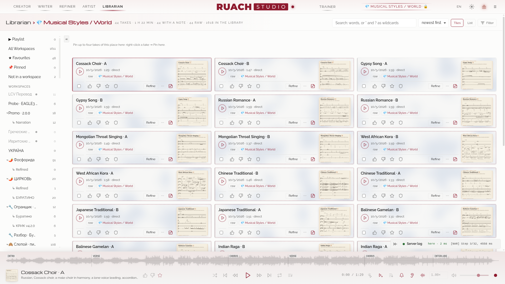

- **Заголовок** називає відкрите зібрання (*Бібліотекар › Sketches*) і що в ньому: семпли, години, вподобання, обране, нотатки, як їх створено.
- **Простори** ліворуч: Усі, Обране, Поза просторами, твої простори, *+ Новий простір*; Приховані й Кошик — у розділі *З очей геть*. Клацни правою кнопкою на просторі, щоб дістатися його **замків** (*Замкнути видалення простору*, *Замкнути видалення семплів*): 🔒 біля його назви, і ніщо з нього не йде в кошик. 💎-простори (публічні набори студії) стоять унизу дерева за назвою, а 💎 … LoRA — нижче за всіх.
- **Плейлист** стоїть першим у колонці, окремим місцем: його не перейменувати, не видалити й не заморозити. Семпл потрапляє до нього зі свого меню (*Додати до плейлиста* › *Першим*, *Останнім* або *Рандомно*; на позначеній картці — усі позначені), а × прибирає його лише з плейлиста, але ніколи з бібліотеки. Вигляд у плейлиста один: список широких карток — ▶ першим, далі назва, коли створено і довжина, позначки, а обкладинка останньою. Перетягни картку на її місце; *Перетасувати колоду* роздає їх усі наново. *Грати з початку* або ▶ на будь-якій картці грає плейлист у його порядку до кінця, хай що каже *грати далі*, а тонка смужка під плеєром називає семпл перед ним, місце в плейлисті (*Плейлист · 3 / 12*) і семпл після: клацання по імені грає його, а × виходить із плейлиста. Остання кнопка плеєра відкриває той самий список у вікні, і плеєр лишається видно під ним. У його шапці кросфейд, від 0 до 4 с: наступний семпл входить під хвіст попереднього, обидва заздалегідь тримаються в сторінці, тож ніхто не чекає мережі; «Назад» і «Вперед» перемикають одразу.
- **Пошук** словами, `*` і `?`; **сортування**: найновіші, найстаріші, за назвою, найдовші; **Плитки** або **Список**: усі три в рядку заголовка, поруч із лічильниками.
- **Картка** носить обкладинку свого семплу у верхньому правому куті, поруч із назвою, коли вона є (*Намалювати обкладинку* в меню семплу); клацання показує картинку цілком над студією, де ‹ › і клавіші-стрілки ходять картинками показаних карток, ▶ грає її семпл, а Esc закриває. Картка, що грає, світиться піками самої пісні. Тонка смужка по лівому краю картки показує твою оцінку: колір акценту — ★, зелена — 👍, приглушено-червона — 👎, сіра — без оцінки.
- **Свіжі семпли**: семпл, який ти ще не грав, носить легку пунктирну лінію; перше програвання знімає її. Перестворений семпл має значок *реджен* і зберігає свою нотатку, вподобання й зірку.
- **Колонка просторів**: тягни її край, щоб розширити чи звузити; « згортає її, і картки стають ширшими: колонок стільки ж, і око не губить свого місця.
- **Підрозділи**: простір може мати підрозділи, щонайбільше два рівні вглиб (⋯ біля його назви → *Новий підрозділ…*), щоб розкласти те, що в ньому, без нового простору щоразу. Простір показує й семпли своїх підрозділів. Усе, з чого Огранювач щось створює, само йде в підрозділ *Огранені* своїх просторів. Простір із підрозділами має зліва в рядку маленький трикутник: клік прибирає його підрозділи з колонки або повертає їх, а згорнуті запам'ятовуються. Колонка прокручується сама по собі й тримається під шапкою кімнати, тож її верх завжди під рукою.
- **Перетягни картку на простір** ліворуч, щоб перемістити її туди (усі позначені, коли вона позначена); тримай **Ctrl**, щоб додати її туди й лишити тут теж. Студія спершу питає, а Ctrl+Z повертає.
- **Закріплені семпли**: до чотирьох у кожному просторі, смугою свого тону над картками (клацання правою кнопкою на семплі → *Закріпити тут*; × відкріплює). Коли ти позначаєш семпли, панель позначених займає місце смуги, тож картки ніколи не зсуваються. Ця смуга — ряд іконок у рамках: вибір, позначки, простори, експорт і кошик у кінці; кожна називає себе при наведенні.
- **Фільтр** (кнопка в кінці рядка пошуку) відкриває вікно, як вибір простору: познач, що шукати, у трьох групах (як створено: сирець (просто з моделі), імпортовані, перестворені, перемальовані; позначені: вподобані, невподобані, обране, з нотаткою, з обкладинкою; що мають: стеми, антигул, ремастер, апскейл), біля кожного — скільки семплів цього місця, і як поєднати позначене: усе разом (AND), будь-що (OR) або нічого з цього (NOR). *Show* застосовує; кнопка потім каже, скільки фільтрів увімкнено і як вони поєднані.
- **Вибери** кілька, як у файловому менеджері: познач один, і відтоді клацання будь-де на іншій картці теж позначає її (Shift: увесь діапазон). Перетягування по порожньому місцю між картками малює смугу, що позначає все, чого торкнеться; **Ctrl+перетягування** малює її звідки завгодно й зберігає те, що вже було позначене. Панель позначених пливе над плеєром: в обране, додати в простір, перемістити в простір, прибрати з цього, приховати, експорт ZIP, у кошик.
- **Кошик** повертає або знищує назавжди, коли ти підтвердиш. **Trash (Art)** поруч із ним у колонці тримає відкладене мистецтво (заходи Художника в кошику, відкладені картинки, обкладинки, зняті із семплів) і повертає його або видаляє назавжди після підтвердження; обкладинки замороженого воркспейсу лишаються.

### Меню семплу <!-- #a-take-s-menu -->

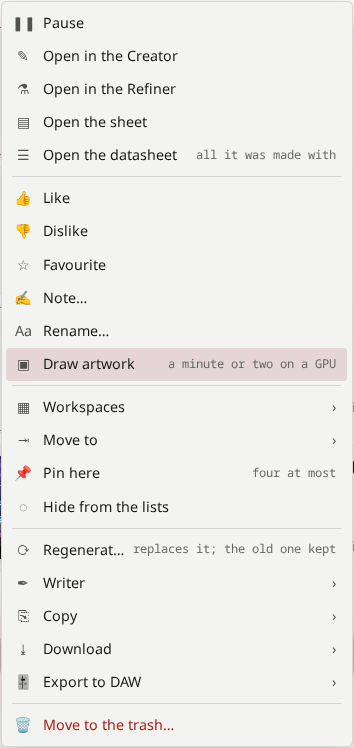

**Перегенерувати з новим зерном** (у меню семплу: «Правити», далі «Перегенерувати»): семпл, створений знову з усього, з чого його створено, але з новими сідами; новий переймає простори й нотатку старого, а старий чекає в підрозділі *Джерело регенерації* свого простору (простір не показує його серед своїх), доки ти цей підрозділ не спорожниш; новий зберігає свою нотатку, вподобання, зірку й картинку. Проба виходить на всі свої дві хвилини. Грати, відкрити в Творці чи в Огранювачі, аркуш (його партитура), паспорт (усе, з чим його створено: стиль і текст, намальована партитура, кожна ручка, LoRA з їхніми силами й хвилями; у семплу «Напряму» партитури нема, і *Записати її за звуком* просить її в транскрибатора), подобається, не подобається, в обране, нотатка, перейменувати, **простори** (один семпл може бути в кількох), **перемістити в** один простір (на позначеній картці: кожен позначений семпл, з відкритого простору), приховати, надіслати в Письменник, копіювати, завантажити, **експорт у DAW** (проєкт REAPER або DAWproject, на будь-якому семплі: з його стемами, щойно Огранювач їх розділив), у кошик. **На позначеній картці, коли позначено й інші**, меню діє на всі одразу, а його шапка каже, на скільки: вподобати, не вподобати, обране, обкладинка, зняти обкладинку, простори, приховати, ZIP; обкладинки для кількох і перегенерація кількох спершу питають, бо це хвилини відеокарти.

**Намалювати обкладинку**: мала мовна модель (Qwen3-4B) читає стиль і слова семплу й пише один промпт картинки; Qwen-Image 2512 малює її з Lightning (1328 px, зберігається в 1024), приблизно за дві хвилини на карті з 16 ГБ разом із промптом і переглядом (на меншій карті його блоки йдуть з RAM, трохи повільніше; художника обирає *Рушій → Обкладинка*). Вона з'являється в плеєрі, на картці, в медіапанелі стільниці і всередині MP3, який ти завантажуєш (як лицьова обкладинка). Щойно семпл має свою картинку, меню каже *Відкрити обкладинку* (над сторінкою, як клацання по картинці картки чи по квадрату плеєра) і *Перемалювати обкладинку* (новий промпт і нова картинка; стара лишається поруч із семплом, в `artwork-removed/`). Автор промпту й фільтр вмісту приходять з `heresy/fetch-heresy.sh --artwork` (8,4 ГБ, спершу питає), художник — з `--qwen 2512-q4` або `2512-q6`. *Engine → Artwork* пропонує всіх художників Qwen, які тут є: Qwen-Image 2512 і його fp8-файнтюни з Lightning, і Qwen-Image 2.1 (див. Художник › Обкладинка для семплу).

### Інструменти під стилем <!-- #the-instruments-under-the-style -->

Під полем Стиль студія називає те, чого просить твій промпт: чип для кожного інструмента й стилю зі шпаргалки, які вона знаходить, пофарбований за тим, що знайшло вухо (зелений — почуто, бурштиновий — під питанням, червоний — під цією назвою не грає), і з картинкою інструмента. Затримай на ньому вказівник, щоб побачити його картку: картинка, батьківщина, як він звучить, ▶ A і ▶ B з їхніми сідами. Клацання показує картинку цілком. **Alt+I** відкриває шпаргалку звідки завгодно.

### Обкладинки: що їх малює, чого воно не вміє, інший художник <!-- #artwork-what-draws-it-what-it-cannot-another-painter -->

**Що їх малює.** Мала мовна модель (Qwen3-4B) читає стиль і слова семплу й пише один промпт картинки, з предметом на початку; Qwen-Image 2512 малює її з Lightning (у 1328 px, а зберігається в 1024), а де не вміщується цілком — його блоки йдуть з RAM (*Рушій → Обкладинка*). Коли семпл названо на честь інструмента (проба інструмента), його вигляд слово в слово веде промпт (що це за інструмент і чим він не є), і Omni (модель слухача) дивиться на картинку за цим виглядом: картинку, де інструмента не знайшлося, малюють наново, щонайбільше три, а коли жодна не показує його правдиво, семпл лишається без картинки, а не з хибною. Приблизно дві хвилини на картинку на карті з 16 ГБ, усе разом.

**Чого воно не вміє** (застереження, сказане прямо): художник малює те, що знає. Інструмент, якого він ніколи не бачив під назвою (дудук, морин хуур, хомус, кришталеві співочі чаші…), виходить здогадом: дерев'яна дудка, скрипка, кухонні миски. Де Omni не знайшов інструмента на жодній із трьох картинок, картинку позначено **≈ здогад** — у перегляді та в шпаргалці інструментів. Обкладинка — це настрій семплу, а не довідкове зображення інструмента: щоб знати, як виглядає інструмент, пошукай його.

## Тренер LoRA <!-- #lora -->

Перевірений на наших піснях і голосах, тренер поки тримається на 90 %: ваші набори й сценарії — не наші, тож розкажіть, як минуло (у репозиторії — *Trainer report*: набір, режим, налаштування, що почули).

### Чого LoRA вчить YuE2 <!-- #what-a-lora-teaches-yue2 -->

LoRA — це малий адаптер над обома половинами. **Стиль приходить здебільшого зі звукової половини; дотримання тексту — з музичної**, а музична половина швидко завчає малі набори напам'ять (її втрата падає до 0). Види:

| вид | дані | чого вчиться |
|---|---|---|
| **Стиль** | 20+ пісень одного звучання | жанр, продакшн, звук гурту |
| **Голос** | один голос, що співає чи говорить: спів (в ідеалі а капела), читання, аудіокниги | тембр |
| **Мова** | багато голосів, точний текст | дикція мови |
| **Артист** | великий, різноманітний каталог | усе разом |

**Адаптер голосу вчиться на будь-якій формі голосу**, не лише на співі: годяться й читання, й аудіокниги. Заміряно тут (05.10.2026): адаптер, навчений на читанні актора, говорив його голосом, а заспівавши, співав з його барвою. Називай такий адаптер за видом голосу (бас, баритенор, контральто…), а не за людиною: `lab/voice_kind.py` міряє голос набору за висотою мовлення.

**Яка сила в голосового адаптера.** Перевірено на пісні (19.10.2026: адаптер читця, ранг 32, на трагічній народній баладі): на 1.0 голос перебиває музику і дубль стає нестабільним, 0.8 усе ще перепалює, 0.7 — стеля, від якої варто танцювати, а 0.4–0.6 найкраще передають голос. Низька сила йде від питча персони й лишає тональність голосу: пісня бере його забарвлення, а не голосовий штамп. Дві його половини не рівні: музична (AR) пише партитуру разом із моделлю, для обох станів, і голос, навчений на мовленні, на високій силі глушить ноти; тримай її не вище 0.5, а звуковій (NAR), що несе тембр, давай до 1.0 (почуто того ж дня: AR 0.4 при NAR 1.0 зберегли музику цілою, а голос рівним). Повзунки так і малюють дорогу голосового адаптера: в адаптера, в імені якого є voice чи vocal, музична половина червоніє після 0.5, звукова — після 1.0.

### Свій голос: запитання з місць <!-- #a-voice-of-your-own-questions-from-the-field -->

Відповіді, дані на GitHub (issue #2) людині, якій був потрібен один провідний вокал, — збережені тут.

- **Дубль з одним голосом.** YuE2 вчився співати на цілих піснях, і його фразування спирається на музику під голосом: «a cappella» у стилі тягне його до підспівок або до цілого гурту. Краще попросити під голос одну тиху річ (м'який пед, одну акустичну гітару) з `solo lead, single voice, no harmonies, no backing vocals, dry vocal, close mic`, а потім розділити дубль в Огранювачі (вісім стемів): *Голос цілком* поверне те, що розділення віднесло до бек-вокалу, *Апскейл голосів* домалює повітря, яке приглушив сепаратор. Що менше під голосом, то чистіший стем.
- **Голосовий адаптер із власних записів.** Сухий провідний вокал одного співака з текстом, 44,1 або 48 кГц із джерел без втрат. Та сама легка кімната на всіх кліпах шкодить менше, ніж різні кімнати, а кліп із важкою реверберацією краще викинути, ніж дочистити наполовину: те, що лишає по собі дереверб, вивчається як частина голосу.
- **Ранг.** 16 для одного голосу, 32 щонайбільше: ранг задає, наскільки адаптер може змінити модель, а не наскільки він наблизиться до співака.
- **Схожість.** Тембр несе звукова половина: грай її на 0,8–1,0 при музичній половині на 0,3–0,5. Назви в стилі стать і регістр співака (`male baritone vocal`). Суди про схожість на тих вагах, на яких адаптер учився: адаптер, вивчений на базовій моделі, рвав голос на файнтюні навіть на малій силі.
- **Вигин кривих наприкінці.** Із *Стоп на плато, далі лише звукова половина* музична половина завмирає, коли звукова перестає кращати, і далі звукова йде сама: тут криві змінюють форму, і саме останні епохи часто дають найчистіший голос. Коли ar_ce наближається до 0, музична половина знає кліпи напам'ять: послухай епоху раніше (зелені чипи).

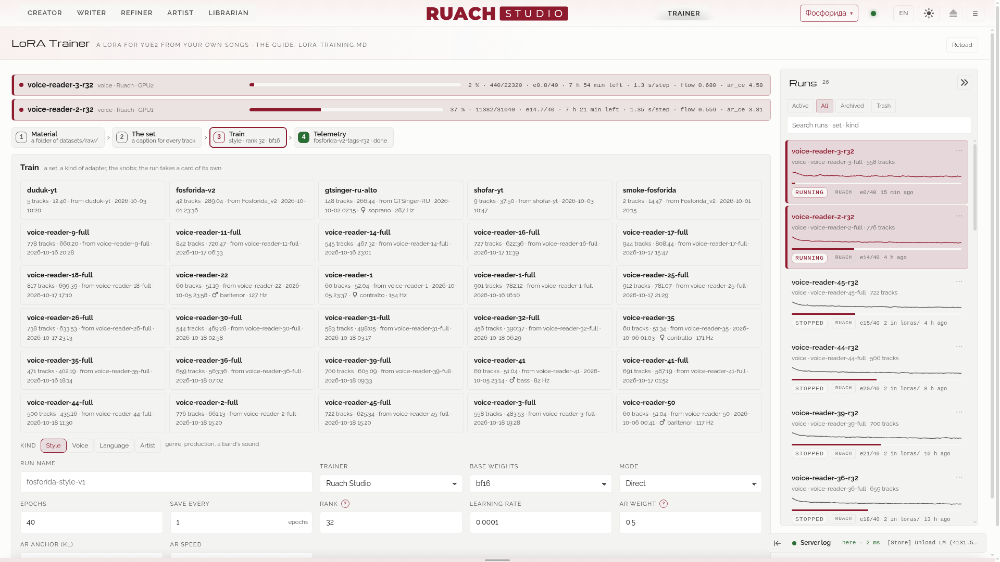

### Навіщо власні адаптери <!-- #why-your-own-adapters -->

Гола відкрита модель, хоч би якою сильною вона була, однаково недобирає в інструментах, стилях і голосах: вона знає те, що чула у своєму навчанні, а твого звучання там майже не буває. Власні адаптери закривають цей розрив; це обладунки професійного аудіо- й музичного воїна. Найвірніший крок угору: збери свої найкращі треки — створені на SUNO (на платному тарифі вони твої) або будь-де ще, де права твої, — і навчи на них адаптер **Стиль**, з точною лірикою біля кожного. Тоді YuE2 пише твоїм звучанням, а не поруч із ним: твоїми інструментами, аранжуваннями, продакшеном. Додай адаптер **Голос** для потрібного співака — і пісні співаються цим тембром. Стиль, навчений на двадцяти твоїх піснях, підносить модель вище, ніж її дотягне будь-який промпт.

### 1 Матеріал <!-- #1-material -->

Поклади папку пісень у `datasets/raw/` і обери її. Вибери, які треки йдуть у набір, дай кожному його текст (знаходиться поруч за назвою, коли він є) і, якщо треба, власний стиль. Треки коротші за 30 секунд типово лишаються поза набором; довгі — добре (музична половина тренується на всій пісні).

**Голос**: *Measure the voice* слухає до дванадцяти треків теки й каже за мовленням, чоловічий він чи жіночий і який регістр (бас, баритон, баритенор, тенор; контральто, меццо, сопрано), з висотою мовлення, і пропонує назву набору з цього, як названо опубліковані адаптери голосів (`voice-ru-m-baritenor-117`): без імені людини. За співом дає заспіваний діапазон, а голос лишає твоєму вуху. Де сама висота не вирішує (140–175 Гц у мовленні), скажи ♂ чи ♀ і виміряй знову. Це чернетка за виміром: вирішує вухо, і голос, яким YuE2 потім співає, може лягти вище чи нижче.

### 2 Набір <!-- #2-the-set -->

**Слово-тригер** (незвичне слово, напр. `sunveil`) потім кличе стиль на ім'я; **спільний рядок стилю** каже, що чути. *Зібрати набір* пише `datasets/prepared/NAME/`: аудіо 48 кГц і підпис на кожен трек.

**Слухач** (Qwen2.5-Omni, на будь-якій карті з приблизно 8 ГБ вільних) чує кожен трек і пише чернетку його тегів; ти їх виправляєш і тиснеш *Записати в підписи*. Це чернетка за будь-якого розміру: читай її.

### 3 Тренування <!-- #3-train -->

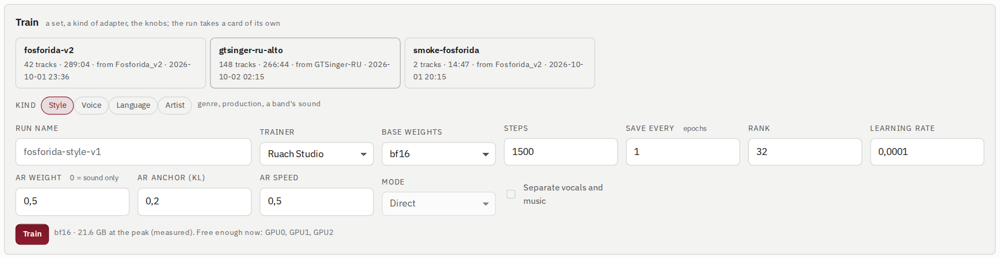

Обери набір, зібраний на кроці 2, потім **вид**: він виставляє ручки під те, чого вчиш (таблиця під списком), і будь-яку можна змінити до *Тренування*. Форма, поле за полем:

- **Вид**: стиль, голос, мова або артист.
- **Ім'я рану**: тека рану (`training/NAME/`) та імена його адаптерів (`loras/NAME/NAME-eNNN`, одразу серед LoRA у Творці). Ім'я належить одному рану: якщо воно зайняте, сторінка попросить інше.
- **Тренер**: **Руах Студія**, власний тренер студії, на неквантованих вагах bf16; латентний кеш набору готує сам; «Напряму» або з партитурою, на піснях як є або розділених. Перенесений рядок у рядок з **AI-Toolkit** від Ostris (MIT), з чиїми кривими на одному наборі сходився епоха в епоху; сам AI-Toolkit пішов зі студії, коли все, чого він навчав, опинилося тут.
- **Базові ваги**: bf16, уся модель (карта на 24 ГБ), або int8 для менших карт, трохи менш точно. Файл базової моделі не змінюється ніколи: вчиться лише адаптер.
- **Карти**: скільки відеокарт бере прогін, 1, 2 або 3, з відданих навчанню в Engine → GPUs. Кожна карта тримає модель цілком і вчить свої пісні; їхні уроки усереднюються на кожному кроці (паралелізм за даними), тож дві карти проходять епоху приблизно вдвічі швидше, три — втричі, хоч парне число, хоч непарне. Батч росте з картами, і швидкість навчання йде за ним (× √карт): більше нічого налаштовувати не треба. Різати одну матрицю між картами (тензорний паралелізм) не потрібно: YuE2 цілком уміщується в карту на 24 ГБ, а на картах без NVLink різання кожного шару коштує дорожче, ніж дає.
- **Епохи**: скільки разів ран проходить набір, кожна доріжка по разу за епоху, по доріжці на крок: кроків у нього стільки, скільки доріжок у наборі, помножене на це (2016 доріжок на 12 епох — це 24 192 кроки). Звукова половина чує 60-секундне вікно доріжки, щоразу вирізане навмання; музична читає пісню від самого початку.
- **Зберігати кожні N епох**: адаптер наприкінці кожної N-ї епохи, щоб кожен послухати й порівняти; зберігаються всі, а поряд з останнім — стан оптимізатора (зупинений ран зберігає вивчене). **Стоп на плато, далі лише звукова половина** (увімкнено типово): два треки зі сотні відкладаються й прослуховуються щоепохи; коли звукова половина 3 епохи не стає на них кращою, музична завмирає на своїй найкращій епосі, а звукова вчиться далі сама, ще до 12 епох. Голос так виходив чистішим. N можна брати аж до десятої частки епохи (0.1 — десять збережень за епоху, з іменами e001.3 і так далі), щоб великий набір слухати, поки він вчиться.
- **Ранг**: наскільки широкий адаптер; його частка від ваг і розмір — у підказці поля (що коштує кожен ранг і який для чого — нижче).
- **Швидкість навчання**: наскільки великий кожен крок звукової половини (AdamW, одна на весь ран); у музичної вона множиться на **Швидкість AR**. Види тримають 0.0001; удвічі менша — дбайливіша, для довгого рану по великому набору; більша — вчить швидше й більше забуває.
- **Згасання LR, епох** і **LR наприкінці, %**: на останніх епохах рану швидкість навчання лінійно знижується до того, що від неї лишається на останньому кроці (0 % гасить її зовсім): звичайний спосіб завершити ран, останні збереження осідають, а не крокують так само круто. Згасання йде від довжини рану, тож подовжений ран згасає біля свого нового кінця, а продовження бере всі ручки рану, і згасання теж. 0 епох, як спочатку: без згасання, швидкість та сама до кінця.
- **Вага AR**, **Якір AR (KL)**, **Швидкість AR**: три ручки музичної половини, про них нижче.
- **Режим**: **Напряму** — для пісень, створених у режимі «Напряму»; **Повний (партитура)** і **Мелодія**, для пісень, створених у цих режимах, вчать музичну половину ще й спершу писати партитуру, яку рушій знімає з кожної пісні перед навчанням; половина кроків іде без партитури, щоб «Напряму» не забулося. **Розділяти вокал і музику**: кожна пісня спершу ділиться на голос і музику розділювачем студії (один раз на набір, хвилини на пісню), і музична половина вчиться ще голосу за самим текстом і музики за самими тегами.
- Під кнопкою: заміряна VRAM попередніх ранів і яка карта зараз досить вільна.

| вид | ранг | кроки | вага AR | якір AR | швидкість AR | для чого |
|---|---|---|---|---|---|---|
| **Стиль** | 32 | 1500 | 0.5 | 0.2 | 0.5 | звучання: жанр, продакшн, звук гурту |
| **Голос** | 16 | 1500 | 0.3 | 0.3 | 0.5 | тембр: музична половина тримається біля бази |
| **Мова** | 32 | 3000 | 1.0 | 0.1 | 1.0 | дикція: музичній половині якраз треба змінитися |
| **Артист** | 32 | 3000 | 0.7 | 0.2 | 0.7 | усе разом |

### Ранг та інші ручки <!-- #rank-and-the-other-knobs -->

**Ранг** — наскільки широка зміна, яку адаптер вносить у кожну матрицю. LoRA адаптує 224 матриці YuE2, по 112 на половину; кожна завширшки 2048, 28 шарів углиб, 1,41 мільярда ваг на половину. Чого коштує ранг, заміряно на цих формах:

| ранг | від ваг, які він адаптує | файл на половину (bf16) |
|---|---|---|
| 16 | 1 % | 29 МБ |
| 32 | 2 % | 59 МБ |
| 64 | 4 % | 117 МБ |
| 128 | 8 % | 235 МБ |
| 256 | 17 % | 470 МБ |

- **Один голос, один інструмент, одне звучання** (від 20 до 50 пісень): **16**, щонайбільше 32.
- **Стиль або артист** (різноманітний каталог): **32**.
- **Великий набір із багатьох голосів** (години записів, тег для кожного голосу): **64**, і **128 щонайбільше**, лише коли 64 вимірно не дотягує. Тренер зупиняється на 128: 256 змінив би шосту частину ваг, яких торкається, — більше, ніж потрібно будь-якому набору тут.
- Файл базової моделі ніколи не змінюється. Ризик великого рангу — сам адаптер: на повній силі він забуває те, чого йому не показали (спів, якщо вчився на мовленні).
- **Епохи**: музична половина швидко завчає малий набір напам'ять (її втрата падає до 0): зелені епохи в Телеметрії — ті, які варто слухати першими, часто задовго до останньої.
- **Частота дискретизації матеріалу**: звукова половина працює на 48 кГц, музична чує на 24 кГц. Запис 24 кГц вчить музичну половину всього, а звукову — лише тьмяного верху: передискретизація не додає нічого вище половини вихідної частоти. Для тембру дай їй 44,1 або 48 кГц.
- **Пам'ять**: мірило — карта на 24 ГБ. Ваги bf16 займають 7,5 ГБ; адаптер, його градієнти й оптимізатор — 16 байтів на вагу (ранг 32: менше 1 ГБ; ранг 128: 3,8 ГБ; ранг 256: 7,5 ГБ); решта — активації уроку, а музична половина читає всю пісню: заміряно 17,7 ГБ на піку з рангом 32 на піснях по кілька хвилин, близько 11 ГБ на коротких голосових кліпах. **Менше 16 ГБ — великі ранги не вчити**: ваги int8, ранг 16–32, короткі кліпи. Ранг 256 на карті 24 ГБ — на самій межі.
- **Кожне збереження — ковзне середнє** адаптера приблизно за останню епоху (EMA), обидві половини, і відкладені треки слухаються на ньому: шум окремих кроків згладжено і в тому, що ти чуєш, і в тому, що зупиняє прогін. Сирі ваги, щоб продовжити, лежать поруч (`resume.safetensors.raw`).

### Три ручки музичної половини <!-- #the-music-half-s-three-knobs -->

Кожен крок учить обидві половини окремо. Звукова половина завжди вчиться звуку: знімати шум зі свого вікна доріжки (втрата flow). Музична вчиться лише тоді, коли **Вага AR** більша за 0, і тоді на неї тягнуть одразу дві сили:

- **її урок** (ar_ce): передбачати власні токени пісні від самого її початку, слово за словом і нота за нотою: дикція, фразування, мелодичні звички, форма пісні;
- **якір** (ar_kl): у кожному з цих місць тренер питає базову модель — ту саму музичну половину з вимкненим адаптером, — що вона написала б тут, і штрафує адаптер за кожен крок убік від цього.

Втрата кроку — це flow + Вага AR × ar_ce + Якір AR × ar_kl. Що дає кожна ручка:

- **Вага AR** вирішує, чи вчиться музична половина взагалі і як сильно її урок тягне проти якоря. На 0 музична половина лишається базовою моделлю (її частина адаптера лишається порожньою: самі нулі, заміряно), адаптер — це тембр на одній звуковій половині, а якір ні на що не впливає.
- **Якір AR** тягне музичну половину назад до базової моделі, щоб вона зберегла те, чого в наборі немає: спів після набору з читання, інші мови, слідування новим словам, письмо партитури. Без якоря її відносить туди, куди веде набір.
- **Ці двоє тягнуть одне проти одного, і рахується лише їхнє відношення, а не величина.** AdamW співмірює кожен крок із величиною власних недавніх градієнтів, тож втрата, помножена на число, вчить того самого, що й раніше: 0.5 з якорем 0.2 — те саме, що 1.0 з 0.4. Читай якір як частку ваги: десята частка дає музичній половині рухатися (Мова), рівна вазі тримає її біля бази (Голос).
- **Швидкість AR** — справжній газ музичної половини: її швидкість навчання дорівнює швидкості навчання, помноженій на цю, і лише ця ручка змушує музичну половину вчитися швидше чи повільніше. Види тримають її на 0.5 (Мова — на 1.0): музична половина завчає малий набір напам'ять задовго до того, як звукова візьме свій тембр.

Заміряно тут (10.10.2026: 40 кроків на наборі з 60 читань, ранг 16, один сід; *зсув* — наскільки великою вийшла зміна, яку адаптер вносить у матриці музичної половини):

| вага AR · якір · швидкість | зсув | відмінність від першого рядка | ar_kl, останні десять кроків |
|---|---|---|---|
| 0.5 · 0.2 · 0.5 (як у Стилю) | 1.32 | той самий ран ще раз: 1 % | 0.257 |
| 1.0 · 0.4 · 0.5 (обидва вдвічі) | 1.36 | 5 % | 0.262 |
| 0.5 · 0 · 0.5 (без якоря) | 1.44 | 23 % | — |
| 0.5 · 0.5 · 0.5 (якір дорівнює вазі) | 1.21 | 17 % | 0.132 |
| 0.5 · 0.2 · 1.0 (швидкість удвічі) | 2.32 | 99 % | 0.443 |
| 0 · 0 · 0.5 | 0 | нічого не вивчила | — |

Подвоєння обох змінило адаптер на 5 %, проти 1 % в одного й того самого рану двічі; частка якоря зсунула його на шосту-чверть; подвоєна швидкість завела його на три чверті далі. Зі звуковою половиною музичну пов'язує лише спільне обрізання градієнтів: від рядка до рядка звукова відрізнялася на 4–13 %, проти 2 % в одного й того самого рану двічі.

Що крутити, за тим, що чуєш і бачиш:

| коли | крути |
|---|---|
| потрібен лише тембр (голос із читання, інструмент) | Вагу AR нижче і якір, рівний їй (у Голосу 0.3 і 0.3), або Вагу AR 0 |
| потрібна дикція мови, фразування стилю | Вага AR 1.0, якір — десята її частка, Швидкість AR 1.0 (як у Мови) |
| ar_ce рано падає нижче 0.3: вона знає пісні напам'ять | Швидкість AR нижче або частку якоря вище; чи послухай ранішу епоху |
| адаптер співає мелодії навчальних пісень на нові слова або губить текст | частку якоря вище: рівною вазі або більше |
| ar_kl тримається біля 0, а дикція не прийшла | Швидкість AR вище або частку якоря нижче |

### 4 Телеметрія <!-- #4-telemetry -->

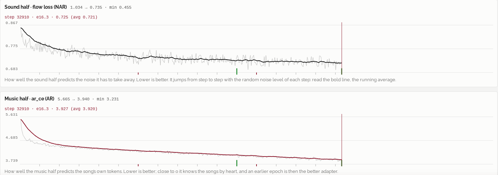

Рани, що тренуються, стоять угорі кімнати зі своїм поступом, часом, що лишився, і обома втратами. Телеметрія рану показує його поступ, потім плитки: швидкість, скільки він іде і скільки лишилося, останні значення flow, ar_ce і **ar_kl** (наскільки музична половина відійшла від базової моделі: 0, поки Вага AR дорівнює 0), пік VRAM і карту; потім дві криві:

- **Звукова половина · втрата flow**: наскільки добре звукова половина передбачає шум, який має прибрати. Вона стрибає від кроку до кроку (кожен крок бере випадковий рівень шуму): читай жирну лінію, ковзне середнє.
- **Музична половина · ar_ce**: наскільки добре музична половина передбачає власні токени пісні. Близько до 0 вона знає пісні напам'ять; тоді кращим адаптером буде раніша епоха.

Наведи на криву, щоб прочитати крок, його епоху і значення в цій точці. **Порівняти з…** накладає поверх цих криві іншого рану, пунктиром. Кнопка поряд із **Лог** ставить обидві криві одну під одною, кожну на всю ширину, або знову поруч. **Лог** відкривається внизу кімнати, завширшки за своїми рядками, поряд із логом сервера.

### Епохи, які варто послухати першими <!-- #the-epochs-worth-hearing-first -->

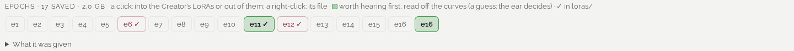

Кожна збережена епоха — чип. **Зелені** варто послухати першими, їх прочитано з кривих: перша епоха, чия звукова втрата усталилася, та, що з найнижчою звуковою втратою, і остання перед тим, як музична половина завчить пісні напам'ять. Це здогад; вирішує вухо. Обери епоху: **У loras/ → у Творця** (вона одразу з'являється серед LoRA), **З loras/** або **Завантажити** її.

> **Адаптер, натренований без партитури («Напряму»), ставиться на музичну половину лише в запусках «Напряму».** У «Повному плані» його музична половина може зламати партитуру навіть на малій силі: там давай йому лише звукову половину.

### Рани <!-- #runs -->

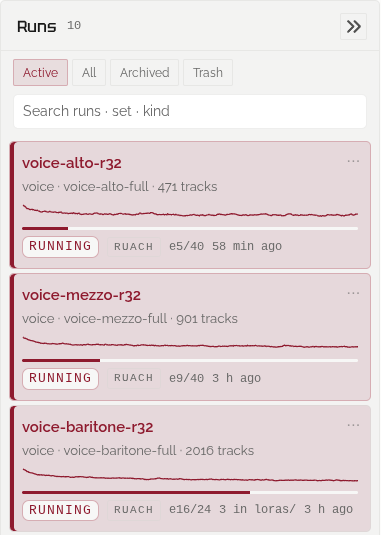

Кожен ран — картка праворуч: *Активні*, *Усі*, *В архіві*, *Кошик*, з пошуком. Ран, що тренується, світиться, як семпл, що грає. ⋯ на картці: його телеметрія, його лог, в архів, зупинити або видалити в кошик (тебе спитають, чи йдуть разом із ним його адаптери в loras/). З Кошика він повертається або йде назавжди. Під ними — прогони за станом: **Навчання**, **На паузі**, **Готово**, **Зупинено**, **Збій**, у кожного своє число, по одному (повторне клацання показує всі). **Пауза** на прогоні, що йде, зберігає вивчене й чекає; **Продовжити** йде далі від цього збереження з тим самим набором, ручками й картами.

## Рушій <!-- #engine -->

Рушій відкривається поверх кімнати, в якій ти стоїш (☰ › Рушій, або Ctrl+Alt+9); його картки за темами лежать у вкладках ліворуч, у тому порядку, в якому їх проходять: **Сервер і лог**, **Залізо** (карта, Обчислення і MIDI в один ряд, під ними відеокарти), **Моделі й LoRA** (з VAE і LoRA), **Письменник і обкладинка**, **Теки й безпека**, **Зовнішній вигляд**, **Оновлення й про програму**. ↑ і ↓ переходять між вкладками, і Рушій знову відкривається на тій, де ти його залишив; Esc, **Закрити** або клацання по затемненій кімнаті довкола закривають його.

### Машина <!-- #the-machine -->

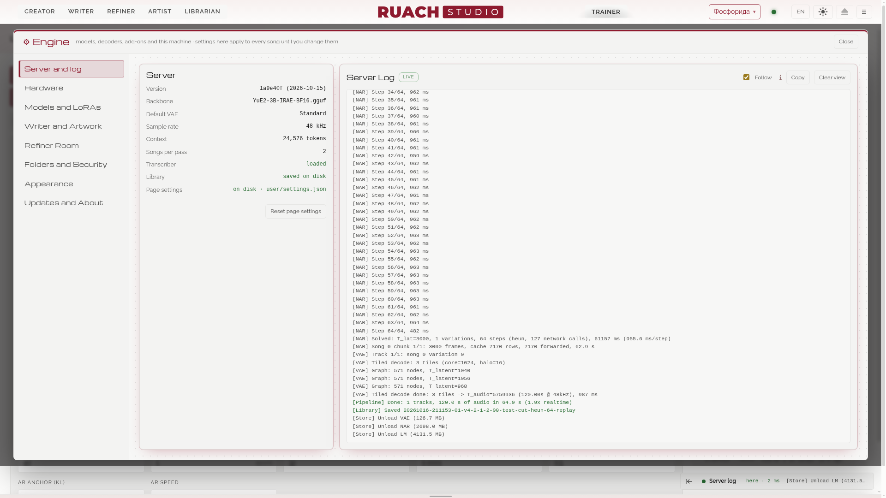

- **Сервер**: що запускає рушій: модель, декодери, контекст, бібліотека.
- **Обчислення**: копія **моделі** (BF16 7,2 ГБ, Q8_0 3,8 ГБ, Q6_K і Q5_K_M менші), **Пресет пам'яті GPU** (*Авто* підганяє контекст і тайли VAE під карту; *Auto within N GB* — те саме для цього обсягу, а решта карти тому, що ще на ній працює (на ноутбуці з 16 ГБ — 14); *Вручну* лишає їх тобі), **Тримати моделі завантаженими**. **Scan the machine** каже, що має машина і що їй пасує (основа, ручки Авто, художник), як нова студія виконує один раз під час першого старту. Завантажені злиття (**More models**) стоять у списку після моделей m-a-p, у своїй лінії: IRA, IRAE, IRAEv2, IRAEv3; у кожного його формати, від найповнішого. Власний файнтюн Ruach Studio, **RS-FW** (сім злиттів YuE2-RS-FW, у кожного в назві епоха і сила), приходить із встановленням як RS-FW 2.4x0.75, модель студії за замовчуванням, і стартує, коли модель не вибрано; решта шість — у **More models**.
- **Залізо**: пам'ять карти зараз; **Вивантажити модель** звільняє її одразу.

### Відеокарти: яка карта за що відповідає <!-- #gpus-which-card-does-what -->

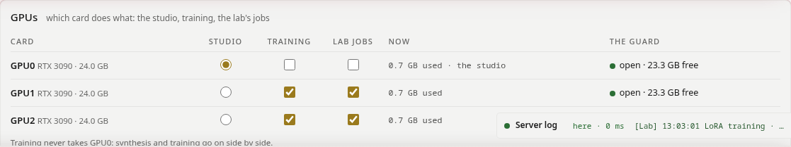

На машині з кількома картами дай кожній її справу: **студію** (синтез) на одну карту, **тренування** на ті карти, які ти йому даси, **завдання** лабораторії (слухач, Whisper, стеми, ремастер, апскейл) на їхні. Поки ран тренується на власній карті студії, синтез чекає, і сторінка каже чому. З однією картою так воно й є: спершу тренування, потім творення. Нова карта для студії діє після перезапуску (кнопка з'являється, коли він потрібен). Справи лабораторії тримаються позначених для них карт, і Художник серед них: коли ті зайняті, завдання чекає на одну з них (Whisper іде на процесор) і ніколи не бере карту, не позначену для лабораторії. Захід Художника йде на карту, де його модель утримано з попереднього заходу, з вагами вже в RAM.

**Intel Arc (бета).** Синтез студії йде й на карті Intel Arc, рушій для неї збирає `./build.sh --sycl` (INSTALL.md, «Intel Arc (beta)»): пісні, адаптери, Full, Extend. Карти в цьому списку — NVIDIA; рушій Arc рахує на своїй карті, а тренування й обкладинки лишаються на NVIDIA.

### Декодери, адаптери, модель письменника, вигляд <!-- #decoders-adapters-the-writer-s-model-the-look -->

- **VAE**, **LoRA**: кожен файл, який знайшла студія, з його джерелом і з тим, для чого він.
- **Моделі й LoRA** (Models and LoRAs): що приносить встановлення, частинами (додаткові декодери, Whisper, моделі стемів, UniverSR, LoRA), як їх знайшов останній прогін, і **Check again**, щоб подивитися наново. У неповної частини список того, чого немає, і її **Fetch**; **Fetch what is missing** докачує все одразу; обірване завантаження продовжується з місця обриву. **More models**: інший бекбон (BF16 поруч із Q8_0), слухач стилю, художник Художника, база тренера — кожен зі своїми варіантами й розмірами, уже завантажений варіант позначено, і кожен спершу питається з розміром. Новий бекбон чи декодер рушій бачить з наступного старту (**Restart the engine**), нові LoRA — одразу. Серед них злиття IRA та IRAE: YuE2 із вшитими адаптерами спільноти (Instrumental і Real Audio від Mothersuperior; в IRAE — Epic Trailer від monsterovich, у трьох силах).
- **Упізнаються за вмістом**: адаптер чи файл моделі, перейменований, перенесений у свою теку або з переписаним заголовком, усе одно на місці: студія та її інсталяція впізнають його за SHA-256, а `.safetensors` — за SHA-256 його тензорів (з `MANIFEST.tsv` репозиторію моделей), і нічого не завантажують знову.
- **Artwork**: хто малює обкладинку семплу: за картами (Qwen-Image 2512 Q6 чи Q4 цілком, де карта його вміщує, інакше Q4 потоком з RAM на меншій карті) або обраний серед художників Qwen, які є на цій машині (Qwen-Image 2512 Q4 чи Q6 і кожен fp8-файнтюн, з Lightning; Qwen-Image 2.1 із застереженням про ліцензію).
- **Письменник**: адреса локального чат-сервера (vLLM, LM Studio, Ollama), *Перевірити зв'язок*.
- **Зовнішній вигляд**: 22 теми (обрані, щоб у них творити: ясні й тихі), кути, чотири шрифти (текст, заголовки, числа, назви кімнат). **Час дубля**: час дубля на картці й усюди, де його показано, як давно (типово) або точні дата й час; клацання по часу на картці перевертає його для цього дубля.
- **Шрифти**: окрім тексту, заголовків, чисел і назв кімнат — *мітки секцій* на хвилі (типово IBM Plex Mono) і *кнопки* (типово шрифт тексту); у кожного, крім тексту, свій розмір відносно тексту, від −2 до +2 pt.
- **Лог сервера**: увесь лог; **Про програму**: у першому рядку власний репозиторій студії, її автор і ліцензія (AGPL-3.0); далі, кожне з посиланням, спершу наше, потім моделі, якими користується студія, і код, з якого вона виросла.
- **Оновлення**: релізи Ruach Studio на GitHub проти цієї версії: як часто дивитися (щодня, щотижня, щомісяця, ніколи), кандидати в реліз теж, а коли вийде новий — спитати або оновитися самій, коли нічого не йде (сама — лише там, де студія — клон свого репозиторію; деінде вибір однаково у твоїх руках, а рядок під ним скаже, чому поки вона питає і як оновитися вручну). Нова студія і кожне оновлення пропонують 💎 набори, яких ще немає.
- **Безпека** (Security): хто може відкрити студію: лише цей комп'ютер, цей комп'ютер і приватні мережі (за замовчуванням; Wi-Fi у кав'ярні чи готелі — теж приватна мережа) або цей комп'ютер і мережі, які ти перелічиш (10.0.0.0/24); рушій зберігає вибір у `user/access.json` і одразу відповідає за ним. Студія, чий господар ще не вирішував, питає під час запуску — з коротким гайдом і прапорцем «Моє рішення усвідомлене». Вибір, що закрив би її для машини, з якої ти питаєш, перепитується; видалення `user/access.json` повертає приватні мережі.
- **Теки** (Folders): де живе твоя праця (пісні разом зі завантаженими воркспейсами, кошик, картинки Художника, документи Письменника), скільки в кожній і скільки місця на її диску. **Move…** переносить теку до будь-якої іншої теки чи на інший диск: студія спершу каже, що виконає (на тому самому диску — перейменування; на іншому — копія, перевірена файл за файлом, потім перемикання посилання), і переносить лише після другого «так», поки нічого не рендериться; стара копія лишається, перейменована, доки ти її не видалиш. **Back home** повертає теку до теки студії; **Link again** знову вказує студії на теку, чий диск повернувся. Моделі, LoRA і навчальні набори лишаються на своїх місцях.

## DAW <!-- #daw -->

**Експериментально.** Шлях у DAW діє і перевірений, але йому ще потрібні краш-тести на інших машинах і проєктах, і ще чимало праці.

### Два виходи зі студії <!-- #two-ways-out-of-the-studio -->

Студія віддає пісню одним із двох способів, і лише цими двома:

1. **Зведений трек**, як його створила студія й доогранив Огранювач: WAV, FLAC або MP3, без DAW посередині.
2. **Увесь семпл у твою власну DAW**, як проєкт цієї DAW: далі все відбувається поза студією. Жодне аудіо й жоден проєкт не повертаються назад: студія не читає проєктів DAW (REAPER може дати їй те, з чого пісня складається: її слова й мелодію).

**Експорт у DAW** відкриває цей вибір: у ☰ або в Огранювачі поруч із семплом у руках. Сторінка показує, які DAW є на власній машині студії (REAPER, Waveform, Bitwig), з їхніми версіями. Коли студія працює на іншому комп'ютері, ніж твоя DAW (сервер удома, ноутбук у дорозі), познач свою кнопкою *Я користуюся цією*.

| DAW | що студія їй дає | стан |
|---|---|---|
| **REAPER** | власний проєкт (.RPP): зведення, стеми, партитура як MIDI, темп і розмір, розділи, текст, рецепт | готово, перевірено самим REAPER |
| **Waveform** (Tracktion), 14 або новіша | DAWproject: зведення і стеми, партитура як нотні доріжки, розділи як маркери, темп і розмір | готово, перевірено за схемою формату |
| **Bitwig** | DAWproject, те саме | готово, перевірено за схемою формату |
| **Studio One, Cubase** (Windows, macOS) | DAWproject, те саме | готово |

### REAPER: встановлення <!-- #reaper-install -->

- **Linux**: з reaper.fm, архів *Linux x86_64*; розпакуй його й запусти `./install-reaper.sh`: він іде в `/opt/REAPER`, без нічого зайвого.
- **Windows, macOS**: інсталятор з reaper.fm.
- REAPER дає 60 днів з усіма функціями, потім просить ліцензію ($60 для особистого користування чи малого бізнесу).

### Найповніший проєкт: спершу три кроки <!-- #the-fullest-project-three-steps-first -->

Що несе проєкт, залежить від того, що має семпл. Щоб було все:

1. **Повний план**, коли створюєш пісню: партитура стає MIDI-доріжками й дає темп і розмір. (У семплу «Напряму» партитури нема: нема й MIDI; темп береться з «NN bpm» у стилі або лишається заглушкою 120.)
2. **Огранювач → Стеми**: кожен стем отримує свою доріжку (два: вокал та інструментал; чотири: з ударними, басом і рештою).
3. **Огранювач → Перевірка тексту**: Whisper розмічає за часом кожен рядок; рядки лягають на таймлайн, а розділи ([Verse], [Chorus]…) стають регіонами.

Жоден із трьох не обов'язковий: проєкт бере те, що є, і каже, чого йому бракувало.

### REAPER: експорт і відкриття <!-- #reaper-export-and-open -->

1. Відкрий семпл (у Творці, Огранювачі чи Бібліотекарі), потім **Експорт у DAW → REAPER → Експортувати семпл**; або клацання правою кнопкою на будь-якому семплі → **Завантажити → Проєкт REAPER**.
2. Студія пакує семпл: аудіо як 24-бітний WAV на 48 кГц, тож семихвилинна пісня з двома стемами важить близько 350 МБ. Браузер зберігає `TITLE.reaper.zip`.
3. Розпакуй його будь-де, увесь: `TITLE/TITLE.RPP` і `TITLE/audio/` лишаються поруч.
4. Відкрий `TITLE.RPP` у REAPER (File → Open project або подвійне клацання).

### Що всередині <!-- #what-is-inside -->

| доріжка | що це |
|---|---|
| **Mix** | пісня, як її озвучила студія; **заглушена**, коли є стеми, тож звучать стеми, а зведення чекає як еталон |
| **Vocals**, **Instrumental** (або Drums, Bass, Other) | стеми, кожен від 0 на всю пісню |
| **Score · Vocal**, **Score · Ins** | партитура як MIDI, по доріжці на голос. Це партитура *як записано*: пісня, як її проспівано, може від неї відходити. Вона не звучить, доки ти не даси їй інструмент (FX доріжки: ReaSynth або будь-який VSTi) |
| **Lyrics** | кожен рядок тексту як порожній елемент із рядком у його нотатці, там, де його почув Whisper |

- **Регіони**: розділи тексту, від першого розміченого рядка кожного до наступного.
- **Темп і розмір**: з партитури (її `Q:` і `M:`), інакше «NN bpm» у стилі, інакше 120 у 4/4 як заглушка; нотатки проєкту кажуть, що саме.
- **Нотатки проєкту** (у налаштуваннях проєкту REAPER): назва, стиль, обидва сіди, власне ім'я семплу — шлях назад до семплу в Бібліотекарі.

### REAPER: коли щось не так <!-- #reaper-when-something-looks-wrong -->

| що ти бачиш | чому | як бути |
|---|---|---|
| media offline | папка аудіо не поруч із .RPP | розпакуй увесь ZIP, тримай `audio/` поруч із проєктом |
| нема тексту, нема регіонів | семпл ніколи не розмічали за часом | Огранювач → Перевірка тексту, потім експортуй знову |
| нема MIDI-доріжок | семпл «Напряму» або семпл без партитури | створи його в «Повному плані» або принеси свою партитуру в Творці |
| темп показує 120 | у семплу нема власного темпу | задай його в REAPER або наступного разу напиши «NN bpm» у стилі |
| MIDI біжить попереду чи позаду голосу | партитура — це план, спів — його виконання | користуйся MIDI як ескізом або підтягни його до стемів |
| текст на івриті чи грецькою показується квадратиками | шрифт REAPER не має цього письма | шрифт із цими письмами в темі чи налаштуваннях REAPER |

### REAPER: пісні зсередини REAPER <!-- #reaper-songs-from-inside-reaper -->

Три дії REAPER у `extras/reaper/` (ReaScript, Lua) дістаються студії через її API, з власної машини студії чи з іншої у твоїй мережі. Звук іде в один бік: пісні виходять зі студії в REAPER, і жодне аудіо чи проєкт не йде назад. Те, що REAPER дає студії, — це те, з чого пісня складається: її слова і її мелодія.

- **Ruach - Generate here**: стиль, довжина й режим, спитані в діалозі; пісня створюється в студії й лягає на нову доріжку на початку виділення часу (її довжина — довжина виділення). Текст береться з нотаток виділених елементів (експортований проєкт зберігає там слова кожного розділу) або з діалогу. **Виділені MIDI-елементи — це мелодія пісні**: їхні ноти стають її партитурою (співається найвища доріжка; доріжка акордів не подається лінією, бо мелодію міг би взяти інструмент), у темпі й розмірі проєкту, у тональності key snap MIDI-елемента або тій, яку підказують ноти, у режимі *Лише мелодія*; нотатки нового елемента кажуть, як прочитано мелодію. REAPER лишається вільним, поки студія творить.
- **Ruach - Bring a take**: слова (назва чи нотатка, `*` і `?`), простір, якщо хочеш, і семпл, який ти обереш, лягає на курсор редагування.
- **Ruach - Settings**: адреса студії, її токен, якщо вона його просить, і простір, у який лягають пісні з REAPER.

Встановлення: скопіюй папку в `Scripts` REAPER, потім *Actions → New action → Load ReaScript* для всіх трьох і раз запусти *Settings*. Їм потрібен `curl` (він є в кожному Linux, macOS і Windows 10 та новіших). README папки каже решту.

### DAWproject (Bitwig, Studio One, Cubase) <!-- #dawproject-bitwig-studio-one-cubase -->

Клацання правою кнопкою на семплі → **Завантажити → DAWproject**, або *Експортувати семпл* на картці Waveform чи Bitwig у вікні DAW: один файл `.dawproject` зі зведенням і кожним стемом (зведення заглушене, коли є стеми), партитурою як нотні доріжки, по одній на голос, розділами як маркери, щойно семпл розмічено за часом, у темпі й розмірі семплу; стиль і текст їдуть у його нотатках. Відкрий його імпортом DAWproject у DAW: Waveform 14 або новіша (*File > Import Other > Import a DAWproject file*; студія вимагає щонайменше Waveform 14), Bitwig, Studio One, Cubase. Перевірено за власною схемою формату (Project.xsd).

### З твоїх власних скриптів <!-- #from-your-own-scripts -->

Усе вище — це також API студії: `POST /api/v1/takes/NAME/reaper` пакує проєкт і каже, звідки його забрати. Див. **docs/API.md**: пісні, завдання, семпли, позначки, простори і сервер MCP для агентів.

## Партитура <!-- #score -->

У «Повному плані» музична половина пише партитуру раніше, ніж прозвучить бодай одна нота, і пісня йде за нею такт за тактом; зі «Своєю партитурою» партитура твоя. Ця вкладка читає її рядок за рядком: діалект, яким пишуть YuE2 і SheetSage2, як два його голоси ділять такти і як їх змінювати, не ламаючи пісню.

### Що чинить партитура <!-- #what-the-score-does -->

Партитура — це текст ABC: шапка, далі пісня групами по одному–чотири такти, кожна група раз для голосу (**Vocal**) і раз для інструментів (**Ins**), на одній сітці тактів. Рушій читає її до музики: ноти голосу несуть слова, акорди ведуть гармонію, такти дають час.

- **Семпл триває стільки, скільки його партитура.** Шість семплів «Повного плану» скінчилися в межах 0.5–5 с від довжини своєї партитури. Такти після останніх слів усе одно грають: це хвіст (*End at…* його відтинає, або прибери ці такти з партитури).
- **Чого немає в партитурі, те не співається.** Якщо в плані менше секцій, ніж у тексті, останні куплети випадають або повторюється ранній.
- **Студія читає її суворо.** Чого перевірка не знає, те вона відкидає і каже де: група, голос, такт. Рушій, можливо, і зіграє таку партитуру, але MIDI, маркерам, зсуву голосу й читанню на партитурі потрібен рідний діалект.

### Шапка <!-- #the-head -->

Вісім рядків, завжди ці, у цьому порядку:

```
X:1
T:
M:4/4
L:1/16
Q:1/4=85
V: Vocal clef=treble name="Vocal Melody" snm="Vocal"
V: Ins clef=treble name="Ins Melody" snm="Inst."
K:D#m
```

- `X:1` і порожній `T:` як є: назва живе у формі.
- `M:` — розмір дробом: `4/4`, `3/4`, `6/8`, `2/4`; знаменник — степінь двійки.
- `L:` — одиниця: нота без числа триває стільки. YuE2 пише `L:1/16`, шістнадцяту, і все нижче лічиться в ній.
- `Q:1/4=` — темп: чвертей за хвилину, цілим числом.
- Обидва рядки `V:` слово в слово: за ними рушій пізнає голоси.
- `K:` — тональність: мажорна за назвою (C, G, D, A, E, B, F#, C#, F, Bb, Eb, Ab, Db, Gb, Cb) або мінорна з m (Am, Em, Bm, F#m, C#m, G#m, D#m, A#m, Dm, Gm, Cm, Fm, Bbm, Ebm, Abm). Інше написання тієї ж тональності відкидається: `Eb`, а не `D#`.

### Групи, голоси й такти <!-- #groups-voices-and-bars -->

Після шапки пісня йде групами:

```
% verse
V: Vocal
"Gm"B2B2B2B2B2B2B2G2|"Eb"B2B2B2B2B2B2B2F2|"F"F2F2F2F2F2G2F2F2|"Gm"G4z12|
V: Ins
Z4|
```

- Група: коментар секції там, де секція починається (`% verse`), потім `V: Vocal` і один рядок з одного–чотирьох тактів, потім `V: Ins` і один рядок із **того самого числа тактів**. Кожен рядок закінчується на `|`; жодних `||` і повторів.
- `Z` — цілий такт паузи, `Z2`, `Z3`, `Z4` — стільки тактів; `z` — пауза з тривалістю, як нота.
- Новий розмір або тональність приходять рядком `M:` або `K:` одразу після рядка `V:` групи, однаково в обох голосах: перевірці треба, щоб обидва голоси стояли на одній сітці й в одній тональності щомиті. Усередині такту зміна тональності пишеться `[K:Em]`.

### Ноти та їхні тривалості <!-- #notes-and-their-lengths -->

- Літери — це висоти: `C D E F G A B` — октава від до першої октави (C4), малі `c d e f g a b` — октава вище; `'` піднімає літеру на октаву, `,` опускає: `B,` — це B3, `c'` — C6.
- `^` дієз, `_` бемоль, `=` бекар (`^^` і `__` — подвійні): знак діє для цієї літери до кінця такту. Власні дієзи й бемолі тональності знаку не потребують.
- Число після ноти — її тривалість в одиницях (за `L:1/16`): `1` шістнадцята, `2` восьма, `3` восьма з крапкою, `4` чверть, `6` чверть із крапкою, `8` половинна, `12` половинна з крапкою, `16` ціла; `24`, `32` і `48` — для довших. Лише ці: інша тривалість — дві ноти лігою (`F4-F` замість п'яти).
- `-` зв'язує ноту з наступною тієї ж висоти, і через тактову риску теж: одна витримана нота, один склад.
- **Кожен такт складається рівно у свій розмір**: за `L:1/16` шістнадцять одиниць у 4/4, дванадцять у 3/4 і в 6/8. Такт, якому бракує одиниці або в якому вона зайва, відкидається — з його числами.

### Акорди <!-- #chords -->

- Акорд — це його назва в лапках перед нотою, з якої він починається: `"Gm"B2`. Він тримається до наступного. Акорди живуть лише у **Vocal** (в Ins перевірка їх відкидає): це гармонія всього гурту, а не ноти співака.
- Назва — це основний тон (від A до G, з `#` або `b`) і одне з: мажор (нічого), `m`, `dim`, `aug`, `7`, `maj7`, `m7`, `dim7`, `m7b5`, `sus4`, `sus2`, `6`, `m6`, `7sus4`, `m(maj7)`; бас — після скісної риски: `C/E`.
- Пауза може нести акорд: `"Bmaj7"z16` — такт цього акорду при мовчазному голосі, як у вступі.
- З акордами партитура грається в **Повному плані**; без жодного — у режимі **Лише мелодія** (план мелодії, акомпанемент вільний). Рушій розуміє це з самої партитури.

### Секції <!-- #sections -->

- `% intro`, `% verse`, `% chorus`, `% bridge`, `% outro` окремим рядком перед групою позначають, де починається секція. Вони йдуть у твій DAW маркерами (*Маркери* і всередині проєкту REAPER), і саме в них план зустрічається з твоїм текстом.
- Дай партитурі секції твого тексту, в їхньому порядку, кожній — місце для її рядків. Планувальник іноді пише їх менше: на одному довгому репі — від 2 до 17 секцій на 32 у тексті. Додай їх або скороти текст до *Створити*.

### Час <!-- #time -->

- Такт триває стільки чвертей × 60 ÷ темп, у секундах (темп лічить чверті): у 4/4 за 85 BPM 2.82 с, за 103 BPM 2.33 с; у 3/4 за 90 BPM 2 с.
- Пісня триває число тактів × це. Рядок перевірки під партитурою це й каже: `✓ Native YuE2 score · Em · 90 BPM · 3/4 · 11 bars · ≈ 0:22 long · 0 sections`.
- Рядку тексту потрібен час його складів: по восьмій на склад такт 4/4 вміщає 8 складів, по шістнадцятій — 16 (куплети репу можуть іти так: `FFFFFEEEE2zDDDDD`).
- Щоб пісня скінчилася раніше, прибери такти наприкінці партитури, в обох голосах; для фіналу додай туди такти.

### Простір голосу: Vocal <!-- #the-voice-s-space-vocal -->

- Vocal — те, що співається: приблизно склад на ноту, зв'язана нота — один витриманий склад, паузи — де співак дихає. Таблиця перевірки каже, скільки нот, скільки за хвилину, діапазон і скільки часу голос звучить.
- Ноти й склади: якщо нот більше, ніж складів, модель розтягує склади на них або додає свої; якщо менше — тіснить слова. Лічильник лірики у «Творенні» міряє кожен рядок часом, який він займає: дай рядку приблизно стільки нот.
- Реп щільний (шістнадцяті на одній-двох висотах: його несе ритм), у балади довгі ноти. Залиш паузу в кінці рядка: там голос дихає, а інструменти відповідають.
- Зсув голосу під партитурою (*Зсунути*) рухає Vocal ступенями гами (на терцію, кварту, октаву), якщо він лежить надто високо чи низько для співака; акорди й Ins лишаються. Замір 21.10.2026: модель іде за рядком Vocal, зсунутим на октаву вниз (співала на 9–10 півтонів нижче), і голос може змінити з ним регістр: жіноче контральто, зсунуте вниз, вийшло чоловічим тенором або баритенором, а чоловічий голос, зсунутий угору, може вийти жіночим; униз може піти й уся музика. ▼ ▲ біля голосового адаптера (у Full, з партитурою) дають те саме один раз.

### Простір інструментів: Ins <!-- #the-instruments-space-ins -->

- Ins — власна лінія інструментів: риф вступу, відповіді між фразами, соло, фінал. Мелодія, а не акорди (ті стоять у Vocal): одна лінія, а гурт довкола неї YuE2 аранжує сам.
- **Під голосом Ins здебільшого мовчить.** Офіційні кавери тримають `Z4` під кожною проспіваною групою й грають у вступі, між секціями і в кінці; семпли Віктора в «Повному плані» — так само (арпеджіо у вступі, `Z4` під куплетами, заповнення на переходах). Зайнятий Ins під проспіваним рядком — друга мелодія проти голосу, і рідні партитури цього уникають.
- Перевірка зводить це в **Ins : Vocal**, ноти одного проти нот другого: понад 1.5 більшість нот несуть інструменти, нижче 0.67 — голос, між ними — приблизно порівну.
- Інструментал: Vocal мовчить (`Z`) усю пісню, а мелодію несе Ins. *Перетворити на інструментал* переносить вокальну мелодію партитури в Ins (офіційний рецепт) і позначає *Інструментал*. Інструментальний адаптер партитури на повній силі при словах для співу дає голос без нот: тримай його низько, коли є текст (Творець › VAE і LoRA).

### Як змінювати її в студії <!-- #changing-it-in-the-studio -->

- **Створити партитуру ABC**, прочитай її і поправ, потім **Створити**: найпевніший шлях до партитури, яку хочеш. Або напиши свою у *Своїй партитурі*.
- Перевірка під партитурою читає її під час набору: ✓ з тональністю, темпом, розміром, тактами, довжиною й секціями, таблиця для кожного голосу і рядок **Ins : Vocal**; або ✗ з тим, що не так і де: `group 3, Ins, bar 9: duration 15/4 quarter notes != meter duration 4`.
- **Тональність** рухає всю партитуру (до найближчої, вгору чи вниз); *Зсунути* рухає лише Vocal або лише Ins, ступенями гами.
- **MIDI** назовні для DAW (доріжка на голос, секції маркерами) і всередину з нього (одна мелодична лінія на голос); **Маркери**: секції з їхніми секундами, файлом CSV.
- *Записати її за звуком* і *Зняти партитуру з цього семплу*: SheetSage2 слухає запис і пише його мелодію й акорди цим діалектом (з акордами або лише мелодію, як обереш у *Кавері або реміксі*).
- *Lay the lyrics on this score…*: твої рядки на тактах партитури; як це з'явилося, розповідає наступна вкладка.
- Партитура семплу нотним станом, на весь екран, друк у PDF: Творець › Партитура.

### Коли перевірка каже «ні» <!-- #when-the-check-says-no -->

| вона каже | це означає | що чинити |
|---|---|---|
| `duration … != meter duration …` | такт не складається | порахуй його одиниці: 16 у 4/4 за `L:1/16` |
| `unsupported duration 5` | тривалість поза 1 2 3 4 6 8 12 16 24 32 48 | зв'яжи дві: `F4-F` |
| `voices have different measure counts` | у Vocal і Ins у групі різне число тактів | додай коротшому такти `Z` |
| `Native chord symbols belong in Vocal, not Ins` | акорд в Ins | перенеси його у Vocal, у той самий такт |
| `unresolved tie at end of score` | остання нота зв'язана ні з чим | прибери її `-` |
| `tie changes pitch` | ліга між двома висотами | зв'язуй висоту лише з нею самою |
| `Unsupported key` | тональність поза списком | та сама тональність, як вона записана у списку: `Eb`, а не `D#` |
| `expected 1–4 measures` | рядок довший за чотири такти | поділи групу надвоє |
| `Preserve native Vocal and Ins voice definitions` | шапку змінено | вісім рядків, як вище |

## Голоси на партитурі <!-- #voices -->

Як у промо студії з'явився звук: оповідач каже рядки промо поверх музичної підкладки, жіночі голоси співають між рядками, кожен рядок — біля моменту, якого потребує його сцена, і все це одним семплом. Спосіб годиться для будь-якого речитативу, читання чи репу поверх підкладки; *Lay the lyrics on this score…* виконує за тебе його середину.

### Підкладка та її годинник <!-- #the-bed-and-its-clock -->

- Спершу музика без слів: семпли в стилі підкладки (для промо — епічний трейлер, D#m, 103 BPM, 128 с), поки один не зазвучить як треба.
- Потім на ньому *Записати її за звуком*: SheetSage2 пише власну партитуру підкладки, її акорди й такти. Ця партитура і є годинником: за 103 BPM у 4/4 такт триває 2.33 с, шістнадцята 0.146 с, тож, поки розмір не змінюється, такт n починається в n × 2.33 с.
- Проспівана в «Повному плані» на цій партитурі, нова пісня тримає цей годинник: ті самі акорди в тих самих тактах, а слова — там, куди їх ставить партитура.

### Рядок на своїх тактах <!-- #a-line-on-its-bars -->

- Кожен рядок мав момент, коли його треба сказати: свою сцену. Він іде на такт, що починається найближче до цього моменту; якщо там ще звучить попередній рядок — на наступний вільний.
- Рядок стає нотами: склад на восьму на тоні акорду свого такту, ім'я з наголосом — чвертю вище, вдих після коми (восьма) і після крапки (чверть), останній склад рядка — чвертю й нижче. Оповідачеві треба мало висот: вистачає тонів акорду, а акорди приходять із підкладки.
- У першому такті рядка партитура отримує коментар секції, а текст — той самий тег: там `% verse`, тут `[Verse]`. Рядок на секцію: план і текст зустрічаються один до одного, і нічого не випадає.
- Слова, у яких модель ставить наголос не туди, отримують позначки Віктора: акут на наголошеній голосній (обе́щано), ім'я, написане так, як звучить (рУ́ах російською, רוּ-אַח англійською).

### Два голоси в одному семплі <!-- #two-voices-in-one-take -->

- Оповідач і жінки — один семпл, а не зведення. Стиль називає обох: `male baritone narrator, spoken word, clear English diction, female a cappella vocalise, oooh aaah, epic cinematic trailer`, і темп, `103 bpm`.
- Текст дає кожен рядок, а після нього, в дужках, вокаліз: `(Ooh, aah)`. У семплах промо його співали жінки.
- Партитура дає вокалізу власні ноти в тактах між рядками: половинну на верхньому тоні акорду, далі решту такту на його тоні речитації, на дві октави вище за ноти оповідача. Власний вокаліз підкладки лишається наприкінці: фінал зберігає такти підкладки разом із нотами.
- Голосовий адаптер може дати оповідачеві голос; тримай його низько (вистачило 0.45 на музичній половині й 0.3 на звуковій), інакше він перехоплює музику.

### Багато семплів, потім найкращий <!-- #many-takes-then-the-best -->

- Шість сідів на мову, «Повний план», ведення 1.6, довжина закріплена на 128 с підкладки, партитура й текст — як є. Кожен семпл каже рядки трохи по-своєму: один лягає ближче, інший каже чистіше.
- Де рядки насправді: Огранювач › Текст › *Розмітити рядки за часом* дає час Whisper для кожного рядка, слово за словом. Власні сегменти Whisper для цього надто грубі: сегмент часто починається на вокалізі перед рядком.
- Порівняй час кожного рядка з його тактом: у найкращому семплі промо 7 з 11 рядків почалися в межах 1.5 с від свого такту (у середньому 1.7 с, найдалі 7.5 с); решта семплів відходила далі. Партитура веде голос, але не прибиває його.
- Розстав їх: спершу рядки в межах 1.5 с, потім почуті рядки, потім середня відстань; послухай перші кілька.

### Подвійне кільце <!-- #the-double-ring -->

- Слово Віктора: спершу довести треки до ладу, а потім підігнати під них ролик, навіть якщо за довжиною вони відрізнятимуться. Тож картинка йде за семплом: сцена з'являється трохи раніше за свій рядок, підпис — поки звучать його слова, а фінальна картка тримається до останньої секунди семплу.
- Отже, рядкові не обов'язково влучати у свій такт до десятої частки секунди: ролик посувається до нього. Так само й без ролика: читання, підігнане під слайди, реп — під секції біту.

### У студії зараз <!-- #in-the-studio-now -->

- *Lay the lyrics on this score…* (Творець › Кавери, ремікси і своя партитура) виконує частину «рядок на тактах» для будь-якої партитури у формі: твої секції, склад на восьму на тонах акорду, вдихи, вступ і фінал, вокаліз, якщо його позначити.
- *Розмітити рядки за часом* (Огранювач › Текст) дає час кожного рядка; *End at…* закінчує семпл після його останнього рядка.
- Чого в студії ще немає: кожен рядок на обраній тобою секунді (моменти сцен промо) і розстановка семплів за відстанню. Для промо це виконали власні скрипти.

## Гарячі клавіші й хитрощі <!-- #shortcuts -->

**У Бібліотекарі:** **Ctrl+A** позначає кожен показаний семпл, **Esc** — жодного, **Delete** відправляє позначені в кошик (спершу питає), **Ctrl+Z** повертає останню зміну (переміщення, простір, приховування, закріплення, позначки, кошик); плашка над плеєром десять секунд тримає ту саму кнопку *Скасувати*.

### Клавіші <!-- #keys -->

| клавіша | де | дія |
|---|---|---|
| **Пробіл** | будь-де, крім текстового поля | грати чи поставити на паузу семпл, що в руках |
| **←** **→** (з **Shift**: 30 с) | будь-де, крім текстового поля чи меню | 5 секунд назад чи вперед |
| **M** | будь-де, крім текстового поля | звук вимкнути й увімкнути |
| медіаклавіші | клавіатура, гарнітура, медіапанель стільниці | грати, пауза, попередній, наступний |
| **Ctrl+Alt+1** … **9** | будь-де | **1** Творець, **2** Письменник, **3** Огранювач, **4** Художник, **5** Відеограф, **6** Тренер, **7** Бібліотекар, **8** назовні у твою DAW, **9** Рушій (Ctrl+1…9 — власні вкладки браузера) |
| **Esc** | будь-де | закриває те, що відкрите: меню, діалог, посібник, повноекранний перегляд, кімнату Рушія |
| **F1** (або **Shift+F1**) | будь-де | цей посібник, на кімнаті, де ти зараз; ще раз — закрити його (довідка браузера не з'являється) |
| **Shift+Tab** | Творець | клавіша рамок, а не зворотний хід по полях: піднята рамка змінюється іншою, а якщо не піднята жодна, піднімається рамка форми (Compose); діалог, меню й рядок пошуку зберігають свій Shift+Tab |
| **F5**, **Ctrl+R**, **Ctrl+Shift+R** | будь-де, крім Бібліотекаря | після набраного (від появи сторінки чи від **Ctrl+S**) спершу питають, інакше перезавантажують одразу; питаючи, кажуть, що перезавантаження забере і що залишить; якщо у формі пісня, *Save to the Writer, then reload* збереже її й у Письменника; **Ctrl+F5** перезавантажує одразу (у Бібліотекарі **F5** перечитує бібліотеку) |
| **Enter** / **Esc** | діалог, перейменування на місці, введене значення LoRA | зберегти / скасувати; у діалозі з довгим текстом **Shift+Enter** — новий рядок |
| **Enter** | *Почати з ідеї* | чат-модель пише чернетку пісні; **Shift+Enter** — новий рядок |
| **Ctrl+S**, **Ctrl+Shift+S** | будь-де | зберігають усе негайно: пісню у формі, відкритий документ Письменника, налаштування (не браузерне «Зберегти сторінку») |
| **Ctrl+N** | будь-де, у вікні Pinokio | нова пісня у Творці (спитає, якщо у формі є слова); браузер лишає Ctrl+N собі, під нове вікно |
| **Alt+K** · **Alt+J** | лірика, Творця й Письменника | поставити мітку на рядок курсора або зняти її · до наступної мітки (**Alt+Shift+J** — до попередньої, **Alt+Shift+K** знімає всі) |
| **Alt+E** | Творець | піднімає лірику над усім і повертає назад; **Shift+Tab** над нею повертає її в підняту форму |
| **Alt+O** · **Alt+L** · **Ctrl+Y** · **Alt+↑ ↓** | лірика, як у mcedit | зняти мітки · на рядок за номером · видалити рядок · пересунути рядок (або виділені) |
| **Ctrl+F** · **F4**, **Ctrl+H** | лірика, стиль, поля Письменника | знайти в цьому полі · знайти й замінити (**Enter** — знахідку під рукою, **Ctrl+Enter** — усі; **Alt+C** — з регістром, як набрано) |
| **↑ ↓** · **→** · **←** | меню | рух · відкрити підменю · вийти з нього |
| **стрілки** | вибір теми | рух між темами |
| **+** **−** **0** | нотний стан чи спектр на весь екран | збільшити, зменшити, назад до розміру вікна; **Ctrl+коліщатко** масштабує там, де вказівник |
| **[** · **]** · **Ctrl+Z** · **Ctrl+Shift+Z** | DAW | секція до · секція після · скасувати · повторити |
| **Пробіл** · **Home** · **L** | DAW на виду | грати й стоп · на початок (петлі, коли вона ввімкнена) · петля ввімк. і вимк. |
| **M** · **S** · **↑ ↓** | DAW, доріжка, вибрана кліком по імені | приглушити її · соло · вибрати іншу доріжку |
| **+** **−** **0** · **Ctrl+коліщатко** · **Shift+коліщатко** | DAW | наблизити, віддалити, уся пісня · зум довкола вказівника · уздовж пісні |
| **F11** | вкладка студії | DAW на виду на весь екран і назад; деінде вся студія на весь екран |
| **← →** (з **Shift**: більші кроки) · **Home** | край колонки у фокусі | колонка вужча чи ширша · знову її власна ширина |
| **Enter** або **Пробіл** | картка рану в Тренері LoRA | відкрити ран |

### Миша <!-- #the-mouse -->

- **Клацання правою кнопкою** на семплі будь-де (список семплів, картка, закріплений семпл) — його меню; клацання правою на просторі — його замки, перейменування й видалення.
- **Подвійне клацання**: семпл у списку семплів — грає його; назва простору — перейменовує його; край колонки — повертає їй власну ширину; нотний стан чи спектр — відкриває на весь екран; значення LoRA — дає ввести його точно.
- **У Бібліотекарі, як у файловому менеджері**: щойно одна картка позначена, клацання будь-де на іншій теж позначає її; **Shift**+клацання позначає увесь діапазон; перетягування по порожньому місцю між картками малює смугу, що позначає все, чого торкнеться; **Ctrl**+перетягування малює її звідки завгодно і перевертає те, що перетинає: непозначені картки позначаються, з позначених позначка знімається. Сторінка прокручується далі, коли смуга доходить до краю.
- **Позначки для багатьох**: коли позначено кілька, 👍, 👎 чи ★ на будь-якому з них (чи на панелі позначених) позначає всі; коли всі вже мають цю позначку, її знімає. Прибирання кількох із простору спершу питає; кошик питає завжди.
- **Наведи** на скорочену назву простору: вона показується цілком, над сіткою.
- **Швидкість** у плеєрі (від 0.5× до 2×) зберігає висоту тону: сповільни, щоб почути деталь, пришвидши, щоб пробігти.

### Дрібні хитрощі <!-- #small-tricks -->

- Лиши **музичний сід** і зміни **звуковий сід**: та сама пісня, озвучена наново.
- Слухай інструмент на **кількох сідах**, перш ніж судити: YuE2 вводить його, коли сід і пісня дозволяють.
- **Закріплюй** семпли, до яких постійно повертаєшся (по чотири в кожному просторі); **Закріплені** ліворуч перелічують їх усі.
- **⋯** на картці — це її меню правої кнопки, для тачпада.

## Поради <!-- #tips -->

### Коли щось іде не так <!-- #when-something-goes-wrong -->

| що ти бачиш | що це | як бути |
|---|---|---|
| *Вавилон у партитурі* | музична половина написала сміття замість партитури | сили в зелене, менше адаптерів на музичній половині або «Напряму» |
| співак проговорює поверх петлі | інструментальний адаптер партитури, надто сильний для пісні зі співом | тримай його на 0.3–0.5 |
| *GPU0 тренує…* | ран тренується на власній карті студії | зачекай, зупини ран або дай тренуванню іншу карту (Рушій → Відеокарти) |
| сторінка каже, що сервер недоступний | студія перезапустилася | зачекай кілька секунд; після оновлення перезавантаж сторінку (F5) |
| семпл звучить металево у верхах | 25-кадровий гул VAE | Огранювач → Антигул на 80 % |
| текст відходить від написаного | музична половина загубила слова | Огранювач → Перевірка тексту; *Перестворити з…* тієї хвилини, де пішло не так |
| пісня обривається до останніх рядків | дубль скінчився раніше за лірику, або музична половина їх відпустила | **Доспівана до кінця?** у паспорті дубля; *Перестворити з…* тієї секунди, де спів обірвався (він її запропонує) |
| інструмента, якого ти просив, нема | YuE2 вирішує, коли вступає інструмент, і сід вирішує багато | той самий промпт із **випадковим музичним сідом**; послухай кілька семплів, перш ніж судити |
| інструмент грає, але не як справжній | це те, що YuE2 про нього знає | LoRA інструмента (Тренер LoRA) |

### Добрі звички <!-- #good-habits -->

- Лиши **музичний сід**, коли пісня вдалася, і міняй лише **звуковий сід**, щоб почути її звук наново.
- Записуй, що працює, у **Нотатку** кожного семплу: наступного тижня ти не згадаєш, який то був сід.
- Дай кожному проєкту свій **простір** і замикай завершені.
- Тренуй на тому, що хочеш чути: адаптер вчиться звуку набору, разом із його вадами.
