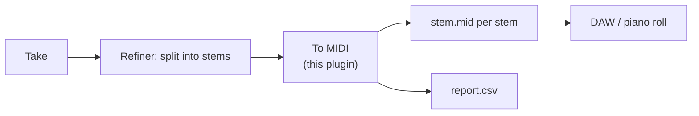

# ruach-basic-pitch

[](https://github.com/null-angel/ruach-basic-pitch-plugin/actions/workflows/ci.yml)


A [Ruach Studio](https://github.com/igrbible/Ruach_Studio) **Refiner plugin** that
turns the separated stems of a take into MIDI with Spotify's
[Basic Pitch](https://github.com/spotify/basic-pitch).

Ruach Studio gets its MIDI from the *score* YuE2 writes before it renders audio.
This plugin goes the other way: it listens to the finished (or refined) audio and
recovers the notes, **one `.mid` per stem**, so you can edit what the model
actually sang and played in a DAW or the piano roll.

## Contents

- [How it fits](#how-it-fits)
- [Install](#install)
- [Use](#use)
- [What you get](#what-you-get)
- [Repository layout](#repository-layout)
- [Quality bar](#quality-bar)
- [Known limits and assumptions](#known-limits-and-assumptions)
- [Documentation](#documentation)
- [Credits and licence](#credits-and-licence)

## How it fits



The Refiner runs its own steps in order (Spectrum, Artifacts, Debuzz, Lyrics,
Stems, Remaster, Upscale); a plugin adds steps of its own *after* them without
touching the studio's code. This plugin adds one step, **To MIDI**.

## Install

Requires Python 3.10+ and the Linux (or Windows-via-WSL2) setup Ruach Studio
itself runs on.

```bash
cd <ruach-studio>/user/plugins
git clone https://github.com/null-angel/ruach-basic-pitch-plugin ruach-basic-pitch
cd ruach-basic-pitch
python -m venv .venv
.venv/bin/pip install -r requirements.txt
```

**On Python 3.12 or newer** (for example 3.14), Basic Pitch's pinned TensorFlow has
no wheel, so use the ONNX Runtime backend instead. It needs no TensorFlow and the
plugin code is identical:

```bash
.venv/bin/pip install --no-deps basic-pitch==0.4.0
.venv/bin/pip install -r requirements-onnx.txt
```

Then reload the studio page; the lab reads `user/plugins/*/plugin.json` when the
page asks (`GET /lab/plugins`). A plugin that does not parse is named under
`errors` there while the others still load.

The plugin has its **own virtual environment** (`"python": ".venv/bin/python"` in
`plugin.json`), so TensorFlow and Basic Pitch stay out of the studio's
environment. You can also keep the folder elsewhere and link it into
`user/plugins/`.

## Use

1. Open a take in the Refiner and **split it into stems** (the panel offers a
   split when the take has none).
2. Run **To MIDI** on a stem set.

| Field | Default | Range | Meaning |
| --- | --- | --- | --- |
| Onset threshold | 0.5 | 0.1 – 0.9 | Higher gives fewer, surer notes |
| Frame threshold | 0.3 | 0.1 – 0.9 | Higher gives shorter, tidier notes |
| Shortest note, ms | 127 | 20 – 500 | Notes shorter than this are dropped |
| Pitch bends | on | – | Keep pitch-bend messages in the MIDI |

Basic Pitch works best on **one instrument at a time**, which is why the step
works on stems rather than on the full mix.

You can also run it by hand, which is handy for trying settings:

```bash
.venv/bin/python transcribe.py <stem-folder> <out-folder> <params.json>
```

## What you get

* `<stem>.mid`: one per stem that contains notes.
* `report.csv`: one row per stem with `stem,status,notes,detail`.
* A one-line summary beside the branch, for example
  `2 of 3 stems transcribed, 412 notes, 1 failed`.

| Stem status | Meaning | MIDI file |
| --- | --- | --- |
| `ok` | Transcribed; at least one note found | yes |
| `silent` | Ran, but nothing cleared the thresholds (normal for drums) | no |
| `error` | Transcription raised; see `detail` | no |

One failing stem never loses the others. The step as a whole fails only if
**every** stem failed.

## Repository layout

```
plugin.json                    what the lab reads: id, step, fields
transcribe.py                  thin entry: PYTHON transcribe.py AUDIO OUTDIR PARAMS.json
src/ruach_basic_pitch/
  contract.py                  wire-format types: ExitCode, StepPayload, FileEntry
  manifest.py                  read and validate the stem set's manifest.json
  params.py                    parse and clamp the step's fields (owns the bounds)
  transcriber.py               Transcriber protocol + the real Basic Pitch adapter
  runner.py                    run every stem, isolate failures, write outputs
  report.py                    StemOutcome, report.csv text, summary line
  cli.py                       the lab's command-line contract
  py.typed                     PEP 561 marker
tests/
  features/transcribe.feature  behaviour in plain English (Gherkin)
  test_transcribe_steps.py     pytest-bdd step definitions
  test_units.py                params, report, manifest, CLI edges
  test_plugin_manifest.py      plugin.json must agree with the code
docs/                          architecture, contract, development, troubleshooting
```

## Quality bar

* **Strictly typed.** `mypy --strict` over `src/` and `tests/`, no `Any` in
  `src/`, full annotations enforced by ruff, `py.typed` shipped. Frozen
  `slots` dataclasses carry data, `TypedDict`s describe the wire format,
  `Literal`/`IntEnum` close the sets, `Protocol`s mark the seams.
* **Behaviour-first tests.** Scenarios in Gherkin drive the real CLI with a fake
  transcriber; CI never installs TensorFlow.
* **Documented.** Google-style docstrings on every module, class and public
  function (enforced), plus the guides under [`docs/`](docs).
* **Dependency inversion.** The runner depends on a `Transcriber` protocol, not
  on Basic Pitch, so the engine is swappable and the core is testable.
* **Drift-proof.** A test fails if `plugin.json` disagrees with the code on field
  keys, defaults or bounds.

```bash
ruff check . && ruff format --check . && mypy && pytest
```

## Known limits and assumptions

Ruach Studio's plugin documentation leaves a few things open. This plugin's
choices are labelled in [`docs/PLUGIN_CONTRACT.md`](docs/PLUGIN_CONTRACT.md) and
each is isolated in one module so it is cheap to change.

* **Stem manifest shape.** The docs say `manifest.json` lists the stems with
  `name`, `title` and `file`. A real take writes them under a top-level
  `{"files": [...]}` key; the plugin also accepts `{"stems": [...]}` or a bare
  list. If a real take differs again, only `manifest.py` changes.
* **`.mid` in the take tree.** The docs define audio versions and text/CSV
  reports, not MIDI, so the lab may show a `.mid` branch that cannot be played.
  The files are still written and open fine in a DAW.
* **Verified so far.** Type-checked and tested against a fake transcriber. Also run
  end to end with **real Basic Pitch** (ONNX Runtime, Python 3.14) on a Ruach Studio
  install: a real generated take was split into **four, six and eight** stems and every
  stem transcribed to MIDI through the lab's `POST /lab/plugin/run` — the Refiner's own
  backend — with no manifest or runtime errors, and the step listed under
  `GET /lab/plugins` with no errors. The browser Refiner **page** itself has not been
  click-tested, but the integration path it calls has.
* **CI uses a fake transcriber by design.** The suite stays hermetic and fast: it never
  installs Basic Pitch or downloads the model, so it does not exercise the real ONNX
  inference path (that is covered by the manual end-to-end run above). Model loading and
  real MIDI output are therefore not guarded by CI.

## Documentation

| Guide | What it covers |
| --- | --- |
| [Architecture](docs/ARCHITECTURE.md) | Diagrams, modules, design decisions, SOLID mapping, extension points |
| [Plugin contract](docs/PLUGIN_CONTRACT.md) | Exactly what the lab sends and expects; documented vs assumed |
| [Development](docs/DEVELOPMENT.md) | Setup, commands, typing and docs policy, adding a field, releasing |
| [Troubleshooting](docs/TROUBLESHOOTING.md) | Symptoms, causes and fixes |
| [Changelog](CHANGELOG.md) | What changed, per version |
| [Contributing](CONTRIBUTING.md) | The short workflow and standards |

## Credits and licence

* [Basic Pitch](https://github.com/spotify/basic-pitch) by Spotify's Audio
  Intelligence Lab, Apache-2.0.
* [Ruach Studio](https://github.com/igrbible/Ruach_Studio), AGPL-3.0. This plugin
  runs as a separate process in its own virtual environment.
* This plugin is released under the [MIT licence](LICENSE): use, modify, bundle
  and redistribute it, including inside Ruach Studio, with no conditions beyond
  keeping the copyright notice. MIT is compatible with Ruach Studio's AGPL-3.0,
  and the plugin runs as a separate process, so it adds no obligations on either side.
