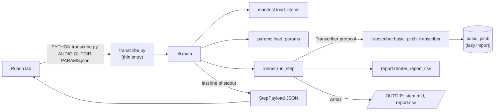
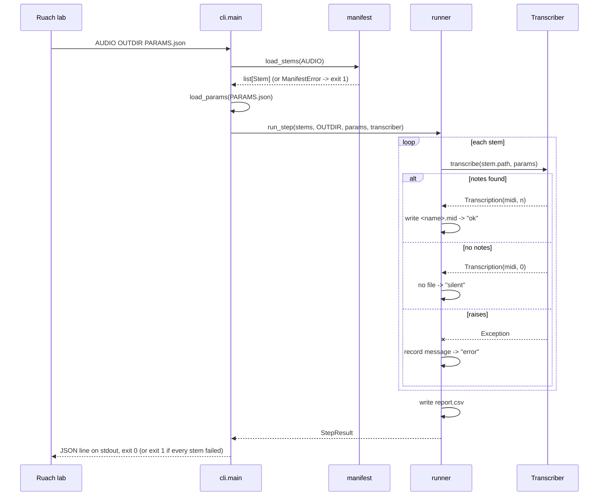

# Architecture

The plugin is small on purpose. This page explains how it is divided, why, and
where to extend it. For the wire format shared with the lab see
[PLUGIN_CONTRACT.md](PLUGIN_CONTRACT.md).

## The big picture

## One run, step by step

## Modules

| Module | Responsibility | I/O? |
| --- | --- | --- |
| `contract.py` | Wire-format types and constants: `ExitCode`, `StepPayload`, `FileEntry`, file names | none |
| `manifest.py` | Parse and validate the stem manifest into `Stem` values | reads `manifest.json` |
| `params.py` | Parse and clamp the step's fields into `Params`; owns the bounds | reads `PARAMS.json` |
| `transcriber.py` | `Transcriber` protocol and the real Basic Pitch adapter | audio via Basic Pitch |
| `runner.py` | Run every stem, isolate failures, write files, build `StepResult` | writes outputs |
| `report.py` | `StemOutcome`, `report.csv` text, summary line | none (pure) |
| `cli.py` | Parse argv, wire the pieces, map results to exit codes | stdout/stderr |
| `__main__.py` / `transcribe.py` | Two thin entry points | none |

Inputs are validated at the edges (`manifest.py`, `params.py`); after that the
core works with small, frozen, fully typed values and never sees raw JSON.

## Design decisions

### The transcriber is injected (dependency inversion)

`runner.run_step` depends on the `Transcriber` protocol, not on Basic Pitch. The
real adapter imports `basic_pitch` lazily, so:

* importing the package is instant and needs no TensorFlow;
* the whole test suite and CI run without installing Basic Pitch;
* swapping the engine (another transcription model) means writing one function
  that matches the protocol.

### Failures are values, not control flow

`transcribe_stem` catches any exception from the transcriber and returns a
`StemOutcome` with `status="error"`. One unreadable stem cannot lose the other
stems' MIDI. The step fails only if every stem failed. The `except Exception` is
deliberately broad because Basic Pitch / TensorFlow raise many unrelated types.

### Pure core, effects at the edges

`report.py` and the data types do no I/O. `runner.py` writes only the files the
lab asked for. The clock is injected (`Clock`) so timing is testable without
sleeping.

### One source of truth for field bounds

`params.py` owns the numeric bounds. `plugin.json` repeats them for the lab's UI,
and `tests/test_plugin_manifest.py` fails if the two disagree, so the UI and the
code cannot silently diverge.

### Untrusted input

The manifest and `PARAMS.json` come from outside the plugin. Values are narrowed
from `object` before use (never trusted by shape), stem files are confined to the
stem folder, and a malformed input is a one-line error on stderr, not a traceback.

### The model loads once

`predict()` given only a path reloads the model on every call. The adapter caches
one loaded `Model` (`functools.cache`) so a take with N stems pays the load cost
once.

## How the SOLID principles show up

| Principle | Where |
| --- | --- |
| Single responsibility | One module per concern (table above); `report.py` knows nothing about disk |
| Open/closed | New transcription engines or output formats are added by writing new functions that match existing protocols, not by editing the runner |
| Liskov substitution | Any `Transcriber` (real or fake) is interchangeable to the runner |
| Interface segregation | `MidiLike` has one method (`write`); `Transcriber` has one (`__call__`) |
| Dependency inversion | `runner` and `cli` depend on `Transcriber`; the Basic Pitch adapter depends on them, not the reverse |

## Extension points

* **Another engine.** Write `def my_transcriber(audio_path: Path, params: Params) -> Transcription`
  and pass it to `cli.main(argv, transcribe=my_transcriber)`.
* **More outputs** (for example a sonified WAV per stem so the branch is
  playable). Extend `transcribe_stem` and add the file to `StepResult.to_payload`.
  Add a scenario to `tests/features/transcribe.feature` first.
* **A new field.** See the checklist in [DEVELOPMENT.md](DEVELOPMENT.md#adding-a-field).
* **A different manifest shape.** Change `manifest._to_stem` / `load_stems` only.

## Non-goals

* No GPU path. Basic Pitch is light; the step runs on the CPU.
* No audio processing. The plugin reads stems and writes MIDI; it never alters the
  take's sound.
* No MIDI post-processing (quantizing, merging, cleaning). Hand the output to a
  DAW or the studio's piano roll.
